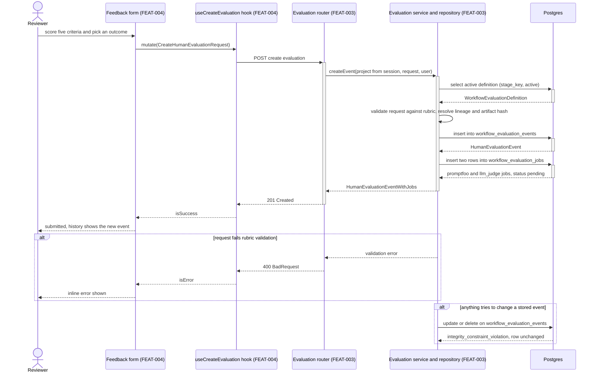
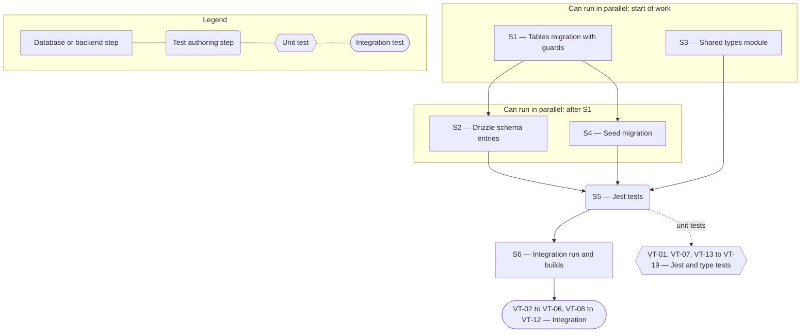

# Technical Specification — Evaluation Data Model and Contracts

> **PRD slug:** `human-workflow-evaluation-for-interviews-and-prds` | **Owning layer:** `migrations/` and `src/shared/types/` (with `src/server/db/schema.ts`) | **Surface:** Backend only (database and shared types)
> **Verification builds:** `npx tsc -p tsconfig.server.json --noEmit` and `npx tsc -p tsconfig.client.json --noEmit`
> **Open items:** See [design-doc-assumptions.md](design-doc-assumptions.md) (4 unresolved)
> **Design doc:** [design-doc-design.md](design-doc-design.md)

Rules applied: `.cursor/rules/postgresql-db.mdc` and the `postgresql-migrations` skill. This Feature changes no React code and adds no route, so the React rules and `rbac-governance.mdc` do not apply beyond the note in Security Enforcement.

---

## System Boundary and Owning Layer

**Owning layer:** `migrations/` (two SQL files), `src/server/db/schema.ts` (three `pgTable` entries) and `src/shared/types/workflowEvaluation.ts` (one new module).

**Rationale:** The Feature defines storage and contracts and nothing that runs per request. The evaluation service, repository, router, hooks and screens all arrive in FEAT-003 and later. Putting the tables, the guards and the types in one Feature lets those Features import a fixed contract. The shared module lives in `src/shared/types/` because the client form and the server router must read the same field names (the TBI-003 non-functional requirement).

**Ownership answers:**
- New or existing Express service in `src/server/services/`? **No.** The evaluation service and its repository (following `chatThreadRepository.ts`) are FEAT-003. This Feature writes no service code.
- New or existing route in `src/server/routes/`? **No.** The dedicated workflow evaluations router is FEAT-003.
- New React component in `src/client/components/`? **No.** Feedback components are FEAT-004 and later.
- New shared type in `src/shared/types/`? **Yes.** `workflowEvaluation.ts` holds the contracts. It follows `aiRunV2.ts`: `as const` arrays, derived union types and `isX` guard functions.
- Database migration needed? **Yes.** Two migrations: tables and guards (TBI-001), then seeds (TBI-002). They ship in the same pull request because the seed depends on the tables.

---

## Security Enforcement

- **Authorization mechanism:** None in this Feature, because it adds no route. The permission keys `workflow-evaluation:view` and `workflow-evaluation:submit` come from FEAT-002 (TBI-004), added with the `rbac-management` skill's Add a Permission workflow, and are enforced with `requirePermission` on the FEAT-003 router. No key is added here, so `rbac-governance.mdc`'s permission catalog stays unchanged in this Feature.
- **Layer that enforces scope:** The database carries the scope key. `workflow_evaluation_events.project` is `NOT NULL`, and jobs inherit scope through their event. The FEAT-003 repository takes `project` from the session on every read and write. Definitions hold no project data and are shared across projects.
- **Integrity guards in the database:** A `BEFORE UPDATE OR DELETE` trigger on events raises `integrity_constraint_violation`, so no code path can alter a stored human judgment (BR-001). A `BEFORE UPDATE` trigger on definitions rejects a change to any column except `active`. Both follow the trigger in `20260901160000_cloud-agent-run-foundations.sql`.
- **Sensitive data handling:** Comments and corrected artifacts hold PRD and Interview text, classified like PRDs and Interviews. Nothing in this Feature adds redaction or retention. Large corrections go to Blob and the row stores only an `AiRunBlobRef`. The PRD sets no retention rule for v1.

---

## Architecture and Approach

### Layers touched

| Layer | Changed | Notes |
|-------|---------|-------|
| Server services (`src/server/services/`) | No | The evaluation service and repository are FEAT-003. |
| Server routes (`src/server/routes/`) | No | The router is FEAT-003. |
| Server middleware (`src/server/middleware/`) | No | Permission middleware constants are FEAT-002. |
| Client components (`src/client/components/`) | No | Feedback UI is FEAT-004 and later. |
| Client hooks (`src/client/hooks/`) | No | TanStack Query hooks are FEAT-004. |
| Shared types (`src/shared/types/`) | Yes | New `workflowEvaluation.ts` (TBI-003). |
| Database (migrations/) | Yes | Tables, indexes, constraints and two guard triggers (TBI-001). Seed rows (TBI-002). |
| Drizzle schema (`src/server/db/schema.ts`) | Yes | `workflowEvaluationDefinitions`, `workflowEvaluationEvents`, `workflowEvaluationJobs` and their `relations()`. |

### Per-work-item design decisions

**TBI-001 — Create evaluation definitions, events and jobs tables**
- Pattern followed: `20261007143000_playbook-interview-template.sql` for CHECK constraints and a partial unique index; `20260901160000_cloud-agent-run-foundations.sql` for the immutability trigger; `playbook_definitions` and `ai_usage_events` in `schema.ts` for `uuid` keys, `project text`, `timestamptz` strings and `index()` declarations.
- Allocate filenames with `node scripts/next-migration-timestamp.mjs workflow-evaluation-tables` and again for the seed. Do not run `migrate:create`.
- Key decisions:
  - **Criteria scores as one `jsonb` object.** Later processes reuse the table and may use other criteria, so five fixed columns would force a migration per process. The database checks only that the value is an object. The FEAT-003 service validates keys and the 1 to 5 range against the definition. Rejected alternative: five `smallint` columns with range checks. They give stronger database guarantees but tie the table to one rubric.
  - **Database-level immutability, not only a missing repository method.** The backlog asks that the data access layer expose no update or delete path. The trigger enforces the same rule against ad hoc SQL and future code. Test helpers must clear the table with `TRUNCATE`.
  - **Lineage columns are real, indexed columns and nullable.** A lineage gap must not drop feedback, and the PRD lists them as indexed. The service writes them whenever it can resolve them.
  - **Subject and lineage coherence by CHECK.** A `prd` subject has `phase_index` null and `prd_id = subject_id`. An `interview_phase` subject has `phase_index` from 1 to 3 and `interview_id = subject_id`. This catches a mixed-up write at insert time.
  - **Inline correction column beside the Blob reference.** See the assumptions file. At most one of the two is set.
  - **Jobs reference `agent_runs` loosely.** `run_id` is nullable `TEXT` with `ON DELETE SET NULL`, so a job exists before admission and an enqueue failure leaves a `pending` job and an intact event.
  - **No columns on `prds` or `interviews`.** History lives only in the events table.

**TBI-002 — Seed platform evaluation definitions**
- Pattern followed: the idempotent `INSERT ... ON CONFLICT ... DO NOTHING` seeds in `20261005120000_seed-ai-runs-interactive-user-queue-flag.sql` and `20261007143000_playbook-interview-template.sql`.
- Key decisions:
  - **Four rows, one migration.** Process `orchestrated_workflow`; stages `prd_human_review`, `interview_phase_1`, `interview_phase_2`, `interview_phase_3`; evaluator `human_review`; benchmark `baseline`; version 1; `active = true`. The key values are subject to the first unresolved item.
  - **Rubric JSON shape** (`WorkflowEvaluationRubric` in the shared module): `scale` (labels for 1 to 5), `criteria` (array of `{ key, label, helpText }` with the five keys), `reasonCodes` (array of `{ key, label }`), `outcomes`, `allowedReviewerRoles`, `lowScoreThreshold` (2) and `minLowScoreCommentLength` (20).
  - **Uniqueness.** A unique constraint on (process, stage, evaluator, benchmark, version) makes re-runs idempotent. A partial unique index on (process, stage, evaluator, benchmark) where `active` allows one active row per key set.
  - **Versioning.** A rubric change is a new migration that inserts version 2 and updates version 1 to `active = false`. The definitions trigger allows that update, and it rejects any rubric edit.
  - **Keep the seed and the shared constants in step with a parity test** (VT-13). The SQL holds JSON literals, and the TypeScript holds the same lists. The test reads the migration file and compares them. Rejected alternative: generate the SQL from TypeScript at build time. That adds build tooling for a four-row seed.
  - **Promptfoo suite reference** is an opaque text key, `orchestrated_workflow/{stage_key}/structural@1`. It is not resolved here.
  - **Judge output schema** is the output of `z.toJSONSchema` for the shared zod schema, pasted into the seed and pinned by VT-16.

**TBI-003 — Define shared evaluation types**
- Pattern followed: `src/shared/types/aiRunV2.ts` (`as const` arrays, derived unions, `isX` guards, `AiRunBlobRef`).
- Exports (all in `src/shared/types/workflowEvaluation.ts`):
  - `WORKFLOW_EVALUATION_OUTCOMES`: `accept_unchanged`, `accept_after_edits`, `regenerate`, `reject`.
  - `WORKFLOW_EVALUATION_CRITERIA_KEYS`: `intent_alignment`, `requirements_coverage`, `scope_alignment`, `acceptance_criteria`, `readiness`.
  - `WORKFLOW_EVALUATION_REASON_CODES`: `missing_requirement`, `invented_requirement`, `incorrect_interpretation`, `too_vague`, `wrong_scope`, `acceptance_criteria_not_testable`, `prd_backlog_inconsistency`.
  - `WORKFLOW_EVALUATION_REVIEWER_ROLE_KEYS`: `product_owner`, `ba`, `manager`, `developer`, `qa`, `other`.
  - `WORKFLOW_EVALUATION_SUBJECT_TYPES`: `interview_phase`, `prd`.
  - `WORKFLOW_EVALUATION_JOB_EVALUATORS`: `promptfoo`, `llm_judge`.
  - `WORKFLOW_EVALUATION_JOB_STATUSES`: `pending`, `running`, `ready`, `failed`.
  - Types: `WorkflowEvaluationScore` (1 to 5), `WorkflowEvaluationCriteriaScores`, `WorkflowEvaluationRubric`, `WorkflowEvaluationDefinition`, `HumanEvaluationEvent`, `CreateHumanEvaluationRequest`, `WorkflowEvaluationJob`, `HumanEvaluationEventWithJobs`, `WorkflowEvaluationJudgeOutput`.
  - A zod schema `workflowEvaluationJudgeOutputSchema`, and guards `isWorkflowEvaluationOutcome`, `isWorkflowEvaluationReasonCode`, `isWorkflowEvaluationCriteriaScores`, `isWorkflowEvaluationJobStatus` and `isWorkflowEvaluationJudgeOutput`.
- Key decisions:
  - **`CreateHumanEvaluationRequest` lists its fields explicitly** and holds no lineage or hash field: `subjectType`, `subjectId`, `stageKey`, `criteria`, `outcome`, `reasonCodes`, `comment?`, `reviewerRoleKey?` (only when ambiguous) and `correctedArtifact?`. It is not built with `Omit` from the event type, so a new lineage column on the event can never leak into the request.
  - **`HumanEvaluationEvent` mirrors the row**, including lineage and `artifactHash`, with `createdAt` as an ISO string.
  - **The module imports no server or client code**, so it compiles in both builds. `zod` is already a dependency.
  - **The module defines contracts only.** Request validation rules (low-score reasons, accept-after-edits correction, role derivation) are FEAT-003 service behavior.

---

## Data and Contracts

### API endpoints

| Method | Route | Request shape | Response shape | Auth |
|--------|-------|--------------|----------------|------|
| — | None in this Feature | — | — | — |

The router that serves these contracts is FEAT-003. It imports `CreateHumanEvaluationRequest`, `HumanEvaluationEvent`, `HumanEvaluationEventWithJobs` and `WorkflowEvaluationDefinition` from the shared module.

### Schema / storage changes

| Target | Change | Reason |
|--------|--------|--------|
| `workflow_evaluation_definitions` | New table. Columns: `id` (uuid), `process_key`, `stage_key`, `evaluator_key`, `benchmark_key`, `version` (integer, at least 1), `rubric` (jsonb), `promptfoo_suite_ref` (text, not blank), `judge_output_schema` (jsonb), `active` (boolean, default true), `created_at`. Unique on (process, stage, evaluator, benchmark, version). Partial unique on (process, stage, evaluator, benchmark) where `active`. Trigger: only `active` may change. | Platform-seeded, versioned rubric that events point at (BR-015). |
| `workflow_evaluation_events` | New table, append-only. Columns: `id` (uuid), `project` (text, not null), `definition_id` (uuid, references definitions, restrict), `subject_type`, `subject_id` (uuid), `stage_key`, `phase_index` (smallint, nullable), `reviewer_user_id` (text, references `app_users(oid)`, restrict), `reviewer_role_key`, `reviewer_role_label`, `skill_path`, `skill_version`, `model` (all nullable text), `interview_id`, `prd_id` (nullable uuid, no foreign key so deleting a PRD or Interview never touches history), `artifact_hash` (text), `criteria_scores` (jsonb object), `outcome`, `reason_codes` (jsonb array, default empty), `comment` (text, nullable), `corrected_artifact_text` (text, nullable), `corrected_artifact_blob_ref` (jsonb `AiRunBlobRef`, nullable), `created_at`. CHECKs: subject type and outcome value sets; phase and lineage coherence per subject type; `artifact_hash` is 64 lowercase hex; role key and label not blank; at most one of the two correction fields. Trigger rejects `UPDATE` and `DELETE`. | One immutable row per human submission (BR-001, BR-006, BR-007). |
| `workflow_evaluation_events` indexes | (project, subject_type, subject_id, created_at DESC) for the newest-first history list; (project, subject_type, subject_id, artifact_hash) for the live-artifact filter; (project, created_at DESC) for the admin list and hub; (skill_path, skill_version); (model); partial on `interview_id` and on `prd_id` where not null. | The PRD requires lookup by project, subject type, subject id and artifact hash, and indexed lineage. |
| `workflow_evaluation_jobs` | New table. Columns: `id` (uuid), `event_id` (uuid, references events, restrict), `evaluator_key` (`promptfoo` or `llm_judge`), `status` (`pending`, `running`, `ready`, `failed`; default `pending`), `run_id` (text, nullable, references `agent_runs(id)` set null), `specification_hash` (text, nullable), `summary` (jsonb, nullable), `result_blob_refs` (jsonb, nullable, `{ output?, appendix? }` of `AiRunBlobRef`), `error_detail` (text, nullable), `created_at`, `updated_at`. Unique on (`event_id`, `evaluator_key`). Partial index on `status` where `pending` or `running`. | Two diagnostic jobs per event, unique per pair (BR-010). Jobs are mutable state, events are not (BR-011). |
| `prds`, `interviews` | None. | History lives in the events table only. |
| Seed rows in `workflow_evaluation_definitions` | Four version-1 rows (see TBI-002 decisions). | Reviewers need a rubric on day one. |
| `src/server/db/schema.ts` | Three `pgTable` entries with `.$type<>()` on jsonb columns, indexes, CHECK and unique declarations, and `relations()` for event → definition, job → event. | Required by `postgresql-db.mdc` after any migration. |

### Shared type contracts

| Type | Used by | Notes |
|------|---------|-------|
| `CreateHumanEvaluationRequest` | FEAT-004 form, FEAT-003 router | No lineage or hash field. |
| `HumanEvaluationEvent`, `HumanEvaluationEventWithJobs` | FEAT-003 router, FEAT-004 history, admin screens | Mirror the row and attach job status. |
| `WorkflowEvaluationDefinition`, `WorkflowEvaluationRubric` | Form, service, executors | The form renders from the rubric. |
| `WorkflowEvaluationJudgeOutput` and its zod schema | Judge executor, service, drawer | Pinned to the seeded `judge_output_schema`. |
| `WorkflowEvaluationJob` and status and evaluator unions | Orchestrator, admin retry control | Mirror the job row. |

---

## Testing Strategy

**Unit tests:**
- `src/server/__tests__/workflowEvaluationMigration.test.ts` (Jest, SQL read as text, following `playbookInterviewTemplateMigration.test.ts`). Proves both migrations have Up and Down sections, create the three tables with the unique job constraint and the two triggers, contain no `ALTER TABLE prds` or `ALTER TABLE interviews`, and that the seed contains no `UPDATE` of rubric content and uses `ON CONFLICT DO NOTHING`. Proves Drizzle `getTableColumns` names and nullability match the migration.
- `src/server/__tests__/workflowEvaluationSeedParity.test.ts`. Parses the JSON literals in the seed migration and compares criteria keys, reason codes, outcomes and reviewer roles with the shared constants. Asserts every row has a non-blank suite reference.
- `src/server/__tests__/workflowEvaluationTypes.test.ts`, following `aiRunV2Types.test.ts`. Covers the guards, the judge output boundaries, the schema parity (`z.toJSONSchema` equals the seeded JSON), and the type-level check that the create request rejects lineage and hash fields with `@ts-expect-error`.
- `src/server/__tests__/workflowEvaluationNoMutation.test.ts`. A source scan, following the import-graph approach of `noDatabaseImports.test.ts`: no file under `src/server` outside `__tests__` calls `update` or `delete` on `workflowEvaluationEvents`.

**Integration tests:**
- `src/server/__tests__/workflowEvaluationSchema.integration.test.ts`, run with `npm run test:integration` against a test Postgres. Applies the migrations up, down and up. Exercises the guards, constraints and seeds (VT-02 to VT-12). If CI has no database, record a manual `npm run migrate:local:up`, `migrate:local:down` and `migrate:local:up` run in the pull request instead.

**E2E tests (if applicable):**
- Not applicable. No user-visible surface ships here.

---

## Observability

- **Custom events/metrics:** None beyond standard request telemetry. This Feature runs no code at request time. Token and cost logging for the diagnostic jobs belongs to the orchestrator Feature.
- **Alerts:** None.

---

## Rollback and Deployment

- **Schema changes backward compatible:** Yes. Both migrations only add tables, indexes, functions, triggers and rows. No existing table or column changes, so the running application is unaffected whether the migration has run or not.
- **Rollback procedure:** Use the feature flag for any rollback after pilot data exists: turn `workflow-human-evaluation` off (a Platform Admin action once FEAT-002 ships). `npm run migrate:down` drops the three tables and deletes every stored evaluation event, so run it only on test databases or before the first pilot submission. The seed Down section deletes the four seeded rows, and the tables Down section drops the triggers, functions, indexes and tables in reverse dependency order (jobs, events, definitions).
- **Deployment dependencies:** None. No manual provisioning. Apply with `npm run migrate:up` in the pipeline before `npm start`. Local order: `migrate:local:up`, then update `schema.ts`, then both `tsc` builds.
- **Feature flag gates deployment:** No. The flag does not exist in this Feature, and the tables are inert until FEAT-003 writes to them.

---

## Verification Test Matrix

"Integration" rows need a real Postgres (see Testing Strategy for the fallback).

| ID | Layer | Arrange | Act | Assert | Linked |
|----|-------|---------|-----|--------|--------|
| VT-01 | Jest (SQL text and Drizzle) | Read the tables migration and import the Drizzle tables | Parse Up and Down; call `getTableColumns` on each table | Three tables, unique (`event_id`, `evaluator_key`), both triggers and the expected indexes appear in Up; Down reverses them; Drizzle column names and nullability match | TBI-001 (a) |
| VT-02 | Integration | Clean test database | Run the tables migration up, down, then up | Tables exist after up, are gone after down (with functions and triggers), and exist again after the second up; no error | TBI-001 (a), (c) |
| VT-03 | Integration | One event row inserted | Run `UPDATE` and `DELETE` on it | Both raise SQLSTATE `23000` (`integrity_constraint_violation`); the row is unchanged | TBI-001 (b) |
| VT-04 | Integration | One event row | Insert two jobs for the same event with `promptfoo`, then a duplicate `promptfoo`, then `llm_judge` | The duplicate raises unique violation `23505`; `promptfoo` and `llm_judge` rows both exist | TBI-001 (b) |
| VT-05 | Integration | A seeded definition and a valid event template | Insert events with `phase_index` 0, 1, 3, 4; a `prd` subject with phase 2; hash of 63 chars, 64 uppercase and 64 lowercase hex chars; `prd_id` not equal to `subject_id` on a `prd` subject; both correction fields set | Phase 1 and 3 and the valid hash are accepted; every other row is rejected by a CHECK | TBI-001 (c) |
| VT-06 | Integration | Column lists of `prds` and `interviews` captured before the migration | Run the migration | The column lists are identical | TBI-001 (d) |
| VT-07 | Jest (source scan) | Walk `src/server` excluding `__tests__` | Search for `update` or `delete` on `workflowEvaluationEvents` | No match | TBI-001 (d) |
| VT-08 | Integration | Both migrations applied | Select from definitions | Four active rows under `orchestrated_workflow` with the four stage keys, each with five criteria, seven reason codes, four outcomes, six roles, a non-blank suite reference and a judge schema | TBI-002 (a) |
| VT-09 | Integration | Seeded rows | Insert a second active row with the same process, stage, evaluator and benchmark | Rejected by the partial unique index | TBI-002 (b) |
| VT-10 | Integration | Seed already applied | Execute the seed Up statements again | Row count stays four; no error | TBI-002 (c) |
| VT-11 | Integration | Seeded rows and one event pointing at `interview_phase_1` version 1 | Insert version 2 for that stage and set version 1 `active = false` | One active row for the stage; version 1 still exists; the event still joins to version 1 | TBI-002 (c) |
| VT-12 | Integration | Seeded rows | Update `rubric` on a row; update only `active` on a row | The rubric update raises `23000`; the `active` update succeeds | TBI-002 (b) |
| VT-13 | Jest | Seed migration text and shared constants | Parse JSON literals; compare lists | Criteria keys, reason codes, outcomes and roles equal the shared constants in order for all four rows; every `promptfoo_suite_ref` is non-blank | TBI-002 (a) |
| VT-14 | Jest (SQL text) | Both migrations | Inspect the definitions columns and the seed statements | No `project` column on definitions; no `UPDATE` of an existing row's rubric in the seed | TBI-002 (d) |
| VT-15 | tsc | The shared module and one import from a server file and one from a client file | Run both `tsc -p` commands | Both exit with code 0 | TBI-003 (a) |
| VT-16 | Jest | The zod schema and the seeded `judge_output_schema` | Compare `z.toJSONSchema` output with the seed JSON; validate a sample judge output | The two are equal; the sample is valid | TBI-003 (a) |
| VT-17 | Jest | Judge outputs missing `confidence`, with `alignmentScore` 7, and with a non-array finding list | Call `isWorkflowEvaluationJudgeOutput` | Each returns false | TBI-003 (b) |
| VT-18 | Jest | Judge outputs with empty arrays and no score; with scores 0, 1, 5, 6 | Call the guard | Empty output valid; 1 and 5 valid; 0 and 6 invalid | TBI-003 (c) |
| VT-19 | Jest (type-level) | A literal `CreateHumanEvaluationRequest` with `skillPath`, `skillVersion`, `model`, `interviewId`, `prdId` or `artifactHash` | Compile with `@ts-expect-error` on each | Compilation passes only because each assignment is an error | TBI-003 (d) |

---

## Implementation Plan

- [ ] S1 — Allocate the tables migration filename with `scripts/next-migration-timestamp.mjs` and write the Up and Down SQL: three tables, constraints, indexes, both guard functions and triggers _(no blockers)_
  - Covers: `VT-01`, `VT-02`, `VT-03`, `VT-04`, `VT-05`, `VT-06`
- [ ] S2 — Add the three `pgTable` entries and `relations()` to `src/server/db/schema.ts` to match S1 _(blocked by S1)_
  - Covers: `VT-01`
- [ ] S3 — Write `src/shared/types/workflowEvaluation.ts`: constants, types, zod judge schema and guards _(no blockers; can parallel with S1)_
  - Covers: `VT-15`, `VT-17`, `VT-18`, `VT-19`
- [ ] S4 — Allocate the seed filename and write the seed migration with four version-1 rows and their Down _(blocked by S1; apply the open-item defaults if the ⚠ items are unanswered)_
  - Covers: `VT-08`, `VT-09`, `VT-10`, `VT-11`, `VT-12`
- [ ] S5 — Write the Jest tests: migration shape, seed parity, types, source scan _(blocked by S2, S3, S4)_
  - Covers: `VT-01`, `VT-07`, `VT-13`, `VT-14`, `VT-16`, `VT-17`, `VT-18`, `VT-19`
- [ ] S6 — Write the integration test and run the full check: `npm run migrate:local:up`, `migrate:local:down`, `migrate:local:up`, both `tsc` builds, `npx jest workflowEvaluation`, `npm run test:integration` _(blocked by S2, S4, S5)_
  - Covers: `VT-02` to `VT-06`, `VT-08` to `VT-12`, `VT-15`

**Execution lanes:**
- Lane 1 (start immediately): S1, S3
- Lane 2 (after S1): S2, S4
- Lane 3 (after S2, S3, S4): S5
- Lane 4 (after S5): S6

---

## Diagram 1 — Code Execution Flow

This Feature ships tables and types only. The diagram traces the first runtime path that uses them, a reviewer submission handled by FEAT-003 and FEAT-004, to show where each contract and database guard sits. Nothing above the database is built in this Feature.

---

## Diagram 2 — Implementation Dependency Map

