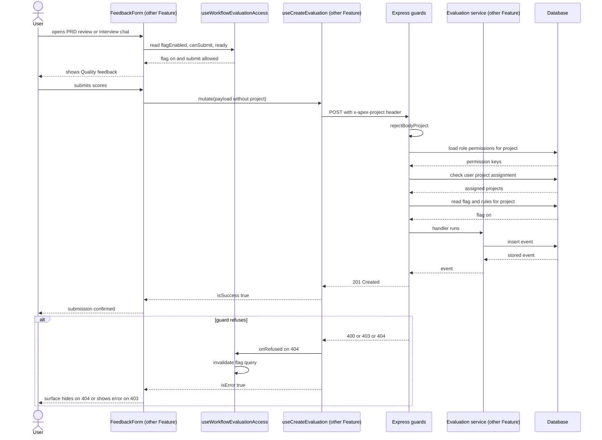
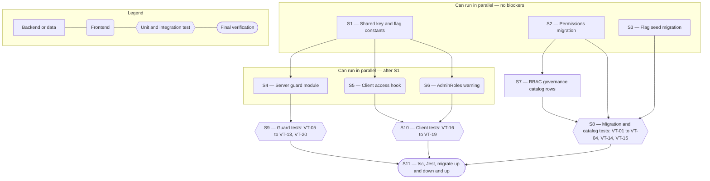

# Technical Specification — Evaluation Permissions and Rollout Gate

> **PRD slug:** `human-workflow-evaluation-for-interviews-and-prds` | **Owning layer:** full-stack (`src/server/middleware/`, `migrations/`, `src/shared/types/`, `src/client/hooks/`) | **Surface:** Full stack
> **Verification builds:** `npx tsc -p tsconfig.server.json --noEmit` and `npx tsc -p tsconfig.client.json --noEmit`
> **Open items:** See [design-doc-assumptions.md](design-doc-assumptions.md) (4 unresolved)
> **Design doc:** [design-doc-design.md](design-doc-design.md)

---

## System Boundary and Owning Layer

**Owning layer:** `src/server/middleware/` (guards), `migrations/` (permissions and flag seed), `src/shared/types/` (key constants), `src/client/hooks/` (access hook)

**Rationale:** This Feature decides who may call the evaluation capability and whether it exists for a project. It holds no evaluation data and no business rules. Apex already splits that concern across three places: RBAC keys live in `app_permissions` and are enforced by `requirePermission` in `src/server/middleware/rbac.ts`, flags live in `featureFlagService.ts`, and the client reads both through `can()` and `useFeatureFlag`. The Feature adds one guard module, one hook and two data migrations, so the evaluation router (TBI-008, Feature "Evaluation Service and API"), the admin routes, the export route, the retry route and the hub all mount the same checks and cannot drift.

**Ownership answers:**
- New or existing Express service in `src/server/services/`? **No.** The guards call the existing `isFeatureEnabled` and `isFeatureOperational` in `featureFlagService.ts` and the existing `requirePermission` (which calls `rbacService.getUserPermissions`). There is no logic to put in a service.
- New or existing route in `src/server/routes/`? **No.** The guards are exported arrays that the router added by TBI-008 mounts. Feature "Evaluation Service and API" depends on this Feature (`dependsOn: FEAT-002`).
- New React component in `src/client/components/`? **No new component.** `AdminRoles.tsx` is edited (warning only). The access hook is new and lives in `src/client/hooks/`.
- New shared type in `src/shared/types/`? **Yes.** A new `workflowEvaluationAccess.ts` holds the two permission keys. The flag key goes beside `WORK_BOARD_FLAG` in the existing `featureFlags.ts`. A separate file avoids a merge conflict with the evaluation domain types that TBI-003 creates in parallel.
- Database migration needed? **Yes, two data-only migrations** (insert rows into `app_permissions`, `app_role_permissions`, `feature_flags`, `feature_flag_rules`). No schema change and no change to `src/server/db/schema.ts`.

---

## Security Enforcement

- **Authorization mechanism:** `requirePermission('workflow-evaluation:view')` for reads and `requirePermission('workflow-evaluation:view', 'workflow-evaluation:submit')` for submit (AND semantics, per `rbac-governance.mdc` and the `rbac-management` skill's middleware quick reference). Admin operations (page data, export, retry) use `requirePermission('admin:roles')`, the permission that already opens `/admin/*`. The hub uses `requireSuperAdmin`. Super admins pass `requirePermission` through the existing bypass, so Platform Admin needs no key. No new admin key is added, as the PRD and this Feature's out-of-scope list require.
- **Layer that enforces scope:** Route middleware only, in this order for project-scoped routes: (1) `rejectBodyProject` — 400 when the JSON body contains a `project` field; (2) `requirePermission(...)`; (3) `requireProjectAccess(resolveRequestProject)` — 403 unless the user is assigned to the project (super admins pass); (4) `requireWorkflowEvaluationFlag` — 400 when no project, 404 when the flag is off for that project and user, `next(err)` when flag evaluation throws. The order of 2 to 4 follows `apexWorkItems.ts`. Step 1 comes first because `resolveRequestProject` reads query, then params, then body, then the `x-apex-project` header. Without step 1, a request could send header `Beta` and body `project: "Apex"`: `requirePermission` would load permissions for Apex while the flag check and later data scope used the header value, so the permission result would belong to a different project than the one served. Rejecting the body field makes all four guards read the same project. The evaluation service (TBI-007) must still check that each subject (Interview or PRD) belongs to the resolved project; that is its rule, not this Feature's. No flag check goes below the route layer.
- **Sensitive data handling:** Not applicable. Guards read no evaluation data. The 403 body lists missing permission keys, which is existing `requirePermission` behavior.

---

## Architecture and Approach

### Layers touched

| Layer | Changed | Notes |
|-------|---------|-------|
| Server services (`src/server/services/`) | No | Reuses `featureFlagService.isFeatureEnabled`, `isFeatureOperational` and `rbacService.getUserPermissions` as they are |
| Server routes (`src/server/routes/`) | No | The router in TBI-008 mounts the exported guards. Nothing is mounted here |
| Server middleware (`src/server/middleware/`) | Yes | New `workflowEvaluationAccess.ts`: key re-exports, `rejectBodyProject`, `requireWorkflowEvaluationFlag`, `requireWorkflowEvaluationOperational`, and four composed guard arrays |
| Client components (`src/client/components/`) | Yes | `AdminRoles.tsx`: submit-without-view warning in `PermissionsModal` and `RoleMembersModal`. No new component |
| Client hooks (`src/client/hooks/`) | Yes | New `useWorkflowEvaluationAccess.ts` |
| Shared types (`src/shared/types/`) | Yes | New `workflowEvaluationAccess.ts` (permission keys). `featureFlags.ts` gains `WORKFLOW_HUMAN_EVALUATION_FLAG` |
| Database (migrations/) | Yes | `20261016120000_add-workflow-evaluation-permissions.sql` and `20261016120100_seed-workflow-human-evaluation-flag.sql`. Data only |
| Drizzle schema (`src/server/db/schema.ts`) | No | `appPermissions`, `appRolePermissions`, `featureFlags` and `featureFlagRules` already exist |

### Per-work-item design decisions

**TBI-004 — Add workflow-evaluation view and submit permissions**
- Pattern followed: `migrations/20260922100000_complete-playbooks-permissions.sql` for the idempotent insert, role grant by name and a down block that removes only these keys. `src/server/__tests__/playbookRbacPermissions.test.ts` for migration and catalog tests. `AdminRoles.tsx` `playbookAuthorWithoutRunWarning` for the implied-permission warning. Workflow A in `.cursor/skills/rbac-management/SKILL.md` for the five steps (migration, middleware, client gating, catalog, verify).
- Key decisions:
  - Keys `workflow-evaluation:view` and `workflow-evaluation:submit`, category `workflow-evaluation`. `AdminRoles` groups permissions by `category`, so the dialog lists them with no component change.
  - Default grants go to roles `admin` and `member`, not to `viewer`. The PRD names Groups (Product-Owner, BA, Manager, Developer) but RBAC attaches permissions to Roles, so the group list cannot be applied literally. Consequence: QA and UI/UX users holding `member` get the keys. Rejected alternative: add `requireGroupMembership('Product-Owner','BA','Manager','Developer')` to the reviewer guards. It adds a second gate that admins can misconfigure, and the PRD says the server does not enforce who submits. See the first ⚠ item in the assumptions file.
  - Submit routes require view as well. The form cannot render without the definitions read, so a submit-only role is a misconfiguration. The warning in `AdminRoles` tells the Project Admin when it happens. Rejected alternative: make submit imply view in `getUserPermissions`. That changes shared RBAC resolution for every feature.
  - Project Admin access reuses `admin:roles`. Rejected alternative: a `workflow-evaluation:admin` key. The PRD and the Feature's `outOfScope` rule it out.
  - Update the catalog table in `.cursor/rules/rbac-governance.mdc` with two rows, placed between the `work-board:*` rows and `workitems:write`.
  - Warning change in `AdminRoles.tsx`: widen `RbacConfigurationWarning.code` to a union that adds `WORKFLOW_EVALUATION_SUBMIT_WITHOUT_VIEW`, make `permissionKeys` a `string[]`, and add `workflowEvaluationSubmitWithoutViewWarning(keys)`. The live warning, the after-save warning and the members-dialog warning each render this second warning in its own element with `data-testid="workflow-evaluation-submit-without-view-warning"`, so the playbook warning and its tests do not change.

**TBI-005 — Gate evaluation routes and UI on the workflow-human-evaluation flag**
- Pattern followed: the `work-board` gate in `src/server/routes/apexWorkItems.ts` (`isFeatureEnabled(FLAG, { userId, project })`, 404 `{ error: 'Not found' }`, `@feature-flag:` markers). Seed shape from `migrations/20260724110000_add-home-access-controls.sql` (flag insert with `ON CONFLICT DO NOTHING`, rule insert guarded by `NOT EXISTS`, down block). Client pattern from `PlaybookDashboardPage.tsx` (`useAppShell().can` plus `useFeatureFlag(key, project)` with `project` passed as a prop). Rules in `.cursor/rules/feature-flags.mdc` and the `feature-flags` skill.
- Key decisions:
  - Move the check into `requireWorkflowEvaluationFlag` in the middleware directory instead of inlining it in a route file as `apexWorkItems.ts` does. Five route groups need the same check, and one file keeps the single pair of `@feature-flag:workflow-human-evaluation` marker regions.
  - Flag seed: `enabled = true`, lifecycle `active`, one `project` rule with value `Apex`. `evaluateFlags` returns false for a flag with no rules, so an enabled flag without rules does nothing. Pilot projects are added by a Platform Admin as further `project` rules in the existing Feature Flags tab, which writes the audit log.
  - Kill switch is the flag's `enabled` toggle. Super admins do not bypass it, because the flag guard runs after `requirePermission` and applies to every caller.
  - Hub routes use `isFeatureOperational(key)` (flag enabled and not archived, rules ignored) because no single project applies. Per-project detail opened from a hub row uses the normal admin guard with `?project=<name>`, so a hub row for a project where the flag is off opens a 404. The hub UI should render such a row as not openable.
  - A flag-evaluation exception goes to `next(err)`, as in `apexWorkItems.ts`. The request does nothing else, so no job starts and no alert sends.
  - The client hook `useWorkflowEvaluationAccess(project)` returns `{ flagEnabled, canView, canSubmit, canAdmin, isPlatformAdmin, ready, onRefused }`. `flagEnabled` comes from `useFeatureFlag(WORKFLOW_HUMAN_EVALUATION_FLAG, project)`. `canView`, `canSubmit` and `canAdmin` (`admin:roles`) come from `useAppShell().can`, which already returns true for super admins. `ready` is false until permissions and flags have loaded, so surfaces render nothing during loading. `onRefused()` calls `queryClient.invalidateQueries({ queryKey: ['feature-flags', 'evaluate', project] })`. Evaluation hooks call it when a request answers 404, which clears the 60-second cached flag value.
  - Each feedback surface calls the hook once at its own entry point (top-level split). The hook is not called inside nested children. Those surfaces belong to other Features.
  - Interview and PRD routes and services are not touched. A static test proves they do not import the guard module.

---

## Data and Contracts

### API endpoints

This Feature adds no endpoint. It defines the guard chains below. Route paths are set by TBI-008 and the admin Features; the "Route group" column names the kind of route that mounts each chain.

| Method | Route group | Request shape | Response shape | Auth |
|--------|-------------|--------------|----------------|------|
| GET | Reviewer reads: definitions, event list, single event | `?project=<name>` or header `x-apex-project`; no body `project` | Handler response; on refusal `400 { error }`, `401 { error: 'Unauthorized' }`, `403 { error: 'Forbidden', missing: string[] }`, `403 { error: 'Forbidden: not assigned to this project' }`, `404 { error: 'Not found' }` | `workflowEvaluationReadGuard`: `rejectBodyProject`, `requirePermission('workflow-evaluation:view')`, `requireProjectAccess(resolveRequestProject)`, `requireWorkflowEvaluationFlag` |
| POST | Reviewer submit: create event | Project from query or header only. Body must not contain `project` | Handler response; same refusals as above | `workflowEvaluationSubmitGuard`: as above with `requirePermission('workflow-evaluation:view', 'workflow-evaluation:submit')` |
| GET, POST | Admin: Workflow evaluations page data, export, retry failed job | Project from query or header | Handler response; same refusals | `workflowEvaluationAdminGuard`: `rejectBodyProject`, `requirePermission('admin:roles')`, `requireProjectAccess`, `requireWorkflowEvaluationFlag` |
| GET | Platform Admin hub list | No project | Handler response; `403 { error: 'Forbidden' }` for non-super-admins, `404 { error: 'Not found' }` when the flag is disabled or archived | `workflowEvaluationHubGuard`: `requireSuperAdmin`, `requireWorkflowEvaluationOperational` |
| GET | `/api/feature-flags/evaluate` (existing, unchanged) | `?project=<name>` | `{ flags: Record<string, boolean> }` including `workflow-human-evaluation` | Existing |
| GET | `/api/me/permissions` (existing, unchanged) | `?project=<name>` | `MyPermissionsResponse` including the two new keys for holders | Existing |

Exported constants:
- `src/shared/types/workflowEvaluationAccess.ts`: `WORKFLOW_EVALUATION_VIEW = 'workflow-evaluation:view'`, `WORKFLOW_EVALUATION_SUBMIT = 'workflow-evaluation:submit'`.
- `src/shared/types/featureFlags.ts`: `WORKFLOW_HUMAN_EVALUATION_FLAG = 'workflow-human-evaluation'`.
- `src/server/middleware/workflowEvaluationAccess.ts`: re-exports the keys plus `rejectBodyProject`, `requireWorkflowEvaluationFlag`, `requireWorkflowEvaluationOperational`, `workflowEvaluationReadGuard`, `workflowEvaluationSubmitGuard`, `workflowEvaluationAdminGuard`, `workflowEvaluationHubGuard`.

### Schema / storage changes

| Target | Change | Reason |
|--------|--------|--------|
| `app_permissions` | Insert two rows: `workflow-evaluation:view` ("View workflow evaluation definitions, event history and job diagnostics") and `workflow-evaluation:submit` ("Submit human workflow evaluations on Interview phases and PRDs"), category `workflow-evaluation`. Insert is idempotent (`ON CONFLICT (key) DO NOTHING`) | TBI-004 permission catalog |
| `app_role_permissions` | Link both keys to roles `admin` and `member`. Insert is idempotent. Down block deletes the links, then the two permission rows | TBI-004 default grants |
| `feature_flags` | Insert flag `workflow-human-evaluation`: enabled, lifecycle `active`, `cleanup_ready` false, no creator. Idempotent | TBI-005 rollout gate |
| `feature_flag_rules` | Insert one rule of type `project`, value `Apex`, guarded by `NOT EXISTS` for that flag, type and value. Down block deletes the rule and the flag | TBI-005 default targeting |

Cleanup plan for the flag: expected winner `enabled`. Retire after two stable sprints at full rollout, using the `feature-flag-cleanup` skill.

---

## Testing Strategy

**Unit tests:**
- `src/server/__tests__/workflowEvaluationAccessMigrations.test.ts` — reads both migration files as text, in the style of `playbookRbacPermissions.test.ts`. Proves keys, category, role names, idempotence, flag seed values, and that the down blocks remove only these rows. Also asserts the exact two catalog rows in `rbac-governance.mdc`.
- `src/server/__tests__/workflowEvaluationAccess.test.ts` — drives each guard with the `makeReq` and `makeRes` helpers used in `rbacMiddleware.test.ts`, with `rbacService`, `groupService`, `superAdmin`, `userProjectAssignmentService` and `featureFlagService` mocked. Covers: allowed, missing view, missing submit, submit without view, project-role override (mock `getUserPermissions` by project argument), unassigned project, body `project` rejected before any permission load, missing project, flag on, flag off, flag evaluation throws, super admin with flag off, hub guard for non-super-admin and for a disabled flag. A static check reads `src/server/routes/interviews.ts` and the PRD route and service files and asserts none imports `workflowEvaluationAccess`.
- `src/client/hooks/__tests__/useWorkflowEvaluationAccess.test.tsx` — mocks `useAppShell` and `useFeatureFlag`. Covers loading, flag off, flag on with and without each permission, super admin, and `onRefused` invalidating the flag query key.
- `src/client/components/__tests__/AdminRoles.test.tsx` (extend) — new keys appear in the permissions dialog under `workflow-evaluation` and toggle; the submit-without-view warning appears and clears; the existing playbook warning tests stay green.

**Integration tests:**
- Apply both migrations to the local database (`npm run migrate:local:up`), then through `rbacService.getUserPermissions` assert a `member` user resolves both keys and a `viewer` resolves neither. Run the down migrations and confirm both permissions and the flag are gone, then apply again to prove idempotence. Use `jest.config.integration.js`.
- `featureFlagService.evaluateFlags` with data shaped like the seed (enabled flag, one `project` rule `Apex`): true for Apex, false for another project, false after `enabled` is set false. Extend `featureFlagService.test.ts`.

**E2E tests (if applicable):**
- Not applicable to this Feature. Nothing visible exists until the feedback surfaces ship. When the first E2E spec lands in a later Feature, add the two keys to the E2E role setup in `src/server/routes/e2eSetup.ts`, as that file does for the `playbooks:*` keys today.

---

## Observability

- **Custom events/metrics:** None beyond standard request telemetry. Refusals appear as 400, 403 and 404 responses in request telemetry. Flag changes are already written to `featureFlagAudit` by `featureFlagService`, and permission grants are visible in Admin → Roles.
- **Alerts:** None. Cost note: `isFeatureEnabled` loads the user's group ids and every non-archived flag with rules on each call. At the PRD's low volume this is acceptable. Re-measure if later Features poll evaluation routes.

---

## Rollback and Deployment

- **Schema changes backward compatible:** Yes. Both migrations insert rows only. The permissions are inert until a route checks them, and the flag has no readers until the guards ship.
- **Rollback procedure:** Fastest: a Platform Admin turns `workflow-human-evaluation` off in Platform Admin → Feature Flags (audited, takes effect on the next request; clients stop showing surfaces within 60 seconds or at the first 404). Full: `npm run migrate:down` twice, which removes the flag, its rule, the role links and both permission rows. Down also removes any extra grants a Project Admin made to custom roles, because those rows cascade.
- **Deployment dependencies:** A Platform Admin adds pilot project rules for each named pilot project before Beta. A Project Admin grants the two keys to any custom or project-specific role used by pilot users, because the migration only grants `admin` and `member`. Confirm the migration timestamps sort after the newest file on `main`.
- **Feature flag gates deployment:** Yes for behavior: every evaluation route and every client surface checks `workflow-human-evaluation`. No for the permissions: they exist as soon as the migration runs.

---

## Verification Test Matrix

| ID | Layer | Arrange | Act | Assert | Linked |
|----|-------|---------|-----|--------|--------|
| VT-01 | Jest (migration text) | Read `20261016120000_add-workflow-evaluation-permissions.sql` | Inspect the up block | Inserts both keys with category `workflow-evaluation`, uses `ON CONFLICT (key) DO NOTHING`, grants only to roles `admin` and `member`, never `viewer` | TBI-004 (a) |
| VT-02 | Jest (migration text) | Same file | Inspect the down block | Deletes links then only the two `workflow-evaluation:*` permissions, touches no other key | TBI-004 (a) |
| VT-03 | Jest (file text) | Read `.cursor/rules/rbac-governance.mdc` | Look for catalog rows | Contains `\| \`workflow-evaluation:view\` \| workflow-evaluation \| admin, member \|` and the submit row | TBI-004 (a) |
| VT-04 | Jest integration (local PostgreSQL) | Migrations applied. Users with roles `member` and `viewer` | Call `getUserPermissions(userId, 'Apex')` for each | `member` has both keys. `viewer` has neither | TBI-004 (a), (b) |
| VT-05 | Jest (middleware) | Caller holds view only | Run `workflowEvaluationSubmitGuard` | 403 `{ error: 'Forbidden', missing: ['workflow-evaluation:submit'] }`, next not called | TBI-004 (b) |
| VT-06 | Jest (middleware) | Caller holds submit only | Run `workflowEvaluationSubmitGuard` and `workflowEvaluationReadGuard` | Both answer 403 with `missing` naming view. The handler is not reached | TBI-004 (b) |
| VT-07 | Jest (middleware) | `getUserPermissions` returns no keys for `Beta` and both keys for `Apex` | Run the submit guard with header `x-apex-project: Beta`, then `Apex` | Beta: 403. Apex: next called. The mock was called with the matching project each time | TBI-004 (c) |
| VT-08 | Jest (middleware) | Caller holds both keys. `getAssignmentsForUser` returns `['Apex']` | Run the read guard with header `Beta` | 403 `Forbidden: not assigned to this project`, flag service not called | TBI-004 (d) |
| VT-09 | Jest (middleware) | Caller holds both keys for Apex | Run the submit guard with header `Beta` and body `{ project: 'Apex' }` | 400 `project must not be sent in the request body`. `getUserPermissions` and `isFeatureEnabled` not called | TBI-004 (d) |
| VT-10 | Jest (middleware) | `isFeatureEnabled` resolves true | Run the read guard for Apex | next called once. `isFeatureEnabled` called with `'workflow-human-evaluation'` and `{ userId, project: 'Apex' }` | TBI-005 (a) |
| VT-11 | Jest (middleware) | `isFeatureEnabled` rejects with an error | Run `requireWorkflowEvaluationFlag` | `next` called with that error. No response status set. The handler is not reached | TBI-005 (b) |
| VT-12 | Jest (middleware) | `isFeatureEnabled` resolves false. Run once as a normal user and once with `isSuperAdminRequest` true | Run the read guard | Both: 404 `{ error: 'Not found' }`. The handler is not reached. The super admin is not exempt | TBI-005 (c), (d) |
| VT-13 | Jest (middleware) | `isFeatureOperational` mocked true, then false. Callers: non-super-admin and super admin | Run `workflowEvaluationHubGuard` | Non-super-admin: 403. Super admin with operational true: next called. Super admin with operational false: 404 | TBI-005 (a), (d) |
| VT-14 | Jest (migration text) | Read `20261016120100_seed-workflow-human-evaluation-flag.sql` | Inspect up and down blocks | Flag `workflow-human-evaluation`, `enabled` true, lifecycle `active`, one `project` rule `Apex` guarded by `NOT EXISTS`. Down removes the rule and the flag only | TBI-005 (a) |
| VT-15 | Jest (service) | `evaluateFlags` fed an enabled flag with one `project` rule `Apex`, then the same flag with `enabled` false | Evaluate for `Apex` and for `Beta` | Enabled: Apex true, Beta false. Disabled: both false | TBI-005 (a), (c) |
| VT-16 | Jest (client hook) | Mock `useFeatureFlag` and `useAppShell().can` | Render `useWorkflowEvaluationAccess('Apex')` in states: loading, flag off, flag on without keys, flag on with view, with view and submit, super admin | Loading: `ready` false. Flag off: every access flag false even for super admin. Flag on: `canView` and `canSubmit` follow `can()`. `canAdmin` follows `admin:roles` | TBI-005 (a), (b) |
| VT-17 | Jest (client hook) | Hook rendered inside a `QueryClientProvider` with a spy on `invalidateQueries` | Call `onRefused()` | `invalidateQueries` called with `{ queryKey: ['feature-flags', 'evaluate', 'Apex'] }` | TBI-005 (c) |
| VT-18 | Jest (React Testing Library) | `usePermissions` returns the two new keys. A role is open in the permissions dialog | Check and uncheck each key, save | Both keys render under a `workflow-evaluation` group with testids `role-permission-workflow-evaluation-view-checkbox` and `...-submit-checkbox`. Save sends the matching permission ids | TBI-004 (a) |
| VT-19 | Jest (React Testing Library) | Same dialog | Check submit without view, then check view | Warning `workflow-evaluation-submit-without-view-warning` appears, then clears. Existing `playbook-author-without-run-warning` tests still pass | TBI-004 (b) |
| VT-20 | Jest (static file check) | Read the Interview route and service and the PRD route and service files | Search for imports of `workflowEvaluationAccess` | None found, so turning the flag off cannot change those flows | TBI-005 (d) |

---

## Implementation Plan

- [ ] S1 — Add `src/shared/types/workflowEvaluationAccess.ts` (two permission key constants) and `WORKFLOW_HUMAN_EVALUATION_FLAG` in `src/shared/types/featureFlags.ts` _(no blockers)_
- [ ] S2 — Write `migrations/20261016120000_add-workflow-evaluation-permissions.sql`: insert both permissions, grant to `admin` and `member`, down block, following `20260922100000_complete-playbooks-permissions.sql` _(no blockers; can parallel with S1, S3)_
  - Covers: `VT-01`, `VT-02`, `VT-04`
- [ ] S3 — Write `migrations/20261016120100_seed-workflow-human-evaluation-flag.sql`: flag plus `project` rule for `Apex`, guarded inserts, down block, following `20260724110000_add-home-access-controls.sql` _(no blockers; can parallel with S1, S2)_
  - Covers: `VT-14`, `VT-15`
- [ ] S4 — Add `src/server/middleware/workflowEvaluationAccess.ts`: `rejectBodyProject`, `requireWorkflowEvaluationFlag` (with `@feature-flag:workflow-human-evaluation` markers), `requireWorkflowEvaluationOperational`, and the four guard arrays _(blocked by S1)_
  - Covers: `VT-05` to `VT-13`
- [ ] S5 — Add `src/client/hooks/useWorkflowEvaluationAccess.ts` _(blocked by S1; can parallel with S4, S6)_
  - Covers: `VT-16`, `VT-17`
- [ ] S6 — Edit `src/client/components/AdminRoles.tsx`: widen `RbacConfigurationWarning`, add the submit-without-view warning in `PermissionsModal` and `RoleMembersModal` _(blocked by S1; can parallel with S4, S5)_
  - Covers: `VT-18`, `VT-19`
- [ ] S7 — Add the two catalog rows to `.cursor/rules/rbac-governance.mdc` _(blocked by S2)_
  - Covers: `VT-03`
- [ ] S8 — Write `workflowEvaluationAccessMigrations.test.ts` and the integration test; extend `featureFlagService.test.ts` _(blocked by S2, S3, S7)_
  - Covers: `VT-01`, `VT-02`, `VT-03`, `VT-04`, `VT-14`, `VT-15`
- [ ] S9 — Write `workflowEvaluationAccess.test.ts` including the static import check _(blocked by S4)_
  - Covers: `VT-05` to `VT-13`, `VT-20`
- [ ] S10 — Write `useWorkflowEvaluationAccess.test.tsx` and extend `AdminRoles.test.tsx` _(blocked by S5, S6)_
  - Covers: `VT-16` to `VT-19`
- [ ] S11 — Run `npx tsc -p tsconfig.server.json --noEmit`, `npx tsc -p tsconfig.client.json --noEmit`, the Jest suites above, and `npm run migrate:local:up`, `npm run migrate:down` twice, `npm run migrate:local:up` again _(blocked by S8, S9, S10)_

**Execution lanes:**
- Lane 1 (start immediately): S1, S2, S3
- Lane 2 (after S1): S4, S5, S6
- Lane 3 (after S2): S7
- Lane 4 (after their inputs): S8 (after S2, S3, S7), S9 (after S4), S10 (after S5, S6)
- Lane 5 (after S8, S9, S10): S11

---

## Diagram 1 — Code Execution Flow

The primary runtime path: a reviewer submits feedback. The form, the submit hook and the handler belong to other Features. This diagram shows where this Feature's guards sit on that path.

---

## Diagram 2 — Implementation Dependency Map

