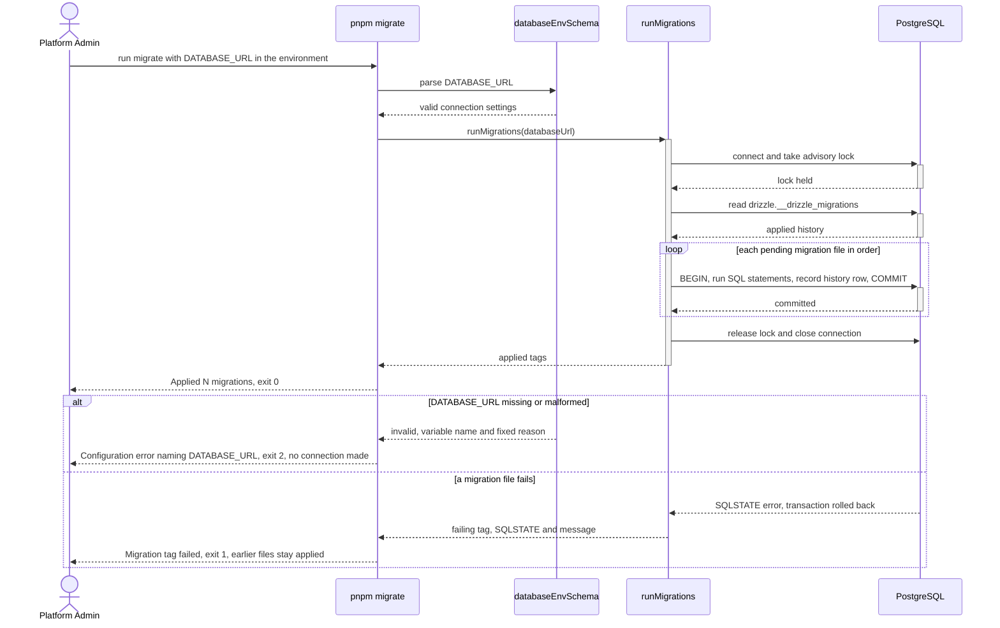
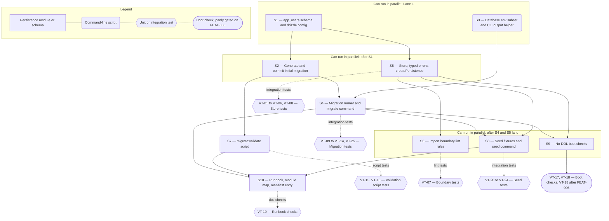

# Technical Specification — Starter Persistence with app_users

> **PRD slug:** `full-stack-express-starter-template` | **Owning layer:** `templates/full-stack-express/apps/api/` (persistence module, command-line scripts, SQL migrations) | **Surface:** Backend only
> **Verification builds:** `pnpm -C templates/full-stack-express check`, `pnpm -C templates/full-stack-express test`, and `pnpm -C templates/full-stack-express migrate:validate`. Apex regression guard from the repo root: `npx tsc -p tsconfig.server.json --noEmit` (the template must leave it unchanged).
> **Open items:** See [design-doc-assumptions.md](design-doc-assumptions.md) (5 unresolved)
> **Design doc:** [design-doc-design.md](design-doc-design.md)

---

## System Boundary and Owning Layer

**Owning layer:** `migrations/` equivalent inside the template (`templates/full-stack-express/apps/api/drizzle/`) and the template's API persistence module (`templates/full-stack-express/apps/api/src/persistence/`). No Apex layer owns this work.

**Rationale:** The PRD isolates the template in `templates/full-stack-express/` and bars any change to Apex runtime, database, or services. The data-access module is the template's single database boundary, so it lives in the API workspace member next to the CLI entry points that use it. A sixth workspace package would break FEAT-001's five-member layout. The contracts package must not import a database, so row types stay in the persistence module and the profile service (FEAT-006) maps them to contract types. Apex's own `src/server/db/drizzle.ts` and `schema.ts` are the pattern reference only; the template copies the shape, not the code.

**Ownership answers:**
- New or existing Express service in `src/server/services/`? No — Apex's `src/server/services/` stays untouched. The template adds a persistence module at `apps/api/src/persistence/`; the profile service (FEAT-006, TBI-015) is its first consumer and lives outside this Feature.
- New or existing route in `src/server/routes/`? No — this Feature has no HTTP endpoint. `GET` and `PUT /api/v1/me` belong to FEAT-006.
- New React component in `src/client/components/`? No — backend only.
- New shared type in `src/shared/types/`? No — Apex's `src/shared/types/` stays untouched. The persistence module owns `AppUser` and the error classes. API request and response types come from the contracts package (FEAT-004).
- Database migration needed? Yes — one initial migration, `apps/api/drizzle/0000_init_app_users.sql`, generated by Drizzle Kit and committed with the schema. No file is added to Apex's `migrations/`, and Apex's `node-pg-migrate` flow and `src/server/db/schema.ts` are not touched.

**Target files (all under `templates/full-stack-express/`):**

```
apps/api/
  drizzle.config.ts                  # Drizzle Kit config: schema path, out dir, dialect
  drizzle/
    0000_init_app_users.sql          # generated, reviewed, committed
    meta/                            # journal and snapshots, committed
  scripts/validateMigrations.ts      # backs `pnpm migrate:validate`
  src/persistence/
    index.ts                         # only public surface of the module
    schema.ts                        # app_users table definition
    client.ts                        # pool + Drizzle instance (private)
    appUserStore.ts                  # find, create, update (private implementation)
    errors.ts                        # typed errors
    mapDatabaseError.ts              # SQLSTATE -> typed error
    migrations/runMigrations.ts      # used by the migrate CLI and test support only
    seed/seedUsers.ts                # synthetic fixtures + seed function
  src/cli/
    migrate.ts                       # standalone migration entry point
    seed.ts                          # seed entry point
    output.ts                        # stdout/stderr writer, exit codes
  test/support/testDatabase.ts       # fresh database per test file
docs/runbooks/migrations.md          # ownership, workflow, forward-only rollback
```

---

## Security Enforcement

- **Authorization mechanism:** None, by design (BR-003). The template defines no role, permission, or policy. This Feature adds no `requirePermission` or `can()` call and no key to Apex's permission catalog in `rbac-governance.mdc`, so the `rbac-management` skill does not apply. Access to the database comes from the credential in `DATABASE_URL`. The runbook advises one DDL-capable credential for `migrate` and one data-only credential for the running application (assumption, owned by Platform Engineering).
- **Layer that enforces scope:** Both the data-access interface and the service layer. The interface enforces scope by shape: every operation takes the external subject and touches at most one row, and the module exports no list, search, or lookup-by-UUID operation. The profile service (FEAT-006) supplies the subject from the authenticated principal and never from the request (BR-001). The `AppUserPatch` type has no `externalSubject`, `status`, `id`, or timestamp field, and the store writes only `display_name`, `email`, and `updated_at`, so a caller cannot change the subject or status through `updateBySubject`.
- **Sensitive data handling:**
  - Display name, email, and external subject are unclassified (⚠ see assumptions) and treated as identity values under BR-007.
  - The error mapper keeps only the SQLSTATE code and the constraint name from a driver error. It drops `detail`, `where`, and query text, because PostgreSQL puts the offending value in `detail` (for example `Key (external_subject)=(...) already exists`). The typed errors carry constant messages and do not attach the driver error as `cause`.
  - The migrate and seed commands print SQLSTATE code and message for a database error, never `detail`, and never the connection URL. Configuration errors name the variable and give a fixed reason; they do not echo the value.
  - Seeds, fixtures, and tests use synthetic values only (BR-007).
  - The data-access module is the only code that imports `drizzle-orm`, `pg`, or `drizzle-kit` (enforced by lint, VT-07). This follows the Drizzle-only rule in `postgresql-db.mdc`, which keeps the pool private.
  - Credentials reach the process only through the environment. The CLI reads `DATABASE_URL` through a Zod schema and never writes it to output.

---

## Architecture and Approach

### Layers touched

| Layer | Changed | Notes |
|-------|---------|-------|
| Server services (`src/server/services/`) | No | Apex untouched. The template's profile service (FEAT-006) consumes the store later. |
| Server routes (`src/server/routes/`) | No | Apex untouched. No route in this Feature. |
| Server middleware (`src/server/middleware/`) | No | Apex untouched. |
| Client components (`src/client/components/`) | No | Backend only. |
| Client hooks (`src/client/hooks/`) | No | Backend only. |
| Shared types (`src/shared/types/`) | No | Apex untouched. Types live in the persistence module. |
| Database (migrations/) | No (Apex) | Apex's `migrations/` untouched. The template adds `apps/api/drizzle/0000_init_app_users.sql`. |
| Drizzle schema (`src/server/db/schema.ts`) | No (Apex) | Apex untouched. The template adds `apps/api/src/persistence/schema.ts` with one table. |
| Template API persistence module (`apps/api/src/persistence/`) | Yes | Schema, store, typed errors, error mapper, `createPersistence`. |
| Template CLI (`apps/api/src/cli/`, `apps/api/scripts/`) | Yes | `migrate`, `seed`, `migrate:validate`. |
| Template config (`apps/api` configuration module from FEAT-002) | Yes | Adds `databaseEnvSchema`, a subset schema for the CLI. |
| Template lint config (`apps/api` ESLint, extends `packages/config`) | Yes | Import boundary rules (VT-07). |
| Template docs (`docs/runbooks/`) | Yes | `migrations.md`. |
| Contracts package (`packages/contracts`) | No | Must not import the database. |

### Per-work-item design decisions

**TBI-006 — Define the app_users schema and data-access module**
- Pattern followed: Apex `src/server/db/drizzle.ts` (one Drizzle instance built once from the pool and the schema) and `src/server/db/schema.ts` (`pgTable` definitions; `uuid('id').primaryKey().defaultRandom()` as in `appRoles`). The store follows Apex `profileService.ts`: it takes the subject as an argument, never a target id, and uses `onConflict` handling that `postgresql-db.mdc` recommends.
- Key decisions:
  - **Public surface is `createPersistence({ databaseUrl })`.** It returns `{ users, ping, close }`. `users` implements `AppUserStore` (below). `ping` runs `select 1` through the Drizzle `sql` tag, as `postgresql-db.mdc` says for raw SQL. `close` ends the pool. FEAT-005 (readiness) and FEAT-007 (shutdown) use `ping` and `close`, so neither imports the pool. Rejected: exporting the `db` instance; that breaks the single-importer rule.
  - **Three operations only: `findBySubject`, `create`, `updateBySubject`.** `create` is strict. A duplicate subject throws `ProfileConflictError`. Rejected: a `findOrCreate` operation inside the module, because TBI-006 specifies a small find, create, update interface and the create-on-first-access rule is still unconfirmed (⚠ see assumptions). The profile service must call `findBySubject` again after a `ProfileConflictError`.
  - **Typed errors, constant messages.** `PersistenceError` is the base class with a `sqlState` field. `ProfileConflictError` maps SQLSTATE `23505` on the `app_users_external_subject_unique` constraint. `SchemaNotMigratedError` maps `42P01` (undefined table). `PersistenceUnavailableError` maps connection failures (`08*`, `57P01`, `ECONNREFUSED`, `ENOTFOUND`, timeouts). Any other driver error becomes a plain `PersistenceError`. The mapper walks the `cause` chain because recent `drizzle-orm` versions wrap driver errors. The errors carry no HTTP status; FEAT-006 maps them to Problem Details. This differs from Apex's `ProfileValidationError`, which sets `statusCode` itself, because the template's database layer must not know HTTP.
  - **Status as text plus CHECK.** `active` and `disabled`, default `active`.
  - **Timestamps as `timestamptz`, returned as `Date`.** `updateBySubject` sets `updated_at` explicitly in the same statement.
  - **No index beyond the unique constraint.** The unique constraint's index serves every query the module makes.
  - **Import boundary by lint.** An ESLint `no-restricted-imports` rule in `apps/api` bans `drizzle-orm`, `drizzle-orm/*`, `pg`, and `drizzle-kit` outside `src/persistence/**`, `drizzle.config.ts`, and `test/**`. Another rule bans importing `src/persistence/migrations/**` outside `src/cli/**`, `scripts/**`, and `test/**`.

**TBI-007 — Add the reviewed SQL migration workflow and standalone migration command**
- Pattern followed: the Apex `postgresql-migrations` skill (ship dependent migrations in one pull request, never rename an applied file, test against a local database first) and the Apex `postgresql-db.mdc` rule that schema changes never run in application startup code. The template deviates on tooling: Apex writes SQL by hand with `node-pg-migrate` and `-- Down` sections, and Drizzle only mirrors the schema. The PRD requires the template to generate SQL from schema changes, so the developer edits `schema.ts` first and runs `pnpm db:generate -- --name <slug>`, which wraps `drizzle-kit generate`. Drizzle Kit writes no down script, which matches the PRD's forward-only rule.
- Key decisions:
  - **The runner lives in `src/persistence/migrations/runMigrations.ts` and is imported only by `src/cli/migrate.ts` and test support.** The API's composition root never imports it. A lint rule and a source scan (VT-07) enforce this, so "application startup contains no schema-changing code" is a checked fact.
  - **The command applies pending migrations one file at a time.** It reads the folder with `readMigrationFiles` from `drizzle-orm/migrator`, compares to `drizzle.__drizzle_migrations`, and runs each file in its own transaction, recording it in the same table so Drizzle's own tooling still reads the history. On failure it prints `Migration <tag> failed: <SQLSTATE> <message>`, exits 1, and leaves earlier files applied. This is the default for ⚠ "Naming the failing migration"; the S4 implementer must check it against the pinned `drizzle-orm` first.
  - **A session advisory lock serializes runs.** The command takes `pg_advisory_lock` on a dedicated connection before reading state and releases it at the end, so two simultaneous runs queue (VT-25).
  - **Exit codes:** 0 success or nothing pending, 1 migration failure, 2 configuration error. Output goes through `src/cli/output.ts`, not Pino, because the command runs outside the API's logger setup.
  - **The command validates only `DATABASE_URL`.** It uses `databaseEnvSchema`, a subset of the FEAT-002 schema, so Platform Engineering need not set authentication or telemetry variables to migrate. A missing or malformed value aborts before any connection attempt. The message names the variable and gives a fixed reason.
  - **`pnpm migrate:validate` needs no database.** It (1) runs `drizzle-kit check` for journal and snapshot consistency, then (2) copies `apps/api/drizzle/` to a scratch folder, runs `drizzle-kit generate` into the copy, and fails if a new file appears, printing the SQL it holds. That SQL is the schema difference. The check that migrations produce the current schema on an empty database runs in the integration suite (VT-09) because it needs PostgreSQL.
  - **Merge conflicts in `meta/_journal.json`:** the runbook tells the later pull request to delete its generated migration, rebase, and regenerate. `drizzle-kit check` and `migrate:validate` catch a wrong merge.
  - **Backward compatibility rule:** the runbook requires expand-then-contract changes, because the command runs before traffic switches and the previous application version still serves requests during the run.
  - **Production rollback is a forward corrective migration.** The runbook says so, and local reset is `docker compose down -v` then `pnpm migrate`.
  - **The container ships the compiled command and the SQL folder** (⚠ see assumptions). The template ships no pipeline.

**TBI-008 — Add the synthetic seed command**
- Pattern followed: Apex has no seed command to copy, so the seed reuses the `AppUserStore` from TBI-006 and keeps the single-importer rule.
- Key decisions:
  - **Fixtures:** three rows in `src/persistence/seed/seedUsers.ts`. Subjects start with `seed-user-` (for example `seed-user-001`), display names start with `Sample Person` (for example `Sample Person One`), and emails use `example.com` (for example `sample.one@example.com`). VT-24 asserts all three rules.
  - **Insert-if-absent.** For each fixture the seed calls `findBySubject`, then `create` if the row is missing, and treats `ProfileConflictError` as "already present". Running twice leaves the same rows, and existing rows are never updated. Rejected: `INSERT ... ON CONFLICT DO UPDATE`, because it needs a second write path in the store and overwrites developer edits.
  - **Production guard runs before any connection.** The command validates `DATABASE_URL` and `NODE_ENV` with `databaseEnvSchema` extended by `NODE_ENV`, and refuses when `NODE_ENV` is `production`.
  - **Missing schema:** the first `findBySubject` throws `SchemaNotMigratedError`, and the command prints `The app_users table does not exist. Run "pnpm migrate" first.` and exits 1. The seed creates no table.
  - **No row for the development principal** (⚠ see assumptions).

**PBI-003 — Change the data model with a reviewed migration**
- Pattern followed: the Apex `postgresql-migrations` skill workflow, reversed to suit generation (schema first, then generated SQL).
- Key decisions: the developer flow is edit `schema.ts`, run `pnpm db:generate -- --name <slug>`, read the SQL, run `pnpm migrate:validate`, and commit schema and SQL together. After generation, `db:generate` runs Prettier over `apps/api/drizzle/meta/*.json` (see assumptions). The "boot leaves schema alone" case is proven in two places: VT-17 at module level now and VT-18 through the real boot path after FEAT-006 (TBI-014) lands.

**PBI-004 — Run migrations as a separate deployment step**
- Pattern followed: the Apex `postgresql-migrations` skill's environment table, where production migrations run in the pipeline before `npm start`.
- Key decisions: one command, `pnpm migrate` in a source checkout or `node dist/cli/migrate.js` in the image. The command reads the database connection only from the environment, as the PBI's security requirement states. The runbook documents the command, its exit codes, and the ownership split: the application repository owns migration files, Platform Engineering owns execution. ECS task definitions and pipeline stages stay out of scope.

**PBI-005 — Load synthetic seed data locally**
- Pattern followed: reuse of TBI-008; no Apex seed to copy.
- Key decisions: `pnpm seed` is a thin wrapper over `seedUsers(store)`. Output reports how many rows were new and how many already existed. The runbook states that the seed is for local databases and that re-running never overwrites a row.

---

## Data and Contracts

### API endpoints

| Method | Route | Request shape | Response shape | Auth |
|--------|-------|--------------|----------------|------|
| — | None | This Feature adds no HTTP endpoint. `GET /api/v1/me` and `PUT /api/v1/me` belong to FEAT-006. | — | — |

### Module contract (internal, TypeScript)

```ts
// apps/api/src/persistence/index.ts — the only public surface of the module
export type AppUserStatus = 'active' | 'disabled';

export interface AppUser {
  id: string;                    // UUID
  externalSubject: string;
  displayName: string;
  email: string | null;
  status: AppUserStatus;
  createdAt: Date;
  updatedAt: Date;
}

export interface NewAppUser {
  externalSubject: string;
  displayName: string;
  email?: string | null;         // omitted = null; status is always 'active'
}

export interface AppUserPatch {
  displayName?: string;          // undefined = leave unchanged
  email?: string | null;         // null = clear; undefined = leave unchanged
}

export interface AppUserStore {
  findBySubject(subject: string): Promise<AppUser | null>;
  create(input: NewAppUser): Promise<AppUser>;                    // throws ProfileConflictError on duplicate subject
  updateBySubject(subject: string, patch: AppUserPatch): Promise<AppUser | null>; // null when no row matches
}

export interface Persistence {
  users: AppUserStore;
  ping(): Promise<void>;         // throws PersistenceUnavailableError
  close(): Promise<void>;
}

export function createPersistence(options: { databaseUrl: string }): Persistence;

export class PersistenceError extends Error { readonly sqlState?: string; }
export class ProfileConflictError extends PersistenceError {}
export class SchemaNotMigratedError extends PersistenceError {}
export class PersistenceUnavailableError extends PersistenceError {}
```

An empty `AppUserPatch` returns the current row and writes nothing.

### Command-line contracts

| Command | Reads | Exit 0 | Exit 1 | Exit 2 |
|---------|-------|--------|--------|--------|
| `pnpm migrate` | `DATABASE_URL` | Applied or nothing pending | A migration failed | `DATABASE_URL` missing or malformed |
| `pnpm migrate:validate` | Nothing (no database) | Schema and migrations agree | Drift or inconsistent journal | Not used |
| `pnpm db:generate -- --name <slug>` | Schema file | New migration written | Generation failed | Not used |
| `pnpm seed` | `DATABASE_URL`, `NODE_ENV` | Seed applied or already present | Production, unmigrated database, or database error | Configuration invalid |

### Schema / storage changes

| Target | Change | Reason |
|--------|--------|--------|
| `app_users` | New table, created by `0000_init_app_users.sql`. No other table in the `public` schema. | The starter's one example table (TBI-006). |
| `app_users.id` | UUID, primary key, generated by the database | Stable key that never leaves the module. |
| `app_users.external_subject` | Text up to 255, required, unique (constraint `app_users_external_subject_unique`) | The identity provider's subject; the lookup key for every operation. |
| `app_users.display_name` | Text up to 100, required | Profile field. |
| `app_users.email` | Text up to 254, optional | Profile field. |
| `app_users.status` | Text, required, default `active`, CHECK in (`active`, `disabled`), constraint `app_users_status_check` | Account state; no endpoint changes it. |
| `app_users.created_at`, `app_users.updated_at` | `timestamptz`, required, default now | Audit-light timestamps; not an audit trail. |
| `drizzle.__drizzle_migrations` | Created by the migration command in the `drizzle` schema | Applied-migration history; kept out of `public` so VT-06 can assert `app_users` is the only table there. |

No column holds a password, session, role, audit event, or flag value. The shared route definitions (FEAT-004) must set field limits at or below the column limits above.

---

## Testing Strategy

**Unit tests:** (Vitest; thresholds from shared config: 80% lines, functions, and statements, 75% branches)
- `mapDatabaseError` — fake driver errors for SQLSTATE `23505`, `42P01`, `08006`, a wrapped error with the driver error in `cause`, and an unknown error; each maps to the right class, and no output field holds the value from `detail`.
- `databaseEnvSchema` — valid, missing, malformed, and a malformed value that contains a sentinel password; the issue list names the variable and never contains the sentinel.
- `seedUsers` fixtures — subjects, names, and emails satisfy the synthetic rules (VT-24).
- `output.ts` and exit-code mapping with injected writers.

**Integration tests:** (Vitest and Testcontainers PostgreSQL; files named `*.integration.test.ts`)
- `test/support/testDatabase.ts` starts one PostgreSQL container per run, creates a fresh database per test file, applies the committed migrations through `runMigrations`, and drops the database on teardown. Each run starts clean and leaves no shared state, as TBI-024 requires.
- Data-access module against real PostgreSQL: create, find, update, duplicate subject, concurrent create, clearing email, length limits, schema shape (VT-01 to VT-06, VT-08).
- Migration runner and CLI as child processes against real PostgreSQL: apply, re-run, bad migration, concurrent runs, configuration errors (VT-09 to VT-14, VT-25).
- Seed CLI as a child process: first run, unmigrated database, second run, production refusal (VT-20 to VT-23).
- Validation script tests copy `apps/api/src/persistence/schema.ts` and `apps/api/drizzle/` to a temp folder, edit the schema there, and run the script (VT-15, VT-16). These need no database.
- Boot checks: VT-17 now; VT-18 after FEAT-006 (TBI-014).

**E2E tests (if applicable):**
- None for this Feature. The Playwright journeys (FEAT-011, TBI-025) reach persistence through the profile API and use the development adapter. They need no code from this Feature beyond a migrated database.

**Prior art:** Apex layers Jest unit and integration tests with Supertest and Playwright. The template uses the same layers with Vitest and Testcontainers, per the PRD. Tests assert observable behavior (exit status, output text, persisted rows, schema shape) and do not assert Drizzle calls.

---

## Observability

- **Custom events/metrics:** None beyond standard telemetry. The persistence module logs nothing itself; the API logs through Pino (FEAT-007), and typed errors carry no identity values, so a log line that prints an error is safe. FEAT-007 must keep `enhancedDatabaseReporting` off in the `pg` OpenTelemetry instrumentation so spans carry parameterized SQL and no values (BR-007).
- **Command output:** `migrate` and `seed` write plain text to stdout (results) and stderr (errors) through `src/cli/output.ts`. They print migration tags, counts, SQLSTATE codes, and variable names, and nothing else.
- **Alerts:** None. A failed migration is a non-zero exit that the caller's pipeline reports.

---

## Rollback and Deployment

- **Schema changes backward compatible:** Yes. The only change is a new table in a new database, so nothing existing breaks. Future migrations must follow expand-then-contract, because the command runs while the previous application version still serves traffic.
- **Rollback procedure:** Production uses forward corrective migrations only; there are no down scripts. A failed run leaves earlier files applied and the failing file rolled back, and the next run retries from the failing file. Local reset: `docker compose down -v`, then `pnpm migrate`.
- **Deployment dependencies:** Platform Engineering runs `migrate` before switching traffic, with a credential that can change schema, and owns the pipeline stage that calls it. The container must ship `dist/cli/migrate.js` and `apps/api/drizzle/` (⚠ see assumptions). PostgreSQL 13 or later is required for `gen_random_uuid()`. Nothing in Apex needs provisioning.
- **Feature flag gates deployment:** No.

---

## Verification Test Matrix

| ID | Layer | Arrange | Act | Assert | Linked |
|----|-------|---------|-----|--------|--------|
| VT-01 | Vitest integration | Fresh migrated database | `create` a user with subject `seed-user-test-1`, then `findBySubject` | Returned row has a UUID `id`, the same subject, name, and null email, `status` `active`, and equal `createdAt` and `updatedAt`; `findBySubject` returns an equal row; an unknown subject returns `null` | TBI-006 |
| VT-02 | Vitest integration | One existing user | `updateBySubject` with a new display name and email; then with `{}`; then with an unknown subject | First call returns the new values with `updatedAt` after `createdAt` and unchanged `id`, subject, `status`, and `createdAt`; `{}` returns the row and leaves `updatedAt` unchanged; unknown subject returns `null` | TBI-006 |
| VT-03 | Vitest integration | One existing user with subject `seed-user-test-1`, display name `Sample Person One`, email `sample.one@example.com` | `create` the same subject again; capture the thrown error | Throws `ProfileConflictError` with `sqlState` `23505`; `message`, `stack`, and `JSON.stringify(error)` contain none of the subject, name, or email; one row exists | TBI-006 |
| VT-04 | Vitest integration | Fresh migrated database | Run two `create` calls for the same subject with `Promise.all` | Exactly one resolves, the other rejects with `ProfileConflictError`, and one row exists | TBI-006 |
| VT-05 | Vitest integration | One existing user | Clear the email with `{ email: null }`; save values of 100, 254, and 255 characters in name, email, and subject; try 101, 255, and 256 characters | Cleared email reads back `null`; values at the limit round-trip; values over the limit reject with `PersistenceError` that holds no value | TBI-006 |
| VT-06 | Vitest integration | Fresh migrated database | Read `information_schema` for the `public` schema | `app_users` is the only table; its columns are exactly `id`, `external_subject`, `display_name`, `email`, `status`, `created_at`, `updated_at`; no column name matches password, session, role, audit, or flag; a unique constraint on `external_subject` and the `status` CHECK exist | TBI-006 |
| VT-07 | Vitest unit (ESLint API) | Fixture files that import `drizzle-orm`, `pg`, and `persistence/migrations/runMigrations` from `src/services` | Lint each fixture with the `apps/api` config; lint the same imports from `src/persistence`, `src/cli`, and `test` | Outside files report `no-restricted-imports`; allowed folders report none. A text scan of `apps/api/src` outside `cli` and `persistence` finds no `CREATE TABLE`, `ALTER TABLE`, or `runMigrations` | TBI-006, TBI-007 |
| VT-08 | Vitest integration | (a) Empty database with no migrations; (b) a connection URL to a closed port | (a) `findBySubject`; (b) `ping` and `findBySubject` | (a) throws `SchemaNotMigratedError`; (b) throws `PersistenceUnavailableError`; neither message contains the URL, host, or subject | TBI-006, PBI-005 (b) |
| VT-09 | Vitest integration | Empty database | Run `runMigrations` on the committed folder; read `drizzle.__drizzle_migrations` and `information_schema` | No error; migrations recorded in filename order; the live columns, types, nullability, defaults, and constraints match the Drizzle table definition from `schema.ts` | TBI-007, PBI-003 (c) |
| VT-10 | Vitest integration | Database already migrated | Run `runMigrations` a second time | No error; the history row count and `app_users` rows are unchanged | TBI-007, PBI-004 (c) |
| VT-11 | Vitest integration (child process) | Database with pending migrations; `DATABASE_URL` set | Run `node dist/cli/migrate.js` | Exit 0; stdout lists `0000_init_app_users`; `app_users` exists | PBI-004 (a) |
| VT-12 | Vitest integration (child process) | Temp migrations folder with a valid first file and a second file with invalid SQL | Run the command against it | Exit 1; stderr names the second file and a SQLSTATE; stdout has no success line; the first file stays recorded and the second leaves no change | PBI-004 (b), TBI-007 |
| VT-13 | Vitest integration (child process) | `DATABASE_URL` unset and no database reachable | Run the command | Exit 2; stderr names `DATABASE_URL`; the run ends before any connection attempt | PBI-004 (d) |
| VT-14 | Vitest integration (child process) | `DATABASE_URL` set to a malformed value that contains the sentinel `sentinel-password-123` | Run the command | Exit 2; stderr names `DATABASE_URL`; neither stdout nor stderr contains the sentinel | PBI-004 (d), TBI-007 |
| VT-15 | Vitest integration (child process, no database) | Temp copy of the schema and `drizzle/` folder; add a nullable column in the copy | Run `db:generate` then `migrate:validate` against the copy | `db:generate` writes a new `.sql` file that adds the column; `migrate:validate` exits 0 | PBI-003 (a) |
| VT-16 | Vitest integration (child process, no database) | Temp copy with a column added to the schema and no new migration | Run `migrate:validate` | Exit 1; output includes the column name from the would-be SQL and the text `Run "pnpm db:generate"` | PBI-003 (b) |
| VT-17 | Vitest integration | Empty database | Call `createPersistence`, `ping`, and a `findBySubject` that throws; then list `information_schema` tables and the `drizzle` schema | No `app_users` table and no `drizzle` schema appear; the module issued no DDL | PBI-003 (d), TBI-007 |
| VT-18 | Vitest integration (Supertest) — activates after FEAT-006, TBI-014 | Empty database; the API composition root | Boot the app; call `GET /health/live` | The app serves liveness; afterward no `app_users` table and no `drizzle` schema exist | PBI-003 (d) |
| VT-19 | Vitest unit | `docs/runbooks/migrations.md` | Parse headings and required statements | The file has sections for ownership, workflow, running the command, and rollback; it states that the application repository owns files, Platform Engineering owns execution, and production rollback is forward-only | TBI-007, PBI-004 |
| VT-20 | Vitest integration (child process) | Migrated database | Run `node dist/cli/seed.js` | Exit 0; three rows exist; stdout reports `Seeded 3 new rows; 0 already present.` | PBI-005 (a), TBI-008 |
| VT-21 | Vitest integration (child process) | Empty database with no migrations | Run the seed | Exit 1; stderr says to run `pnpm migrate` first; no table was created | PBI-005 (b) |
| VT-22 | Vitest integration (child process) | Migrated database | Run the seed twice | Both exit 0; row count stays 3; each row's `id` and `created_at` are unchanged after the second run | PBI-005 (c), TBI-008 |
| VT-23 | Vitest integration (child process) | `NODE_ENV=production`; `DATABASE_URL` points at a closed port | Run the seed | Exit 1; stderr says seeding never runs in production; no connection error appears, which shows the guard ran first; a reachable migrated database keeps its row count in a second variant | PBI-005 (d), TBI-008 |
| VT-24 | Vitest unit | The fixture list | Check every row | Subjects start with `seed-user-`; names start with `Sample Person`; emails end with `@example.com`; subjects are unique | TBI-008 |
| VT-25 | Vitest integration (child process) | Empty database | Start two `migrate` processes at once | Both exit 0; `app_users` exists once; the history holds one row per migration | TBI-007 |

---

## Implementation Plan

- [ ] S1 — Add `apps/api/src/persistence/schema.ts` with the `app_users` table, constraints, and `apps/api/drizzle.config.ts`; add the `db:generate` script (TBI-006, PBI-003) _(blocked by FEAT-001 workspace; no blockers inside this Feature)_
  - Covers: none directly; S2 and S5 test it
- [ ] S2 — Generate `0000_init_app_users.sql` with `pnpm db:generate -- --name init_app_users`, read the SQL, run Prettier on `meta/*.json`, and commit schema and SQL together (TBI-007) _(blocked by S1)_
  - Covers: `VT-09`
- [ ] S3 — Add `databaseEnvSchema` (subset of the FEAT-002 schema) and `src/cli/output.ts` with exit codes and safe error text (TBI-007, PBI-004) _(blocked by FEAT-002 TBI-004; can parallel with S1)_
  - Covers: `VT-13`, `VT-14`
- [ ] S4 — Write `runMigrations` (file-by-file, advisory lock, failing-file report), `src/cli/migrate.ts`, the `migrate` script, and `test/support/testDatabase.ts` (TBI-007, PBI-004) _(blocked by S2, S3; resolve ⚠ "Naming the failing migration" first)_
  - Covers: `VT-09`, `VT-10`, `VT-11`, `VT-12`, `VT-25`
- [ ] S5 — Write `errors.ts`, `mapDatabaseError.ts`, `appUserStore.ts`, `client.ts`, and `createPersistence` with `ping` and `close` (TBI-006) _(blocked by S1 for code; its integration tests run after S4; can parallel with S2 and S3)_
  - Covers: `VT-01`, `VT-02`, `VT-03`, `VT-04`, `VT-05`, `VT-06`, `VT-08`
- [ ] S6 — Add the ESLint import-boundary rules and the source scan test (TBI-006, TBI-007) _(blocked by S5)_
  - Covers: `VT-07`
- [ ] S7 — Write `scripts/validateMigrations.ts` and the `migrate:validate` script (TBI-007, PBI-003) _(blocked by S2)_
  - Covers: `VT-15`, `VT-16`
- [ ] S8 — Write `seedUsers.ts`, `src/cli/seed.ts`, and the `seed` script (TBI-008, PBI-005) _(blocked by S4, S5)_
  - Covers: `VT-20`, `VT-21`, `VT-22`, `VT-23`, `VT-24`
- [ ] S9 — Add the module-level no-DDL test now and the API boot test when the composition root exists (TBI-007, PBI-003) _(VT-17 blocked by S4 and S5; VT-18 blocked by FEAT-006 TBI-014)_
  - Covers: `VT-17`, `VT-18`
- [ ] S10 — Write `docs/runbooks/migrations.md`, add the module-map entry that separates the starter's `app_users` from Apex's, document the scripts in the README, and register `migrate:validate` in the quality manifest (TBI-007, PBI-003, PBI-004, PBI-005) _(blocked by S4, S7, S8; manifest entry blocked by FEAT-012)_
  - Covers: `VT-19`

**Execution lanes:**
- Lane 1 (start immediately): S1, S3
- Lane 2 (after S1): S2, S5
- Lane 3 (after S2 and S3): S4; (after S2): S7
- Lane 4 (after S4 and S5): S6, S8, S9
- Lane 5 (after S4, S7, and S8): S10

---

## Diagram 1 — Code Execution Flow

This Feature has no React, hook, or Express hop. The primary runtime path is PBI-004: Platform Admin runs the standalone migration command against PostgreSQL.



---

## Diagram 2 — Implementation Dependency Map


