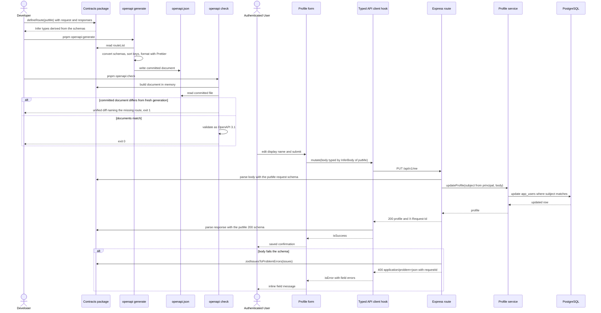
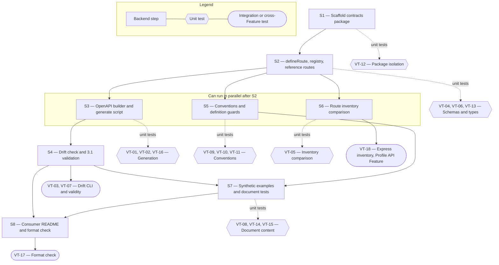

# Technical Specification — Zod-Authoritative API Contract

> **PRD slug:** `full-stack-express-starter-template` | **Owning layer:** `templates/full-stack-express/packages/contracts/` (full-stack shared package) | **Surface:** Full stack (this Feature ships only the shared contracts package)
> **Verification builds:** From `templates/full-stack-express/`: `pnpm --filter @scope/contracts typecheck`, `pnpm --filter @scope/contracts test`, `pnpm --filter @scope/contracts build`, and `pnpm openapi:check`. From the Apex root: `npx prettier --check templates/full-stack-express/packages/contracts/openapi/openapi.json`. Apex's own `npx tsc -p tsconfig.server.json --noEmit` and `npx tsc -p tsconfig.client.json --noEmit` do not read the template (both include only `src/`), so they stay unchanged.
> **Open items:** See [design-doc-assumptions.md](design-doc-assumptions.md) (4 unresolved)
> **Design doc:** [design-doc-design.md](design-doc-design.md)

`@scope/contracts` stands for the package name built from the template's documented package-scope placeholder.

---

## System Boundary and Owning Layer

**Owning layer:** `templates/full-stack-express/packages/contracts/`. Nothing in Apex's `src/server/`, `src/client/`, `src/shared/`, or `migrations/` changes.

**Rationale:** The PRD makes the contracts package a deep module. It holds every route definition and has no dependency on Express, React, or the database, so the API application, the web client, and the test tools can all import it. Apex's `fullstack-node-bff` skill already names `src/shared/` as "the only safe import boundary between client and server". The contracts package plays that role inside the template, with one addition: it carries runtime schemas and route metadata, not only types. The generated OpenAPI document and the two scripts that write and check it live in the same package, so a Developer changes one place.

**Ownership answers:**
- New or existing Express service in `src/server/services/`? No — Apex services are untouched. The template's profile service belongs to the Health and Self-Service Profile API Feature (`apps/api`), not to this Feature.
- New or existing route in `src/server/routes/`? No — Apex routes are untouched. This Feature defines four route contracts; their Express handlers belong to the Health and Self-Service Profile API Feature.
- New React component in `src/client/components/`? No — the Feature ships no UI. The Self-Service Profile Screen Feature builds its typed API client from this package.
- New shared type in `src/shared/types/`? No in Apex. Yes in the template: derived types and schemas live in `packages/contracts/src/`, which replaces `src/shared/types/` for generated projects.
- Database migration needed? No — the Feature touches no table. The profile response schema reads `app_users` values through the data-access module, owned by the Starter Persistence with `app_users` Feature.

**Package layout:**

```
packages/contracts/
  package.json            exports: ".", "./openapi", "./openapi.json"; sideEffects: false; type: module
  tsconfig.json           extends the config package base
  vitest.config.ts        extends the config package preset
  openapi/openapi.json    generated, committed, never hand-edited
  src/
    index.ts              public barrel: defineRoute, routes, Infer* types, schemas, conventions
    define-route.ts       defineRoute, definition-time guards, standard-response merge
    registry.ts           routes (keyed by id), routeList, routeKey
    inventory.ts          compareRouteInventory
    conventions/
      problem-details.ts  problemDetailsSchema, problemTypes, zodIssuesToProblemErrors
      request-id.ts       requestIdHeader, requestIdSchema
      pagination.ts       paginationQuerySchema, paginated()
      versioning.ts       path pattern and guard
    routes/
      health.ts           getHealthLive, getHealthReady
      me.ts               getMe, putMe, profile schemas
    openapi/
      build-document.ts   buildOpenApiDocument (pure, no Node built-ins)
  scripts/
    generate-openapi.ts   writes openapi/openapi.json (Node, Prettier)
    check-openapi.ts      drift check and OpenAPI 3.1 validation (Node, diff)
  test/                   Vitest unit and integration tests
  README.md               conventions for new endpoints
```

---

## Security Enforcement

- **Authorization mechanism:** None at runtime in this Feature. The template defines no roles, permissions, or policy (BR-003), so Apex's `requirePermission(...)` middleware and `can(...)` client guards (`rbac-governance.mdc`) are not copied. Each route definition declares `auth: "principal"` or `auth: "none"`. The OpenAPI document turns that into a `security` entry. The authentication middleware (Identity Provider Adapter Feature) and `registerRoute` (Health and Self-Service Profile API Feature) enforce it.
- **Layer that enforces scope:** Both, outside this Feature. The route middleware rejects unauthenticated calls. The service layer takes the external subject from the authenticated principal only (BR-001). This Feature adds the definition-time guard: `defineRoute` throws if a `params`, `query`, or `body` schema names `userId`, `subject`, `sub`, `externalSubject`, or `externalId`. Request and response objects are `z.strictObject`, so extra fields in a request are rejected and extra fields in a response fail conformance tests.
- **Sensitive data handling:** Error bodies never carry identity values or stack traces (BR-007). `problemDetailsSchema` is strict, so a body with a `stack` or `subject` member does not match it. `zodIssuesToProblemErrors` builds `errors[].message` from a fixed catalog keyed by Zod issue code and never copies the submitted value. Examples in the committed document use synthetic values only (`Ada Example`, `ada@example.test`), and a test fails on any other email-shaped value. The data classification of `displayName`, `email`, and the subject stays unresolved and belongs to Platform Engineering.

---

## Architecture and Approach

### Layers touched

| Layer | Changed | Notes |
|-------|---------|-------|
| Server services (`src/server/services/`) | No | Apex untouched. |
| Server routes (`src/server/routes/`) | No | Apex untouched. |
| Server middleware (`src/server/middleware/`) | No | Apex untouched. |
| Client components (`src/client/components/`) | No | Apex untouched; the Feature has no UI. |
| Client hooks (`src/client/hooks/`) | No | Apex untouched. |
| Shared types (`src/shared/types/`) | No | Apex untouched. The template equivalent, `packages/contracts/src/`, is the whole Feature. |
| Database (migrations/) | No | No schema change. |
| Drizzle schema (`src/server/db/schema.ts`) | No | Apex untouched. The template's `app_users` schema belongs to the Starter Persistence Feature. |

Template modules touched:

| Template module | Changed | Notes |
|-----------------|---------|-------|
| `packages/contracts/` | Yes (new) | The entire Feature. |
| `packages/config/` | No | Read only. The contracts package extends its TypeScript and Vitest presets (TBI-003). |
| Root `package.json` of the template | Yes | Adds root aliases `openapi:generate` and `openapi:check`, and adds `openapi:check` to `check`. |
| `apps/api/`, `apps/web/` | No | They consume this package in later Features. |

### Per-work-item design decisions

**PBI-006 — Define an endpoint once**
- Pattern followed: Apex's shared-schema pairing (`CreateSessionRequestSchema` in `src/shared/types/calendarWorkItemAssistant.ts`, derived with `z.infer`, parsed by `safeParse(req.body)` in `src/server/routes/api.ts`). That pattern defines a schema per handler. This Feature binds method, path, and responses to the schema in one object, so one definition drives the handler, the types, and the document.
- Key decisions: The authoring path is `defineRoute` → `routeList` → `buildOpenApiDocument` → committed file. Scenario (a) holds because the builder reads only `routeList`. Scenario (b) holds because the drift check compares the whole file. Scenario (c) holds because Zod bounds become `minLength` and `maxLength` in the document and `400` Problem Details at runtime. Scenario (d) takes three layers, since contracts cannot see Express:
  1. `registerRoute` (FEAT-006) accepts only objects made by `defineRoute`, so TypeScript rejects an ad hoc route.
  2. An ESLint rule in `apps/api` bans direct `get`, `post`, `put`, `patch`, `delete`, and `all` calls on `app` and `router`.
  3. `routes:check` (FEAT-006) lists the routes on the running Express app and calls `compareRouteInventory`, which reports undocumented routes (in Express, not in contracts) and unimplemented routes (the reverse).
- Alternative rejected: reading Express internals from inside the contracts package. It would add an Express dependency, which the TBI-009 non-functional requirement forbids.

**PBI-007 — Inspect the API contract without running the application**
- Pattern followed: none in Apex (it has no OpenAPI). The reader artifact is the committed `openapi/openapi.json`, exposed as `@scope/contracts/openapi.json`.
- Key decisions: `info.description` says "Generated from the Zod route definitions. Do not edit by hand.", because JSON allows no comments. Every operation lists its request, response, and error schemas and the `X-Request-Id` response header. Examples are optional and synthetic. A route without examples is still fully described, because constraints (`required`, `minLength`, `maxLength`, `format`, `enum`, `additionalProperties: false`) come from the schema, not from examples. QA gets the same drift check as Developers, so a stale document fails before anyone relies on it.
- Alternative rejected: generating examples automatically from schemas. It risks inventing realistic-looking names and emails, which PBI-007 scenario (d) forbids.

**TBI-009 — Create the contracts package with shared Zod route definitions**
- Pattern followed: Apex `src/shared/types/` plus `z.infer` (above), and the `fullstack-node-bff` rule that client and server share only through the shared folder.
- Key decisions: `defineRoute({ id, method, path, auth, summary, request, responses })` returns a frozen definition and throws at module load on any guard failure (fail-fast). Request parts are `params`, `query`, `headers`, and `body`, each a Zod schema. `routes` is a typed record keyed by `id`, and `routeList` is the same set as an array. Types come from helpers: `InferBody<R>`, `InferQuery<R>`, `InferParams<R>`, and `InferResponse<R, Status>`. The package exports the Zod schemas themselves, because the web client must parse every response with the shared schema (TBI-022). The package is ESM-only, has `sideEffects: false`, imports only `zod`, and imports no `node:` module in `src/`. VT-12 enforces both rules.
- Alternatives rejected: (1) plain TypeScript interfaces with hand-written OpenAPI, which is how drift starts. (2) A framework such as ts-rest or tRPC, which would bring its own Express integration into a package that must stay free of Express. (3) OpenAPI-first generation, which the Feature puts out of scope.

**TBI-010 — Generate the OpenAPI 3.1 document and add the drift check**
- Pattern followed: none in Apex. The closest habit is `scripts/ci/check-codemap-paths.mjs` (a script that exits non-zero with a plain message when a committed file is stale); the drift check copies that exit-code and message style.
- Key decisions: `buildOpenApiDocument(routeList, info)` is pure and imports no Node module, so tests call it in memory. It converts each schema with Zod's JSON Schema conversion (draft 2020-12, the dialect OpenAPI 3.1 uses), using input shape for requests and output shape for responses. Shared schemas named with `.meta({ id })` become `components.schemas` entries and `$ref`s. Parameters come from `params`, `query`, and `headers`, and `requestBody` from `body`. The builder sorts `paths` and `components.schemas` by key, orders operations by a fixed method list, and writes no timestamp. `scripts/generate-openapi.ts` formats the JSON with Prettier using `parser: "json"`, `printWidth: 80`, `tabWidth: 2` (the values in Apex's root `.prettierrc`), so Apex's root `prettier --check .` accepts it. `scripts/check-openapi.ts` generates in memory, compares bytes with the committed file, prints a unified diff on mismatch, and then validates the committed file as OpenAPI 3.1. S3 starts with a spike that pins the conversion behavior in a snapshot. The library choice is ⚠ (see assumptions).
- Alternatives rejected: (1) comparing parsed JSON, which would pass a file that `openapi:generate` would still rewrite, leaving a dirty working tree after generation. (2) A third-party generator that owns route registration, which needs Express.

**TBI-011 — Define error, request ID, pagination, and versioning conventions**
- Pattern followed: none in Apex (no Problem Details exists). RFC 9457 and RFC 9110 define the shapes.
- Key decisions:
  - `problemDetailsSchema` is strict, with `type`, `title`, `status`, optional `detail` and `instance`, `requestId`, and optional `errors[]` of `{ pointer, code, message }`.
  - `problemTypes` holds the URNs `urn:problem-type:validation-error`, `malformed-body`, `authentication-required`, `not-found`, `rate-limited`, `not-ready`, and `internal-error`.
  - `defineRoute` merges standard responses: `500` for every route, `401` and `429` when `auth` is `principal`, `400` when the route has any input. It also adds `X-Request-Id` to every response. A route may not declare a 4xx or 5xx response with a non-Problem schema.
  - `requestIdSchema` is 1 to 128 characters from `[A-Za-z0-9._-]`.
  - `paginationQuerySchema` is `limit` (integer 1 to 100, default 20) and `cursor` (string, at most 512 characters). `paginated(item)` builds `{ items, nextCursor }`.
  - The version guard accepts `/api/v<n>/...` and `/health/...` only, and checks that `params` keys match the `:name` segments of the path.
  - The README lists these rules as the checklist for a new endpoint.
- Alternatives rejected: offset pagination, because deep offsets get slow and shift under concurrent writes. A `type` URL on a real domain, because the template has none.

---

## Data and Contracts

### API endpoints

Success bodies use `application/json`. Error bodies use `application/problem+json`. Every response carries `X-Request-Id`. "Standard errors" means the merge rule above.

| Method | Route | Request shape | Response shape | Auth |
|--------|-------|--------------|----------------|------|
| GET | `/health/live` | None | `200 { status: "ok" }`; standard `500` | None (`auth: "none"`) |
| GET | `/health/ready` | None | `200 { status: "ready" }`; `503` Problem Details (`not-ready`, no host, connection string, or error text); standard `500` | None (`auth: "none"`) |
| GET | `/api/v1/me` | None. The subject comes from the authenticated principal. | `200 { displayName: string, email: string \| null, status: "active" \| "disabled" }` (status set pending ⚠); standard `401`, `429`, `500` | `auth: "principal"` |
| PUT | `/api/v1/me` | Body `{ displayName: string (trimmed, 1–100), email?: string \| null (valid address, at most 254) }`, strict. An omitted or `null` email clears it. | `200` same profile shape as `GET`; standard `400`, `401`, `429`, `500` | `auth: "principal"` |

Illustrative definition (shows the interface, not final code):

```ts
export const putMe = defineRoute({
  id: 'putMe',
  method: 'put',
  path: '/api/v1/me',
  auth: 'principal',
  summary: 'Update my own profile',
  request: { body: updateProfileBodySchema },
  responses: { 200: { description: 'The updated profile', body: profileSchema } },
});
// defineRoute adds 400, 401, 429, 500 and the X-Request-Id header.
```

Public interface of the package (one import path for consumers):

| Export | Purpose | Consumer |
|--------|---------|----------|
| `defineRoute`, `routes`, `routeList`, `routeKey` | One definition per route; registry | API application, web client |
| `InferBody`, `InferQuery`, `InferParams`, `InferResponse` | Derived types | API application, web client |
| `problemDetailsSchema`, `problemTypes`, `zodIssuesToProblemErrors` | Error contract and the mapper that keeps values out of error bodies | API application, web client |
| `requestIdHeader`, `requestIdSchema` | Response header contract | API application, web client |
| `paginationQuerySchema`, `paginated` | Pagination convention | Future list endpoints |
| `compareRouteInventory` | Reports undocumented and unimplemented routes | `routes:check` in the API application |
| `buildOpenApiDocument` (from `./openapi`) | Pure builder | Scripts, conformance tests |
| `openapi.json` (from `./openapi.json`) | Committed document | QA, conformance tests |

Scripts:

| Script | Where | Behavior |
|--------|-------|----------|
| `openapi:generate` | Contracts package, root alias | Writes `openapi/openapi.json`. Exits 0. |
| `openapi:check` | Contracts package, root alias, part of root `check` | Exits 1 with a unified diff if the committed file differs from a fresh generation. Exits 1 with the validator's messages if the committed file is not valid OpenAPI 3.1. Exits 0 otherwise. |

### Schema / storage changes

| Target | Change | Reason |
|--------|--------|--------|
| `app_users` | None. The Starter Persistence Feature owns the table and its migrations. | The contract reads profile values; it does not define storage. |
| `packages/contracts/openapi/openapi.json` | New generated file, committed with the definitions | The reviewable contract (BR-004) |

---

## Testing Strategy

**Unit tests:** (Vitest in the contracts package, `test/*.test.ts`; Apex's `src/server/__tests__/playbookStepRegistry.test.ts` is the nearest prior art, with paired valid and invalid `safeParse` assertions at each boundary.)
- `defineRoute` and the builder — a fixture route appears in the generated document with its request, response, and error schemas and the request ID header (VT-01).
- Determinism — two runs, and a shuffled registry, give identical bytes (VT-02).
- Profile and fixture schemas — values at, below, and above each limit give the expected parse result and Problem Details errors with a pointer, a code, and no echoed value (VT-04, VT-06).
- Route inventory comparison — undocumented and unimplemented routes are reported (VT-05).
- Problem Details, pagination, and definition guards — see VT-09, VT-10, VT-11.
- Package isolation and derived types — VT-12, VT-13 (type tests with `expectTypeOf`).
- Document content — headers and error responses on every operation, synthetic-only examples, constraint coverage without examples, registry equals document (VT-08, VT-14, VT-15, VT-16).

**Integration tests:**
- Drift check CLI — run `check-openapi` as a child process against a temporary copy of the package. A stale document exits 1 and names the missing route (VT-03). A valid document passes OpenAPI 3.1 validation (VT-07).
- Format — `prettier --check` on the committed document with the Apex root options (VT-17).
- Express route discovery — owned by the Health and Self-Service Profile API Feature (VT-18, blocked until `apps/api` exists).

**E2E tests (if applicable):** Not applicable. The Feature has no running surface. Contract conformance against live routes belongs to the Reference Test Framework Feature, and it reads the committed document this Feature produces.

---

## Observability

- **Custom events/metrics:** None beyond standard request telemetry. The `requestId` member and `X-Request-Id` header that this Feature defines let the logging Feature (Pino) tie a response to its log lines. The scripts print plain-text results and exit codes, and write no telemetry.
- **Alerts:** None.

---

## Rollback and Deployment

- **Schema changes backward compatible:** Yes — there is no database change. The committed document changes with every route edit; consumers read it from the repository, so a revert restores the earlier document and definitions together.
- **Rollback procedure:** Revert the Feature's commits. Apex runtime is unaffected, because the template is not wired into Apex's root workspace. After a template is adopted, a breaking change to a published route goes in a new `/api/v<n+1>/` path; the version guard already accepts it.
- **Deployment dependencies:** None for Apex. Apex's PR pipeline treats template files as application changes (not markdown-only), so the PR runs the full Apex suite and dev deploy with no behavior change. The Feature needs the pinned toolchain and the config package from the Isolated pnpm Workspace Feature, and the tooling decision in the assumptions file (⚠).
- **Feature flag gates deployment:** No. The PRD sets "Flag required: No".

---

## Verification Test Matrix

| ID | Layer | Arrange | Act | Assert | Linked |
|----|-------|---------|-----|--------|--------|
| VT-01 | Vitest unit | A fixture route `getThing` (`GET /api/v1/things`, `auth: "principal"`, one query field, one `200` body) in a test registry | `buildOpenApiDocument` on the registry | `paths["/api/v1/things"].get` exists with the query parameter, the `200` schema, `400`/`401`/`429`/`500` as `application/problem+json`, and the `X-Request-Id` header on each response | PBI-006 (a), TBI-009, TBI-010 |
| VT-02 | Vitest unit | The real `routeList`, and a copy in reversed order | Generate and serialize each twice | All four outputs are byte-identical; `paths` keys are sorted; no timestamp field exists | TBI-010 |
| VT-03 | Vitest integration (child process) | Temp copy of the package with the committed document, and a new route added to the registry without regenerating | Run `check-openapi` | Exit code 1; output contains a unified diff that names `PUT /api/v1/things` as missing from the committed file | PBI-006 (b), PBI-007 (b) |
| VT-04 | Vitest unit | `updateProfileBodySchema` and a fixture route with an optional `nickname` field (`min(2)`, `max(20)`) | `safeParse` with lengths 1, 2, 20, 21, and `displayName` of 0, 1, 100, 101 characters and whitespace only; `email` of 254 and 255 characters, `null`, omitted, `"not-an-email"` | Boundary values at 2, 20, 1, 100, and 254 pass; below and above fail; whitespace-only fails; `null` and omitted email pass; each failure maps to a Problem Details `errors[]` entry with a pointer and code | PBI-006 (c), TBI-009 |
| VT-05 | Vitest unit | Registered list `[GET /api/v1/me, PUT /api/v1/me, GET /api/v1/debug]` and a `routeList` that also holds both health routes | `compareRouteInventory(registered)` | `undocumented` is `[GET /api/v1/debug]`; `unimplemented` is the health routes not in the registered list; the helper reports a non-empty result so a caller can exit 1 | PBI-006 (d) |
| VT-06 | Vitest unit | `putMe` request body schema | `safeParse` bodies containing `subject`, `id`, or `status` beside valid fields | Each fails; the mapped error has pointer `/subject` (or `/id`, `/status`), code `unrecognized_key`, a fixed message, and no copy of the submitted value | TBI-009, TBI-011 |
| VT-07 | Vitest integration | The committed `openapi/openapi.json` | Run the OpenAPI 3.1 validator | No errors; the `openapi` field starts with `3.1` | TBI-010 |
| VT-08 | Vitest unit | The committed document | Walk every operation and response | Every response has the `X-Request-Id` header; every operation has a `500` `application/problem+json` response; operations with `security` also have `401` and `429`; operations with input also have `400` | PBI-007 (a), TBI-011 |
| VT-09 | Vitest unit | Sample bodies for `validation-error`, `authentication-required`, `not-found`, `internal-error`, and `not-ready`; a body with a `stack` member; Zod issues from a failed parse of a body holding the value `ada@example.test` | Parse each sample with `problemDetailsSchema`; run `zodIssuesToProblemErrors` | All five samples parse; the `stack` body is rejected; `JSON.stringify` of the mapped errors does not contain `ada@example.test` | TBI-011 |
| VT-10 | Vitest unit | `paginationQuerySchema` and a fixture list route using `paginated(item)` | Parse `{}`, `{ limit: 100 }`, `{ limit: 101 }`, `{ limit: 0 }`, `{ limit: 1.5 }`, and a 513-character `cursor` | `{}` yields `limit: 20`; 100 passes; 101, 0, 1.5, and the long cursor fail; the response schema accepts `nextCursor: null` | TBI-011 |
| VT-11 | Vitest unit | Calls to `defineRoute` with: path `/users`; params key not in the path; a `400` response with a non-Problem schema; a body field named `userId`; and a valid route | Each call | The first four throw with a message that names the rule; the valid route returns a frozen definition | TBI-011, TBI-009 |
| VT-12 | Vitest unit | `package.json` and every file in `src/` | Read dependency names and import specifiers | No dependency or import is `express`, `react`, `drizzle-orm`, `pg`, or a `node:` module; the only runtime dependency is `zod` | TBI-009 |
| VT-13 | Vitest typecheck | `InferBody<typeof putMe>` and `InferResponse<typeof getMe, 200>`; two consumer fixtures that import the package (one API-shaped, one web-shaped) | `expectTypeOf` and `tsc` on the fixtures | Types equal `z.infer` of the schemas; both fixtures compile | TBI-009 |
| VT-14 | Vitest unit | The committed document | Collect every string value in `example` and `examples` and every `format: email` example | Each email ends in `@example.test` or `@example.com`; names come from a short allowlist (`Ada Example`); no value matches a subject-like pattern | PBI-007 (d) |
| VT-15 | Vitest unit | The `putMe` operation with examples stripped | Read the request and response schemas | `required`, `minLength: 1`, `maxLength: 100`, `maxLength: 254`, `format: email`, `enum`, and `additionalProperties: false` are present | PBI-007 (c) |
| VT-16 | Vitest unit | The committed document and `routeList` | Compare the set of `method + path` pairs | The sets are equal; a route absent from `routeList` never appears | TBI-010, PBI-007 (a) |
| VT-17 | CI script (Prettier) | The committed document, Apex root options | `npx prettier --check` from the Apex root, and `pnpm openapi:check` from the template | Both exit 0 | TBI-010 |
| VT-18 | Vitest (owned by the Health and Self-Service Profile API Feature; blocked until `apps/api` exists) | The composed app with in-memory fakes, plus a test handler registered by calling `router.get` directly | `routes:check` | The direct registration is reported as undocumented and the script exits 1; with only contract-registered routes it exits 0; zero routes found throws | PBI-006 (d) |

---

## Implementation Plan

- [ ] S1 — Scaffold `packages/contracts`: `package.json` (ESM, `sideEffects: false`, `exports` map), `tsconfig.json` and `vitest.config.ts` extending the config package, empty `src/index.ts`, and the isolation test _(blocked by the Isolated pnpm Workspace Feature: TBI-001, TBI-003)_
  - Covers: `VT-12`
- [ ] S2 — Core: `defineRoute`, `registry.ts`, `Infer*` types, minimal `problemDetailsSchema` and `X-Request-Id` header, and the four reference routes with their schemas _(blocked by S1; ⚠ status value set must be confirmed before S2 ends)_
  - Covers: `VT-04`, `VT-06`, `VT-13`
- [ ] S3 — `buildOpenApiDocument`, the conversion spike pinned by a snapshot, deterministic ordering, and `scripts/generate-openapi.ts` with Prettier _(blocked by S2; ⚠ tooling decision)_
  - Covers: `VT-01`, `VT-02`, `VT-16`
- [ ] S4 — `scripts/check-openapi.ts` (byte compare, unified diff, OpenAPI 3.1 validation), first committed `openapi.json`, root aliases, and `openapi:check` added to root `check` _(blocked by S3)_
  - Covers: `VT-03`, `VT-07`
- [ ] S5 — Conventions: `problemTypes`, `zodIssuesToProblemErrors` with the fixed message catalog, standard-response merge, pagination, path guard, identifier-field guard, README conventions section _(blocked by S2; can parallel with S3, S4, S6)_
  - Covers: `VT-09`, `VT-10`, `VT-11`
- [ ] S6 — `compareRouteInventory` and `routeKey`, with the interface FEAT-006 needs for `routes:check` _(blocked by S2; can parallel with S3, S4, S5)_
  - Covers: `VT-05`; hands `VT-18` to the Health and Self-Service Profile API Feature
- [ ] S7 — Synthetic examples on the profile routes, regenerate and commit `openapi.json`, and the document-content tests _(blocked by S4, S5)_
  - Covers: `VT-08`, `VT-14`, `VT-15`
- [ ] S8 — README "Consuming the contracts" section for the API, web client, conformance tests, quality manifest, and `api-contract` Skill; run the root format check on the template folder _(blocked by S4, S7)_
  - Covers: `VT-17`

**Execution lanes:**
- Lane 1 (start after FEAT-001): S1, then S2
- Lane 2 (after S2): S3, then S4
- Lane 3 (after S2, parallel with Lane 2): S5, S6
- Lane 4 (after S4 and S5): S7, then S8

---

## Diagram 1 — Code Execution Flow

The first half traces PBI-006 (author, generate, check). The second half traces the runtime path that the same definition serves; the handler, hook, and form code belong to the Health and Self-Service Profile API and Self-Service Profile Screen Features.



---

## Diagram 2 — Implementation Dependency Map


