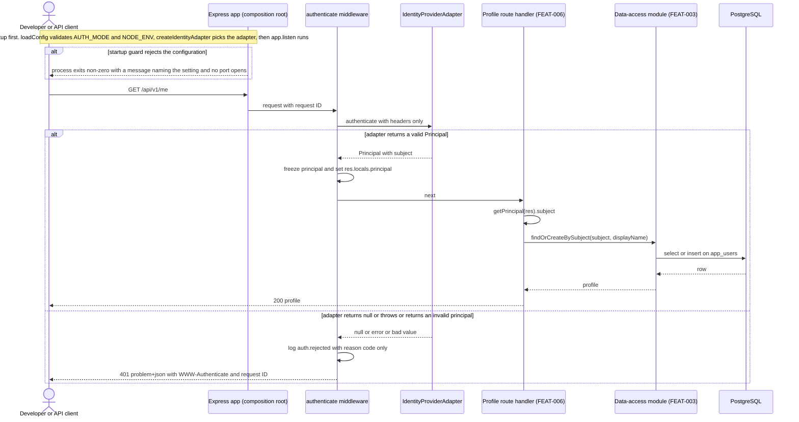
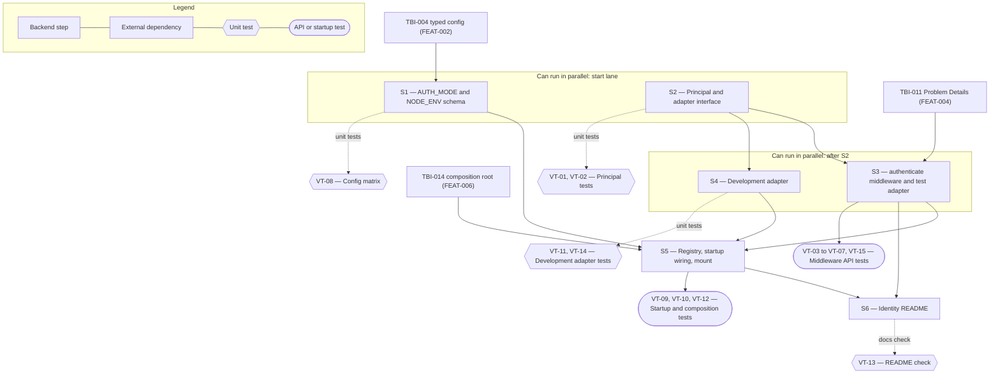

# Technical Specification — Identity Provider Adapter

> **PRD slug:** `full-stack-express-starter-template` | **Owning layer:** `templates/full-stack-express/apps/api/src/identity/` (template API app; no Apex `src/` change) | **Surface:** Backend only
> **Verification builds:** Template: `pnpm check` and `pnpm test` from `templates/full-stack-express/`. Apex must stay unchanged: `npx tsc -p tsconfig.server.json --noEmit` and `npx tsc -p tsconfig.client.json --noEmit`.
> **Open items:** See [design-doc-assumptions.md](design-doc-assumptions.md) (4 unresolved)
> **Design doc:** [design-doc-design.md](design-doc-design.md)

In this document `<template>` means `templates/full-stack-express/`. Directory names under `<template>` are assumptions listed in the assumptions file.

---

## System Boundary and Owning Layer

**Owning layer:** `<template>/apps/api/src/identity/` (new module), with a small extension to `<template>/apps/api/src/config/` (environment schema). No Apex layer (`src/server/services/`, `src/server/routes/`, `src/client/components/`, `src/shared/types/`, `migrations/`) owns any of this work.

**Rationale:** The principal contract, the adapter interface, and the middleware are server concerns that every API route depends on. They sit in their own module so a project replaces the adapter without touching route handlers or the profile service. The principal is a server-internal value that never crosses the HTTP boundary, so it does not belong in the contracts package. The contracts package supplies only the Problem Details schema that the 401 response uses. BR-008 and the PRD forbid changes to Apex, so nothing under Apex's `src/` is edited and nothing is imported from it.

**Ownership answers:**
- New or existing Express service in `src/server/services/`? No — Apex is untouched. The template equivalent is a new module, `<template>/apps/api/src/identity/`, with no business service. The profile service (FEAT-006) consumes `Principal` from it.
- New or existing route in `src/server/routes/`? No — the Feature adds no route. It adds middleware that guards the existing `/api/v1` router. `/health/live` and `/health/ready` stay outside it.
- New React component in `src/client/components/`? No — backend-only. The web client needs no change for this Feature.
- New shared type in `src/shared/types/`? No — `Principal` stays inside the API app. The contracts package already carries the Problem Details schema (TBI-011) and gets no new export.
- Database migration needed? No — the Feature stores nothing. The subject it returns is consumed by `app_users` (FEAT-003), which owns that schema.

---

## Security Enforcement

- **Authorization mechanism:** Authentication only. The template defines no roles or permissions (BR-003), so none of Apex's RBAC mechanisms apply: not `requirePermission`, not `can('…')`, and not the permission catalog in `rbac-governance.mdc`. The mechanism is one `authenticate` middleware, created by `createAuthMiddleware({ adapter, logger })` and mounted once on the `/api/v1` router in `<template>/apps/api/src/app.ts`. A route added under `/api/v1` is protected without any per-route call. Apex's `ensureAuthenticated` in `src/server/middleware/auth.ts` is the closest prior art for the shape (an Express middleware that returns 401 before the handler runs). The template deviates in three ways: it returns RFC 9457 Problem Details with a request ID (Apex returns `{ error: 'Not authenticated' }`), it logs no identity or session values (Apex logs `sessionID`), and it applies at the router mount rather than per mount call.
- **Layer that enforces scope:** Both. Route middleware decides who is calling (`authenticate`). The service layer decides whose data is touched: the profile service (FEAT-006) takes the external subject from `getPrincipal(res)` and never from request input (BR-001). This Feature owns the first half and exposes the accessor for the second.
- **Sensitive data handling:** `subject`, `displayName`, and `email` are identity values (BR-007).
  - The middleware logs only a reason code (`no_principal`, `adapter_error`, `invalid_principal`) and, for `adapter_error`, the error class name. It never logs the error message, request headers, or any principal field.
  - The 401 body uses a fixed `detail` ("Authentication is required.") and carries no value from the adapter.
  - The principal is frozen (`Object.freeze`) before it goes on `res.locals`, so a handler cannot change it.
  - The `res.locals.principal` path and the three field names go on the Pino redaction list owned by TBI-016 (FEAT-007), so a stray log call still masks them.
- **Development adapter containment:** the adapter is the only way to run unauthenticated, so three checks guard it.
  1. The Zod environment schema rejects `AUTH_MODE=development` when `NODE_ENV=production` (S1).
  2. `createIdentityAdapter(config)` repeats the check and throws (S5).
  3. The `DevelopmentAdapter` constructor throws when `NODE_ENV=production` (S4).
  All three run before `app.listen`. `NODE_ENV` and `AUTH_MODE` have no default, so a missing value aborts startup. A mistyped `NODE_ENV` (`prod`, `Production`) also aborts, because the schema accepts only `development`, `test`, and `production`.
- **Provider outage behavior:** deny with 401 if the adapter throws or times out. This is the one place where the authentication check can be unable to decide. The log reason (`adapter_error`) separates it from a missing credential.

---

## Architecture and Approach

### Layers touched

| Layer | Changed | Notes |
|-------|---------|-------|
| Template API identity module (`<template>/apps/api/src/identity/`) | Yes | New: `principal.ts`, `adapter.ts`, `authMiddleware.ts`, `developmentAdapter.ts`, `registry.ts`, `README.md` |
| Template API config (`<template>/apps/api/src/config/`) | Yes | Extend the TBI-004 Zod schema with `AUTH_MODE` and the `NODE_ENV` enum and cross-field rule; add both to `.env.example` |
| Template API composition root (`<template>/apps/api/src/app.ts`, `server.ts`) | Yes | Build the adapter before `listen`; mount `authenticate` on `/api/v1`. The files belong to TBI-014 (FEAT-006); this Feature adds the wiring lines only |
| Template contracts package (`<template>/packages/contracts/`) | No | Consumed only: the Problem Details schema and error builder from TBI-011 |
| Server services (`src/server/services/`) | No | Apex untouched |
| Server routes (`src/server/routes/`) | No | Apex untouched; no new route |
| Server middleware (`src/server/middleware/`) | No | Apex's `ensureAuthenticated` is prior art only and is not imported |
| Client components (`src/client/components/`) | No | Backend-only |
| Client hooks (`src/client/hooks/`) | No | Backend-only |
| Shared types (`src/shared/types/`) | No | `Principal` is server-internal |
| Database (migrations/) | No | No stored data |
| Drizzle schema (`src/server/db/schema.ts`) | No | `app_users` belongs to FEAT-003 |

### Per-work-item design decisions

**TBI-012 — Define the principal contract, adapter interface, and authentication middleware**
- Pattern followed: Apex's `ensureAuthenticated` middleware shape (`src/server/middleware/auth.ts`), and the middleware order that the `fullstack-node-bff` skill documents (authentication mounted before routes). The error body follows the RFC 9457 schema in the contracts package (TBI-011), not Apex's plain JSON.
- Key decisions:
  - **Contract.** In `principal.ts`:
    ```ts
    export interface Principal {
      readonly subject: string;       // external identity subject, non-empty, at most 255 characters
      readonly displayName?: string;
      readonly email?: string;
    }
    ```
    The same file exports `principalSchema` (Zod). The middleware validates what the adapter returns, because a project writes the adapter and an empty subject must not reach a handler. There is no role, permission, group, or free-form claims field (BR-003). Reason: a claims bag invites handlers to read provider-specific fields and ties them to one provider. Alternative rejected: put `Principal` in the contracts package. The principal never goes over HTTP, and a public schema would invite clients to send one.
  - **Adapter interface.** In `adapter.ts`:
    ```ts
    export interface AdapterRequest {
      readonly headers: IncomingHttpHeaders;
    }
    export interface IdentityProviderAdapter {
      /** Defaults to "Bearer". Sent in WWW-Authenticate on every 401. */
      readonly challenge?: string;
      /** Return a Principal, or null when the request cannot be authenticated. May throw. */
      authenticate(request: AdapterRequest): Promise<Principal | null>;
    }
    ```
    The adapter sees headers, not the Express `Request`. Reason: the adapter stays testable without Express, and a provider that reads `Authorization` or `Cookie` has what it needs. Alternative rejected: pass `req` and `res` (adapters could write responses or read `res.locals`, which breaks "swapping the adapter needs no handler change").
  - **Middleware.** `authMiddleware.ts` exports `createAuthMiddleware({ adapter, logger })`. Flow: call `adapter.authenticate({ headers: req.headers })`; on `null`, a throw, or a result that fails `principalSchema`, log `auth.rejected` with a reason code and respond 401; otherwise freeze the principal, set `res.locals.principal`, and call `next()`. The 401 uses the TBI-011 Problem Details builder, content type `application/problem+json`, the request ID from the request-ID middleware, and `WWW-Authenticate: <adapter.challenge ?? 'Bearer'>`. `logger` is a narrow interface (`warn(fields)`), so this module compiles before TBI-016 exists. Express 5 forwards rejected promises to the error handler, but the middleware catches adapter errors itself so they always become a 401, not a 500.
  - **Accessor.** `getPrincipal(res): Principal` reads `res.locals.principal` and throws when it is absent. The central error handler (TBI-014) turns that throw into a generic 500 Problem Details. Reason: a route mounted outside the middleware by mistake produces a loud server error, not a silent anonymous request. Alternative rejected: augment `Express.Request` with `principal`. Global augmentation leaks into every package that imports Express types and lets a handler read a value the middleware never set.
  - **Mount point.** `app.use('/api/v1', authenticate, v1Router)` in `app.ts`. Health routes are mounted before it.

**TBI-013 — Add the development adapter and the production startup guard**
- Pattern followed: Apex gates dev-only behavior on an environment read in `src/server/middleware/devEnvAccess.ts` (`getAppEnvironment() !== 'dev'`). The template deviates: that check runs on every request in Apex. Here the check runs once at startup in the Zod schema, and a bad combination stops the process before it listens (BR-010).
- Key decisions:
  - **Config rule (S1).** Extend the TBI-004 schema: `NODE_ENV: z.enum(['development','test','production'])` and `AUTH_MODE: z.enum(['development','provider'])`, neither with a default, plus a `superRefine` that adds an issue on `AUTH_MODE` when `AUTH_MODE === 'development' && NODE_ENV === 'production'`. Messages:
    - `Invalid environment: AUTH_MODE is required (one of: development, provider).`
    - `Invalid environment: AUTH_MODE=development is not allowed when NODE_ENV=production.`
    Alternative rejected: treat `NODE_ENV !== 'production'` as "non-production" inside the factory only. A typo such as `prod` would then pass the guard on a real deployment.
  - **Adapter (S4).** `developmentAdapter.ts` exports `DEVELOPMENT_PRINCIPAL` (frozen: subject `synthetic-dev-subject`, display name `Synthetic Developer`, email `synthetic.developer@example.invalid`) and `createDevelopmentAdapter({ nodeEnv, logger })`. `authenticate` ignores its argument and returns the constant. The factory throws if `nodeEnv === 'production'`. It logs one startup warning, `auth.development_adapter_active`, with no identity values. The constant is exported so the seed command (TBI-010) and tests use the same values.
  - **Factory and registry (S5).** `registry.ts` exports `createIdentityAdapter(config, deps)`: an exhaustive `switch` on `config.AUTH_MODE` (a `never` check forces a new case when a mode is added). `development` repeats the production check and returns the development adapter. `provider` throws `AUTH_MODE=provider requires an adapter registered in apps/api/src/identity/registry.ts.` The file is the single place a project edits to plug in its provider.
  - **Ordering.** `server.ts` runs `loadConfig()`, then `createIdentityAdapter()`, then builds the app, then `app.listen`. Any throw before `listen` exits the process non-zero with the message, and no port opens.

**PBI-008 — Use protected routes locally without an identity provider**
- Pattern followed: the same middleware and factory as TBI-012 and TBI-013; no extra code.
- Key decisions: (a) is proven through the full composition (`createApp` with `AUTH_MODE=development`) so it covers the real mount point (VT-10). (b) and (c) are proven by starting the server function and checking that no port opened (VT-09). (d) is the negative path of the middleware (VT-03). Example env file ships `AUTH_MODE=development` and `NODE_ENV=development` so the "no other configuration" definition of done holds.

**PBI-009 — Replace the adapter with the production identity provider**
- Pattern followed: the registry `switch` in `registry.ts`; the adapter README in `<template>/apps/api/src/identity/README.md`.
- Key decisions:
  - A provider adapter implements `IdentityProviderAdapter`, verifies credentials before returning a principal, and returns `null` or throws on any doubt (the NFR "must verify credentials before returning a principal"). It sets `challenge` if its scheme is not `Bearer`.
  - The README (S6) has these sections: the contract; a step list for writing a provider adapter and registering it; the test adapter pattern; the logging rule (no identity values, no error messages); **Roles and RBAC**, which states "The template defines no roles or permissions" and says RBAC would attach as a project-owned `authorize` middleware mounted after `authenticate` in `app.ts`, reading an extended `Principal`. Link it from the API module map (owned by the knowledge-base Feature).
  - Swap proof (VT-07): the same probe route module runs under two different adapters with no code change.

---

## Data and Contracts

### API endpoints

No endpoint is added. The Feature changes how existing endpoints authenticate.

| Method | Route | Request shape | Response shape | Auth |
|--------|-------|--------------|----------------|------|
| Any | `/api/v1/*` | Credentials in headers, in whatever form the active adapter reads. The development adapter reads none | Handler response on success. On failure: `401` with `ProblemDetails` (`application/problem+json`: `type`, `title`, `status`, `detail` = "Authentication is required.", request ID member), headers `WWW-Authenticate` and the request ID header | `authenticate` middleware (adapter returns a valid `Principal`) |
| GET | `/health/live`, `/health/ready` | None | Unchanged (FEAT-006) | None; mounted outside `authenticate` |

Route definitions for protected endpoints in the contracts package declare the `401` response and the `WWW-Authenticate` header (TBI-011 already requires each route to declare its error responses). The OpenAPI drift check then covers the 401 shape.

### Schema / storage changes

| Target | Change | Reason |
|--------|--------|--------|
| `app_users` | None | The Feature stores nothing. FEAT-003 owns the table; FEAT-006 passes `principal.subject` to it |
| Environment schema (`<template>/apps/api/src/config/`) and `.env.example` | Add required `AUTH_MODE` (`development` or `provider`). Change `NODE_ENV` to a required enum (`development`, `test`, `production`). Add the cross-field rule. Add both variables to `.env.example` with development values and no secrets | Select the adapter from configuration and stop startup on an unsafe combination (BR-002, BR-010) |

---

## Testing Strategy

Runner and layers follow the template's reference stack (Vitest, Supertest), which mirrors Apex's Jest and Supertest layering. Coverage floors from BR-012 apply: 80% lines, functions, and statements; 75% branches. Tests assert status codes, Problem Details bodies, captured log output, and process behavior, not internal calls.

**Unit tests:**
- `principalSchema` — accepts a subject-only principal; rejects an empty subject, a subject over 255 characters, and non-string fields (VT-01).
- `Principal` type — `expectTypeOf<keyof Principal>()` equals `'subject' | 'displayName' | 'email'`, so no role or permission field can appear without a failing test (VT-02).
- Environment schema — every `AUTH_MODE` × `NODE_ENV` combination, including unset and mistyped values; error text names the variable (VT-08).
- Development adapter — returns the same frozen principal for any request; constructor throws in production; startup warning logs once and holds no identity value (VT-11, VT-14).
- `createIdentityAdapter` — `provider` with no registered adapter throws the named message (VT-12).

**Integration tests:**
- Middleware through Supertest on a probe app with the static test adapter (`apps/api/test/support/staticAdapter.ts`, never part of the production build): 401 shape and headers (VT-03), principal read only from the middleware (VT-04), adapter that throws with secret-looking text produces a clean 401 and clean logs (VT-05), principal with no email or display name (VT-06), two adapters under one handler (VT-07), invalid principal from the adapter (VT-15).
- Composition tests on `createApp` with `AUTH_MODE=development` (VT-10).
- Startup tests that call the server start function with a given environment, then try to connect to the configured port (VT-09, VT-12).
- Log capture uses the Pino test destination from TBI-016. Assertions search captured output for the fixture subject, display name, email, and a fake token string.
- No PostgreSQL container is needed for these tests; the probe route does not touch the database.

**E2E tests (if applicable):**
- None specific to this Feature. The Playwright profile journey in the web client Features runs through the development adapter, and a failure there would show a break in VT-10.

---

## Observability

- **Custom events/metrics:** Two structured log events, both free of identity values.
  - `auth.rejected` — fields: `reason` (`no_principal` | `adapter_error` | `invalid_principal`), and `errorName` when `reason` is `adapter_error`. Logged at `warn`, with the request ID that the logging middleware already attaches.
  - `auth.development_adapter_active` — logged once at startup at `warn`, fixed text, no fields.
  No custom OpenTelemetry metric is added. If a project wants a rejection counter, it can count `auth.rejected` from logs or add a meter inside its own adapter.
- **Alerts:** None. Projects decide alerting on `auth.rejected` volume with Platform Engineering.

---

## Rollback and Deployment

- **Schema changes backward compatible:** Yes — there is no schema change. The only configuration change is two new required environment variables.
- **Rollback procedure:** Revert the commit that adds the identity module and the environment schema change. The template is not deployed by Apex, and Apex runtime is unaffected. In a consuming project, a rollback restores whatever authentication the project had before; set `AUTH_MODE` and `NODE_ENV` in the environment before deploying a build that includes this Feature.
- **Deployment dependencies:** Two items for Platform Engineering, both recorded in the handoff document.
  1. Every deployed environment sets `NODE_ENV=production` and `AUTH_MODE=provider` (see the environment-signal ⚠ item).
  2. The template as shipped does not start with `AUTH_MODE=provider`, because no provider adapter is registered. A production build starts only after the project implements and registers one. This is intended.
- **Feature flag gates deployment:** No — the PRD states no Feature Flag is required.

---

## Verification Test Matrix

| ID | Layer | Arrange | Act | Assert | Linked |
|----|-------|---------|-----|--------|--------|
| VT-01 | Vitest unit | `principalSchema` | Parse `{ subject: 's-1' }`; parse `{ subject: '' }`; parse a 256-character subject; parse `{ subject: 's-1', email: 42 }` | First parse succeeds with no other field required. The other three fail with a path naming the field | PBI-009 (c), TBI-012 |
| VT-02 | Vitest type test | `Principal` interface | `expectTypeOf<keyof Principal>().toEqualTypeOf<'subject' \| 'displayName' \| 'email'>()` | Test compiles and passes. Adding `roles` or `permissions` to `Principal` fails `pnpm check` | TBI-012, PBI-008 (BR-003) |
| VT-03 | Supertest | Probe app: `authenticate` with a static adapter that returns `null`; protected route `GET /api/v1/probe` | Call the route with no headers | Status 401, `Content-Type: application/problem+json`, body validates against the contracts `ProblemDetails` schema, request ID header present, `WWW-Authenticate: Bearer`, handler never ran | PBI-008 (d), TBI-012 |
| VT-04 | Supertest | Static adapter returns subject `fixture-subject-a`; handler returns `getPrincipal(res).subject` | Call with headers `x-user: other` and `x-subject: other` | Response subject is `fixture-subject-a`. Calling `getPrincipal` on a route mounted without the middleware returns a generic 500 Problem Details | TBI-012 |
| VT-05 | Supertest + log capture | Adapter throws `new Error('token=abc123 subject=fixture-subject-a')`; Pino test destination | Call a protected route with `Authorization: Bearer abc123` | Status 401 Problem Details. Captured logs hold `auth.rejected` with `reason: adapter_error` and the error class name. Logs and response body contain none of `abc123`, `fixture-subject-a`, or the header value | PBI-009 (b) |
| VT-06 | Supertest | Static adapter returns `{ subject: 'fixture-subject-a' }` only | Call a handler that reads the principal | Status 200. Handler received `displayName` and `email` as `undefined` and did not throw | PBI-009 (c) |
| VT-07 | Supertest | One probe router module; adapter A (static) and adapter B (a different class that reads a fixture `x-fixture-token` header) | Build two apps from the same router with different adapters; call each | Both return their own principal's subject. The router module is identical in both apps (no per-adapter branch) | PBI-009 (a), TBI-012 |
| VT-08 | Vitest unit | Environment schema | Parse each combination: `development`×`development`, `development`×`test`, `development`×`production`, `provider`×`production`, `AUTH_MODE` unset, `AUTH_MODE=Development`, `NODE_ENV` unset, `NODE_ENV=prod` | First two parse. `development`×`production` fails with the `not allowed when NODE_ENV=production` message. `provider`×`production` parses. Every other case fails with an error that names `AUTH_MODE` or `NODE_ENV` and prints no value from a secret variable | PBI-008 (b), PBI-008 (c), TBI-013 |
| VT-09 | Vitest integration | Server start function, free test port | Start with `NODE_ENV=production`, `AUTH_MODE=development`; then start with `AUTH_MODE` unset | Both calls reject before listening. Error message for the first names the unsafe combination, for the second names `AUTH_MODE`. A TCP connect to the port is refused. No development adapter is created | PBI-008 (b), PBI-008 (c), TBI-013 |
| VT-10 | Supertest | `createApp` with `AUTH_MODE=development`, `NODE_ENV=development`; protected route that returns the principal subject | Call the route with no credentials; call again with `Authorization: Bearer x` and `x-user: other` | Both return `synthetic-dev-subject` (the `DEVELOPMENT_PRINCIPAL` value). Headers change nothing | PBI-008 (a), TBI-013 |
| VT-11 | Vitest unit | `createDevelopmentAdapter` | Build with `nodeEnv: 'production'`; build with `development`; call `authenticate` with three different header sets | First build throws. Second returns an adapter whose three results are the same frozen object with synthetic values (email ends in `.invalid`) | TBI-013 |
| VT-12 | Vitest unit + integration | `createIdentityAdapter` with `AUTH_MODE=provider` and the template registry; then a test registry with one adapter | Call the factory; call the server start function | Template registry: factory throws `AUTH_MODE=provider requires an adapter registered in apps/api/src/identity/registry.ts.` and no port opens. Test registry: the app starts and routes resolve the principal from that adapter | PBI-009 (a), TBI-013 |
| VT-13 | Vitest unit (docs check) | `apps/api/src/identity/README.md` | Read headings and the Roles and RBAC section | Heading `Roles and RBAC` exists, the text states that roles are not defined, and the text names `authenticate` and `app.ts` as the attach point. Add the file to the docs validator's required-section list when that validator exists | PBI-009 (d) |
| VT-14 | Vitest unit + log capture | `createDevelopmentAdapter` with Pino test destination | Build the adapter | Exactly one `auth.development_adapter_active` entry at `warn`. Output holds no subject, display name, or email | TBI-013 |
| VT-15 | Supertest | Adapter returns `{ subject: '' }`, then `{ subject: 'x'.repeat(256) }` | Call a protected route twice | Both return a 401 Problem Details. Logs hold `reason: invalid_principal`. Handler never ran | PBI-009 (b), TBI-012 |

---

## Implementation Plan

- [ ] S1 — Extend the environment schema with `AUTH_MODE` and the `NODE_ENV` enum and cross-field rule; update `.env.example` _(blocked by TBI-004 in FEAT-002; no blockers inside this Feature)_
  - Covers: `VT-08`
- [ ] S2 — Add `principal.ts` (`Principal`, `principalSchema`) and `adapter.ts` (`IdentityProviderAdapter`, `AdapterRequest`) _(blocked by FEAT-001 workspace; no blockers inside this Feature)_
  - Covers: `VT-01`, `VT-02`
- [ ] S3 — Add `authMiddleware.ts` (`createAuthMiddleware`, `getPrincipal`), the 401 Problem Details response, and `apps/api/test/support/staticAdapter.ts` _(blocked by S2; also blocked by TBI-011 in FEAT-004 for the Problem Details builder)_
  - Covers: `VT-03`, `VT-04`, `VT-05`, `VT-06`, `VT-07`, `VT-15`
- [ ] S4 — Add `developmentAdapter.ts` with `DEVELOPMENT_PRINCIPAL`, the production check, and the startup warning _(blocked by S2; can parallel with S3)_
  - Covers: `VT-11`, `VT-14`
- [ ] S5 — Add `registry.ts` (`createIdentityAdapter`) and wire it into `server.ts` before `listen`, and `authenticate` onto `/api/v1` in `app.ts` _(blocked by S1, S3, S4; also blocked by TBI-014 in FEAT-006 for the composition root files)_
  - Covers: `VT-09`, `VT-10`, `VT-12`
- [ ] S6 — Write `apps/api/src/identity/README.md` with the contract, the provider adapter steps, and the Roles and RBAC section; link it from the API module map _(blocked by S3, S5)_
  - Covers: `VT-13`

**Execution lanes:**
- Lane 1 (start immediately, given TBI-004 and FEAT-001 are done): S1, S2
- Lane 2 (after S2): S3, S4
- Lane 3 (after S1, S3, S4): S5
- Lane 4 (after S3, S5): S6

---

## Diagram 1 — Code Execution Flow

The Feature is backend-only, so the flow starts at an HTTP client and has no React or hook step. The path shown is a `GET /api/v1/me` request (FEAT-006) through the adapter.



---

## Diagram 2 — Implementation Dependency Map


