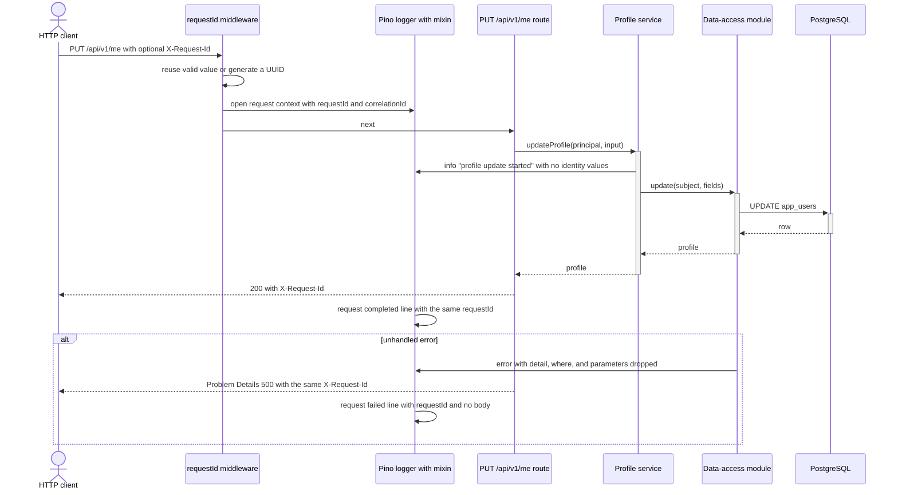
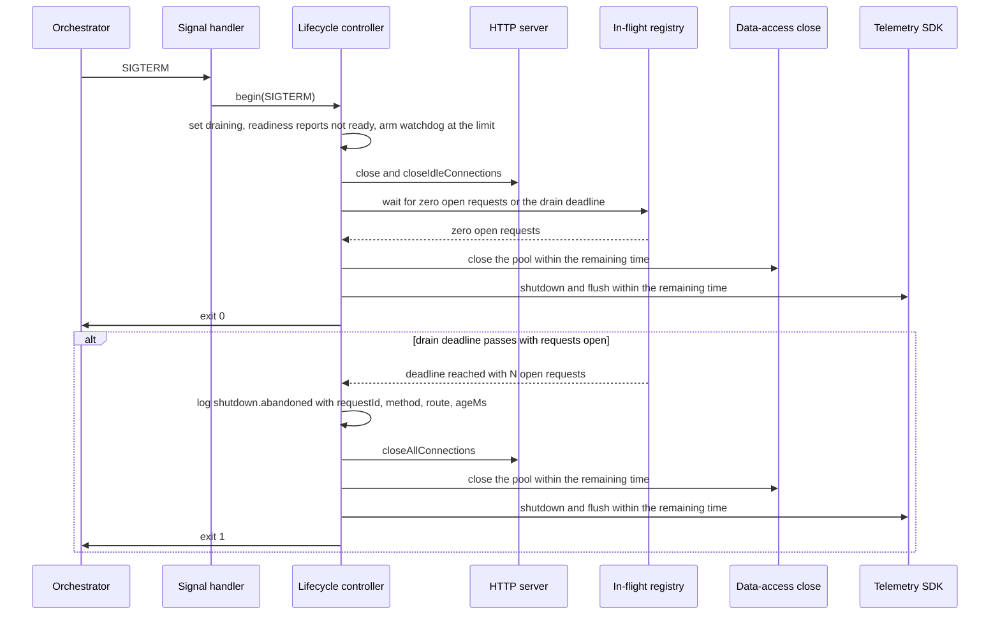
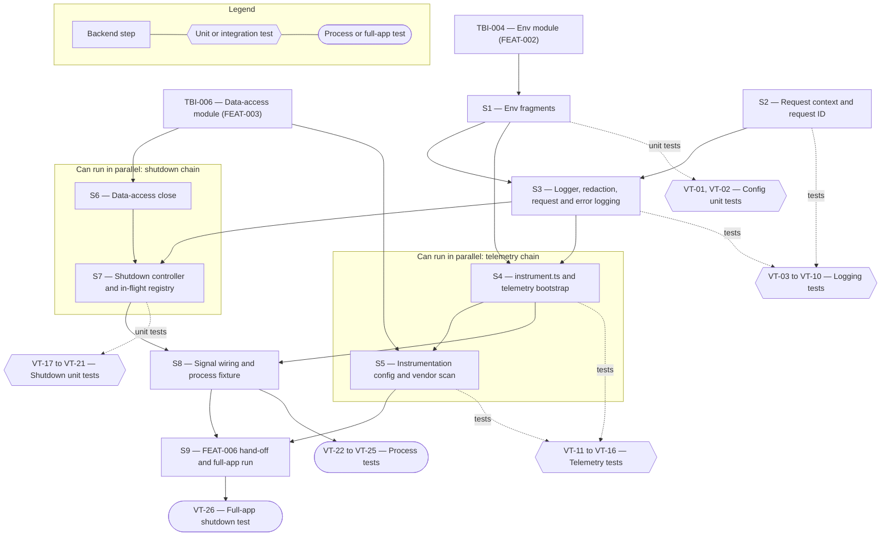

# Technical Specification — Observability and Graceful Shutdown

> **PRD slug:** `full-stack-express-starter-template` | **Owning layer:** `templates/full-stack-express/apps/api/src/` (full-stack template, backend-only work) | **Surface:** Backend only
> **Verification builds:** `pnpm --dir templates/full-stack-express build`, `pnpm --dir templates/full-stack-express check`, `pnpm --dir templates/full-stack-express test` (the named scripts from TBI-005). Apex's own `npx tsc -p tsconfig.server.json --noEmit` and `npx tsc -p tsconfig.client.json --noEmit` must give the same result with and without the template folder.
> **Open items:** See [design-doc-assumptions.md](design-doc-assumptions.md) (4 unresolved)
> **Design doc:** [design-doc-design.md](design-doc-design.md)

---

## System Boundary and Owning Layer

**Owning layer:** `templates/full-stack-express/apps/api/src/` — new folders `observability/` and `lifecycle/`, one new entry file `instrument.ts`, and edits to `config/env.ts` and the data-access module. Nothing outside `templates/full-stack-express/` changes.

**Rationale:** The PRD places observability and shutdown in the API application's composition root ("wires middleware, routes, identity, observability, and shutdown"). The work is process-level plumbing: middleware, a logger, an OpenTelemetry bootstrap, and a signal-driven controller. None of it is business logic, so it needs no service layer. The contracts package keeps its role. It already declares the request ID header (TBI-011), so this Feature adds no route and no contract. Apex's `src/server/`, `src/client/`, `src/shared/`, and `migrations/` are out of bounds (BR-008, PRD "Any change to Apex runtime behavior").

**Ownership answers:**
- New or existing Express service in `src/server/services/`? No — Apex's `src/server/services/` is untouched. In the template this Feature adds no business service. It adds `observability/` and `lifecycle/` modules in `apps/api/src/`, and one method (`close()`) to the existing data-access module from TBI-006.
- New or existing route in `src/server/routes/`? No — no route is added. The Feature mounts middleware (request ID, request logging, error logging, in-flight tracking). The readiness handler from PBI-012 (FEAT-006) reads `lifecycle.isShuttingDown()`, and FEAT-006 owns the route.
- New React component in `src/client/components/`? No — backend only. The template web client is untouched.
- New shared type in `src/shared/types/`? No — `packages/contracts` already declares `X-Request-Id`. The new types (`Lifecycle`, `ShutdownDeps`, `TelemetryHandle`) are internal to `apps/api` and not shared with the web client.
- Database migration needed? No — no table or column changes. `app_users` is unchanged, and the application never changes schema at startup (BR-006).

---

## Security Enforcement

- **Authorization mechanism:** None added. The template defines no roles or permissions (BR-003), so Apex's guards from `rbac-governance.mdc` (for example `can('admin:roles')` or `requirePermission('prds:review')`) and `ensureAuthenticated` do not apply here. No HTTP endpoint starts a shutdown, reads logs, or changes telemetry settings. Control sits with whoever owns the process (a termination signal) and the deployment environment (variables).
- **Layer that enforces scope:** The `observability/` module enforces BR-007 in one place: allowlist serializers, key-based redaction, a typed error serializer, and instrumentation config with header, body, and enhanced database reporting turned off. The data-access module (TBI-006) enforces the second rule: it returns typed errors and never raw `pg` errors. Route handlers cannot widen what gets logged because they never receive a raw logger configuration.
- **Sensitive data handling:** Display name, email, and external subject must not appear in logs, span attributes, metrics, or API error bodies.
  - Logs: whitelist serializers log `method`, the path without query string, status, duration, and IDs. They never log bodies, headers, or cookies. The `err` serializer keeps `type`, `code`, `message`, and `stack`, and drops `detail`, `where`, `parameters`, and query text, because a PostgreSQL unique violation puts the offending value in `detail`.
  - Redaction: the names in `IDENTITY_FIELD_NAMES` (`displayName`, `display_name`, `email`, `externalSubject`, `external_subject`, `subject`, `sub`) are replaced with `[Redacted]` at depths 0–3. Tests loop over that one constant.
  - Telemetry: `HttpInstrumentation` captures no request or response headers, `PgInstrumentation` runs with `enhancedDatabaseReporting: false` so SQL parameters never reach spans, and the application code sets no custom span attributes.
  - Exporter secrets: `OTEL_EXPORTER_OTLP_HEADERS` can carry credentials. Config errors name the variable only. Startup logs report enabled state and exporter names, never the endpoint or headers.

---

## Architecture and Approach

### Layers touched

| Layer | Changed | Notes |
|-------|---------|-------|
| Server services (`src/server/services/`) | No | Apex is untouched. The template has no service layer change for this Feature. |
| Server routes (`src/server/routes/`) | No | Apex is untouched. No route added in the template. |
| Server middleware (`src/server/middleware/`) | No | Apex is untouched. Template middleware is listed in the next table. |
| Client components (`src/client/components/`) | No | Backend only. |
| Client hooks (`src/client/hooks/`) | No | Backend only. |
| Shared types (`src/shared/types/`) | No | No contract change. `X-Request-Id` already exists in `packages/contracts`. |
| Database (migrations/) | No | No schema change. |
| Drizzle schema (`src/server/db/schema.ts`) | No | No schema change. |

**Template layers touched** (all under `templates/full-stack-express/apps/api/src/`):

| Path | Changed | Notes |
|------|---------|-------|
| `config/env.ts` | Yes (extend) | Adds Zod fragments for `LOG_LEVEL`, `SHUTDOWN_TIMEOUT_MS`, and the OpenTelemetry variables. `.env.example` lists each. Owned by TBI-004. |
| `observability/requestContext.ts` | Yes (new) | `AsyncLocalStorage` store with `requestId`, `correlationId`, and `startedAt`. |
| `observability/requestId.ts` | Yes (new) | Express middleware: validate, reuse or generate, set `X-Request-Id`, open the context. |
| `observability/redaction.ts` | Yes (new) | `IDENTITY_FIELD_NAMES`, Pino `redact` paths, and the `err`, `req`, and `res` serializers. |
| `observability/logger.ts` | Yes (new) | `createLogger(env, destination?)`. A `mixin` adds `requestId`, `correlationId`, `trace_id`, and `span_id`. |
| `observability/requestLogging.ts` | Yes (new) | `pino-http` configured with the serializers; probe paths log at `debug`. |
| `observability/errorLogging.ts` | Yes (new) | Error middleware that logs the error and calls `next(err)`. TBI-014's Problem Details handler runs after it. |
| `instrument.ts` | Yes (new) | Loaded with `node --import` before application code. Builds and starts the OpenTelemetry SDK from validated env. |
| `observability/telemetry.ts` | Yes (new) | `startTelemetry(env)` returns a `TelemetryHandle { enabled, shutdown() }`; diagnostic logger adapter with 60-second de-duplication. |
| `lifecycle/inFlight.ts` | Yes (new) | Middleware and registry of open requests: id, method, route template, start time. |
| `lifecycle/shutdown.ts` | Yes (new) | `createShutdown(deps)` controller and `registerSignalHandlers`. |
| data-access module (from TBI-006) | Yes (extend) | Adds `close(): Promise<void>` that ends the `pg` pool. |
| `main.ts` and the Express app factory (TBI-014, FEAT-006) | Hand-off | FEAT-006 mounts the middleware and calls `registerSignalHandlers`. |

### Per-work-item design decisions

**TBI-016 — Add Pino structured logging with request IDs and redaction**
- Pattern followed: Apex validates environment with Zod in one module (`src/client/config/env.ts`, described in the `fullstack-node-bff` skill). The template extends its own `config/env.ts` the same way. Apex has no Pino logger to copy, because Apex uses Azure Application Insights, which the template excludes as Apex-specific. This is a deliberate deviation.
- Key decisions:
  - **One module-level logger with a `mixin`**, not a logger passed through calls. The mixin reads the `AsyncLocalStorage` store, so a log call in the data-access module carries the request ID with no plumbing. The alternative, `req.log` only, would leave service and data-access logs without the ID and fail PBI-013 (a).
  - **The completion line takes its ID from `pino-http`'s `req.id`** (mapped to `requestId`), not from `AsyncLocalStorage`. A `res.on('finish')` listener may run outside the request's async context, and this avoids depending on it.
  - **Request ID rule:** reuse a caller `X-Request-Id` that matches `^[A-Za-z0-9._-]{1,64}$`; otherwise call `crypto.randomUUID()`. The middleware sets the response header before it calls `next()`, so error and not-found responses carry it too.
  - **Correlation ID:** a valid `X-Correlation-Id` header, otherwise the request ID. Log-only.
  - **Redaction is key-based, with allowlist serializers.** A scanner that searches every log line for identity values was rejected, because it adds string work to the request path and cannot see values that were never in the request context.
  - **Level and format:** `LOG_LEVEL` (`fatal`, `error`, `warn`, `info`, `debug`, `trace`, `silent`; default `info`). Output is always single-line JSON to stdout through an asynchronous destination. Pretty printing is a developer-side pipe.
  - **Boundary with TBI-014:** this item ships the middleware. TBI-014 mounts it first in the chain, so every response, including the not-found response, carries the ID.

**TBI-017 — Add OpenTelemetry traces and metrics with environment-configured exporters**
- Pattern followed: the same Zod environment module (`config/env.ts`) validates every `OTEL_*` variable at startup, so a malformed value aborts startup as BR-010 requires. For the diagnostic logger adapter, no Apex pattern exists. Apex's telemetry client is Application Insights and is not reused.
- Key decisions:
  - **Load order:** `instrument.ts` runs through `node --import ./dist/instrument.js dist/main.js`, so instrumentation patches `http`, `express`, and `pg` before they load. It parses only the telemetry fragment of the Zod schema that `config/env.ts` exports, so there is one schema. `main.ts` validates the full environment right after (⚠ module format, see assumptions).
  - **Enablement:** the SDK starts only when `OTEL_SDK_DISABLED` is not `true` and an OTLP endpoint is set, or an exporter is `console`. In any other case the application never constructs the SDK, the API stays a no-op, and `shutdown()` resolves at once.
  - **Exporters:** OTLP over HTTP (`@opentelemetry/exporter-trace-otlp-http`, `@opentelemetry/exporter-metrics-otlp-http`). The SDK reads `OTEL_EXPORTER_OTLP_ENDPOINT`, `OTEL_EXPORTER_OTLP_HEADERS`, and the batch and interval variables natively, so no application code names a vendor. ADOT and CloudWatch collectors accept OTLP, so PBI-014's goal needs no code change. gRPC is out.
  - **Instrumentation:** `HttpInstrumentation`, `ExpressInstrumentation`, and `PgInstrumentation` (driver `pg`). Header capture is off. `enhancedDatabaseReporting` is `false`. The application code sets no custom span attributes. Requests to `/health/live` and `/health/ready` are excluded from tracing so probes do not flood spans.
  - **Metrics:** the HTTP server request duration histogram comes from `HttpInstrumentation`. The database call histogram comes from the pinned `PgInstrumentation` release, or from a histogram recorded in the data-access pool wrapper if that release emits spans only (⚠ see assumptions).
  - **Export failures:** the OpenTelemetry diagnostic logger routes to Pino at `warn` through an adapter that logs the same message once per 60 seconds. Exports run in the SDK's background batch processors, so they never block a request.

**TBI-018 — Add graceful shutdown**
- Pattern followed: Apex's `src/server/services/interactiveActorHost/shutdownDrain` and its test `src/server/__tests__/interactiveActorHostShutdownDrain.test.ts`. It uses `createInFlightCounter`, an injected `exit`, `dispose`, and `log`, a drain deadline, and fake timers. The template keeps that shape: `createShutdown(deps)` takes every side effect as a dependency, so unit tests run it with fake timers and fakes and need no real signal.
- Key decisions:
  - **Deviation from Apex:** Apex polls a counter every `pollMs`. The template waits on the `server.close()` callback and a registry of open requests. The registry stores the request ID, method, and route template, which the "abandoned work" log line needs. Apex exits `0` at the deadline. The template exits `1` when it abandons requests (⚠ see assumptions).
  - **Sequence on the first `SIGTERM` or `SIGINT`:**
    1. Set the state to `draining`. Readiness now reports not ready (⚠ readiness response vs refused connections, see assumptions). Arm a watchdog timer at the full limit that calls `exit(1)`.
    2. Call `server.close()` and `server.closeIdleConnections()`.
    3. Set `Connection: close` on responses to requests that arrive on open connections. Those requests still run to completion.
    4. Wait for the server to close or for the drain deadline, `limit − cleanupBudget`, where `cleanupBudget = min(5000, 20% of limit)`.
    5. If the deadline passes with requests open, log `shutdown.abandoned` with the count and up to 20 entries (`requestId`, `method`, `route`, `ageMs`), then call `server.closeAllConnections()`.
    6. Run `db.close()`, then `telemetry.shutdown()`. Each is raced against the time left. A rejection or a timeout is logged as `shutdown.cleanup_failed` and does not stop the sequence.
    7. Flush the logger and call `exit(forced ? 1 : 0)`.
  - **Second signal:** treated as "the deadline is now". It skips the wait, runs the bounded cleanup, and exits `1`.
  - **No new work after exit:** `db.close()` ends the pool, so a later query rejects with the data-access module's typed error. The server closes before the pool, so no request can start a write after the pool ends.
  - **Hung telemetry:** `telemetry.shutdown()` can wait on an unreachable collector. The race against the remaining time and the watchdog keep the total at or under `SHUTDOWN_TIMEOUT_MS`.
  - **Signal delivery:** `registerSignalHandlers` registers once per process with `process.once`. The production container must run `node` directly so it receives the signal (see Rollback and Deployment).

**PBI-013 — Follow one request through the logs by its request ID**
- Pattern followed: same as TBI-016. The middleware order is request ID, request logging, in-flight tracking, routes, error logging, then TBI-014's Problem Details handler.
- Key decisions: PBI-013 (b) logs the error through `errorLogging.ts`, which uses the typed `err` serializer and no body. PBI-013 (c) is the request ID rule above, and the 64 and 65 character boundary has its own test (VT-07). PBI-013 (d) is proved with marker identity values taken from the synthetic seed fixtures (TBI-008).

**PBI-014 — Connect telemetry exporters through environment settings**
- Pattern followed: same as TBI-017. Platform Engineering's contract is the variable table in Data and Contracts.
- Key decisions: PBI-014 (a) and (b) are tested against a local OTLP stub (a Node HTTP server that records `POST /v1/traces` and `/v1/metrics`) and against a closed port. PBI-014 (d) is a source and dependency scan test (VT-16) that fails on vendor exporter names. It checks exit status and findings, like the PRD's other validators.

**PBI-015 — Stop an instance without dropping in-flight requests**
- Pattern followed: same as TBI-018.
- Key decisions: PBI-015 (a) to (c) are tested twice: with fake timers against `createShutdown`, and with a real child process that gets a real signal, so exit status and timing are real. PBI-015 (d) uses a probe route in the fixture app (VT-25) until FEAT-006 supplies `/health/ready` (VT-26).

---

## Data and Contracts

### API endpoints

This Feature adds no endpoint. It changes how existing endpoints behave:

| Method | Route | Request shape | Response shape | Auth |
|--------|-------|--------------|----------------|------|
| any | every route | Optional header `X-Request-Id` (reused if it matches `^[A-Za-z0-9._-]{1,64}$`, else replaced). Optional header `X-Correlation-Id` (same rule, log-only). | Header `X-Request-Id` on every response, including errors and not-found. | Unchanged. Template routes keep their own rules (BR-003). |
| GET | `/health/ready` (FEAT-006, PBI-012) | none | During shutdown: the not-ready status and body the contracts package defines for PBI-012. No connection strings, hosts, or error text. | None |
| GET | `/health/live` (FEAT-006, PBI-012) | none | Unchanged. Liveness stays successful while draining, and it never calls the database. | None |

### Environment variables (the contract Platform Engineering consumes)

| Variable | Type and default | Purpose |
|----------|------------------|---------|
| `LOG_LEVEL` | enum `fatal`, `error`, `warn`, `info`, `debug`, `trace`, `silent`; default `info` | Pino level (TBI-016) |
| `SHUTDOWN_TIMEOUT_MS` | integer 1000–120000; default `25000` | Total shutdown time limit (TBI-018) |
| `OTEL_SDK_DISABLED` | `true` or `false`; default `false` | Turns telemetry off explicitly (PBI-014 (c)) |
| `OTEL_SERVICE_NAME` | string; default `api` | Service name on spans and metrics |
| `OTEL_EXPORTER_OTLP_ENDPOINT` | URL; unset by default | Enables OTLP export. Also accepts `OTEL_EXPORTER_OTLP_TRACES_ENDPOINT` and `OTEL_EXPORTER_OTLP_METRICS_ENDPOINT`. |
| `OTEL_EXPORTER_OTLP_PROTOCOL` | `http/protobuf` only | Fixed protocol (assumptions) |
| `OTEL_EXPORTER_OTLP_HEADERS` | string; secret-bearing; unset by default | Collector credentials. Never logged. |
| `OTEL_TRACES_EXPORTER`, `OTEL_METRICS_EXPORTER` | `otlp`, `console`, or `none`; default `otlp` when an endpoint is set, else `none` | Per-signal exporter choice |
| `OTEL_METRIC_EXPORT_INTERVAL`, `OTEL_BSP_SCHEDULE_DELAY` | integer ms; SDK defaults | Read by the SDK. Tests set small values. |

Each variable goes into `.env.example` with a synthetic or empty value and no secret. A missing or malformed value aborts startup with an error that names the variable and never prints its value (BR-010).

### Log events

| `msg` | Level | Fields (no identity values) |
|-------|-------|-----------------------------|
| `request completed` | `info` (`debug` for probe paths, `error` for 5xx) | `requestId`, `correlationId`, `method`, `path`, `statusCode`, `durationMs`, `trace_id`, `span_id` |
| `request failed` | `error` | `requestId`, `correlationId`, `err` (`type`, `code`, `message`, `stack`) |
| `telemetry.started` | `info` | `traces` and `metrics` exporter names |
| `telemetry.disabled` | `info` | `reason` (`no exporter configured` or `OTEL_SDK_DISABLED`) |
| `telemetry.export_failed` | `warn` | `signal`, `err.message`. At most once per 60 seconds. |
| `shutdown.begin` | `info` | `signal`, `inFlight`, `timeoutMs` |
| `shutdown.abandoned` | `warn` | `abandonedCount`, `abandoned[]` (`requestId`, `method`, `route`, `ageMs`; first 20) |
| `shutdown.cleanup_failed` | `error` | `step` (`database` or `telemetry`), `err` |
| `shutdown.complete` | `info` | `forced`, `elapsedMs`, `exitCode` |

### Internal interfaces

- `Lifecycle` — `{ isShuttingDown(): boolean; begin(signal): Promise<number> }`. FEAT-006's readiness handler takes `isShuttingDown` as an argument.
- `ShutdownDeps` — `{ server, inFlight, closeDatabase: () => Promise<void>, telemetry: { shutdown(): Promise<void> }, logger, exit: (code: number) => void, timeoutMs, setTimer, now }`.
- `TelemetryHandle` — `{ enabled: boolean; shutdown(): Promise<void> }`.
- Data-access module — gains `close(): Promise<void>`.

### Schema / storage changes

| Target | Change | Reason |
|--------|--------|--------|
| (none) | No table, column, or migration change. | Logs and telemetry go to stdout and the exporter. The Feature stores nothing (the PRD's `app_users` holds no audit or telemetry data). |

---

## Testing Strategy

The template tests prove observable behavior: status codes, response headers, captured log lines, exit status, and timing. The test layers follow the PRD's reference layers, using Vitest, Supertest, Testcontainers, and child processes. Apex's `interactiveActorHostShutdownDrain.test.ts` is the prior art for fake-timer shutdown tests.

**Unit tests:**
- `config/env.ts` — valid, missing, and malformed logging, shutdown, and telemetry values. Errors name the variable and never print `OTEL_EXPORTER_OTLP_HEADERS`.
- `observability/logger.ts` and `redaction.ts` — output is single-line JSON; the level follows `LOG_LEVEL`; every name in `IDENTITY_FIELD_NAMES` is redacted at top level and nested; an error object that carries a PostgreSQL-style `detail` with a marker value logs without it.
- `observability/requestId.ts` — generated, reused, malformed, and boundary (64 and 65 characters) values.
- `lifecycle/shutdown.ts` — fake timers and fakes: in-flight work completes, hung work is abandoned at the deadline with exit `1`, idle exit is immediate with exit `0`, a database close or telemetry flush that hangs or rejects does not pass the limit, and a second signal forces exit.
- `observability/telemetry.ts` — with no exporter, `enabled` is `false` and `shutdown()` resolves with no network call.

**Integration tests:**
- Request flow (Supertest on a test app that uses the real middleware): one request produces one request ID on the response and on every captured log line, including a line written from inside the data-access module.
- Identity markers: a `PUT` carrying marker display name and email, both on the success path and on a forced error path (a thrown error with marker values in `detail`, in the message of a wrapped cause, and in the body), leaves no marker in any captured log line or span attribute.
- Telemetry with real PostgreSQL (the Testcontainers helper from TBI-006): in-memory span and metric exporters see an HTTP server span, a database span, an HTTP duration metric, and a database call metric.
- Exporters: a local OTLP stub receives traces and metrics; a closed port leaves requests at `200` and produces one `telemetry.export_failed` line.
- Static check: a test scans `apps/api/src` and `apps/api/package.json` for vendor exporter names (`aws-sdk`, `xray`, `cloudwatch`, `awsemf`, `applicationinsights`, `azure-monitor`, `datadog`). It must find none.

**E2E tests (if applicable):**
- Process-level tests (backend only, no browser): a fixture app runs the real `createShutdown`, a real HTTP server, the real middleware, and a stub database in a child process. The test sends real `SIGTERM` with `SHUTDOWN_TIMEOUT_MS` near 1500 and asserts exit status, elapsed time (limit plus 1000 ms of slack), response codes, and stdout log lines. A fuller run with the real `/health/ready` and PostgreSQL happens after FEAT-006 (VT-26).
- Playwright journeys (FEAT-011) do not cover this Feature.

---

## Observability

- **Custom events/metrics:** The log events listed in Data and Contracts. No custom metrics: the HTTP server request duration histogram and the database call histogram come from the instrumentation (the database histogram may need the fallback described in the assumptions). The application code adds no span attributes.
- **Alerts:** None. Alert rules and dashboards are out of scope (Feature `outOfScope`).

---

## Rollback and Deployment

- **Schema changes backward compatible:** Yes — there are no schema changes.
- **Rollback procedure:** For Apex, remove or revert the template folder change. Nothing in Apex's build, lockfile, or runtime depends on it. For an application started from the template, set `OTEL_SDK_DISABLED=true` to stop telemetry and `LOG_LEVEL` to reduce logs, both without a code change. A code rollback is a normal redeploy of the previous image. Since the Feature adds no migration, no forward corrective migration is involved (BR-006).
- **Deployment dependencies:** Platform Engineering provides the OTLP endpoint or collector, and sets the container stop timeout longer than `SHUTDOWN_TIMEOUT_MS`. The production container (FEAT-013, BR-014) must run `node --import ./dist/instrument.js dist/main.js` as the main process and not through `pnpm`, `npm`, or a shell, or `SIGTERM` never reaches the process. Orchestrators must send `SIGTERM` and not only `SIGKILL`.
- **Feature flag gates deployment:** No — the PRD sets "Flag required: No". `OTEL_SDK_DISABLED` is configuration, not an Apex Feature Flag.

---

## Verification Test Matrix

All layers use Vitest. "Process" means a child process with a real signal. Each linked scenario ID refers to the acceptance criteria rows in the design doc.

| ID | Layer | Arrange | Act | Assert | Linked |
|----|-------|---------|-----|--------|--------|
| VT-01 | Vitest unit | Env with only required values | Parse the env schema | `LOG_LEVEL` is `info`, `SHUTDOWN_TIMEOUT_MS` is `25000`, telemetry is off, and valid explicit values parse | TBI-016, TBI-017, TBI-018 |
| VT-02 | Vitest unit | `LOG_LEVEL=loud`, `SHUTDOWN_TIMEOUT_MS=abc`, `OTEL_EXPORTER_OTLP_ENDPOINT=not-a-url`, `OTEL_TRACES_EXPORTER=zipkin`, headers set to a marker secret | Parse the env schema | Parse throws, each message names its variable, and no message contains the marker secret | TBI-016, TBI-017, TBI-018 |
| VT-03 | Vitest integration (Supertest) | Test app with request ID, request logging, and a handler that logs once itself and once through the data-access stub; log capture stream | `GET` a route with no request ID header | `X-Request-Id` is a UUID, and every captured line for that request has `requestId` equal to it | PBI-013 (a) |
| VT-04 | Vitest integration (Supertest) | Handler throws an error; request body contains marker values | `POST` the body | The captured error line has the `requestId` and `err.type`, holds no request body field, and contains no marker; the response carries the same ID | PBI-013 (b) |
| VT-05 | Vitest integration (Supertest) | Test app as in VT-03 | Send `X-Request-Id: abc-123_DEF.456` | Response header and log lines use that exact value | PBI-013 (c) |
| VT-06 | Vitest integration (Supertest) | Test app as in VT-03 | Send `X-Request-Id` values `has space`, `<script>`, and a non-ASCII string | Each response carries a new UUID, and no log line holds the sent value | PBI-013 (c) |
| VT-07 | Vitest integration (Supertest) | Test app as in VT-03 | Send a 64-character valid value, then a 65-character one | The 64-character value is reused and the 65-character value is replaced | PBI-013 (c) |
| VT-08 | Vitest integration (Supertest) | Seed-fixture marker display name, email, and subject; handler logs success and a wrapped error whose `detail` holds the markers | `PUT` the markers, then force the error path | No captured log line contains any marker | PBI-013 (d), TBI-016 |
| VT-09 | Vitest unit | Logger with capture stream | Log objects with each `IDENTITY_FIELD_NAMES` key at depth 0 to 3, and an `Error` with `detail`, `where`, and `parameters` | Keys are `[Redacted]`, and the serialized error omits `detail`, `where`, and `parameters` | TBI-016 |
| VT-10 | Vitest unit | Logger with `LOG_LEVEL=warn`, then `info` | Log at `info` and `warn` | Output is single-line JSON; `info` is absent under `warn` and present under `info` | TBI-016 |
| VT-11 | Vitest integration (real PostgreSQL) | SDK with in-memory span and metric exporters; test app with data-access module | `GET` a route that queries the database | An HTTP server span, a database span, an HTTP duration metric, and a database call metric exist | TBI-017 |
| VT-12 | Vitest integration (real PostgreSQL) | As in VT-11, with marker identity values in the `PUT` body | `PUT` the markers | No span attribute, event, resource attribute, or metric attribute contains a marker | TBI-017, PBI-013 (d) |
| VT-13 | Vitest unit and integration | No exporter variables set | Call `startTelemetry`, then send a request, then call `shutdown()` | `enabled` is `false`, the request returns `200`, no network call is made, and `shutdown()` resolves at once | PBI-014 (c), TBI-017 |
| VT-14 | Vitest integration | Local OTLP stub server; endpoint set to it; `OTEL_METRIC_EXPORT_INTERVAL=300`, `OTEL_BSP_SCHEDULE_DELAY=100` | Send several requests and wait for export | The stub receives a trace `POST` and a metric `POST` with a protobuf content type | PBI-014 (a) |
| VT-15 | Vitest integration | Endpoint set to a closed port; header marker secret set | Send several requests over more than 60 seconds of fake time or with a short window | Every request returns `200`; one `telemetry.export_failed` line per window; no marker value or identity value in logs | PBI-014 (b) |
| VT-16 | Vitest static check | Source and `package.json` of `apps/api` | Scan for vendor exporter names | No match; a seeded test file with a vendor name makes the scan fail with a clear message | PBI-014 (d) |
| VT-17 | Vitest unit (fake timers) | `createShutdown` with one open request that ends at 2 s, limit 10 s | Call `begin('SIGTERM')`, then advance 2 s | No `shutdown.abandoned` line; database closed and telemetry flushed; `exit(0)` | PBI-015 (a), TBI-018 |
| VT-18 | Vitest unit (fake timers) | `createShutdown` with one request that never ends, limit 10 s | Call `begin('SIGTERM')`, then advance 10 s | `shutdown.abandoned` names the request ID, method, and route; `closeAllConnections` ran; `exit(1)` was called at or before 10 s | PBI-015 (b), TBI-018 |
| VT-19 | Vitest unit (fake timers) | `createShutdown` with no open requests | Call `begin('SIGTERM')` | The server closes, then the database closes, then telemetry flushes, then `exit(0)`, with no timer advance | PBI-015 (c), TBI-018 |
| VT-20 | Vitest unit (fake timers) | `closeDatabase` never resolves, and a second run where `telemetry.shutdown` rejects | Call `begin('SIGTERM')`, advance the limit | `shutdown.cleanup_failed` is logged; the rest of the sequence runs; exit occurs by the limit | TBI-018 |
| VT-21 | Vitest unit (fake timers) | `createShutdown` with an open request | Call `begin('SIGTERM')`, then `begin('SIGTERM')` again | The second call skips the wait, runs bounded cleanup, and exits `1` | TBI-018 |
| VT-22 | Process (Vitest, child process) | Fixture app with a route that responds after 500 ms; `SHUTDOWN_TIMEOUT_MS=1500` | Send the request, send `SIGTERM` at 100 ms | The client receives `200`, and the process exits with status `0` | PBI-015 (a) |
| VT-23 | Process (Vitest, child process) | Fixture route that never responds; `SHUTDOWN_TIMEOUT_MS=1500` | Send the request, send `SIGTERM` | The process exits within 2500 ms with status `1`; stdout has one `shutdown.abandoned` JSON line with `abandonedCount` of `1`; no identity value | PBI-015 (b), TBI-018 |
| VT-24 | Process (Vitest, child process) | Fixture app, no open requests | Send `SIGTERM` | The process exits with status `0` within 1000 ms, and the log shows the database close before `shutdown.complete` | PBI-015 (c) |
| VT-25 | Process (Vitest, child process) | Fixture app with a probe route that reads `isShuttingDown`; one keep-alive connection open; a slow request keeps the drain open | Send `SIGTERM`, then open a new TCP connection, then call the probe on the open connection | The new connection gets `ECONNREFUSED`; the probe returns the not-ready status with `Connection: close` | PBI-015 (d) |
| VT-26 | Process (Vitest, real PostgreSQL), blocked by FEAT-006 | Full app from TBI-014 with the real `/health/ready`; a `PUT /api/v1/me` held open by a test delay | Send `SIGTERM`; call `/health/ready` on an open connection; let the `PUT` finish | Readiness returns the contract's not-ready status; the `PUT` returns `200` and its row is saved; the process exits `0`; a data-access call after exit rejects | PBI-015 (a), PBI-015 (d), TBI-018 |

---

## Implementation Plan

Prerequisites outside this Feature: TBI-004 (typed environment module, FEAT-002) and TBI-006 (data-access module and its PostgreSQL test helper, FEAT-003).

- [ ] S1 — Extend `config/env.ts` and `.env.example` with `LOG_LEVEL`, `SHUTDOWN_TIMEOUT_MS`, and the `OTEL_*` fragments; export the telemetry fragment for `instrument.ts` _(blocked by TBI-004)_
  - Covers: `VT-01`, `VT-02`
- [ ] S2 — Add `requestContext.ts` and the `requestId.ts` middleware _(no blockers)_
  - Covers: `VT-05`, `VT-06`, `VT-07`
- [ ] S3 — Add `redaction.ts`, `logger.ts`, `requestLogging.ts`, and `errorLogging.ts`; write the marker-value tests _(blocked by S1, S2)_
  - Covers: `VT-03`, `VT-04`, `VT-08`, `VT-09`, `VT-10`
- [ ] S4 — Add `instrument.ts` and `telemetry.ts` with env-driven exporters, the clean disabled mode, and the diagnostic logger adapter _(blocked by S1, S3; needs ⚠ module format decision)_
  - Covers: `VT-13`, `VT-14`, `VT-15`
- [ ] S5 — Configure `HttpInstrumentation`, `ExpressInstrumentation`, and `PgInstrumentation`; confirm the database call metric on the pinned release or add the pool-wrapper histogram; add the vendor scan test _(blocked by S4, TBI-006; needs ⚠ database metric decision)_
  - Covers: `VT-11`, `VT-12`, `VT-16`
- [ ] S6 — Add `close()` to the data-access module _(blocked by TBI-006; no blockers inside this Feature; can parallel with S1 to S5)_
  - Covers: `VT-19`, `VT-26`
- [ ] S7 — Add `inFlight.ts` and `shutdown.ts` (`createShutdown`, `Lifecycle`, abandoned-work log, second-signal rule) with fake-timer tests _(blocked by S3, S6; needs ⚠ exit status and ⚠ readiness decisions)_
  - Covers: `VT-17`, `VT-18`, `VT-19`, `VT-20`, `VT-21`
- [ ] S8 — Add `registerSignalHandlers` and the process-level fixture app; write the child-process tests _(blocked by S4, S7)_
  - Covers: `VT-22`, `VT-23`, `VT-24`, `VT-25`
- [ ] S9 — Hand off to FEAT-006: document the middleware order, `Lifecycle.isShuttingDown`, the `--import` start command, and the container command requirement; run the full-app test once TBI-014 and PBI-012 exist _(blocked by S5, S8, FEAT-006)_
  - Covers: `VT-26`

**Execution lanes:**
- Lane 1 (start immediately): S2, S6 (S6 needs TBI-006 from FEAT-003)
- Lane 2 (after TBI-004): S1
- Lane 3 (after S1 + S2): S3
- Lane 4 (after S3): S4 → S5, in parallel with S7 (S7 also waits for S6)
- Lane 5 (after S4 + S7): S8
- Lane 6 (after S5 + S8 + FEAT-006): S9

---

## Diagram 1 — Code Execution Flow

The primary path is PBI-013: one `PUT /api/v1/me` request followed through the request ID middleware, logger, route, profile service, data-access module, and PostgreSQL. This Feature has no React component or hook, so the flow starts at the HTTP client. The second diagram shows the shutdown path (PBI-015).

---

## Diagram 2 — Implementation Dependency Map

