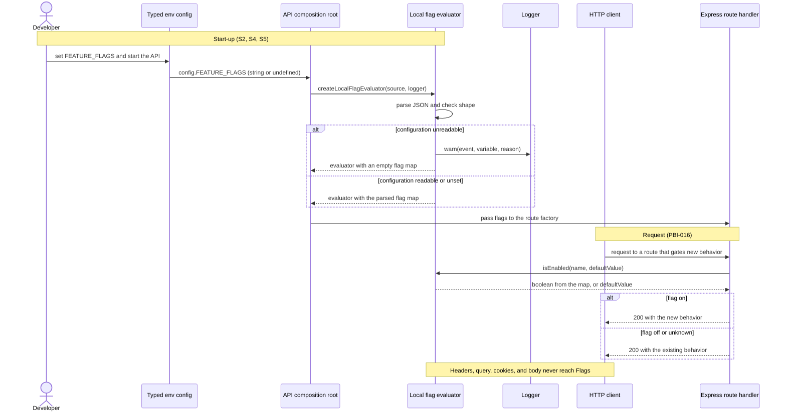
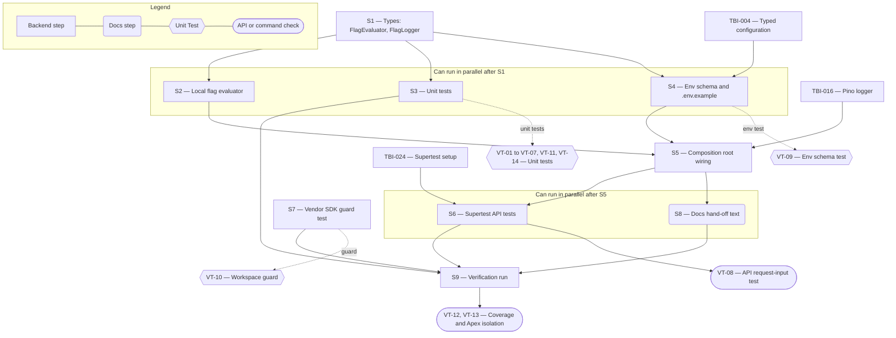

# Technical Specification — Provider-Neutral Feature Flag Interface

> **PRD slug:** `full-stack-express-starter-template` | **Owning layer:** `templates/full-stack-express/apps/api/src/feature-flags/` (template API application, not an Apex layer) | **Surface:** Backend only
> **Verification builds:** From `templates/full-stack-express/`: `pnpm check` and `pnpm test` (script names from TBI-005). To prove Apex is unchanged (BR-008): `npx tsc -p tsconfig.server.json --noEmit` and `npx tsc -p tsconfig.client.json --noEmit` from the Apex root.
> **Open items:** See [design-doc-assumptions.md](design-doc-assumptions.md) (2 unresolved)
> **Design doc:** [design-doc-design.md](design-doc-design.md)

---

## System Boundary and Owning Layer

**Owning layer:** `templates/full-stack-express/apps/api/src/feature-flags/` for the interface and adapter, with small edits to the API environment schema and the API composition root. Directory names follow the usual pnpm layout; TBI-001 fixes them (see assumptions).

**Rationale:** Flag values come from configuration, and call sites live in API route and service code, so the API application owns the work. The contracts package holds HTTP route definitions, and this Feature adds no route. A sixth workspace member for one 60-line module would break the five-member layout in the PRD. Nothing here touches `src/` in Apex: the template cannot import or reference Apex code (BR-008), and Apex's `featureFlagService.ts` is a database-backed, asynchronous system with targeting rules, which is the wrong shape for a starter.

**Ownership answers:**
- New or existing Express service in `src/server/services/`? No — Apex's `src/server/services/` is untouched. The evaluator is a new module in the template API application, built once in the composition root and passed to route factories, the same way as the data-access module.
- New or existing route in `src/server/routes/`? No — no Apex route and no template route. Flag values are never served over HTTP.
- New React component in `src/client/components/`? No — backend only. No web hook and no screen.
- New shared type in `src/shared/types/`? No — Apex's `src/shared/types/featureFlags.ts` stays as it is. The `FlagEvaluator` and `FlagLogger` types live in the API module, because only the API uses them.
- Database migration needed? No — flag values live in configuration. The PRD forbids flag data in `app_users` and lists feature-flag tables as out of scope.

---

## Security Enforcement

- **Authorization mechanism:** None. The template defines no roles or permissions (BR-003), and the evaluator is an in-process function with no request. No `requirePermission`, `can()`, or permission key is added, and the permission catalog in `rbac-governance.mdc` does not change. That rule governs Apex UI features and does not apply to this backend-only template module.
- **Layer that enforces scope:** The module's signature. `isEnabled(name, defaultValue)` has no request, principal, or header parameter, so request input cannot reach the lookup. The adapter builds its flag map once at construction and exposes no setter. VT-08 proves this through the HTTP stack.
- **Sensitive data handling:** Flag values are not identity data. The one log line carries an event name, the variable name, and a reason code, and never the raw value or Zod issue paths, because a key could look like an identity value (BR-007). VT-14 asserts this with synthetic identity-shaped keys.
- **Rule for call sites:** Do not gate authentication, authorization, or the development identity adapter's production guard (BR-002) behind a flag. The module map and the developer skill state this. A flag is a switch for new product behavior only.

---

## Architecture and Approach

### Layers touched

| Layer | Changed | Notes |
|-------|---------|-------|
| Server services (`src/server/services/`) | No | Apex untouched. |
| Server routes (`src/server/routes/`) | No | Apex untouched. |
| Server middleware (`src/server/middleware/`) | No | Apex untouched. |
| Client components (`src/client/components/`) | No | Backend only. |
| Client hooks (`src/client/hooks/`) | No | No client hook (`useFeatureFlags.ts` stays as it is). |
| Shared types (`src/shared/types/`) | No | Apex untouched. |
| Database (migrations/) | No | No schema change. |
| Drizzle schema (`src/server/db/schema.ts`) | No | Apex untouched. |
| Template feature-flags module (`templates/full-stack-express/apps/api/src/feature-flags/`) | Yes | New: `flag-evaluator.ts` (types), `local-flag-evaluator.ts` (adapter), `index.ts`, and co-located `*.test.ts` files. |
| Template environment schema (API app, TBI-004) | Yes | One optional string variable, `FEATURE_FLAGS`; `.env.example` lists it. |
| Template API composition root | Yes | Builds the evaluator from `config.FEATURE_FLAGS` and the logger; passes it to route factories. |
| Template docs (README, module map, handoff register) | Yes | Text supplied here; authored under FEAT-014 and FEAT-017. |

### Per-work-item design decisions

**TBI-019 — Create the flag-evaluation interface and local adapter**
- Pattern followed: Error handling mirrors `evaluateGroundingFlag` in Apex's `src/server/services/featureFlagService.ts`, which catches an evaluation failure, reports it through an `onEvaluationError` callback, and returns a safe value. The template keeps that contract (never throw, report, return the default) but differs on purpose: evaluation is synchronous with no database, takes no `FlagEvaluationContext`, and returns the caller's default instead of `false`. The adapter follows the template's own data-access pattern (TBI-006 in FEAT-003): a small interface, one implementation, constructed once in the composition root. The kebab-case rule copies Apex's `KEBAB_CASE_RE` (copy, not import: BR-008). No Apex name or path appears in template code or comments.
- Key decisions:
  - **Interface:** `isEnabled(name: string, defaultValue: boolean): boolean`. Synchronous, never throws, never does I/O. The TBI-019 non-functional requirement says "synchronous or cached"; synchronous is simpler. A future remote provider adapter must answer from an in-memory cache it refreshes elsewhere. The TSDoc on the interface says so.
  - **Boolean only, no context argument.** Targeting is out of scope. A later optional third parameter keeps call sites compiling.
  - **One optional variable, `FEATURE_FLAGS`,** holding a JSON object such as `{"checkout-v2":true}`. The adapter receives the string from typed configuration (`source`) and never reads `process.env`.
  - **Parse once, in the constructor.** `JSON.parse`, then a Zod record check (kebab-case keys, boolean values). Any failure rejects the whole value, stores an empty map, and logs one warning `{ event: 'feature_flags.config_invalid', variable: 'FEATURE_FLAGS', reason: 'invalid_json' | 'invalid_shape' }`. An unset, empty, or whitespace-only value yields an empty map with no log.
  - **Lookup is `Map.get`.** An unknown name, or a non-string name passed from untyped code, returns `defaultValue`. The kebab-case key rule also keeps names such as `__proto__` out of the map.
  - **Logger is a structural type:** `FlagLogger { warn(fields: Record<string, unknown>, message: string): void }`. A Pino logger satisfies it. The module has no Pino import, so TBI-019 does not wait for TBI-016.
  - **Alternatives rejected:**
    - A typed flag registry (central list of names and defaults). The backlog says "a named flag with a default value", and a registry makes a second place to edit for every flag.
    - Adopting OpenFeature in the template. It is a dependency the PRD does not ask for. The interface is small enough that a project can wrap an OpenFeature provider in one adapter.
    - Per-variable configuration (`FLAG_CHECKOUT_V2=true`). It needs name mangling and a prefix scan of the environment, and it cannot reject bad values as one unit.
    - Aborting startup on bad `FEATURE_FLAGS`. It contradicts PBI-016 scenario (b).

**PBI-016 — Gate new behavior behind a flag**
- Pattern followed: The "gate at one entry point and keep both branches working" guidance in Apex's `feature-flags` skill, restated in the template's module map and developer skill without the Apex comment markers. The evaluator reaches handlers through the composition root, as the data-access module does.
- Key decisions:
  - **The composition root owns the single construction site.** `createApp` takes a `flags: FlagEvaluator` dependency. To switch providers, a team changes one line (the `createLocalFlagEvaluator` call) and no call site. Scenario (e) and VT-07 prove it.
  - **Call sites read the flag at the top of a handler or service entry point,** declare the default there, and branch once. No nested checks.
  - **No reference call site ships.** The reference profile and health endpoints stay as the PRD defines them. Tests register a test-only route to show gating.
  - **Request input cannot reach the evaluator.** The signature has no request parameter. VT-08 sends crafted headers, query strings, bodies, and cookies through the real Express stack.
  - **Never use a flag to weaken security controls** (see Security Enforcement).

---

## Data and Contracts

### API endpoints

| Method | Route | Request shape | Response shape | Auth |
|--------|-------|--------------|----------------|------|
| — | None | This Feature adds no HTTP endpoint and no entry in the contracts package. | — | Not applicable |

### In-process contract (API application)

```ts
export interface FlagEvaluator {
  /** Synchronous. Never throws. Never performs I/O. Returns defaultValue for any flag it does not know. */
  isEnabled(name: string, defaultValue: boolean): boolean;
}

export interface FlagLogger {
  warn(fields: Record<string, unknown>, message: string): void;
}

export interface LocalFlagEvaluatorOptions {
  /** Raw FEATURE_FLAGS value from typed configuration; undefined when unset. */
  source: string | undefined;
  logger: FlagLogger;
}

export function createLocalFlagEvaluator(options: LocalFlagEvaluatorOptions): FlagEvaluator;
```

### Configuration contract

| Variable | Required | Format | Behavior |
|----------|----------|--------|----------|
| `FEATURE_FLAGS` | No | JSON object. Keys are kebab-case flag names; values are booleans. Example: `{"checkout-v2":true,"beta-banner":false}`. In a `.env` file, wrap the value in single quotes. | Unset or empty: no flags defined. Invalid: whole value ignored, one warning logged, every flag returns its declared default. Read once at start-up; a change needs a restart. |

### Schema / storage changes

| Target | Change | Reason |
|--------|--------|--------|
| `app_users` and every other table | None | The PRD keeps flag data out of the schema. Values live in configuration. |
| `.env.example` | Add a `FEATURE_FLAGS` line with the value `{}` | BR-010: the example environment file lists every variable and holds no secrets. |

---

## Testing Strategy

**Unit tests** (Vitest, co-located `*.test.ts` in `apps/api/src/feature-flags/`, unless FEAT-011 sets another layout):
- `createLocalFlagEvaluator` — on, off (including off over a default of true), unknown name with both defaults, unset and empty source, invalid JSON, wrong shape (array, string value, non-boolean value, non-kebab key), and that a failure logs exactly once. The tests assert returned values and logged payloads only, not internal calls.
- Replacement adapter — a test double that implements `FlagEvaluator` runs through the same gating helper as the local adapter, with no change to the helper.
- Log redaction — a source whose keys look like an email address or subject produces a log payload that contains none of those strings.
- Type-level check — `isEnabled` returns `boolean`, not a `Promise`.
- Coverage — the module meets the shared floors (80% lines, functions, statements; 75% branches). Thresholds are defined once in shared configuration (TBI-023), and this Feature does not redefine them.

**Integration tests** (Vitest and Supertest, following TBI-024; no PostgreSQL needed):
- API composition root — build the app with stub dependencies, plus a test-only route that gates on `checkout-v2` with default `false`. With the flag on, the route returns the gated response. Requests that carry `?checkout-v2=false`, an `x-feature-flag-checkout-v2` header, a cookie, or a JSON body naming the flag do not change the result.
- Environment schema — `FEATURE_FLAGS` absent, `{}`, and a malformed string all pass environment validation (the startup abort in BR-010 does not fire), and the adapter degrades for the malformed string.
- Workspace guard — scan every `package.json` in the template workspace and fail with the package name when a vendor flag SDK appears (deny list in the test; OpenFeature is not on it).

**E2E tests (if applicable):**
- Not applicable. There is no screen and no Playwright journey for this Feature. The profile journey in FEAT-011 is unaffected.

---

## Observability

- **Custom events/metrics:** One structured warning log event, `feature_flags.config_invalid`, with fields `variable` and `reason` (`invalid_json` or `invalid_shape`). No evaluation metric: one counter per flag name adds unbounded label cardinality for no decision a Developer needs. No log line per evaluation.
- **Alerts:** None. Platform Engineering may alert on the event name if it wants to catch configuration typos.

---

## Rollback and Deployment

- **Schema changes backward compatible:** Yes — there is no schema change. `FEATURE_FLAGS` is optional, so an existing `.env` or deployed environment keeps working with no edit.
- **Rollback procedure:** Remove the `FEATURE_FLAGS` line from the environment and restart: every call returns its declared default. To remove the Feature from the template, delete the `feature-flags` module, the `flags` dependency in `createApp`, the environment schema entry, the `.env.example` line, and the doc entries. No call site exists in the reference application, so nothing else changes.
- **Deployment dependencies:** None. Platform Engineering supplies `FEATURE_FLAGS` through its own environment mechanism when a generated application needs a flag. This Feature ships with no pipeline or infrastructure change.
- **Feature flag gates deployment:** No. The PRD sets "Flag required: No", and this Feature does not use an Apex Feature Flag.

---

## Verification Test Matrix

| ID | Layer | Arrange | Act | Assert | Linked |
|----|-------|---------|-----|--------|--------|
| VT-01 | Vitest unit | `source` is `{"checkout-v2":true}`; fake logger | `isEnabled('checkout-v2', false)`, then run a gated helper | Returns `true`; the helper takes the gated branch; logger not called | PBI-016 (a), TBI-019 |
| VT-02 | Vitest unit | `source` is `{"checkout-v2":false}` | `isEnabled('checkout-v2', true)` | Returns `false` (the configured off value beats a default of true) | PBI-016 (a), TBI-019 |
| VT-03 | Vitest unit | `source` is `{"other-flag":true}` | `isEnabled('checkout-v2', false)` and `isEnabled('checkout-v2', true)` | Returns `false`, then `true`; no throw; logger not called | PBI-016 (c), TBI-019 |
| VT-04 | Vitest unit | `source` is `{not json`; fake logger | Construct the evaluator, then `isEnabled('checkout-v2', true)` | Returns `true`; logger `warn` called once with `variable: 'FEATURE_FLAGS'` and `reason: 'invalid_json'`; no throw | PBI-016 (b) |
| VT-05 | Vitest unit | Each of `[true]`, `"true"`, `{"checkout-v2":"yes"}`, `{"Bad_Key":true}` | Construct, then evaluate `checkout-v2` with default `false` and a valid key from the same source | Returns `false` for both (whole value rejected, including any valid key); one warning with `reason: 'invalid_shape'` | PBI-016 (b) |
| VT-06 | Vitest unit | `source` is `undefined`, `''`, and `'   '` in turn | Construct, then evaluate with each default | Returns the default every time; logger never called | PBI-016 (c) |
| VT-07 | Vitest unit | A test-double `FlagEvaluator` that returns `true` for `checkout-v2`; the same gating helper used in VT-01 | Call the helper with the double, then with the local adapter | Both work; the helper source is unchanged | PBI-016 (e), TBI-019 |
| VT-08 | Vitest + Supertest | App built with stub dependencies, `flags` from `{"checkout-v2":true}` and a second app from `{}`; test-only route gates on `checkout-v2` with default `false` | GET the route with `?checkout-v2=false`, header `x-feature-flag-checkout-v2: false`, a cookie, and a JSON body naming the flag; repeat on the second app with `true` values | First app always returns the gated response; second app always returns the existing response | PBI-016 (d) |
| VT-09 | Vitest unit | The API environment schema | Parse an environment with `FEATURE_FLAGS` absent, `'{}'`, and `'{not json'` | All three pass validation; no startup abort | TBI-019, PBI-016 (b) |
| VT-10 | Vitest unit (workspace guard) | All `package.json` files in the template workspace | Compare dependency names with the vendor SDK deny list | Passes now; fails with the package name when a listed SDK is added | TBI-019 |
| VT-11 | Vitest type test | The `FlagEvaluator` type | `expectTypeOf` on `isEnabled` | Return type is exactly `boolean` | TBI-019 |
| VT-12 | Command | Full unit suite | `pnpm test` with coverage | Module meets 80% lines, functions, statements and 75% branches; command exits 0 | TBI-019 |
| VT-13 | Command | Apex root with the template folder present | Apex root `npx tsc -p tsconfig.server.json --noEmit` and `npx tsc -p tsconfig.client.json --noEmit`; `git status` outside the template folder | Both exit 0; no file outside `templates/full-stack-express/` changed | TBI-019 (BR-008) |
| VT-14 | Vitest unit | `source` is `{"alice@example.test":true}` and a fake logger | Construct the evaluator | Warning logged once; serialised payload contains neither `alice` nor `example.test` nor the raw source | PBI-016 (b), BR-007 |

---

## Implementation Plan

- [ ] S1 — Add `flag-evaluator.ts` with `FlagEvaluator` (TSDoc: synchronous, cache-backed providers) and `FlagLogger`, and an `index.ts` export _(no blockers)_
  - Covers: `VT-11`
- [ ] S2 — Add `local-flag-evaluator.ts`: parse once, Zod record check, `Map` lookup, one warning on failure _(blocked by S1)_
  - Covers: `VT-01`, `VT-02`, `VT-03`, `VT-04`, `VT-05`, `VT-06`, `VT-14`
- [ ] S3 — Write the unit tests, including the replacement double and the type test; write them first if working test-first _(blocked by S1; can parallel with S2)_
  - Covers: `VT-01` to `VT-07`, `VT-11`, `VT-14`
- [ ] S4 — Add optional `FEATURE_FLAGS` to the API environment Zod schema and a `FEATURE_FLAGS={}` line to `.env.example` _(blocked by S1 for the type only; also blocked by TBI-004 from FEAT-002, see ⚠ in assumptions)_
  - Covers: `VT-09`
- [ ] S5 — In the API composition root, build `createLocalFlagEvaluator({ source: config.FEATURE_FLAGS, logger })` and add `flags: FlagEvaluator` to the `createApp` dependencies _(blocked by S2, S4, and TBI-016 for the logger)_
  - Covers: enables `VT-08`
- [ ] S6 — Write the Supertest tests with a test-only gated route and stub dependencies _(blocked by S5 and by TBI-024 for the Supertest setup)_
  - Covers: `VT-08`
- [ ] S7 — Add the workspace guard test with the vendor SDK deny list _(blocked only by TBI-001 for the workspace; can run in lane 1)_
  - Covers: `VT-10`
- [ ] S8 — Write the documentation hand-off text: module map entry (responsibility, public interface, the rule against gating security controls), a README `FEATURE_FLAGS` row with the single-quote note, a developer-skill usage snippet, and the unresolved-decision register entry that names `createLocalFlagEvaluator` in the composition root as the flag provider extension point _(blocked by S5; feeds TBI-033, FEAT-014, FEAT-017)_
- [ ] S9 — Run `pnpm check`, `pnpm test` with coverage, and the Apex root type checks; confirm no file changed outside the template folder _(blocked by S3, S6, S7, S8)_
  - Covers: `VT-12`, `VT-13`

**Execution lanes:**
- Lane 1 (start immediately): S1, S7
- Lane 2 (after S1): S2, S3, S4 (S4 also waits for TBI-004)
- Lane 3 (after S2, S4, and TBI-016): S5
- Lane 4 (after S5): S6, S8
- Lane 5 (after S3, S6, S7, S8): S9

---

## Diagram 1 — Code Execution Flow

This Feature is backend only, so the path has no React component, hook, or database. It traces start-up wiring and then one request that reads a flag.



---

## Diagram 2 — Implementation Dependency Map


