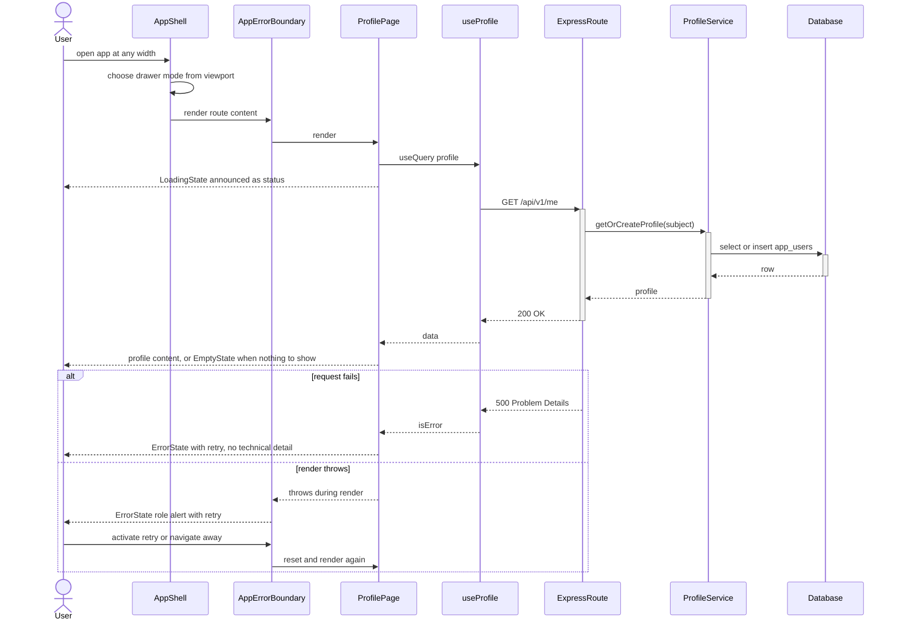
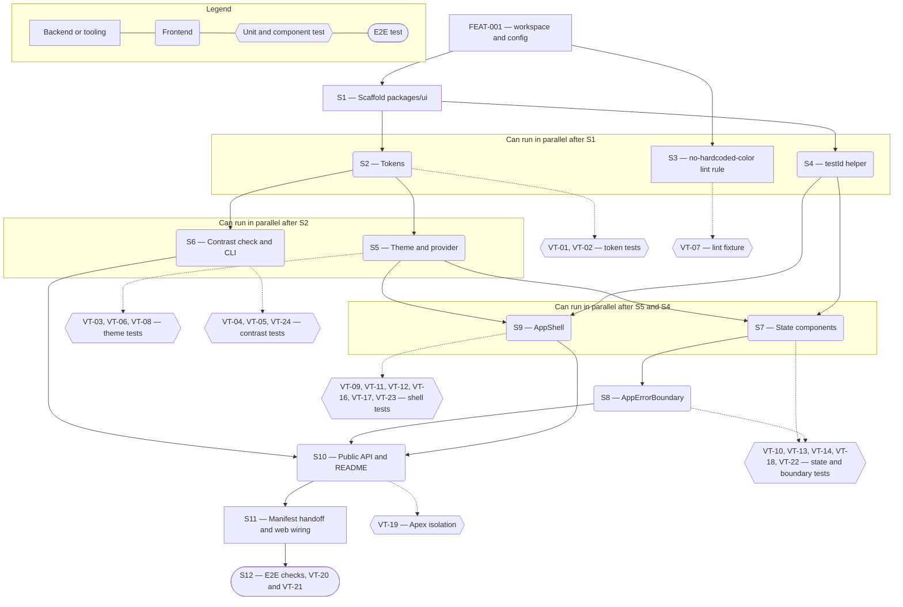

# Technical Specification — Neutral MUI Design System and App Shell

> **PRD slug:** `full-stack-express-starter-template` | **Owning layer:** `templates/full-stack-express/packages/ui/` (template UI package, outside Apex `src/`) | **Surface:** Frontend only
> **Verification builds:** `pnpm --filter @your-scope/ui typecheck`, `pnpm --filter @your-scope/ui test`, `pnpm --filter @your-scope/ui check:contrast`, `pnpm --filter @your-scope/web build`, and `pnpm lint` from `templates/full-stack-express/`. Apex's own `npx tsc -p tsconfig.client.json --noEmit` and `npx tsc -p tsconfig.server.json --noEmit` must give the same result with and without the template folder (VT-19).
> **Open items:** See [design-doc-assumptions.md](design-doc-assumptions.md) (3 unresolved)
> **Design doc:** [design-doc-design.md](design-doc-design.md)

---

## System Boundary and Owning Layer

**Owning layer:** `templates/full-stack-express/packages/ui/` (new). Supporting changes: `templates/full-stack-express/packages/config/` (one lint rule) and `templates/full-stack-express/apps/web/` (wiring only, owned by TBI-022).

**Rationale:** The PRD makes the UI package a deep module that owns tokens, themes, component defaults, the shell, the error boundary, and the state components. The web client imports one public entry point and never reaches into internals. The template is a nested workspace with its own lockfile and lint rules (BR-008), so none of this code touches Apex's `src/client/`, `src/server/`, or `src/shared/`.

**Ownership answers:**
- New or existing Express service in `src/server/services/`? No — a frontend-only Feature. The template's API (FEAT-005, FEAT-006) is untouched.
- New or existing route in `src/server/routes/`? No — the shell calls no endpoint of its own.
- New React component in `src/client/components/`? No — the components are new, but they live in `templates/full-stack-express/packages/ui/src/`. Apex's `src/client/components/` (including `ViewErrorFallback.tsx` and `AppHeader.tsx`) stays unchanged.
- New shared type in `src/shared/types/`? No — prop and token types are exported from `@your-scope/ui`. The contracts package (Zod route definitions) is not involved.
- Database migration needed? No — the Feature stores nothing server-side. The theme choice lives in browser `localStorage`.

**Module layout (new files):**

```
packages/ui/
  package.json              exports "." only; peerDependencies react, react-dom, @mui/material, @emotion/*, react-router
  tsconfig.json             extends @your-scope/config
  vitest.config.ts          extends shared test config; environment jsdom
  README.md                 usage of every export, token override recipe, test selector convention
  src/
    index.ts                public API, the only import path for consumers
    tokens/
      colors.ts             light and dark semantic palettes
      spacing.ts            spacing base and named steps
      typography.ts         font stack and type scale
      breakpoints.ts        breakpoint values
      index.ts              `tokens` object and `TokenOverrides` type
    theme/
      createAppTheme.ts     builds the MUI theme from tokens and overrides
      components.ts         component defaults and focus styles
      AppThemeProvider.tsx  ThemeProvider, CssBaseline, color-scheme storage
      useColorMode.ts       mode read and set
      contrast.ts           CONTRAST_PAIRINGS and checkThemeContrast
      checkContrast.cli.ts  script entry for check:contrast
    shell/
      AppShell.tsx
      ColorModeToggle.tsx
      NavDrawer.tsx
      SkipLink.tsx
      icons.tsx             MenuIcon and CloseIcon built on SvgIcon
    states/
      LoadingState.tsx
      EmptyState.tsx
      ErrorState.tsx
      AppErrorBoundary.tsx
    testing/
      testId.ts             convention helper
packages/config/
  eslint/no-hardcoded-color.js   custom rule plus a rules fixture
```

---

## Security Enforcement

- **Authorization mechanism:** None in this Feature. The template defines no roles, permissions, or authorization policy (BR-003). Apex's `can()` and `requirePermission()` guards and `rbac-governance.mdc` apply to Apex only and are excluded from the template (BR-008). The shell renders navigation for whoever the host mounts it for. Route protection is the API authentication middleware (FEAT-005) plus the unauthenticated handling in the API client (TBI-022).
- **Layer that enforces scope:** Not applicable. The shell and state components hold no data and make no request.
- **Sensitive data handling:** The UI package never renders identity values (display name, email, external subject). `ErrorState` shows only a caller-supplied `message`, and the default is a fixed string. `AppErrorBoundary` never renders `error.message`, because messages can embed identity values (BR-007). Apex's `ViewErrorFallback` does render `error.message`, so the template deliberately differs. `AppErrorBoundary` passes the error to an optional `onError` callback only. The host decides whether and how to log it, and the documentation requires redaction. VT-22 proves the DOM never contains a thrown message.

---

## Architecture and Approach

### Layers touched

| Layer | Changed | Notes |
|-------|---------|-------|
| Server services (`src/server/services/`) | No | Apex untouched |
| Server routes (`src/server/routes/`) | No | Apex untouched |
| Server middleware (`src/server/middleware/`) | No | Apex untouched |
| Client components (`src/client/components/`) | No | Apex untouched; new components live in the template UI package |
| Client hooks (`src/client/hooks/`) | No | Apex untouched; `useColorMode` lives in the template UI package |
| Shared types (`src/shared/types/`) | No | Types are exported from `@your-scope/ui` |
| Database (migrations/) | No | No storage change |
| Drizzle schema (`src/server/db/schema.ts`) | No | No storage change |
| Template UI package (`templates/full-stack-express/packages/ui/`) | Yes | Tokens, themes, contrast check, shell, error boundary, state components, test id helper |
| Template config package (`templates/full-stack-express/packages/config/`) | Yes | `no-hardcoded-color` ESLint rule and its fixture |
| Template web client (`templates/full-stack-express/apps/web/`) | Yes (wiring) | Mounts `AppThemeProvider`, `AppShell`, `AppErrorBoundary`; passes `navItems`. Owned by TBI-022 |

### Per-work-item design decisions

**TBI-020 — Create the UI package theme tokens and light and dark themes**
- Pattern followed: Apex `ui-design-standards.mdc` (tokens only, system font stack, 4–32 px spacing scale) with MUI `createTheme` in place of Apex's `App.css` custom properties.
- Key decisions:
  - **One token object, two schemes.** `tokens.colors.light` and `tokens.colors.dark` have identical keys. A type (`Record<ColorToken, string>`) makes a missing key a compile error. VT-02 asserts equality of the key sets.
  - **Semantic color tokens:** `primary`, `secondary`, `error`, `warning`, `info`, `success` (each `main` and `contrastText`), `text.primary`, `text.secondary`, `background.default`, `background.paper`, `divider`, `focus`, and `inputBorder`. Indicative starting values, to be settled by VT-04:

    | Token | Light | Dark |
    |-------|-------|------|
    | `background.default` / `background.paper` | `#FFFFFF` / `#F5F7FA` | `#101418` / `#181D23` |
    | `text.primary` / `text.secondary` | `#1A1D21` / `#4A5058` | `#E8EAED` / `#B0B6BE` |
    | `primary.main` / `primary.contrastText` | `#1D4ED8` / `#FFFFFF` | `#8AB4F8` / `#0B1220` |
    | `error.main` / `error.contrastText` | `#B3261E` / `#FFFFFF` | `#F2B8B5` / `#601410` |
    | `focus` | `#1D4ED8` | `#8AB4F8` |

  - **Spacing:** MUI base unit stays 8 px, so MUI internals keep working. Named steps map to Apex's scale: 4, 8, 12, 16, 24, 32 px (`theme.spacing(0.5 … 4)`). Components call `theme.spacing()` and never write pixel values.
  - **Typography:** the Apex system font stack (`-apple-system, BlinkMacSystemFont, 'Segoe UI', Roboto, Oxygen, Ubuntu, sans-serif`), no web-font download, `button.textTransform: 'none'`, rem-based type scale.
  - **Breakpoints:** `xs` 0, `sm` 600, `md` 900, `lg` 1200, `xl` 1536.
  - **Theme construction:** `createAppTheme(overrides?: TokenOverrides)` calls `createTheme({ cssVariables: true, colorSchemes: { light, dark }, … })`. CSS variables let the mode change without a reload or remount (PBI-017 performance NFR).
  - **Overrides:** `TokenOverrides` is `{ colors?: { light?: DeepPartial<LightColors>; dark?: DeepPartial<DarkColors> }, typography?, … }`. A per-scheme deep merge means a light-only override leaves the dark scheme at its defaults (PBI-017 (c)). Alternative rejected: one merged palette applied to both schemes, because it would silently break dark contrast.
  - **Component defaults** (`components.ts`): `MuiButton` gets `disableElevation`. `MuiTextField` gets `variant="outlined"` and `fullWidth`. `MuiLink` gets `underline="always"` so links do not rely on color alone. `MuiButtonBase` and `MuiCssBaseline` draw a 2 px `focus` outline with 2 px offset on `:focus-visible`. `MuiCssBaseline` also disables transitions under `prefers-reduced-motion: reduce`. Every value reads from theme tokens.
  - **Contrast check:** `CONTRAST_PAIRINGS` lists required pairs per scheme. Text pairs need 4.5:1 and non-text pairs need 3:1:

    | Pairing | Minimum |
    |---------|---------|
    | `text.primary` on `background.default` and on `background.paper` | 4.5 |
    | `text.secondary` on `background.default` and on `background.paper` | 4.5 |
    | each `*.contrastText` on its `*.main` (six colors) | 4.5 |
    | `primary.main` on `background.default` and on `background.paper` (links) | 4.5 |
    | `focus` on `background.default` and on `background.paper` | 3 |
    | `inputBorder` on `background.paper` | 3 |

    `checkThemeContrast(overrides?)` returns `ContrastFailure[]` with `{ scheme, foreground, background, ratio, required }`. It uses `getContrastRatio` from `@mui/material/styles`. A value that cannot be parsed returns a failure with `ratio: null` and the token name. `checkContrast.cli.ts` prints one line per failure (for example `dark: text.secondary on background.paper = 3.8, needs 4.5`) and exits 1. It exits 0 when the list is empty. The script reads an optional `--overrides <path>` module so projects can check their own overrides.
  - **Color mode:** `AppThemeProvider` sets `defaultMode: 'system'` and `modeStorageKey: 'app-color-mode'`. `useColorMode()` returns `{ mode, setMode }` with `mode` of `'light' | 'dark'`. This is subject to ⚠ "Light/dark selection mechanism".
  - **No hard-coded colors:** the ESLint rule `no-hardcoded-color` (in `packages/config`) reports string literals that match hex, `rgb(a)`, or `hsl(a)` in `apps/web/src/**` and `packages/ui/src/**`, and allows `packages/ui/src/tokens/**`. It extends the shared lint configuration from TBI-003, so one rule edit reaches every member.

**TBI-021 — Create the app shell, error boundary, state components, and test selector convention**
- Pattern followed: Apex `src/client/App.tsx` wraps views in `ErrorBoundary` with `ViewErrorFallback` (`react-error-boundary`) and a Suspense fallback. React coding standards apply: `React.FC` with a `ComponentNameProps` interface, early returns, hooks in the stated order.
- Key decisions:
  - **`AppShell`** props: `{ appName: string; navItems: NavItem[]; headerActions?: ReactNode; children: ReactNode }` where `NavItem` is `{ id: string; label: string; to: string }`. It renders `<header>` (MUI `AppBar`, position `static`), the drawer, and `<main id="main-content" tabIndex={-1}>`. A `SkipLink` is the first element.
  - **Responsive drawer.** `NavDrawer` reads `useMediaQuery(theme.breakpoints.up('md'), { noSsr: true })`. At `md` and up it renders a permanent drawer. Below `md` it renders a temporary drawer opened by the menu button. `noSsr: true` is safe because the web client is a Vite single-page app, and it removes the first-render flash that causes layout shift (PBI-018 performance NFR). Alternative rejected: render both drawers and hide one with CSS. It doubles the DOM, and jsdom cannot test it.
  - **Focus management.** On open, focus goes to the first nav item (the temporary `Drawer` is an MUI modal, so it traps focus and closes on Escape). On close by Escape or link activation, focus returns to the menu button. The drawer unmounts when closed, so no hidden links stay in the tab order.
  - **Navigation.** `NavLink` from React Router renders each item. It sets `aria-current="page"`. The shell renders no `<nav>` and no menu button when `navItems` is empty.
  - **`ColorModeToggle`** is an MUI `Switch` inside `FormControlLabel` with the label "Dark mode". The `data-testid` goes through `slotProps.input`, because MUI puts props on the root otherwise.
  - **`AppErrorBoundary`** wraps `react-error-boundary`'s `ErrorBoundary`. Props: `{ children; onError?: (error: unknown, info: ErrorInfo) => void; resetKeys?: unknown[] }`. The fallback is `ErrorState` with the fixed message "Something went wrong. Try again, and if the problem continues, contact your administrator." and a retry button wired to `resetErrorBoundary`. The web app passes `resetKeys={[location.pathname]}` so navigating away clears the error (VT-18).
  - **State components.** `LoadingState({ label = 'Loading', variant = 'page' })` renders `CircularProgress` with visible text inside `role="status"`. `EmptyState({ title, description?, action? })` renders inside `role="status"`. `ErrorState({ title = 'Something went wrong', message?, onRetry?, retryLabel = 'Try again' })` renders inside `role="alert"`, and renders the retry button only when `onRetry` is set. Each is a plain presentational component with no data fetching, so TanStack Query states map onto them in the host (`isPending` to `LoadingState`, `isError` to `ErrorState`).
  - **Test selector convention.** `testId(scope, ...parts)` lower-cases each part, joins with `-`, and throws in development if the result is not kebab-case. Rule: interactive elements and key content elements carry `data-testid`. Dynamic parts use stable ids (a nav item `id`), never array indexes or display text.
  - **Documented usage.** Each export has TSDoc with an example. `packages/ui/README.md` holds the usage table, the override recipe, and the selector convention. FEAT-014 and FEAT-015 link to it.

**PBI-017 — Rebrand the application by overriding theme tokens**
- Pattern followed: the token-driven theming in Apex `ui-design-standards.mdc` ("never hardcode colors").
- Key decisions: Overrides pass through a single file in `apps/web` (`src/theme/overrides.ts`, empty by default) into `createAppTheme`. The same module feeds `check:contrast --overrides`. Rejected: runtime token editing UI (out of scope) and per-component `sx` colors (blocked by lint).

**PBI-018 — Use the application on any screen size**
- Pattern followed: Apex mobile responsiveness (hamburger menu below desktop width, per `context.md`) and its `ErrorBoundary` plus `ViewErrorFallback` wrapping.
- Key decisions: The three layouts differ in drawer mode, padding (`theme.spacing(2)`, `(3)`, `(4)`), and maximum content width (1200 px at desktop). `main` uses `minWidth: 0` and `overflowWrap: 'anywhere'` on long text, so content never forces horizontal scrolling at 320 px. The loading and empty components are the only approved blank-area replacements. They carry `role="status"`.

---

## Data and Contracts

### API endpoints

| Method | Route | Request shape | Response shape | Auth |
|--------|-------|--------------|----------------|------|
| — | None | This Feature adds no endpoint. Consumers of the shell call `GET /api/v1/me` and `PUT /api/v1/me` (FEAT-005, FEAT-010). | — | Authentication middleware (FEAT-005) |

**Public module contract** (`packages/ui/src/index.ts`):

| Export | Signature | Notes |
|--------|-----------|-------|
| `tokens` | `Tokens` | Read-only semantic tokens |
| `createAppTheme` | `(overrides?: TokenOverrides) => Theme` | Both schemes, CSS variables |
| `AppThemeProvider` | `React.FC<{ overrides?: TokenOverrides; children }>` | Theme, baseline styles, mode storage |
| `useColorMode` | `() => { mode: 'light' \| 'dark'; setMode(m): void }` | Used by `ColorModeToggle` |
| `checkThemeContrast` | `(overrides?: TokenOverrides) => ContrastFailure[]` | Pure; no side effects |
| `AppShell` | `React.FC<AppShellProps>` | See TBI-021 |
| `AppErrorBoundary` | `React.FC<AppErrorBoundaryProps>` | See TBI-021 |
| `LoadingState`, `EmptyState`, `ErrorState` | `React.FC<…Props>` | See TBI-021 |
| `testId` | `(scope: string, ...parts: string[]) => string` | Convention helper |
| `NavItem`, `TokenOverrides`, `ContrastFailure` | types | |

Storage: `localStorage` key `app-color-mode` holds `'light'` or `'dark'`. It holds no identity or server data.

### Schema / storage changes

| Target | Change | Reason |
|--------|--------|--------|
| None | No database change | The Feature stores nothing server-side. The only persisted value is the browser color-mode preference |

---

## Testing Strategy

**Unit tests:** (Vitest, files next to the source as `*.test.ts`, matching the template's Vitest layer; Apex uses Jest with the same layering)
- `tokens` — all four groups exist; light and dark share one key set (VT-01, VT-02).
- `createAppTheme` — an override changes the resolved theme; a light-only override leaves dark at defaults (VT-03, VT-06).
- `checkThemeContrast` and the CLI — defaults pass; a failing or unparseable override names the token and pairing; the CLI exits 1 (VT-04, VT-05, VT-24).
- `testId` — lower-cases, joins, and rejects non-kebab output (VT-15).

**Integration tests:** (Vitest and React Testing Library with jsdom, `window.matchMedia` stubbed through a shared `setViewport(width)` helper in `packages/ui/src/testing/`)
- `AppShell` at 320, 768, and 1280 px — landmarks, drawer modes, focus management, `aria-current`, empty `navItems` (VT-09, VT-11, VT-12, VT-16, VT-17, VT-23).
- `AppErrorBoundary` — recovery by retry and by `resetKeys`; no thrown message in the DOM (VT-10, VT-18, VT-22).
- State components — roles and announcements, keyboard retry, no blank `main` (VT-13, VT-14).
- `ColorModeToggle` — switches the scheme without remounting children and without navigation (VT-08).
- ESLint — `RuleTester` fixture for `no-hardcoded-color` (VT-07).
- Apex isolation — run the Apex root install, build, and lint before and after, and compare (VT-19).
- Tests assert what a person sees and does (roles, names, visible text), not MUI internals.

**E2E tests (if applicable):** (Playwright with axe, harness from FEAT-011, run against the profile route from FEAT-010)
- Three viewports (1280×800, 768×1024, 320×568): landmarks, no horizontal scroll, layout-shift score under 0.1, zero axe violations (VT-20).
- Dark theme after toggling: zero axe violations, URL unchanged (VT-21).
- Focus-visible styling and 3:1 focus contrast are verified here, because jsdom cannot compute them.

---

## Observability

- **Custom events/metrics:** None beyond standard request telemetry. `AppErrorBoundary` exposes an optional `onError` callback and logs nothing itself. The template's web client has no client telemetry, so Platform Engineering can attach one without a UI package change. The callback receives the raw error, so the host must redact identity values before logging (BR-007).
- **Alerts:** None.

---

## Rollback and Deployment

- **Schema changes backward compatible:** Yes — there are no schema changes.
- **Rollback procedure:** Revert the commit that touches `templates/full-stack-express/`. Apex builds, lockfile, and scripts are unaffected (VT-19). A bad token override is rolled back by reverting `apps/web/src/theme/overrides.ts`.
- **Deployment dependencies:** None. The package builds with the template's `pnpm build` and ships inside the web client artifact. It needs MUI at the version in the compatibility table (TBI-002), and `react-error-boundary` and React Router listed there too.
- **Feature flag gates deployment:** No — the PRD states "Flag required: No".

---

## Verification Test Matrix

| ID | Layer | Arrange | Act | Assert | Linked |
|----|-------|---------|-----|--------|--------|
| VT-01 | Vitest unit | Import `tokens` | Read the `colors`, `spacing`, `typography`, and `breakpoints` groups | Each group exists and is non-empty | TBI-020 |
| VT-02 | Vitest unit | Import both color schemes | Compare their key sets | Keys are identical; both themes come from one token set | TBI-020 |
| VT-03 | Vitest + RTL | `AppThemeProvider` with `overrides.colors.light.primary.main = '#7A1FA2'`; render a `Button`, a `Link`, and a focusable control | Read computed `background-color`, `color`, and focus `outline-color` | Button, link, and focus color use the new value; no component file changed | PBI-017 (a) |
| VT-04 | Vitest unit | Default tokens | Call `checkThemeContrast()` | Returns `[]` for light and dark; every pairing meets its minimum | TBI-020, PBI-017 (a) |
| VT-05 | Vitest unit + CLI | Override `text.secondary` (dark) to `#555555` on `background.paper` `#181D23` | Call `checkThemeContrast(overrides)` and run `check:contrast --overrides` | Failure lists `scheme: dark`, `text.secondary`, `background.paper`, ratio, and required 4.5; CLI prints the pairing and exits 1 | PBI-017 (b) |
| VT-06 | Vitest + RTL | Override only `colors.light.*`; render with mode `dark` | Compare dark palette to defaults; run `checkThemeContrast` for dark | Dark palette equals defaults; dark has no contrast failures; text stays legible | PBI-017 (c) |
| VT-07 | Vitest (ESLint `RuleTester`) | Fixture files in `apps/web/src` and `packages/ui/src/tokens` | Lint `sx={{ color: '#ff0000' }}`, `'rgb(0,0,0)'`, and `'hsl(0 0% 0%)'` | Each literal outside `tokens/` is reported as `no-hardcoded-color`; the same literal in `tokens/` passes | PBI-017 (d) |
| VT-08 | Vitest + RTL | Render `AppShell` with a stateful child and a spy on `window.location.reload` | Click `app-shell-color-mode-toggle`, then remount the provider | `data-mui-color-scheme` flips; child state survives the toggle; no reload; `localStorage['app-color-mode']` is set, and the remounted provider restores the chosen scheme | PBI-017 (a), TBI-020 |
| VT-09 | Vitest + RTL | `setViewport(1280)`; `MemoryRouter`; three `navItems` | Render `AppShell`; press Tab once, then Enter | Roles `banner`, `navigation` (name "Primary"), and `main` exist; the permanent drawer is visible; the skip link is the first tab stop and moves focus to `main` | PBI-018 (a) |
| VT-10 | Vitest + RTL | A child that throws on first render and works after retry | Render inside `AppErrorBoundary`; click `error-state-retry` | `role="alert"` with a retry button shows, not a blank page; after retry the child renders | PBI-018 (b), TBI-021 |
| VT-11 | Vitest + RTL + user-event | `setViewport(320)` | Click `app-shell-menu-button`; press Escape | The nav is hidden before the click, and the button has `aria-expanded="false"`; after the click, the drawer is open with `aria-expanded="true"` and focus on the first nav item; Escape closes it and focus returns to the button | PBI-018 (c) |
| VT-12 | Vitest + RTL | Parametrize `setViewport` with 320, 599, 600, 899, 900, 1280 | Render `AppShell` | Widths below 900 give a temporary drawer and a menu button; 900 and up give a permanent drawer and no menu button; the content padding steps 16, 24, 32 px | TBI-021, PBI-018 (c) |
| VT-13 | Vitest + RTL + user-event | Render each state component | Query by role; focus the retry button; press Enter, then Space | `LoadingState` and `EmptyState` expose `role="status"` with text; `ErrorState` exposes `role="alert"`; `onRetry` is called once per key press | PBI-018 (d), TBI-021 |
| VT-14 | Vitest + RTL | Page child switches between `LoadingState` and `EmptyState` | Render inside `AppShell` | `app-shell-main` always contains text content and a status role; it is never empty | PBI-018 (d) |
| VT-15 | Vitest unit + RTL | `testId('app-shell', 'nav-item', 'Profile')`; render shell and state components | Call the helper; collect every interactive element | Helper returns `app-shell-nav-item-profile` and throws on `'Bad Value!'`; every button, link, and switch has a `data-testid` that matches `^[a-z0-9]+(-[a-z0-9]+)*$` | TBI-021 |
| VT-16 | Vitest + RTL + user-event | `setViewport(1280)` | Tab through the whole shell | Order is skip link, nav links, color toggle, then `main` content; each control has an accessible name from `getByRole(..., { name })` | TBI-021, PBI-018 (a) |
| VT-17 | Vitest + RTL | `MemoryRouter` at `/profile`; nav item `to="/profile"` | Render `AppShell` | The Profile link has `aria-current="page"` and others do not | PBI-018 (a) |
| VT-18 | Vitest + RTL | Boundary with `resetKeys={[path]}`, child throws on `/a` only | Trigger the error, then change `path` to `/b` | The error state clears and the `/b` child renders without a click | PBI-018 (b) |
| VT-19 | Integration (script) | Clean Apex checkout with and without `templates/full-stack-express/` | Run Apex root install, build, lint, and `tsc` commands | Lockfile, scripts, build output, and command exit codes are identical; the template is not built by Apex | TBI-020, TBI-021 (isolation, BR-008) |
| VT-20 | Playwright + axe | Dev adapter running; profile route open | At 1280×800, 768×1024, and 320×568: record `layout-shift` entries, read `scrollWidth` and `clientWidth`, run axe | Landmarks present; `scrollWidth <= clientWidth`; total layout shift under 0.1; zero axe violations; focus ring visible on Tab | PBI-018 (a), PBI-018 (c) |
| VT-21 | Playwright + axe | Profile route open in light theme | Click `app-shell-color-mode-toggle`; run axe; read `page.url()` | Dark scheme applies with no navigation and no reload; zero axe violations | PBI-017 (a), TBI-020 |
| VT-22 | Vitest + RTL | Child throws `new Error('synthetic.user@example.test')` | Render inside `AppErrorBoundary` | The text `synthetic.user@example.test` does not appear in the DOM; the fixed message appears; `onError` receives the error | PBI-018 (b), BR-007 |
| VT-23 | Vitest + RTL | `navItems=[]` | Render `AppShell` at 320 and at 1280 | No `navigation` landmark and no menu button; `main` and `banner` still render | PBI-018 (c), TBI-021 |
| VT-24 | Vitest unit | Override `primary.main` with `'red'` | Call `checkThemeContrast(overrides)` | Returns a failure naming `primary.main` with `ratio: null`; the CLI exits 1 | PBI-017 (b) |

---

## Implementation Plan

- [ ] S1 — Scaffold `packages/ui`: `package.json` (single export, peer dependencies), `tsconfig.json` extending the config package, Vitest config, `setViewport` test helper _(blocked by FEAT-001: TBI-001, TBI-003)_
  - Covers: `VT-19`
- [ ] S2 — Add tokens: `colors.ts`, `spacing.ts`, `typography.ts`, `breakpoints.ts`, `TokenOverrides` type _(blocked by S1)_
  - Covers: `VT-01`, `VT-02`
- [ ] S3 — Add `no-hardcoded-color` rule and fixture to `packages/config`, and enable it for `apps/web` and `packages/ui` _(blocked by FEAT-001: TBI-003; can parallel with S2)_
  - Covers: `VT-07`
- [ ] S4 — Add `testId` helper and the selector convention section of the README _(blocked by S1; can parallel with S2)_
  - Covers: `VT-15`
- [ ] S5 — Build `createAppTheme`, component defaults, `AppThemeProvider`, and `useColorMode` _(blocked by S2)_
  - Covers: `VT-03`, `VT-06`, `VT-08`
- [ ] S6 — Build `checkThemeContrast`, the pairing list, and the `check:contrast` CLI script _(blocked by S2; can parallel with S5)_
  - Covers: `VT-04`, `VT-05`, `VT-24`
- [ ] S7 — Build `LoadingState`, `EmptyState`, `ErrorState` _(blocked by S5, S4)_
  - Covers: `VT-13`, `VT-14`
- [ ] S8 — Build `AppErrorBoundary` with `resetKeys` and `onError` _(blocked by S7)_
  - Covers: `VT-10`, `VT-18`, `VT-22`
- [ ] S9 — Build `AppShell`, `NavDrawer`, `SkipLink`, `ColorModeToggle`, and icons _(blocked by S5, S4; can parallel with S7; confirm ⚠ items 1 and 3 first)_
  - Covers: `VT-09`, `VT-11`, `VT-12`, `VT-16`, `VT-17`, `VT-23`
- [ ] S10 — Export the public API from `src/index.ts`, write TSDoc and `README.md`, and add the `check:contrast` and `typecheck` package scripts _(blocked by S6, S8, S9)_
  - Covers: `VT-15`, `VT-19`
- [ ] S11 — Hand the contrast script and lint rule to the quality manifest owner (FEAT-012), and wire the web client (`apps/web`) to the shell and boundary through TBI-022 _(blocked by S10; confirm ⚠ item 2)_
- [ ] S12 — Run the E2E checks against the profile route _(blocked by S11, FEAT-010 PBI-019, and FEAT-011 Playwright harness)_
  - Covers: `VT-20`, `VT-21`

**Execution lanes:**
- Lane 1 (start immediately, after FEAT-001): S1
- Lane 2 (after S1): S2, S3, S4 in parallel
- Lane 3 (after S2): S5, S6 in parallel
- Lane 4 (after S5 and S4): S7, S9 in parallel; S8 follows S7
- Lane 5 (after S6, S8, S9): S10, then S11
- Lane 6 (after S11 and the FEAT-010 and FEAT-011 deliverables): S12

---

## Diagram 1 — Code Execution Flow

Primary runtime path for PBI-018. The shell and boundary belong to this Feature. The page, hook, route, service, and repository belong to FEAT-010, FEAT-005, and FEAT-006, and appear here only to show where the state components render.



---

## Diagram 2 — Implementation Dependency Map


