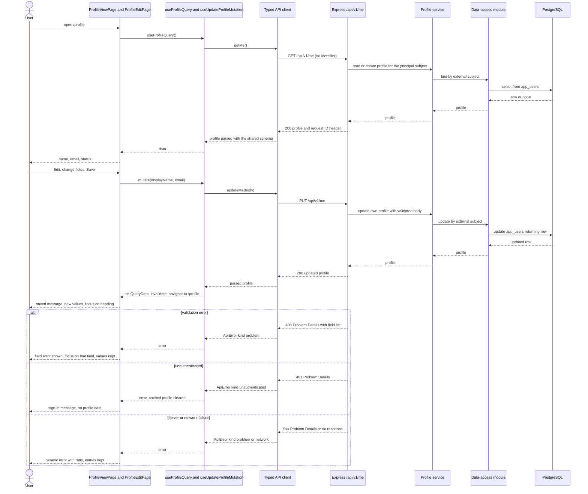
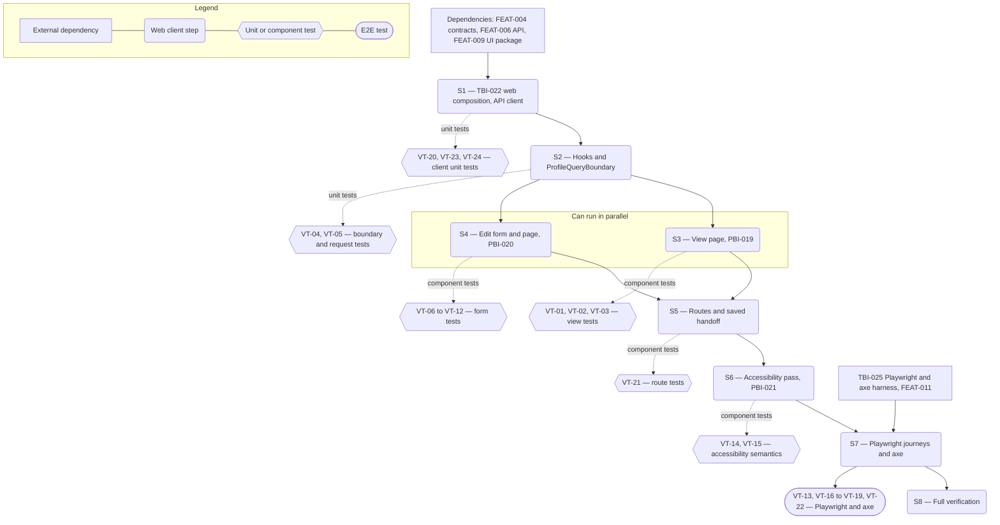

# Technical Specification — Self-Service Profile Screen

> **PRD slug:** `full-stack-express-starter-template` | **Owning layer:** `templates/full-stack-express/apps/web/src/` (web client; see note on Apex layers below) | **Surface:** Frontend only
> **Verification builds:** from `templates/full-stack-express/`: `pnpm --filter @{scope}/web exec tsc --noEmit`, `pnpm check`, `pnpm test`, `pnpm build` (script names follow TBI-005 and are provisional). Apex's root install, build, test, and format commands must give the same results as without the folder (TBI-001). Apex's `tsc -p tsconfig.server.json` and `tsconfig.client.json` do not cover the template.
> **Open items:** See [design-doc-assumptions.md](design-doc-assumptions.md) (5 unresolved)
> **Design doc:** [design-doc-design.md](design-doc-design.md)

---

## System Boundary and Owning Layer

**Owning layer:** `templates/full-stack-express/apps/web/src/` — the template's web application. Apex's `src/client/components/` is not used, because the template is a nested, self-contained sample with its own lockfile and shares no code with Apex.

**Rationale:** The Feature is a screen and the web composition around it. It consumes the profile API (FEAT-006), the Zod route definitions (FEAT-004), and the UI package (FEAT-009) through package imports. Nothing on the server, in the contracts package, or in the database changes, so the web application is the single owning layer. Feature code sits in `apps/web/src/features/profile/`; app composition sits in `apps/web/src/app/` and `apps/web/src/api/`.

**Ownership answers:**
- New or existing Express service in `src/server/services/`? No — the profile service in `apps/api` (FEAT-006) already serves `GET` and `PUT /api/v1/me`. This Feature calls it and does not edit it.
- New or existing route in `src/server/routes/`? No — `/api/v1/me` is FEAT-006's. The new routes here are two client routes (`/profile`, `/profile/details/edit`) plus an index redirect, registered in `apps/web/src/app/routes.tsx`.
- New React component in `src/client/components/`? Yes, in the template's web app, not Apex's folder: `ProfileQueryBoundary`, `ProfileViewPage`, `ProfileDetails`, `ProfileStatusChip`, `ProfileEditPage`, `ProfileForm` under `apps/web/src/features/profile/`. Loading, error, and shell pieces come from `packages/ui`.
- New shared type in `src/shared/types/`? No — request and response types derive from the Zod definitions in `packages/contracts` (`z.infer`). The web app defines no parallel interface for the profile.
- Database migration needed? No — `app_users` and its migration belong to FEAT-003. The screen reads and writes only through the API.

---

## Security Enforcement

- **Authorization mechanism:** The API's authentication middleware (TBI-012) and the authenticated principal gate `GET` and `PUT /api/v1/me`. The web client has no role or permission check. Apex's permission-key pattern in `rbac-governance.mdc` (`requirePermission(...)` on routes, `can(...)` in the UI) is deliberately not used, because the template defines no roles and leaves RBAC as an extension point (BR-003). The client relies on one rule: a 401 means the session is over.
- **Layer that enforces scope:** The API service layer takes the external subject from the principal and never from the request (BR-001, TBI-015). The client adds a second guard: the request type and the `updateMe` body schema hold only `displayName` and `email`, the URL carries no identifier or query string, and VT-05 asserts both. A 401 on `GET` clears cached profile data, so the screen cannot show stale values after the session ends (PBI-019 AC d).
- **Sensitive data handling:** Display name, email, and subject have no data classification yet (PRD, left to Platform Engineering), so the screen uses the strictest handling. Values stay in the in-memory TanStack Query cache and never reach `localStorage`, `sessionStorage`, cookies, URLs, or the console. The screen renders values as React text (no `dangerouslySetInnerHTML`). Error copy is fixed text; Problem Details `title`, `detail`, and request ID are never rendered, except the per-field validation messages from the shared schema. All fixtures and tests use synthetic values.

---

## Architecture and Approach

### Layers touched

| Layer | Changed | Notes |
|-------|---------|-------|
| Server services (`src/server/services/`) | No | Profile service belongs to FEAT-006 |
| Server routes (`src/server/routes/`) | No | `/api/v1/me` belongs to FEAT-006 |
| Server middleware (`src/server/middleware/`) | No | Authentication middleware belongs to FEAT-005 (TBI-012) |
| Client components (`src/client/components/`) | Yes | In the template: `apps/web/src/features/profile/*.tsx` (six components) and `apps/web/src/app/` composition (`main.tsx`, `App.tsx`, `routes.tsx`) |
| Client hooks (`src/client/hooks/`) | Yes | In the template: `profileKeys.ts`, `useProfileQuery.ts`, `useUpdateProfileMutation.ts`; TanStack Query lives in hooks, as `react-coding-standards.mdc` requires |
| Shared types (`src/shared/types/`) | No | Types derive from `packages/contracts`; no new type files |
| Database (migrations/) | No | No schema change |
| Drizzle schema (`src/server/db/schema.ts`) | No | No schema change |
| Web API client and query client | Yes | `apps/web/src/api/apiClient.ts`, `ApiError.ts`; `apps/web/src/app/queryClient.ts` (TBI-022) |
| Web build config | Yes | `apps/web/vite.config.ts` dev proxy for `/api` (TBI-022) |
| Web tests | Yes | Vitest and React Testing Library beside each module; Playwright specs in the template's e2e folder (TBI-025 sets the location) |

### Per-work-item design decisions

**TBI-022 — Compose the web application with routing, query client, and typed API client**
- Pattern followed: Apex's `react-coding-standards.mdc` — server state in TanStack Query inside custom hooks, never fetched in `useEffect`; every view wrapped in loading and error boundaries. The template's `main.tsx` mounts, outermost to innermost: the UI package theme provider, `QueryClientProvider`, the UI package error boundary, and the router with the application shell as the layout route.
- Key decisions:
  - The API client is a small module built from the contracts route definitions: `getMe()` and `updateMe(body)`. Each call builds a relative URL (`/api/v1/me`), sends `fetch` with `Accept: application/json` (and `Content-Type: application/json` for `PUT`), then parses a 2xx body with the route's response schema. A body that fails the schema throws `ApiError` of kind `invalid-response`, so unparsed data never reaches a component (TBI-022 NFR). Types come from `z.infer` on the same definitions.
  - `ApiError` is the single error type. It has `kind` (`unauthenticated`, `problem`, `invalid-response`, `network`), `status`, and the parsed Problem Details body when one exists. A non-JSON error body (for example a proxy page) becomes kind `problem` with no body. 401 becomes `unauthenticated`. The client does not redirect on 401 (see ⚠ in the assumptions file).
  - Relative URLs work in both places: `vite.config.ts` proxies `/api` to the API's local port in development, and the production container serves the built client from the same origin (TBI-014, TBI-032). Rejected: a `VITE_API_BASE_URL` variable, because it adds a config surface and a way to point the client at the wrong host.
  - Query client defaults: `mutations.retry: 0`; queries inherit TanStack defaults except the profile query sets `retry: false` itself. Rejected: global `retry: false`, because future list screens may want retries.
  - `routes.tsx` holds a plain route array. S5 adds the entries for `/`, `/profile`, and `/profile/details/edit`. Page components load with `React.lazy`, wrapped in `Suspense` (the UI package `LoadingState`) and the error boundary, following `react-coding-standards.mdc`.

**PBI-019 — See my profile on a profile screen**
- Pattern followed: Apex `react-coding-standards.mdc` early-return pattern; the UI package `LoadingState` and `ErrorState` from TBI-021.
- Key decisions:
  - `useProfileQuery` calls `apiClient.getMe()` with key `['profile', 'me']` (from `profileKeys.ts`) and `retry: false`. The user retries by choice, and the error state appears without the 7-second delay default retries would add.
  - `ProfileQueryBoundary` owns state precedence, so both pages behave the same: (1) unauthenticated error → remove cached profile data and render the sign-in state; (2) `data` present → render children, even if a background refetch failed; (3) other error → `ErrorState` with "Try again" bound to `refetch()`; (4) otherwise → `LoadingState`, rendered on the first render with no delay. Rejected: a delayed spinner, because the AC requires an immediate loading state.
  - `ProfileDetails` is a presentational `dl`. Email renders `data.email ?? <EmptyValue>No email on file</EmptyValue>`; `null`, `undefined`, and `''` all take the empty path, so the word "null" and blank space cannot appear. `ProfileStatusChip` maps the contract's status enum to a text label with a typed `Record`, so a new enum value fails type-checking until labeled.
  - The page reads no identifier from the URL, router state, or props. The screen shows only `displayName`, `email`, and `status`; it renders no `id` or subject even if the response carries one.
  - The Edit control is a router `Link` styled as a MUI `Button` (it navigates, so it is a link, not a button).

**PBI-020 — Edit my profile with clear validation**
- Pattern followed: Apex `react-coding-standards.mdc` forms rule — React Hook Form with `zodResolver`, no hand-managed field state.
- Key decisions:
  - The form's schema reuses field schemas from the contracts package: `z.object({ displayName: updateProfileRequestSchema.shape.displayName, email: z.preprocess((v) => (v === '' ? null : v), updateProfileRequestSchema.shape.email) })`. Limits and messages stay in contracts, so the form copies no rule. Because `preprocess` makes input and output types differ, the form declares `useForm<FormInput, unknown, UpdateProfileRequest>` and `mutate` receives the parsed output (`email: string | null`). Rejected: a second hand-written form schema, which would drift from the contract.
  - `mode: 'onChange'` shows over-limit errors before submit. Inputs have no `maxLength` attribute, which would stop the input the AC says must show an error. `shouldFocusError: true` (the default) moves focus to the first invalid field in DOM order, display name then email, and the request is never sent.
  - Form values start from the loaded profile once, when the form mounts (`defaultValues` built from `data`). A background refetch does not reset the form, so typed values survive it. `ProfileEditPage` renders the form only inside `ProfileQueryBoundary`, so `data` exists at mount.
  - `useUpdateProfileMutation` calls `apiClient.updateMe(body)`. On success it runs `queryClient.setQueryData(profileKeys.me, response)` and then `invalidateQueries({ queryKey: profileKeys.me })`, so the read page shows saved values at once and a background `GET` confirms them. The page then calls `navigate('/profile', { state: { saved: true } })`.
  - Failures: `ApiError` kind `problem` with a validation body → `mapProblemToFormErrors` calls `setError` per named field, and `setFocus` on the first one. Any other failure → form-level `Alert` ("We couldn't save your changes. Your entries are still here.") with "Try again" that re-submits the current values through `handleSubmit`. A 401 on `PUT` → the same `Alert` with sign-in text and no retry; values stay.
  - Save pending: the Save button gets `aria-disabled` and "Saving…", and the submit handler returns early while `isPending`. It is not `disabled`, so keyboard focus does not drop to `body`.
  - Cancel is a `Link` to `/profile` with no confirmation.

**PBI-021 — Use the profile screen with a keyboard and screen reader**
- Pattern followed: MUI's built-in `TextField` label and helper-text wiring, the UI package's state components (named accessible regions), and Apex's focus-management habit of explicit refs for targets that are not natively focusable.
- Key decisions:
  - Focus targets: `h1` (`tabIndex={-1}`) after a save or when a page opens; first invalid input on a blocked submit or server field error; the form-level `Alert` (`tabIndex={-1}`) on a general save failure. The form carries `aria-describedby` to the `Alert` id while it shows.
  - Announcements: loading text in `role="status"`; load error, sign-in-required, and field error text in `role="alert"`; the saved message in `role="status"`. Live regions render on the first paint of their state, not toggled later, so screen readers pick them up.
  - Tab order follows DOM order with no positive `tabIndex` values. No `autoFocus` on inputs.
  - Axe runs in Playwright on every state in light and dark themes (S7). Component tests assert roles, names, and descriptions (`toHaveAccessibleName`, `toHaveAccessibleDescription`) so most failures show up before the browser run.
  - Colors, spacing, and focus rings come from theme tokens (TBI-020). The screen sets no color, font, or shadow itself, and `sx` is used only for layout.
  - Standards note: `ui-standards` (TBI-036) does not exist yet when this screen is built; PBI-034 reviews the finished screen against it (see assumptions).

---

## Data and Contracts

### API endpoints

This Feature consumes endpoints that FEAT-006 implements and FEAT-004 defines. It adds none.

| Method | Route | Request shape | Response shape | Auth |
|--------|-------|--------------|----------------|------|
| GET | `/api/v1/me` | None (no body, no query, no identifier) | `ProfileResponse`: `{ displayName: string, email: string \| null, status: <contract enum> }`; the screen reads only these fields. Headers include the request ID. | Authenticated principal from the identity adapter; no roles |
| PUT | `/api/v1/me` | `UpdateProfileRequest`: `{ displayName: string, email: string \| null }`; the screen sends exactly these two keys | Updated `ProfileResponse` | Authenticated principal from the identity adapter; no roles |

Error responses are RFC 9457 Problem Details with a request ID header. 401 means unauthenticated. 400 carries a list of `{ field, message }` entries, one per invalid field. Other statuses produce the generic error state. Field names, limits, and the cleared-email format are open in the assumptions file (⚠), and the working names are `getMe`, `updateMe`, `updateProfileRequestSchema`, and `profileResponseSchema`.

### Schema / storage changes

| Target | Change | Reason |
|--------|--------|--------|
| None | No table, column, migration, or Drizzle change | The screen uses the API only; `app_users` is FEAT-003's |
| Browser storage | None written | Profile values stay in the in-memory query cache (see Security Enforcement) |

---

## Testing Strategy

Tests prove what a person sees and does, and what the network receives. They do not assert hook internals or library calls.

**Unit tests (Vitest):**
- `apiClient` — success parses with the shared schema; a Problem Details error throws `ApiError` with status and body; 401 gives kind `unauthenticated`; a 200 whose body fails the schema throws `invalid-response`; request URLs are relative; the `PUT` body holds only the two fields. Stub `fetch` at the network boundary (TBI-022 DoD).
- `mapProblemToFormErrors` — maps each named field; ignores unknown field names without throwing.
- `ProfileStatusChip` — each enum value shows its text label.

**Component tests (Vitest and React Testing Library, `MemoryRouter`, fresh `QueryClient` per test with `retry: false`):**
- `ProfileViewPage` — loading text first, then details; error with retry (and retry succeeds); empty email text; 401 shows the sign-in state and no profile text; cached data is cleared on 401.
- `ProfileEditPage` and `ProfileForm` — valid save sends exactly `{ displayName, email }`, returns to `/profile`, and shows saved values; failed save keeps values and shows the retry; clearing email sends `null`; limit and limit-plus-one lengths (import the limits from contracts); empty name and malformed email send no request and focus the right field; server 400 maps to fields; pending state blocks a second submit.
- Accessibility semantics — roles, accessible names and descriptions, focus targets, live-region text.
- Query by role and label first; use the `data-testid` values from the design doc for regions that have no role.

**Integration and E2E tests (Playwright with axe; harness from TBI-025, FEAT-011):**
- Journey against the real API and PostgreSQL with the development adapter: first open creates the profile, edit, save, reload shows the saved values (VT-22).
- State journeys with `page.route` stubs: slow `GET` (loading), 500 (error and retry), 401, `email: null`, failing `PUT`, validation 400. Axe runs on each state in light and dark themes.
- Keyboard-only journey (VT-13) and a 320 px width check with no horizontal scroll (VT-19).
- Cross-user access is proven at the API level (FEAT-006 tests), not here. This Feature proves the client sends no identifier.

Prior art: Apex layers Jest, Supertest, and Playwright with `data-testid` conventions. The template uses the same layers with Vitest, React Testing Library, and Playwright with axe, as the PRD's Testing Decisions state. Coverage floors (80% lines, functions, and statements; 75% branches; BR-012) apply to the web app, and this Feature's tests count toward them.

---

## Observability

- **Custom events/metrics:** None beyond standard telemetry. The client emits no custom events and writes no console output. The API logs and traces requests (FEAT-007); the request ID header on each response lets Platform Engineering trace a failed call, and the screen never displays it.
- **Alerts:** None.

---

## Rollback and Deployment

- **Schema changes backward compatible:** Yes — there are no schema changes.
- **Rollback procedure:** Remove the three route entries and the `features/profile/` folder. The API, contracts, and UI package do not depend on this Feature, so removal is a revert of one commit. Nothing outside `templates/full-stack-express/` changes.
- **Deployment dependencies:** None. The template has no pipeline here; Platform Engineering's pipeline calls the named scripts (TBI-005). The production container (TBI-032) packages the built client, and this Feature needs no change to it.
- **Feature flag gates deployment:** No — the PRD sets Flag required: No.

---

## Verification Test Matrix

| ID | Layer | Arrange | Act | Assert | Linked |
|----|-------|---------|-----|--------|--------|
| VT-01 | Vitest + RTL | `GET /api/v1/me` stub returns `{ displayName: 'Sam Example', email: 'sam@example.test', status }` after a delay | Render `/profile` | Loading status text shows first; then display name, email, and status text show in the `dl` | PBI-019 (a) |
| VT-02 | Vitest + RTL | `GET` stub returns 500 Problem Details with a `detail` string, then 200 on the second call | Render `/profile`; click "Try again" | Error state shows with a retry button and none of `title`, `detail`, status code, or request ID; after retry the details show | PBI-019 (b) |
| VT-03 | Vitest + RTL | `GET` returns `email: null` (repeat with `''`) | Render `/profile` | "No email on file" shows in the email slot; the text "null" and an empty `dd` do not appear | PBI-019 (c) |
| VT-04 | Vitest + RTL | `GET` returns 401 Problem Details; also a seeded cache entry followed by a 401 refetch | Render `/profile` | Sign-in message shows with `role="alert"`; no display name, email, or status text; cached data is gone | PBI-019 (d), TBI-022 (d) |
| VT-05 | Vitest + RTL | Record every request made by the pages and hooks | Load `/profile`, edit, and save | Every request goes to `/api/v1/me` with no query string; the `PUT` body keys equal `displayName` and `email` only; no request holds a subject or id | PBI-019 (d), PBI-020 (d) |
| VT-06 | Vitest + RTL | Profile loaded; `PUT` stub returns the updated profile; the follow-up `GET` stub is delayed | Open `/profile/details/edit`, change display name, press Save | One `PUT` with `{ displayName, email }`; app is at `/profile`; the new name shows before the delayed `GET` resolves; saved message in `role="status"`; a background `GET` runs | PBI-020 (a) |
| VT-07 | Vitest + RTL | `PUT` stub returns 500 once, then 200 | Edit both fields, press Save, then "Try again" | After failure the inputs hold the typed values; `Alert` with `role="alert"` and retry shows; focus is on the `Alert`; retry re-sends the same body and succeeds | PBI-020 (b) |
| VT-08 | Vitest + RTL | Profile has an email; limits imported from contracts | Clear the email and save; separately enter a name at the maximum length and save; then enter maximum plus one | `PUT` sends `email: null` and succeeds; the maximum-length name sends and succeeds; maximum plus one shows a field error immediately with no submit and no request | PBI-020 (c) |
| VT-09 | Vitest + RTL | Profile loaded | Clear the name and press Save; then fix the name, enter `not-an-email`, and press Save; then break both | No `PUT` is sent in any case; each invalid field shows its error and `aria-invalid`; focus lands on the first invalid field (name when both are invalid) | PBI-020 (d) |
| VT-10 | Vitest + RTL | `PUT` stub returns 400 Problem Details naming `email` | Submit a well-formed form | The email input shows the message and has focus; the name input shows no error; values stay | PBI-020 (b) |
| VT-11 | Vitest + RTL | `PUT` stub returns 401 | Submit the form | `Alert` shows the sign-in text with no retry; the inputs keep their values | PBI-020 (d), TBI-022 (d) |
| VT-12 | Vitest + RTL | `PUT` stub never resolves | Press Save twice (click, then Enter) | One request only; button shows "Saving…" with `aria-disabled="true"` and still has focus | PBI-020 (c) |
| VT-13 | Playwright | Real API with the development adapter | Using only the keyboard: Tab to Edit, Enter, change name, Tab to Save, Enter | Focus order is Edit, name, email, Save, Cancel; each focused control shows a visible focus indicator; save succeeds and focus lands on the `h1` | PBI-021 (a) |
| VT-14 | Vitest + RTL | `PUT` returns 500; separately returns 400 for `email` | Submit the form | General failure: `role="alert"` text is present and the form's `aria-describedby` points at it. Field failure: the email input's accessible description holds the message | PBI-021 (b) |
| VT-15 | Vitest + RTL | `GET` delayed; second case `GET` returns `email: null` | Render `/profile` | Loading text sits in a `role="status"` region; the empty-email text is part of the `dd` and is read with its label | PBI-021 (c) |
| VT-16 | Playwright | Stubs for loading, unauthenticated, and empty-email states | Open each state, press Tab repeatedly | Focus moves from the state into the shell and back with no trap; the loading and sign-in states are exposed in the accessibility tree with their text | PBI-021 (c) |
| VT-17 | Playwright + axe | Stubs for every state: loading, load error, sign-in, view, empty email, edit, field errors, save error; run in light and dark themes | Open each state and run axe | Zero violations in every state and theme | PBI-021 (d) |
| VT-18 | Playwright + axe | A test-only page with an unlabeled input and a low-contrast text pair | Run the shared axe helper on it | The helper reports both violations and its test fails, so the gate fails on a bad control | PBI-021 (d) |
| VT-19 | Playwright | Real API; viewport 320 px wide | Open `/profile` and `/profile/details/edit` | No horizontal scroll; Edit, Save, and Cancel stay reachable | PBI-019 (a), PBI-020 (a) |
| VT-20 | Vitest | `fetch` stub returns 200 with a body missing `status`, and a body with a wrong type | Call `apiClient.getMe()` | Throws `ApiError` kind `invalid-response`; no data returned | TBI-022 (d) |
| VT-21 | Vitest + RTL | `MemoryRouter` at `/`, `/profile`, and `/profile/details/edit` | Render the app routes | `/` redirects to `/profile`; `/profile/details/edit` loads the form after loading with no earlier navigation | PBI-020 (a), TBI-022 (a) |
| VT-22 | Playwright | Real API and PostgreSQL, development adapter, empty `app_users` | Open `/profile`, edit the name, save, reload | First open creates the profile; saved name shows after save and after reload | PBI-019 (a), PBI-020 (a) |
| VT-23 | Vitest | `fetch` stubs for 200, 500 Problem Details, 401, and a rejected fetch | Call `getMe()` and `updateMe(body)` | 200 returns typed data; 500 throws `ApiError` kind `problem` with the body; 401 throws kind `unauthenticated`; a rejected fetch throws kind `network`; every URL is `/api/v1/me`; the `PUT` has `Content-Type: application/json` | TBI-022 (a), (b), (c) |
| VT-24 | Vitest + RTL | Render the app with a child page that throws during render | Open the route | The page sits inside the shell's `main` landmark; the error boundary shows its recoverable state rather than a blank page | TBI-022 (a) |

---

## Implementation Plan

- [ ] S1 — **TBI-022:** Compose the web app in `apps/web`: `main.tsx` providers (theme, `QueryClientProvider`, error boundary, router with shell layout route); `app/queryClient.ts`; `api/ApiError.ts` and `api/apiClient.ts` (`getMe`, `updateMe`) built on `packages/contracts`; `vite.config.ts` `/api` dev proxy; empty `routes.tsx` _(blocked by FEAT-004, FEAT-006, and FEAT-009 deliverables; the assumptions file lists the names to confirm)_
  - Covers: `VT-20`, `VT-23`, `VT-24`
- [ ] S2 — Add `profileKeys.ts`, `useProfileQuery.ts`, `useUpdateProfileMutation.ts`, and `ProfileQueryBoundary.tsx` with the loading, error, and sign-in states _(blocked by S1; also needs ⚠ sign-in action answered)_
  - Covers: `VT-04`, `VT-05`
- [ ] S3 — Build `ProfileDetails`, `ProfileStatusChip`, and `ProfileViewPage` (heading, saved message, Edit link, `document.title`) _(blocked by S2; can parallel with S4; ⚠ create-on-first-access confirmed first)_
  - Covers: `VT-01`, `VT-02`, `VT-03`
- [ ] S4 — Build `ProfileForm`, `mapProblemToFormErrors`, and `ProfileEditPage` (schema reuse, validation on change, save, failure, retry, pending, Cancel) _(blocked by S2; can parallel with S3; ⚠ field limits and cleared-email format confirmed first)_
  - Covers: `VT-06`, `VT-07`, `VT-08`, `VT-09`, `VT-10`, `VT-11`, `VT-12`
- [ ] S5 — Register `/` (redirect), `/profile`, and `/profile/details/edit` in `routes.tsx` with lazy pages; hand off `{ saved: true }` on save _(blocked by S3, S4; ⚠ route shape confirmed first)_
  - Covers: `VT-21`
- [ ] S6 — Accessibility pass: focus targets, live regions, `aria-describedby` links, tab order, `data-testid` values from the design doc _(blocked by S5)_
  - Covers: `VT-14`, `VT-15`
- [ ] S7 — Add Playwright journeys and axe runs for every state in both themes, the keyboard journey, the 320 px check, the axe negative control, and the real-API journey _(blocked by S6 and the FEAT-011 harness, TBI-025)_
  - Covers: `VT-13`, `VT-16`, `VT-17`, `VT-18`, `VT-19`, `VT-22`
- [ ] S8 — Run the full verification: template `check`, `test`, and `build`; confirm coverage floors; confirm Apex's root install, build, test, and format checks behave as before _(blocked by S7)_
  - Covers: all `VT-xx`

**Execution lanes:**
- Lane 1 (start immediately): S1
- Lane 2 (after S1): S2
- Lane 3 (after S2, in parallel): S3, S4
- Lane 4 (after S3 + S4): S5, then S6
- Lane 5 (after S6 + TBI-025): S7, then S8

---

## Diagram 1 — Code Execution Flow

---

## Diagram 2 — Implementation Dependency Map

