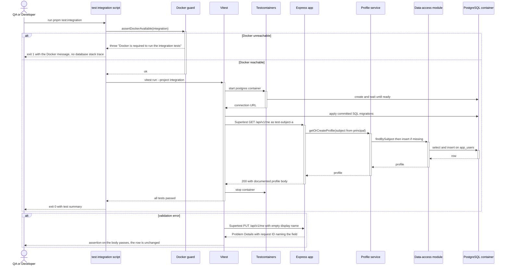
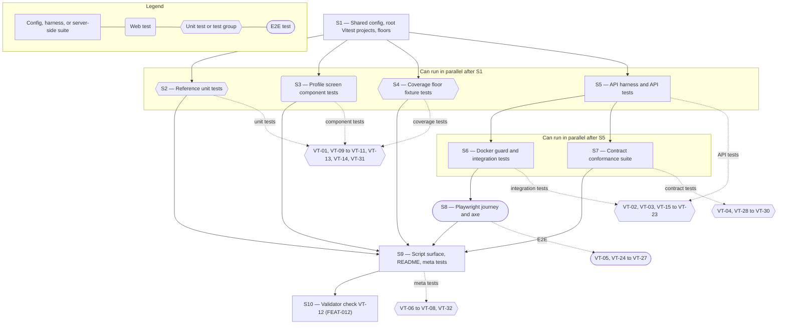

# Technical Specification — Reference Test Framework

> **PRD slug:** `full-stack-express-starter-template` | **Owning layer:** full-stack — `templates/full-stack-express/` (`packages/config`, `apps/api/test/`, `apps/web`, `e2e/`, `scripts/`) | **Surface:** Full stack
> **Verification builds:** Template: `pnpm check`, `pnpm test:coverage`, `pnpm test:api`, `pnpm test:contract`, `pnpm test:integration`, `pnpm test:e2e`. Apex stays unchanged: `npx tsc -p tsconfig.server.json --noEmit`, `npx tsc -p tsconfig.client.json --noEmit`, and `npm run lint` return the same results with and without the template folder.
> **Open items:** See [design-doc-assumptions.md](design-doc-assumptions.md) (5 unresolved)
> **Design doc:** [design-doc-design.md](design-doc-design.md)

---

## System Boundary and Owning Layer

**Owning layer:** `templates/full-stack-express/` — the isolated pnpm workspace from FEAT-001. Inside it: `packages/config` (shared Vitest and Playwright configuration), `apps/api/test/` (API, integration, and contract tests plus their harness), `apps/web` and `packages/ui` (component tests next to the code), root `e2e/` (Playwright), and root `scripts/` (Docker guard). Apex's own `src/`, `migrations/`, `tests/`, and root configs stay untouched.

**Rationale:** BR-008 bars Apex-specific code and Apex runtime changes. The framework belongs in the template workspace, in the layers it tests. The shared floors and project helpers go in `packages/config` because TBI-003 makes that package the one place where rules change for every member. Server-side tests sit in `apps/api/test/` so they import the real Express app, middleware, and contracts. Playwright sits at the template root because a journey spans `apps/api` and `apps/web`, and neither app should own it.

**Ownership answers:**
- New or existing Express service in `src/server/services/`? **No.** Apex has no change here. Inside the template, the profile service (TBI-015) is the unit under test; this Feature adds no service.
- New or existing route in `src/server/routes/`? **No.** The tests call the routes from FEAT-006 and add none.
- New React component in `src/client/components/`? **No.** Apex has no change. Component tests live beside the template's profile screen (FEAT-010) as `*.test.tsx` files.
- New shared type in `src/shared/types/`? **No.** Test helper types stay in `apps/api/test/support/`. Route and error types come from the contracts package.
- Database migration needed? **No.** Tests apply the migrations that FEAT-003 commits. A test never edits or adds a migration.

**Cross-feature inputs this Feature needs before its tests can run:** committed migrations and the data-access module (FEAT-003), the committed OpenAPI document and route registry (FEAT-004), the Express composition root and profile and health routes (FEAT-006), and the profile screen and test selector convention (FEAT-009 TBI-021, FEAT-010).

---

## Security Enforcement

- **Authorization mechanism:** None to add. The template defines no roles or permissions (BR-003), so Apex patterns such as `requirePermission(...)` and the groups in `rbac-governance.mdc` do not apply and must not appear in template code. The tests assert the authentication boundary that exists: every protected route returns a Problem Details 401 without a principal (VT-17), and the development adapter works only when the mode is `development` and the environment is not production (covered by FEAT-005; the journey uses it under that guard).
- **Layer that enforces scope:** Both. Route middleware rejects unauthenticated calls. The profile service takes the subject from the principal and never from the request, so data stays user-scoped. VT-21 proves the second layer against real PostgreSQL: a request that carries another principal's identifier in the body, query, or path changes nothing and reveals nothing.
- **Sensitive data handling:**
  - Fixtures use synthetic values only: emails end in `@example.test`, subjects and names carry a `test-` prefix (BR-007). VT-31 scans fixtures and test artifacts and fails on anything else.
  - No test needs a real credential. The PostgreSQL container uses throwaway credentials, binds to a random port on localhost, and is removed after the run.
  - Playwright talks only to the local process that `start-stack.mjs` starts. The config sets no remote `baseURL`.
  - Coverage and test reports contain paths and percentages, never record data (VT-14).
  - Failure output for database errors must hold no connection string, host, or SQL text (VT-18, VT-23).

---

## Architecture and Approach

### Layers touched

| Layer | Changed | Notes |
|-------|---------|-------|
| Server services (`src/server/services/`) | No | Apex untouched (BR-008). |
| Server routes (`src/server/routes/`) | No | Apex untouched. |
| Server middleware (`src/server/middleware/`) | No | Apex untouched. VT-08 swaps the template's authentication middleware inside a test run only. |
| Client components (`src/client/components/`) | No | Apex untouched. |
| Client hooks (`src/client/hooks/`) | No | Apex untouched. |
| Shared types (`src/shared/types/`) | No | Apex untouched. |
| Database (migrations/) | No | Apex untouched. Tests apply the template's migrations to a throwaway container. |
| Drizzle schema (`src/server/db/schema.ts`) | No | Apex untouched. VT-19 reads the template's Drizzle table definition to compare it with the migrated schema. |
| Template `packages/config` | Yes | Vitest helper, `coverageFloors`, Playwright base config. |
| Template `apps/api/test/` | Yes | `api/`, `integration/`, `contract/`, `support/`. |
| Template `apps/web`, `packages/ui` | Yes | `*.test.tsx` component tests and MSW handlers; no source change. |
| Template `e2e/` | Yes | Playwright config, `start-stack.mjs`, journey spec, axe helper. |
| Template `scripts/` | Yes | `docker-guard.mjs`. |
| Template root `package.json`, `README.md` | Yes | Test scripts and a Testing section. |

**Test layout (all paths inside the template):**

| Layer | Project / runner | Files | Needs Docker |
|-------|------------------|-------|--------------|
| Unit | Vitest `unit` (Node) | `**/*.test.ts` outside `apps/api/test/{api,integration,contract}` | No |
| Component | Vitest `component` (jsdom) | `apps/web/**/*.test.tsx`, `packages/ui/**/*.test.tsx` | No |
| API | Vitest `api` (Node) | `apps/api/test/api/*.api.test.ts` | No |
| Integration | Vitest `integration` (Node) | `apps/api/test/integration/*.integration.test.ts` | Yes |
| Contract | Vitest `contract` (Node) | `apps/api/test/contract/*.contract.test.ts` | No |
| End-to-end and accessibility | Playwright | `e2e/specs/*.spec.ts` | Yes |

### Per-work-item design decisions

**TBI-023 — Set up unit and component tests with coverage thresholds**
- Pattern followed: Apex `jest.config.js` splits tests into `projects` (a Node `server` project and a jsdom `client` project). The template mirrors that with Vitest `projects` in one root `vitest.config.ts`. Apex's `tests/integration/*.integration.test.ts` naming also carries over.
- Key decisions:
  - `packages/config` exports `coverageFloors` and a `defineTestProject({ name, environment })` helper. Each member's own `vitest.config.ts` calls the helper, which accepts no threshold option, so a local override is impossible by API and detectable by scan (VT-13).
  - Only the root `vitest.config.ts` reads `coverageFloors` into `coverage.thresholds`. Vitest reads coverage options at the root, so one definition covers every project.
  - Provider is V8. Reporters are `text` (prints the totals), `json-summary`, and `lcov`, written to a git-ignored `coverage/` folder.
  - Component tests use React Testing Library with `user-event` and answer HTTP calls through `msw` at the network edge. This keeps tests on what a person sees and does and off the API client's internals (PRD testing decisions). Alternative rejected: mocking the API client module, which asserts wiring instead of behavior.
  - Reference unit tests: contracts (valid and invalid payloads parse as the schema says, and the generator output stays stable), configuration (valid, missing, and malformed environment values, with no secret in the message), and data-access logic that needs no database (row-to-profile mapping and unique-violation classification). Real SQL stays in the integration suite.
  - Reference component tests cover the profile screen: loading, loaded, empty email shown as a clear empty value, load error with retry, valid save, field-level validation with focus on the first invalid field, save failure that keeps typed values, and the unauthenticated message.
  - Alternative rejected: Jest. Apex uses it, but the web client builds with Vite, and Vitest shares that transform. The backlog also names Vitest.

**TBI-024 — Set up API and PostgreSQL integration tests**
- Pattern followed: Apex `tests/integration/` runs against real PostgreSQL with one worker, and Apex already depends on Supertest.
- Key decisions:
  - **Two suites with one harness.** `apps/api/test/support/createTestApp.ts` builds the real Express composition root (FEAT-006) from injected parts: a data-access store and an identity adapter. API tests inject an in-memory store that implements the data-access interface and can be told to throw. Integration tests inject the real Drizzle store on a container database. Both suites send requests through Supertest.
  - `testIdentityAdapter.ts` picks the principal from an `x-test-subject` header. It lives under `test/` and `src/` never imports it.
  - **Fresh database per run.** A Vitest `globalSetup` for the `integration` project calls the Docker guard, starts a `postgres` Testcontainers container, applies the committed SQL migrations through the same function the `migrate` script calls, and passes the connection URL to tests with `provide`. It does not use a schema push, which would hide a broken migration. A `beforeEach` truncates `app_users`. Teardown stops the container; Testcontainers' reaper removes it after a crash. Deviation from Apex: Apex points tests at a shared, pre-migrated database through `TEST_DATABASE_URL`.
  - The script runs the suite with `--no-file-parallelism`, as Apex's integration config sets `maxWorkers: 1`.
  - Timeouts: 30 s per test (Apex uses the same) and 120 s for the container start hook.
  - Database failure on the integration side uses an app instance whose pool points at a closed local port. It proves the real driver error becomes a Problem Details 500 with no database text.
  - VT-19 checks the schema by comparing `information_schema` columns and constraints with the Drizzle table definition read through `getTableConfig`.

**TBI-025 — Set up Playwright journeys with axe accessibility checks**
- Pattern followed: Apex `tests/e2e/specs/a11y.spec.ts` (`@axe-core/playwright`, tag-filtered scans, a shared assert helper, an `@a11y` tag, role-based locators) and Apex `playwright.config.ts` (serial workers, `forbidOnly`, trace on failure).
- Key decisions:
  - `e2e/support/start-stack.mjs` is the Playwright `webServer` command. Playwright starts `webServer` before `globalSetup`, so the script itself guards Docker, starts PostgreSQL, applies migrations, then starts the built API with `AUTH_MODE=development` and a non-production `NODE_ENV`. The API serves the built web client, so the browser uses relative paths, as the container will.
  - The journey needs a row for the development principal. It relies on create-on-first-access (⚠ in the assumptions file).
  - States come from route interception on `/api/v1/me`, never from a test-only switch in the application: hold the request for loading, fulfill 500 `application/problem+json` for load and save errors, and fulfill 401 for the unauthenticated state. Interception waits on a promise, not a timer.
  - `e2e/support/axe.ts` exports `expectNoAxeViolations(page, label)`. It scans with `wcag2a`, `wcag2aa`, and `wcag21aa` and fails on any violation, listing rule id, impact, and the first node. Deviation from Apex: Apex fails only on `critical` and `serious`, but PBI-021 (d) says the gate fails on any violation.
  - States scanned: loading, loaded, loaded without email, edit, validation error, save error, load error, and unauthenticated.
  - Locators use roles, labels, and the `data-testid` convention from FEAT-009 TBI-021. A lint rule in the config package bans CSS-class, id, and XPath locators in `e2e/` (VT-27).
  - Config: Chromium only, `workers: 1`, `forbidOnly: true`, `retries: 0`, `trace: 'retain-on-failure'`, `screenshot: 'only-on-failure'`, reporters `list` and `html` (never auto-open). It reads no `CI` variable, because BR-013 leaves run policy to each team.
  - Browsers install through `pnpm e2e:install`, not `pnpm install`.

**TBI-026 — Add contract conformance tests from the OpenAPI document**
- Pattern followed: the contracts package's drift check (FEAT-004) already ties the committed document to Zod. This suite ties the running API to that document.
- Key decisions:
  - The suite runs on the API test harness, so it needs no Docker. The in-memory store forces each documented error.
  - `scenarios.ts` is a record keyed by `operationId` from the contracts package's route registry. A route with no entry is a type error, and VT-28 repeats the check at run time against the committed document, so a stale registry cannot hide a gap.
  - For each scenario the test sends the request, finds the response schema for the actual status in the committed document, resolves `$ref`s, and validates the body with `ajv` (2020-12 dialect, matching OpenAPI 3.1). A status the document does not list fails. Every response must carry a request ID header. Non-2xx bodies must have the `application/problem+json` type and validate against the shared Problem Details schema.
  - Alternative rejected: validating responses with the Zod schemas. Zod generated the document, so that check would not catch a document that drifted or a handler that returns something the document does not describe.

**PBI-022 — Run the complete reference test suite**
- Pattern followed: Apex's `test`, `test:integration`, and `test:e2e` scripts.
- Key decisions:
  - Root `package.json` defines the script surface in [Data and Contracts](#data-and-contracts). The README's Testing section lists each command, what it needs, and a sentence that each team decides when to run them (BR-013).
  - `scripts/docker-guard.mjs` exports `assertDockerAvailable(suite)` and also runs as a CLI. It asks the Testcontainers runtime client for a connection inside a `try`, with a 5 s limit, and throws an error that reads: "Docker is required to run the {suite} tests. Start Docker, or set DOCKER_HOST to a reachable runtime, then re-run `pnpm test:{suite}`." The integration `globalSetup` calls it first, before any database client loads, and the `test:integration` and `test:e2e` scripts run it as a first step. A missing runtime never reaches a database driver, so no connection stack trace appears (VT-07).
  - Default reporters print the test name plus `expected` and `received` values (Vitest) or `Expected` and `Received` (Playwright). No custom reporter is needed (VT-06).
  - The unauthenticated-rejection test enumerates every protected route in the contracts registry and sends no credentials. VT-08 proves the suite catches a removed guard by re-running it with the authentication middleware aliased to a pass-through.

**PBI-023 — See coverage fail below the baseline floors**
- Pattern followed: Vitest's built-in global thresholds. Apex's Jest config sets no thresholds, so this is new ground.
- Key decisions:
  - `pnpm test:coverage` runs the `unit`, `component`, and `api` projects with `--coverage`. Those three need no Docker.
  - Vitest compares each metric with its floor and prints a line such as `Coverage for branches (74%) does not meet global threshold (75%)`. It names the metric and exits non-zero. A value equal to the floor passes.
  - Behavior tests build throwaway fixture projects in a temp folder at test time. The fixtures use the shared floors module and are sized to hit exact counts: 74% branches, 75% branches with 80% on the other three, and a passing set. A helper reads `coverage-summary.json` first and asserts the achieved percentages, so a fixture mistake fails loudly before the threshold check runs (VT-09 to VT-11).
  - VT-13 scans every `vitest.config.*` and `vitest.*.ts` file and fails when a `thresholds` key appears outside the root config. VT-12 (the validator's view of a lowered local threshold) waits for TBI-029.
  - The `include` and `exclude` lists live in the shared config, so a team that widens them does so in one place.

---

## Data and Contracts

### API endpoints

This Feature adds no endpoint. It tests these, all from FEAT-006:

| Method | Route | Request shape | Response shape | Auth |
|--------|-------|--------------|----------------|------|
| GET | `/health/live` | none | liveness body from the contract | None |
| GET | `/health/ready` | none | readiness body from the contract; not-ready status when the database is down; no connection detail | None |
| GET | `/api/v1/me` | none (subject comes from the principal) | profile: display name, optional email, status | Authenticated principal (identity-provider adapter) |
| PUT | `/api/v1/me` | display name and optional email, validated by the shared schema | updated profile | Authenticated principal (identity-provider adapter) |

Every error is RFC 9457 Problem Details with a request ID (BR-005). Tests read status codes for validation and not-ready from the committed OpenAPI document.

### Script contract (consumed by Platform Engineering's pipeline and by the quality manifest)

| Script | Runs | Needs Docker | Exit |
|--------|------|--------------|------|
| `test:unit` | `vitest run --project unit` | No | 0 when all pass |
| `test:component` | `vitest run --project component` | No | 0 when all pass |
| `test:coverage` | `vitest run --project unit --project component --project api --coverage` | No | non-zero when any floor is missed |
| `test:api` | `vitest run --project api` | No | 0 when all pass |
| `test:integration` | `node scripts/docker-guard.mjs integration && vitest run --project integration --no-file-parallelism` | Yes | non-zero with the Docker message when Docker is down |
| `test:contract` | `vitest run --project contract` | No | 0 when all pass |
| `e2e:install` | `playwright install chromium` | No | 0 on success |
| `test:e2e` | `node scripts/docker-guard.mjs e2e && pnpm build && playwright test` | Yes | non-zero with the Docker message when Docker is down |
| `test:a11y` | same as `test:e2e` with `--grep @a11y` | Yes | as above |
| `test` | runs `test:unit`, `test:component`, `test:api`, `test:contract`, `test:integration`, `test:e2e` in order | Yes | stops at the first failure |

The `contract` gate has no manifest entry yet (⚠ in the assumptions file).

### Shared configuration contract

| Export (from `packages/config`) | Meaning |
|---------------------------------|---------|
| `coverageFloors` | `{ lines: 80, functions: 80, statements: 80, branches: 75 }`, the only definition |
| `coverageScope` | `include` and `exclude` globs |
| `defineTestProject({ name, environment })` | Vitest project helper; takes no threshold option |
| `playwrightBase` | Chromium, serial, trace-on-failure defaults |

### Schema / storage changes

| Target | Change | Reason |
|--------|--------|--------|
| Apex database and `migrations/` | None | BR-008: the template never touches Apex data. |
| Template `app_users` | None. Tests read it. | FEAT-003 owns the table. VT-19 compares the migrated table with the Drizzle definition. |
| Throwaway PostgreSQL container | Created per run, migrated from the committed files, removed after the run | Each integration or end-to-end run starts from a fresh database and shares no state (TBI-024 NFR). |

---

## Testing Strategy

**Unit tests:**
- Contracts package — valid and invalid payloads, error shapes, and generator output.
- Configuration — valid, missing, and malformed environment values; the message names the variable and never prints a secret.
- Data-access logic — row mapping and unique-violation classification, with no database.
- Coverage floors — fixture projects prove pass, fail-with-metric-name, and exact-boundary behavior (VT-09 to VT-11). A static scan proves floors are defined once (VT-13).
- Test-support checks — synthetic-data scan (VT-31), script-surface scan (VT-32).

**Component tests:**
- Profile screen — all states from [TBI-023 decisions](#architecture-and-approach), with `msw` answering at the network edge and `user-event` for keyboard and pointer input.

**Integration tests:**
- API (Supertest, in-memory store) — success, validation failure, unauthenticated on every protected route, and store failure (VT-15 to VT-18).
- PostgreSQL (Testcontainers) — migrations, data-access create, find, update, and unique violation, cross-principal isolation, fresh database per run, and health readiness with the database up and down (VT-19 to VT-23).
- Contract — every committed route, response schema, mutated-response detection, and Problem Details on errors (VT-28 to VT-30).

**E2E tests:**
- Profile journey (Playwright, development adapter) — view, edit, save, and save failure (VT-24).
- Accessibility — axe on every screen state, plus a check that the helper itself fails on a known violation (VT-25, VT-26).
- Selector lint — a deliberate CSS-class locator in `e2e/` fails the lint command (VT-27).

**Meta tests (the framework tests itself):**
- A planted failing test shows readable output (VT-06). A missing Docker runtime shows the Docker message (VT-07). A removed authentication guard fails the API suite (VT-08).

**Existing patterns used:** Apex `tests/integration/*.integration.test.ts` (real PostgreSQL, one worker), `tests/e2e/specs/a11y.spec.ts` (axe helper, `@a11y` tag), and `playwright.config.ts` (serial run, `forbidOnly`, trace on failure). Deviations are named under each work item.

---

## Observability

- **Custom events/metrics:** None beyond standard telemetry. The framework emits no events. Machine-readable outputs are the coverage `json-summary` and `lcov` files and the Playwright HTML report and traces. All stay in git-ignored folders and hold no identity values (VT-14).
- **Alerts:** None. This Feature sets no schedule and no pipeline (BR-013).

---

## Rollback and Deployment

- **Schema changes backward compatible:** Yes. No schema change. Tests run migrations only inside throwaway containers.
- **Rollback procedure:** Revert the test files, config exports, scripts, and README section. Nothing outside `templates/full-stack-express/` changes, so Apex has nothing to restore.
- **Deployment dependencies:** None for Apex. Each machine that runs integration or end-to-end tests needs Docker, and `pnpm e2e:install` once for Chromium. The README says so.
- **Feature flag gates deployment:** No. The PRD requires no flag, and the template does not change Apex runtime behavior.

---

## Verification Test Matrix

| ID | Layer | Arrange | Act | Assert | Linked |
|----|-------|---------|-----|--------|--------|
| VT-01 | Script / Vitest | Installed workspace, no Docker needed | Run `pnpm test:unit` and `pnpm test:component` with the JSON reporter | Both exit 0; reference tests ran in contracts, config, data-access, and profile-screen suites (each count above 0) | PBI-022 (a), TBI-023 |
| VT-02 | Script / Vitest | Installed workspace | Run `pnpm test:api` | Exit 0; suite includes VT-15 to VT-18 | PBI-022 (a), TBI-024 |
| VT-03 | Script / Vitest | Docker running | Run `pnpm test:integration` | Exit 0; suite includes VT-19 to VT-23 | PBI-022 (a), TBI-024 |
| VT-04 | Script / Vitest | Installed workspace | Run `pnpm test:contract` | Exit 0; suite includes VT-28 to VT-30 | PBI-022 (a), TBI-026 |
| VT-05 | Script / Playwright | Docker running, Chromium installed | Run `pnpm test:e2e` and `pnpm test:a11y` | Both exit 0 | PBI-022 (a), TBI-025 |
| VT-06 | Script / meta | A temp project with one test that asserts `1` equals `2`, run once under Vitest and once under Playwright | Run each runner on it | Output holds the test title, the expected value, and the received value; exit non-zero | PBI-022 (b) |
| VT-07 | Script / meta | Docker unreachable (`DOCKER_HOST` set to a dead socket) | Run `pnpm test:integration` and `pnpm test:e2e` | Exit non-zero; output contains "Docker is required" and the re-run command; output matches none of `ECONNREFUSED`, `password authentication`, or `pg-pool` | PBI-022 (c) |
| VT-08 | Vitest / meta | Temp Vitest config aliasing the authentication middleware module to a pass-through | Run the `api` project with that config | Exit non-zero; at least one failed test title mentions unauthenticated | PBI-022 (d) |
| VT-09 | Vitest / meta | Fixture project whose four metrics meet the floors | Run Vitest with `--coverage` and the shared floors | Exit 0; output prints the totals table | PBI-023 (a) |
| VT-10 | Vitest / meta | Fixture with 74% branches (for example 37 of 50), other metrics above 80% | Same | Exit non-zero; output names `branches` and the 75% floor | PBI-023 (b) |
| VT-11 | Vitest / meta | Fixture with exactly 75% branches and exactly 80% lines, functions, and statements; helper confirms the percentages from `coverage-summary.json` | Same | Exit 0 | PBI-023 (c) |
| VT-12 | Script / validator | One package's local config sets a lower threshold | Run the manifest validator (TBI-029, FEAT-012) | Output reports the package does not use the shared floors. **Blocked by TBI-029.** | PBI-023 (d) |
| VT-13 | Vitest unit | Template source tree | Scan `vitest.config.*` and `vitest.*.ts` files for a `thresholds` key | Only the root `vitest.config.ts` has one; a planted extra file makes the scan fail | TBI-023, PBI-023 (d) |
| VT-14 | Vitest unit | A finished `test:coverage` run | Scan `coverage/` text and `json-summary` output for any synthetic subject, name, or email from the fixtures | No match | PBI-023 (NFR security) |
| VT-15 | Vitest api | In-memory store holds a profile for `test-subject-a` | `GET` then `PUT` `/api/v1/me` with valid values | 200 on both; bodies match the documented shape; the store holds the new values | TBI-024 |
| VT-16 | Vitest api | Same | `PUT` with empty display name; `PUT` with malformed email; `PUT` with display name over the maximum | Validation Problem Details names each invalid field; the store is unchanged; the over-limit case is rejected, and a value at the limit is saved | TBI-024 |
| VT-17 | Vitest api | Route list read from the contracts registry | Send each protected route without credentials | Problem Details 401 with a request ID, for every route | TBI-024, PBI-022 (d) |
| VT-18 | Vitest api | Store set to throw a driver-style error | `GET` `/api/v1/me` | 500 Problem Details with a request ID; the body has no SQL, host, or driver text | TBI-024 |
| VT-19 | Vitest integration | Empty PostgreSQL container, committed migrations | Apply migrations, then compare `information_schema` with the Drizzle `app_users` definition | Migrations apply with no error; columns, types, nullability, primary key, and unique subject constraint match | TBI-024 |
| VT-20 | Vitest integration | Migrated container, no rows | Call data-access find, create on first access, update, and insert a duplicate subject | Create returns a row; find returns it; update changes only display name and email; the duplicate raises the classified unique violation | TBI-024 |
| VT-21 | Vitest integration | Rows for `test-subject-a` and `test-subject-b` | As A: `GET`, `PUT`, and `PUT` with B's subject and id in body, query, and path | A sees and changes only A's row; B's row is unchanged; B's values never appear in any response to A | TBI-024 |
| VT-22 | Vitest integration | Two consecutive `pnpm test:integration` runs; run one inserts a marker row | Start run two | `app_users` is empty at the start of run two; the container id differs | TBI-024 (NFR) |
| VT-23 | Vitest integration | Container up, then an app instance with a pool at a closed port | `GET` `/health/ready` and `/health/live` in each setup | Up: ready succeeds. Down: ready reports not-ready with no connection string or host; live still succeeds; neither call needs credentials | TBI-024 |
| VT-24 | Playwright | `start-stack.mjs` running, development adapter, synthetic principal | Open the profile screen, edit display name and email, save; then intercept the save with a 500 and save again | Updated profile shows without reload; on failure the typed values stay and an error with retry shows | TBI-025 |
| VT-25 | Playwright | Same; interception sets each state | Run `expectNoAxeViolations` in loading, loaded, loaded-without-email, edit, validation-error, save-error, load-error, and unauthenticated states | Zero violations in every state | TBI-025, PBI-022 (a) |
| VT-26 | Playwright | A page with an unlabeled input set through `page.setContent` | Call `expectNoAxeViolations` | The helper throws and names the rule id | TBI-025 |
| VT-27 | Script / lint | A temp spec in `e2e/` using `page.locator('.some-class')` | Run the template lint command | Lint exits non-zero and names the banned locator; the real specs pass | TBI-025 |
| VT-28 | Vitest contract | Committed OpenAPI document | List every path and method, then compare with the keys of `scenarios.ts` | Every operation has at least one scenario; a planted missing key fails with the operation name | TBI-026 |
| VT-29 | Vitest contract | A handler variant that returns a profile with `displayName` as a number | Run the conformance check on `GET /api/v1/me` | The check fails and names the schema path | TBI-026 |
| VT-30 | Vitest contract | Forced 401, validation failure, 500, and not-ready | Run the conformance check on each | Each body validates against the Problem Details schema, uses `application/problem+json`, and carries a request ID | TBI-026 |
| VT-31 | Vitest unit | All fixture, seed-for-test, and e2e data files | Scan values | Emails end in `@example.test`; subjects and names carry the `test-` prefix; no value looks like a real credential | TBI-023, PBI-022 (NFR security) |
| VT-32 | Vitest unit | Root `package.json` and the README Testing section | Parse both | Every script in the README exists; every `test*` script appears in the README; the README states that each team decides when tests run | PBI-022 |

---

## Implementation Plan

- [ ] S1 — Add shared test configuration in `packages/config` (`coverageFloors`, `coverageScope`, `defineTestProject`, `playwrightBase`) and a root `vitest.config.ts` with the `unit`, `component`, `api`, `integration`, and `contract` projects; add `test:unit`, `test:component`, and `test:coverage` _(blocked by FEAT-001 TBI-003, the config package)_
  - Covers: `VT-13`
- [ ] S2 — Write reference unit tests for contracts, configuration, and data-access logic, and the synthetic fixture module _(blocked by S1; needs FEAT-002, FEAT-003, FEAT-004 modules)_
  - Covers: `VT-01`, `VT-31`
- [ ] S3 — Write reference component tests for every profile screen state, with `msw` handlers _(blocked by S1; needs FEAT-010 and TBI-022; needs the `msw` approval)_
  - Covers: `VT-01`
- [ ] S4 — Write the coverage floor fixture tests and the coverage artifact scan _(blocked by S1)_
  - Covers: `VT-09`, `VT-10`, `VT-11`, `VT-14`
- [ ] S5 — Build the API harness (`createTestApp`, in-memory store, test identity adapter) and write the API tests; add `test:api` _(blocked by S1; needs FEAT-006 composition root and routes)_
  - Covers: `VT-02`, `VT-15`, `VT-16`, `VT-17`, `VT-18`
- [ ] S6 — Add `scripts/docker-guard.mjs`, the integration `globalSetup` with Testcontainers, and the integration tests; add `test:integration` _(blocked by S5 for the harness; needs FEAT-003 migrations and create-on-first-access confirmed)_
  - Covers: `VT-03`, `VT-19`, `VT-20`, `VT-21`, `VT-22`, `VT-23`
- [ ] S7 — Write the contract conformance suite and `scenarios.ts`; add `test:contract` _(blocked by S5; needs the committed OpenAPI document from FEAT-004 and `ajv` approval)_
  - Covers: `VT-04`, `VT-28`, `VT-29`, `VT-30`
- [ ] S8 — Add Playwright: `e2e/` config, `start-stack.mjs`, axe helper, selector lint rule, and the journey; add `e2e:install`, `test:e2e`, and `test:a11y` _(blocked by S6 for the Docker guard; needs FEAT-010 and the FEAT-009 selector convention)_
  - Covers: `VT-05`, `VT-24`, `VT-25`, `VT-26`, `VT-27`
- [ ] S9 — Add the aggregate `test` script and the README Testing section; write the meta tests for failure output, missing Docker, and the removed authentication guard; run every suite end to end _(blocked by S2, S3, S4, S7, S8)_
  - Covers: `VT-06`, `VT-07`, `VT-08`, `VT-32`
- [ ] S10 — Hand VT-12 to FEAT-012 and tick it when the manifest validator lands _(blocked by FEAT-012 TBI-029; tracks PBI-023 (d))_
  - Covers: `VT-12`

**Execution lanes:**
- Lane 1 (start immediately): S1
- Lane 2 (after S1, all parallel): S2, S3, S4, S5
- Lane 3 (after S5, parallel): S6, S7
- Lane 4 (after S6): S8
- Lane 5 (after S2, S3, S4, S7, S8): S9
- Lane 6 (after FEAT-012 TBI-029, outside this Feature): S10

---

## Diagram 1 — Code Execution Flow

The primary path for PBI-022: a QA runs the integration suite, which checks Docker, starts PostgreSQL, applies migrations, and drives the profile endpoint through Supertest.

---

## Diagram 2 — Implementation Dependency Map

