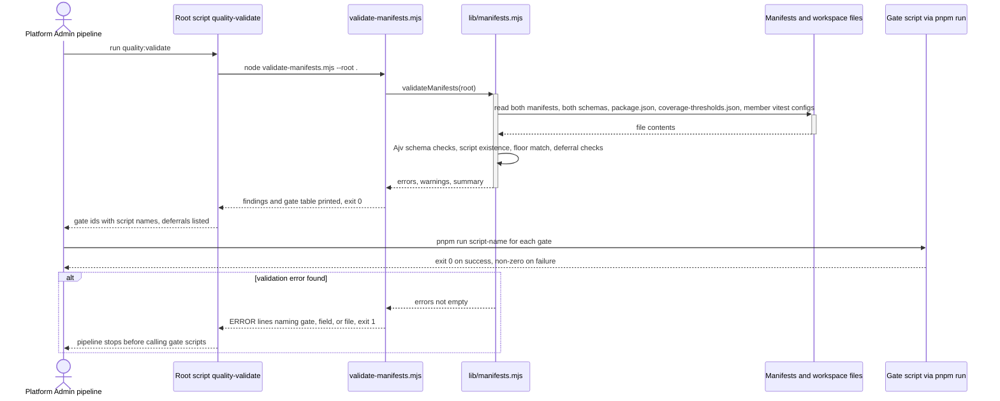
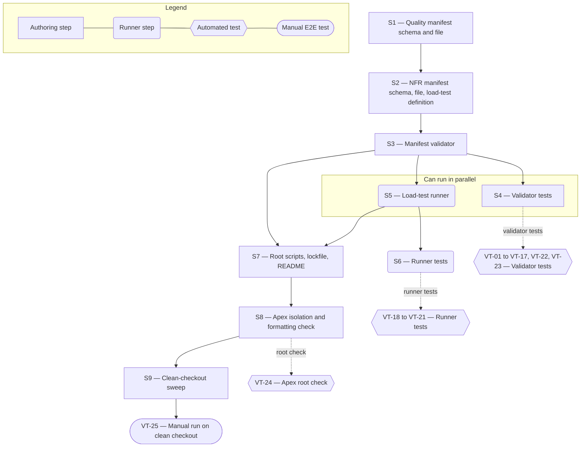

# Technical Specification — Quality Manifest and NFR Manifest

> **PRD slug:** `full-stack-express-starter-template` | **Owning layer:** `templates/full-stack-express/quality/` and `templates/full-stack-express/scripts/quality/` (no Apex `src/` layer) | **Surface:** Backend only
> **Verification builds:** Apex is unaffected, so `npx tsc -p tsconfig.server.json --noEmit` and `npx tsc -p tsconfig.client.json --noEmit` must give the same result with and without the template folder. Run `npm run lint` at the Apex root to confirm Prettier accepts the new files. Inside the template, run `pnpm quality:validate` and `pnpm test:quality`.
> **Open items:** See [design-doc-assumptions.md](design-doc-assumptions.md) (6 unresolved)
> **Design doc:** [design-doc-design.md](design-doc-design.md)

---

## System Boundary and Owning Layer

**Owning layer:** `templates/full-stack-express/quality/` (schemas, manifests, sample load-test definition, README) and `templates/full-stack-express/scripts/quality/` (validator, load-test runner, tests). The template's root `package.json` gains three script entries. Nothing under Apex's `src/`, `migrations/`, or `.cursor/` changes.

**Rationale:** The Feature describes the template repository to its consumers: Platform Engineering's pipeline, developers, and QA agents. Those readers need files and scripts at the template root, not code inside an Express service or a React component. The workspace stays at five members (TBI-001), so the new files sit beside the members rather than in a sixth package. The validator is plain Node ESM with no build step, so it runs on a clean checkout before `build`. This follows Apex's own validators, `scripts/ci/check-codemap-paths.mjs` and `scripts/validate-foundation-skills.mjs`, which print findings and exit 0 or 1.

**Ownership answers:**
- New or existing Express service in `src/server/services/`? No. The Feature adds no server code. Apex services are untouched, and the template's API application is not changed. The sample load test only calls the existing `GET /api/v1/me`.
- New or existing route in `src/server/routes/`? No. It adds no HTTP endpoint to Apex or to the template API.
- New React component in `src/client/components/`? No. It adds no screen or component to Apex or to the template web application.
- New shared type in `src/shared/types/`? No. Apex's shared types are untouched. The template's contracts package (Zod) is untouched too. The manifests use JSON Schema, because TBI-027 and TBI-028 name it and the files must be readable without running the application.
- Database migration needed? No. `app_users` is unchanged. The runner's data-volume check runs a read-only count (see ⚠ in assumptions).

---

## Security Enforcement

- **Authorization mechanism:** None. The template defines no roles, permissions, or authorization policy (BR-003), and Apex's RBAC does not apply. `rbac-governance.mdc` governs Apex client features that add `can('key')` guards or `requirePermission` routes. This Feature adds no UI and no route, so it adds no permission key and needs no `rbac-management` workflow. Access is repository access.
- **Layer that enforces scope:** The scripts themselves, because there is no request layer.
  - The validator reads only paths under `--root`. It writes nothing.
  - The load-test runner refuses to start unless `LOAD_TEST_BASE_URL` is set, prints the target before the first request, and refuses to start when either manifest has validation errors.
  - Apex's load-test module blocks production-pattern hostnames through an admin-managed target allowlist. The template has no admin surface, so it does not copy that control. The team chooses the environment, and the runner does not pick one.
- **Sensitive data handling:**
  - `LOAD_TEST_AUTH_HEADER` and `LOAD_TEST_DATABASE_URL` come only from environment variables (BR-010). The runner never prints, logs, or writes them, and never passes them on the command line of a child process.
  - Schema error output prints the JSON path and the rule broken, not the rejected value, so a secret pasted into a manifest does not reach the log.
  - Deferral text must not contain secrets. The secret-scan script (TBI-030) covers committed manifests.
  - The load test and the tests use synthetic data only (BR-007). The data-volume count reads a row total and returns no identity values.

---

## Architecture and Approach

### Layers touched

| Layer | Changed | Notes |
|-------|---------|-------|
| Server services (`src/server/services/`) | No | Apex is untouched |
| Server routes (`src/server/routes/`) | No | No new endpoint |
| Server middleware (`src/server/middleware/`) | No | No new guard |
| Client components (`src/client/components/`) | No | No UI |
| Client hooks (`src/client/hooks/`) | No | No UI |
| Shared types (`src/shared/types/`) | No | Manifest shapes are JSON Schema files in the template |
| Database (migrations/) | No | No schema change |
| Drizzle schema (`src/server/db/schema.ts`) | No | No schema change |
| Template quality files (`templates/full-stack-express/quality/`) | Yes | Two schemas, two manifests, one sample load-test definition, README |
| Template scripts (`templates/full-stack-express/scripts/quality/`) | Yes | Validator, report helper, load-test runner, tests, fixtures |
| Template root `package.json` and lockfile | Yes | Script entries `quality:validate`, `loadtest:run`, `test:quality`. Dev dependencies `ajv` and `yaml`, pinned and added to the compatibility table (TBI-002). This is the template's own `package.json`, not Apex's root. |
| Template config package (`packages/config/`) | Read only | The validator reads `coverage-thresholds.json` and `package.json`. TBI-023 owns both. |

### Gate-to-script map

The validator takes script names from the manifest, so any name works if the script exists. These names are proposals. The last column shows who creates each script (see ⚠ "Owner of the script behind each gate").

| Gate id | Proposed script (`pnpm run …`) | Creating work item |
|---------|-------------------------------|--------------------|
| `build` | `build` | TBI-005 (named in its definition of done) |
| `type-check` | `typecheck` | Not named in the backlog |
| `lint` | `lint` | TBI-003 (root lint command) |
| `formatting` | `format:check` | TBI-003 (root format command) |
| `openapi-drift` | `openapi:check` | TBI-010 |
| `migration-validation` | `db:validate` | FEAT-003 (migration validation) |
| `unit` | `test:unit` | TBI-023 |
| `component` | `test:unit` (shared with `unit`) | TBI-023 |
| `api` | `test:api` | TBI-024 |
| `integration` | `test:integration` | TBI-024 |
| `accessibility` | `test:e2e` | TBI-025 |
| `container-build` | `container:build` | Not named in the backlog (TBI-032 defines the image only) |

### Per-work-item design decisions

**TBI-027 — Create the quality manifest schema and file**
- Pattern followed: `foundation-skills/catalog.json` with `scripts/validate-foundation-skills.mjs`. Apex already lists what a package promises in a JSON file and checks each entry against the file system.
- Key decisions:
  - Two files: `quality/quality-manifest.schema.json` (JSON Schema 2020-12) and `quality/quality-manifest.json`. The manifest points at its schema through `$schema`, so editors give completion. The schema declares `$schema` as an allowed string property, because it sets `additionalProperties: false`.
  - Every object is closed (`additionalProperties: false`) at the root and on each gate. A `tier`, `schedule`, `runOn`, or `trigger` key is a schema error. That enforces BR-013 in structure, not only in prose.
  - Gate ids are free kebab-case strings, not a closed enum. The validator requires the 12 core ids. Adding a gate later is then a data edit.
  - Deferrals sit in a top-level `deferrals` array of `{ gate, reason, owner }`, not on the gate. A deferral can then name a gate that does not exist, and the validator can report it (PBI-025 (c)). Both text fields must contain a non-space character.
  - Coverage floors sit in a `coverage` object with four numbers from 0 to 100.
  - A `schemaVersion` integer (`1`) lets pipeline code detect a breaking change.
  - Alternative rejected: YAML. It adds a parser dependency to every consumer, and the manifest must be readable without running the application.

**TBI-028 — Create the NFR manifest schema and load-test tooling**
- Pattern followed: the same schema-plus-manifest pair as TBI-027. For the tool, Apex's Load Testing module and its `k6-load-test-generation` skill (k6 scripts with thresholds), subject to ⚠ "Load-test tool".
- Key decisions:
  - `quality/nfr-manifest.schema.json` and `quality/nfr-manifest.json` hold three required targets: `responseTime` (`percentile`, `maxMs`), `concurrency` (`users`), and `dataVolume` (`table`, `rows`).
  - Each target carries a required boolean `illustrative` and a required `verifiedBy` path to the load-test definition that checks it. The committed manifest sets `illustrative: true` on all three and carries the values P95 under 500 ms, 50 users, and 100,000 rows in `app_users`. Each target's schema `description` says the value shows the format and is not a promise (design NFR "visibly labeled illustrative").
  - `dataVolume.table` matches `^[a-z_][a-z0-9_]*$`. The runner quotes it, so a manifest value cannot inject SQL.
  - The sample definition, `quality/load-test/profile-read.k6.js`, calls `GET /api/v1/me` and reads `responseTime` and `concurrency` from the manifest through k6's `open()`. It carries no target numbers of its own.
  - The runner, `scripts/quality/run-load-test.mjs`, validates both manifests first and aborts on errors. It runs the tool, reads the tool's summary, and prints a verdict per target. `evaluateTargets(manifest, measured)` is a pure function so tests do not need the tool.
  - No script, README line, or package script states when load tests run (BR-013). The runner only runs when someone starts it.

**TBI-029 — Add the manifest validator**
- Pattern followed: `scripts/validate-foundation-skills.mjs` for its `FAIL`/`WARN`/`OK` lines, its error count, and exit code 0 or 1. `scripts/ci/check-codemap-paths.mjs` for "list the missing paths, then exit 1".
- Key decisions:
  - Deep module: `validateManifests(root)` in `scripts/quality/lib/manifests.mjs` returns `{ errors, warnings, summary }`. It does no printing and never calls `process.exit`. `validate-manifests.mjs` is a thin CLI that prints and sets the exit code. The runner reuses the function.
  - Ajv runs with `allErrors: true`, so one run names every problem, not only the first.
  - Check list (E = error, W = warning):
    - Q1 (E) Quality manifest missing or not valid JSON.
    - Q2 (E) Quality manifest breaks its schema.
    - Q3 (E) One of the 12 core gate ids is missing.
    - Q4 (E) Duplicate gate id, or two deferrals for one gate.
    - Q5 (E) A gate's `script` is not a key in the root `package.json` `scripts`. Reported as W when the gate has a complete deferral.
    - Q6 (E) A coverage floor differs from `packages/config/coverage-thresholds.json`. Also E when that file is missing.
    - Q7 (E) A workspace member's `vitest*.config.*` contains the word `thresholds`, or does not import the package named in `packages/config/package.json`. Members come from `pnpm-workspace.yaml`.
    - Q8 (E) A deferral names an unknown gate. Reason or owner is blank. (Blank text is also a Q2 schema error. The message names the deferral's index and gate.)
    - N1 (E) NFR manifest missing or not valid JSON. The NFR manifest is required.
    - N2 (E) NFR manifest breaks its schema. The message names each missing field, for example `/targets/responseTime: missing required field "maxMs"`.
    - N3 (E) A target's `verifiedBy` path does not exist.
    - N4 (W) A target has `illustrative: true`. If all do, one extra warning says the project has not set real targets.
  - Output is one line per finding (`ERROR`, `WARN`, `INFO`), then a gate summary, a deferral list, an NFR trace table, and a last line `quality:validate: N error(s), M warning(s)`. Each gate shows as `defined` or `deferred`, never as passed.
  - Exit code is 1 when any error exists and 0 otherwise. Warnings do not change it.
  - `--root <dir>` sets the template root, default two levels above the script. Tests use it with fixture directories.
  - The validator never runs a gate script.

**PBI-024 — Invoke every quality gate from the manifest by script name**
- Pattern followed: Apex root `package.json` script surface (`npm run lint`, `npm run test:integration`). A pipeline calls a script by name and reads its exit code.
- Key decisions: no gate runner. Platform Admin reads `gates[].script` and calls `pnpm run <script>`. A wrapper would re-implement what the manifest already says and add a tool to maintain. The validator is the guarantee that every name resolves (Q5). Scripts return exit 0 on success and non-zero on failure by their own tests (TBI-023 to TBI-026). Gate scripts read secrets only from environment variables and never print them.

**PBI-025 — Record a justified deferral for a gate**
- Pattern followed: `catalog.json` plus validator cross-check (the validator rejects an entry that points at a missing thing).
- Key decisions: a deferral is data in the manifest, reviewed in the same pull request as the code. A complete deferral turns a missing-script error into a warning (Q5) so a gate that cannot run yet is allowed, and the summary shows it as `deferred` with owner and reason. No approval step, no expiry (PBI-025 out of scope).

**PBI-026 — Trace non-functional requirements to verification evidence**
- Pattern followed: Apex load-test definitions that pair a k6 script with thresholds.
- Key decisions: traceability is a file path. Each target's `verifiedBy` points at the load-test definition that checks it, and the validator prints a trace table (target, value, illustrative or not, definition) so QA sees targets and evidence in one place. Illustrative values warn but never fail, so the committed template validates.

---

## Data and Contracts

### API endpoints

This Feature adds no endpoint. The sample load test calls one existing endpoint and does not change it.

| Method | Route | Request shape | Response shape | Auth |
|--------|-------|--------------|----------------|------|
| GET | `/api/v1/me` (existing, FEAT-006) | No body. Optional `Authorization` header value from `LOAD_TEST_AUTH_HEADER`. | Profile of the authenticated principal, as defined in the contracts package | Identity-provider adapter. In `development` mode the fixed synthetic principal, otherwise the supplied header. No role check (BR-003). |

### Schema / storage changes

| Target | Change | Reason |
|--------|--------|--------|
| `app_users` | None. The runner reads `count(*)` when `LOAD_TEST_DATABASE_URL` is set. | Data-volume verdict (⚠ in assumptions) |
| `quality/quality-manifest.schema.json` | New file | Shape of the quality manifest (TBI-027) |
| `quality/quality-manifest.json` | New file | 12 gates, coverage floors, empty `deferrals` (TBI-027) |
| `quality/nfr-manifest.schema.json` | New file | Shape of the NFR manifest (TBI-028) |
| `quality/nfr-manifest.json` | New file | Three illustrative targets (TBI-028) |
| `quality/load-test/profile-read.k6.js` | New file | Sample definition that reads targets from the manifest (TBI-028). Format follows the load-test tool decision. |
| `quality/README.md` | New file | Field reference, how to record a deferral, and the statement that each team decides when gates and load tests run (PBI-024 (d), PBI-026 (d)) |
| `scripts/quality/` | New directory | Validator, runner, tests, fixtures |
| `packages/config/coverage-thresholds.json` | Read only. Created by TBI-023 under the contract in the assumptions. | Single source of the coverage floors |

### File and CLI contracts

**Quality manifest** (`quality/quality-manifest.json`):

```json
{
  "$schema": "./quality-manifest.schema.json",
  "schemaVersion": 1,
  "coverage": { "lines": 80, "functions": 80, "statements": 80, "branches": 75 },
  "gates": [
    { "id": "build", "title": "Build all workspace members", "script": "build" },
    { "id": "type-check", "title": "TypeScript type check", "script": "typecheck" },
    { "id": "unit", "title": "Unit tests", "script": "test:unit" },
    { "id": "component", "title": "Component tests", "script": "test:unit" }
  ],
  "deferrals": [
    { "gate": "container-build", "reason": "Docker is not available on the review machine", "owner": "platform-engineering" }
  ]
}
```

The example is shortened to show the shape. The committed file lists all 12 gates and an empty `deferrals` array.

**NFR manifest** (`quality/nfr-manifest.json`):

```json
{
  "$schema": "./nfr-manifest.schema.json",
  "schemaVersion": 1,
  "targets": {
    "responseTime": {
      "percentile": 95,
      "maxMs": 500,
      "illustrative": true,
      "verifiedBy": "quality/load-test/profile-read.k6.js"
    },
    "concurrency": {
      "users": 50,
      "illustrative": true,
      "verifiedBy": "quality/load-test/profile-read.k6.js"
    },
    "dataVolume": {
      "table": "app_users",
      "rows": 100000,
      "illustrative": true,
      "verifiedBy": "quality/load-test/profile-read.k6.js"
    }
  }
}
```

**Validator CLI** (`pnpm quality:validate` runs `node scripts/quality/validate-manifests.mjs [--root <dir>]`):

| Item | Contract |
|------|----------|
| Exit code | `0` when there are no errors. `1` when there is at least one. Warnings never change it. |
| Finding line | `ERROR <file> <json-path>: <rule broken>` or `WARN <file> <json-path>: <message>`. No rejected values. |
| Summary | Gate table (`id`, `defined` or `deferred`, script), deferral list (gate, owner, reason), NFR trace table, then `quality:validate: N error(s), M warning(s)`. |

**Load-test runner** (`pnpm loadtest:run` runs `node scripts/quality/run-load-test.mjs`):

| Variable | Required | Use |
|----------|----------|-----|
| `LOAD_TEST_BASE_URL` | Yes. No default. | The target environment. The runner exits non-zero before any request when it is unset. |
| `LOAD_TEST_AUTH_HEADER` | No | Value for the `Authorization` header when the target is not in `development` mode. Never printed. |
| `LOAD_TEST_DATABASE_URL` | No | Read-only connection for the data-volume count. When unset the verdict is `NOT MEASURED`. Never printed. |
| `LOAD_TEST_DURATION_SECONDS` | No. Default `30`. | Length of the run. A run parameter, not a target. |

Verdict rules, one line each: `responseTime` is `PASS` when the measured `percentile` value is at most `maxMs`. `concurrency` is `PASS` when the run held at least `users` virtual users and no request failed. `dataVolume` is `PASS` when the counted rows are at least `rows`. A target that was not measured is `NOT MEASURED`. The runner exits 0 only when all three are `PASS`.

---

## Testing Strategy

**Unit tests:**
- Validator (`validateManifests`, driven through the CLI on fixture roots) — exit status and finding text for each check Q1 to Q8 and N1 to N4. Each test builds a throwaway root from a valid fixture plus one mutation, so one test proves one rule. Tests assert the exit code and that the output names the gate, field, or file. They do not assert Ajv internals. Follow the layout of Apex's `foundation-skills/test/*.test.mjs` for process-level checks, but run under Vitest with the shared preset so the thresholds stay defined once (`test:quality`).
- Boundary cases: branches at exactly 75 and the other floors at exactly 80 pass. Branches at 74 in the manifest against 75 in the shared file fail and name `branches`.
- `evaluateTargets` — verdicts for met, exceeded, and unmeasured targets, with fixed measured values.
- Runner start-up — exits non-zero without `LOAD_TEST_BASE_URL` before any network call. Output never contains a sentinel value placed in `LOAD_TEST_AUTH_HEADER`.

**Integration tests:**
- Gate-script contract — a fixture workspace whose `package.json` has one script that exits 0 and one that exits 1. `pnpm run <script>` for each name taken from the fixture manifest returns the matching status.
- Committed files — the validator passes on the committed manifests in the template, lists 12 gates, and reports `illustrative` warnings only.
- Documentation — `quality/README.md` contains the statement that each team decides when gates and load tests run, and no template script is named for a schedule or trigger.

**E2E tests (if applicable):**
- No Playwright journey, because there is no UI. One manual run on a clean checkout with PostgreSQL and the API running: `pnpm loadtest:run` with `LOAD_TEST_BASE_URL` pointing at the local API, then a verdict for each of the three targets. Then every gate script in the committed manifest runs once and exits 0.

---

## Observability

- **Custom events/metrics:** None beyond standard request telemetry. The validator and runner print `ERROR`, `WARN`, and `INFO` lines to the terminal, and the template's API telemetry (Pino logs, OpenTelemetry) records load-test requests like any other request.
- **Alerts:** None.

---

## Rollback and Deployment

- **Schema changes backward compatible:** Yes. There is no database change. A manifest change that removes or renames a field must raise `schemaVersion`, so a pipeline can detect it.
- **Rollback procedure:** Revert the commit that added the files. Nothing reads the manifests at runtime, so no running system changes. After Platform Engineering's pipeline calls the scripts, revert in the template repository and update the pipeline in the same change.
- **Deployment dependencies:** The load-test tool (default: a pinned k6 container image, so Docker must be present) is needed only to run the load test. `ajv` and `yaml` are added to the template lockfile, and the frozen install must pass from a clean checkout. No manual provisioning.
- **Feature flag gates deployment:** No. The PRD sets no Apex Feature Flag, and the template's flag interface is a separate deliverable (FEAT-008).

---

## Verification Test Matrix

AC scenario ids come from the design doc: (a) happy, (b) error, (c) edge, (d) negative.

| ID | Layer | Arrange | Act | Assert | Linked |
|----|-------|---------|-----|--------|--------|
| VT-01 | Vitest (CLI on fixture root) | Valid fixture: 12 gates, all scripts in `package.json`, floors equal shared file, no deferrals | `validate-manifests.mjs --root <fixture>` | Exit 0. Output lists 12 gates as `defined` and ends with `0 error(s)` | TBI-027, TBI-029, PBI-024 (a) |
| VT-02 | Vitest (CLI) | Fixture gate `lint` names script `lint:all`, absent from `package.json` | Run the validator | Exit 1. An `ERROR` line names gate `lint` and script `lint:all` | PBI-024 (b), TBI-029 |
| VT-03 | Vitest (CLI) | Fixture gate `container-build` names a missing script and has a deferral with reason and owner | Run the validator | Exit 0. A `WARN` line names the missing script. The deferral appears in the output | PBI-024 (c), PBI-025 (a) |
| VT-04 | Vitest (CLI) | Fixture manifest adds a `schedule` key to a gate and a `tier` key at the root | Run the validator | Exit 1. Errors name `schedule` and `tier` as unknown properties | PBI-024 (d), TBI-027 |
| VT-05 | Vitest (integration) | Fixture workspace with scripts `ok` (exit 0) and `bad` (exit 1) named in a fixture manifest | `pnpm run ok` and `pnpm run bad` | Exit 0 for `ok`. Non-zero for `bad` | PBI-024 (a) |
| VT-06 | Vitest (CLI) | Fixture deferral for gate `unit` with an empty `reason` | Run the validator | Exit 1. Error names the deferral (index and gate `unit`) | PBI-025 (b) |
| VT-07 | Vitest (CLI) | Fixture deferral names gate `smoke-test`, which is not in `gates` | Run the validator | Exit 1. Error contains `smoke-test` | PBI-025 (c) |
| VT-08 | Vitest (CLI) | Fixture with gate `accessibility` deferred (script present) | Run the validator and read the gate table | `accessibility` shows `deferred` with owner and reason. It does not show `defined` | PBI-025 (d) |
| VT-09 | Vitest (CLI) | Fixture deferral with a blank `owner` | Run the validator | Exit 1. Error names the deferral and the `owner` field | PBI-025 (b), TBI-027 |
| VT-10 | Vitest (CLI) | Fixture manifest with `coverage.lines` as a string and an unknown root property | Run the validator | Exit 1. Both problems appear on separate lines with their JSON paths | TBI-029, TBI-027 |
| VT-11 | Vitest (CLI) | Manifest `branches: 74`, shared file `branches: 75` | Run the validator | Exit 1. Error names `branches` with both values | TBI-029, TBI-027 |
| VT-12 | Vitest (CLI) | A fixture member `vitest.config.ts` contains `thresholds: { lines: 50 }` | Run the validator | Exit 1. Error names that file and says it does not use the shared floors | TBI-029 (PBI-023 (d) in FEAT-011) |
| VT-13 | Vitest (CLI) | Manifest floors exactly 80, 80, 80, 75 and the shared file equal | Run the validator | Exit 0. No coverage error | TBI-029 (edge) |
| VT-14 | Vitest (CLI) | NFR fixture without `responseTime.maxMs` | Run the validator | Exit 1. Error names `/targets/responseTime` and `maxMs` | PBI-026 (b) |
| VT-15 | Vitest (CLI) | NFR fixture with `illustrative: true` on all three targets | Run the validator | Exit 0. Three target warnings plus one warning that the project has not set real targets | PBI-026 (c) |
| VT-16 | Vitest (CLI) | NFR fixture where `verifiedBy` points at a file that does not exist | Run the validator | Exit 1. Error names the target and the path | TBI-028, PBI-026 |
| VT-17 | Vitest (CLI) | Fixture root without `nfr-manifest.json` | Run the validator | Exit 1. Error says the NFR manifest is required and missing | TBI-028 |
| VT-18 | Vitest (unit) | `evaluateTargets` with measured P95 of 480 ms (target 500), 50 users held (target 50), 100,001 rows (target 100,000) | Call the function | All three `PASS`. With P95 at 501 ms, `responseTime` is `FAIL` and the others stay `PASS` | PBI-026 (a), TBI-028 |
| VT-19 | Vitest (CLI) | Environment without `LOAD_TEST_BASE_URL` | Run the runner | Non-zero exit before any request. Message names the variable | PBI-026 (a), TBI-028 |
| VT-20 | Vitest (CLI) | `LOAD_TEST_AUTH_HEADER` set to a sentinel string, target unreachable | Run the runner | Non-zero exit. Neither stdout nor stderr contains the sentinel | PBI-024 NFR, PBI-026 NFR |
| VT-21 | Vitest (unit) | `evaluateTargets` with no row count supplied | Call the function | `dataVolume` is `NOT MEASURED`, and the overall result is not a pass | PBI-026 (a) |
| VT-22 | Vitest (CLI) | Fixture root with a gate list missing `formatting`, and another with two gates sharing an id | Run the validator on each | Exit 1 each time. Errors name the missing id and the duplicate id | TBI-027, TBI-029 |
| VT-23 | Vitest (integration) | Committed template files and README | Run the validator. Read `quality/README.md`. List `package.json` script names | Exit 0 with warnings only. README states each team decides when gates and load tests run. No script name contains `schedule`, `nightly`, or `tier` | PBI-024 (d), PBI-026 (d), TBI-028 |
| VT-24 | Apex root check | Template folder present with all new files | `npm run lint` at the Apex root | Prettier reports no finding for the new files (or the approved ignore entry applies) | TBI-027 (⚠ formatting) |
| VT-25 | Manual E2E (CLI) | Clean checkout, Docker running, PostgreSQL and API started with the example environment | `pnpm quality:validate`, each gate script once, then `pnpm loadtest:run` with `LOAD_TEST_BASE_URL` and `LOAD_TEST_DATABASE_URL` set | Validator exits 0. Each gate script exits 0. The runner prints a verdict for each of the three targets | PBI-024 (a), PBI-026 (a) |

---

## Implementation Plan

- [ ] S1 — Create `quality/quality-manifest.schema.json`, the committed `quality/quality-manifest.json` (12 gates, floors, empty `deferrals`), and the quality section of `quality/README.md` (TBI-027) _(blocked by FEAT-011 TBI-023 for `packages/config/coverage-thresholds.json`, and by ⚠ "Owner of the script behind each gate")_
  - Covers: `VT-04`, `VT-10`, `VT-13`
- [ ] S2 — Create `quality/nfr-manifest.schema.json`, the committed `quality/nfr-manifest.json` with illustrative values, `quality/load-test/profile-read.k6.js`, and the NFR section of `quality/README.md` (TBI-028) _(blocked by S1 and by ⚠ "Load-test tool")_
  - Covers: `VT-23`
- [ ] S3 — Build the validator: `scripts/quality/lib/manifests.mjs`, the report helper, and `validate-manifests.mjs` with checks Q1 to Q8 and N1 to N4 (TBI-029) _(blocked by S1, S2)_
  - Covers: `VT-01`, `VT-02`
- [ ] S4 — Write the fixture builder and the validator tests (`scripts/quality/__tests__/`) _(blocked by S3; can parallel with S5)_
  - Covers: `VT-01` to `VT-17`, `VT-22`, `VT-23`
- [ ] S5 — Build the runner `scripts/quality/run-load-test.mjs` with `evaluateTargets`, the environment checks, and the data-volume count (TBI-028) _(blocked by S2, S3, and by ⚠ "How the sample load test checks the data-volume target"; can parallel with S4)_
  - Covers: `VT-18`, `VT-19`, `VT-20`, `VT-21`
- [ ] S6 — Write the runner tests _(blocked by S5)_
  - Covers: `VT-18` to `VT-21`
- [ ] S7 — Add `quality:validate`, `loadtest:run`, and `test:quality` to the template `package.json`. Add `test:quality` to the `test:unit` aggregate. Add `ajv` and `yaml` to the lockfile and the compatibility table. Document the scripts in the README (PBI-024, PBI-025, PBI-026) _(blocked by S3, S5)_
  - Covers: `VT-05`
- [ ] S8 — Check isolation: Apex root install, build, and `npm run lint` give the same result with and without the template folder (⚠ formatting) _(blocked by S7)_
  - Covers: `VT-24`
- [ ] S9 — Run the clean-checkout sweep: validator, every gate script, and the load test against the local stack _(blocked by S7, S8, and by the scripts from FEAT-011 and FEAT-013)_
  - Covers: `VT-25`

**Execution lanes:**
- Lane 1 (start immediately once the blockers on S1 clear): S1, then S2, then S3
- Lane 2 (after S3): S4
- Lane 3 (after S3, parallel with Lane 2): S5, then S6
- Lane 4 (after S3 + S5): S7, then S8, then S9

---

## Diagram 1 — Code Execution Flow

This Feature has no React, hook, or Express path. The primary PBI path is PBI-024: a person or pipeline validates the manifest before calling a gate script.



---

## Diagram 2 — Implementation Dependency Map


