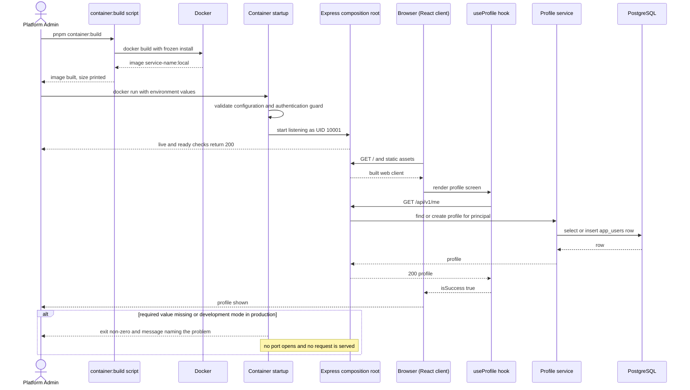
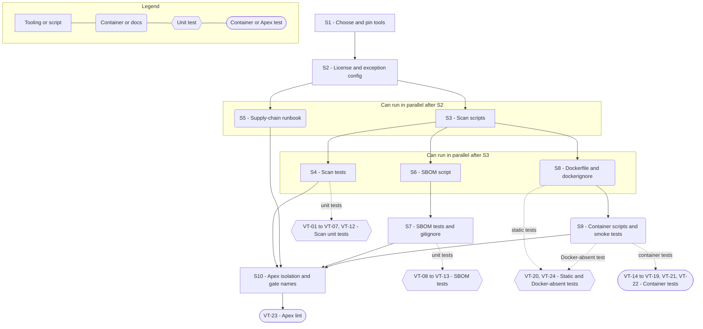

# Technical Specification — Supply-Chain Baseline and Production Container

> **PRD slug:** `full-stack-express-starter-template` | **Owning layer:** `templates/full-stack-express/` (standalone pnpm workspace; no Apex `src/` layer) | **Surface:** Full stack (this Feature's work is build tooling and packaging; no client UI work)
> **Verification builds:** Run from `templates/full-stack-express/`: `pnpm build`, `pnpm scan`, `pnpm sbom`, `pnpm container:build`, `pnpm test:container`. Run from the Apex root: `npm run lint` (Apex's `prettier --check .` reaches the template). The Apex `npx tsc -p tsconfig.server.json --noEmit` and `npx tsc -p tsconfig.client.json --noEmit` builds do not apply, because the Feature changes no Apex source.
> **Open items:** See [design-doc-assumptions.md](design-doc-assumptions.md) (7 unresolved)
> **Design doc:** [design-doc-design.md](design-doc-design.md)

---

## System Boundary and Owning Layer

**Owning layer:** `templates/full-stack-express/` (repository root of the template), made up of:
- `Dockerfile` and `.dockerignore`
- `scripts/supply-chain/` (Node `.mjs` scripts and their Vitest tests)
- `config/supply-chain/` (allowed licenses, vulnerability exceptions, secret-scan settings)
- `docs/runbooks/supply-chain.md`
- `.gitignore` (excludes `artifacts/`)
- the supply-chain and container entries in the template's root `package.json`

**Rationale:** BR-008 and the PRD "Isolation and delivery" decisions make the template a nested, self-contained sample. It has its own lockfile, scripts and lint rules, and it does not change Apex runtime or builds. All of this Feature's work is packaging and checking, so it belongs at the template root next to the workspace manifests it reads (`pnpm-lock.yaml`, `pnpm-workspace.yaml`, per-package `package.json`). Apex's root `.dockerignore` is written for repo-root builds of `runners/load-test-k6/Dockerfile` and does not apply when the build context is the template folder. The template therefore needs its own `.dockerignore` and `.gitignore`.

**Ownership answers:**
- New or existing Express service in `src/server/services/`? No — Apex's `src/server/` is unchanged (BR-008). The template API (FEAT-006) already exists, and this Feature adds no service to it.
- New or existing route in `src/server/routes/`? No — no Apex route changes, and no new template route. The container consumes `GET /health/live`, `GET /health/ready` and the static client serving from TBI-014.
- New React component in `src/client/components/`? No — the Feature adds no screen. The container serves the web client that FEAT-010 builds.
- New shared type in `src/shared/types/`? No — nothing in Apex. The Feature adds no types to the template contracts package. The scripts validate their two config files with local Zod schemas inside `scripts/supply-chain/`.
- Database migration needed? No — the Feature adds no table or column. The image contains no migration tooling and never changes schema at startup (BR-006). See the migration item in the assumptions file.

---

## Security Enforcement

- **Authorization mechanism:** The Feature adds no Apex permission key and no RBAC guard, so `rbac-governance.mdc` has nothing to change. The template defines no roles (BR-003). Inside the container, protected routes require authentication only, through the identity-provider adapter from FEAT-005. The Feature relies on three boundary rules that other Features implement, and it proves each from outside the container:
  - The container must not start with the development adapter in production (BR-002). The guard runs before the server accepts connections (TBI-013). VT-19 proves it from outside the container.
  - A missing or invalid required environment value aborts startup (BR-010). VT-17 proves it.
  - Production secrets reach the container only as environment variables, never in image layers (BR-010, BR-014).
- **Layer that enforces scope:** Build-time and process-start only. The Dockerfile sets the user. The API startup code (FEAT-002, FEAT-005) enforces the configuration and adapter guards. The scan scripts enforce supply-chain policy locally. There is no route middleware or service-layer scope in this Feature.
- **Sensitive data handling:**
  - Scans never print matched secret values. The wrapper reduces tool output to rule name, file and line before printing, and it drops any other field (`redact` mode plus an output filter).
  - Scan and SBOM output contains no environment values. VT-12 sets a sentinel value in the environment and asserts it never appears in output.
  - Image hardening:
    - Numeric non-root UID `10001`.
    - No build tools, no package managers and no development dependencies in the runtime stage.
    - No `ARG` or `ENV` carries a secret.
    - `.dockerignore` excludes `.env*` (except `.env.example`), `node_modules`, tests, `docs/` and `artifacts/`.
    - The image runs with a read-only root filesystem and all capabilities dropped (VT-22).
  - Tests and fixtures use synthetic data only (BR-007).

---

## Architecture and Approach

### Layers touched

| Layer | Changed | Notes |
|-------|---------|-------|
| Server services (`src/server/services/`) | No | Apex unchanged. Template API code is not changed by this Feature. |
| Server routes (`src/server/routes/`) | No | No new routes. The container consumes health routes and static serving. |
| Server middleware (`src/server/middleware/`) | No | Apex unchanged. |
| Client components (`src/client/components/`) | No | No screen. |
| Client hooks (`src/client/hooks/`) | No | No hook. |
| Shared types (`src/shared/types/`) | No | No Apex type. |
| Database (migrations/) | No | No migration. The image excludes migration tooling. |
| Drizzle schema (`src/server/db/schema.ts`) | No | No schema change. |
| Template root (`templates/full-stack-express/`) | Yes | `Dockerfile`, `.dockerignore`, `.gitignore`, `package.json` script entries, `scripts/supply-chain/`, `config/supply-chain/`, `docs/runbooks/supply-chain.md`, `artifacts/` (generated, ignored). |

### Per-work-item design decisions

**TBI-030 — Add secret, vulnerability, and license scan scripts**
- Pattern followed: Apex's named check scripts. `package.json` entries such as `lint:codemap` call a Node `.mjs` file (`scripts/ci/check-codemap-paths.mjs`) that exits non-zero with a message. The template uses the same shape: `scan:secrets`, `scan:vulns`, `scan:licenses`, plus `scan`, which runs all three and reports every finding before it exits.
- Key decisions:
  - **Split "run the tool" from "judge the report".** Each script has a thin runner that calls the tool and a pure `evaluate(report, config)` function. Unit tests call `evaluate` with recorded reports, so they run offline and fast. Only the integration run (VT-01) calls the real tools. Rejected: tests that call the live advisory source, which would make them flaky and need network access.
  - **Exit codes:** `0` no findings, `1` findings, `2` the check could not run. A scanner crash, an unreachable advisory source, a malformed config file or a missing lockfile exits `2` with a message. It never exits `0` (VT-06, VT-07).
  - **Secret redaction at the wrapper.** The scanner runs in redacting mode, and the wrapper prints only `rule`, `file` and `line`. Rejected: relying on the tool's own formatter, which can print the match.
  - **Planted secret created at test time (VT-02).** The test writes a file to a temporary directory and builds the fake token from two string pieces, so the repository never holds a complete token and its own scan stays clean. Rejected: a committed fixture with an allowlist entry, which hides a real bug if the allowlist grows.
  - **Exceptions and license list are committed files** validated by Zod schemas at script start: `config/supply-chain/vulnerability-exceptions.json` (`advisory`, `package`, `reason`, `owner`, `reviewed`, `expires`) and `config/supply-chain/allowed-licenses.json` (SPDX identifiers). An expired exception is not honored and is reported (VT-04). An honored exception prints on its own line so reviewers see it (VT-03). The pattern mirrors the quality-manifest rule that a deferral needs a reason and an owner.
  - **Threshold:** fail on `high` and `critical` advisories (default in the assumptions file).
  - **Runbook:** `docs/runbooks/supply-chain.md` explains how to record a reviewed exception. TBI-030's definition of done requires this documentation, and FEAT-014's validation script will check it.

**TBI-031 — Add SBOM generation**
- Pattern followed: the same `scripts/supply-chain/` structure as TBI-030, called by the `sbom` package script. It depends on TBI-030 in the backlog and shares its lockfile reader and config loader.
- Key decisions:
  - **Format:** CycloneDX JSON, written to `artifacts/sbom/<service-name>.cdx.json`.
  - **Scope:** production dependencies of the API and web packages, from the lockfile. `devDependencies` are excluded (VT-11). Web dependencies count as production because the build bundles them into the shipped client.
  - **Deterministic output** (TBI-031 requirement). Components sorted by package URL. `serialNumber` is a UUIDv5 of the lockfile SHA-256. `metadata.timestamp` is omitted unless `SOURCE_DATE_EPOCH` is set. The tool's default random UUID and wall-clock time would break byte-for-byte comparison (VT-10).
  - **Atomic write.** The script writes a temporary file in `artifacts/sbom/` and renames it on success. On any error it deletes the temporary file, so no partial SBOM remains (VT-09).
  - **Image mode.** `pnpm sbom -- --image <tag>` reads the contents of a built image through the chosen tool and writes `<service-name>.image.cdx.json`. TBI-031 asks for "the lockfile and container contents". The default mode does not need Docker.
  - **Ignored output.** The template's own `.gitignore` excludes `artifacts/`, and `.dockerignore` excludes it from the build context (VT-13).

**TBI-032 — Create the production container definition**
- Pattern followed: `runners/load-test-k6/Dockerfile`: a `node:*-bookworm-slim` base, `NODE_ENV=production`, a production-only dependency install, and a build-time `RUN node -e "require(...)"` that fails the image build if the entry module graph cannot resolve. This Feature keeps all of that and departs from it in four ways:
  - It builds in stages, so the runtime stage holds no sources or build tools.
  - It runs as a numeric non-root user. The k6 runner image runs as root.
  - It uses pnpm with `--frozen-lockfile`, not `npm ci`.
  - It packages a built web client.
- Key decisions:
  - **Stages:**

    | Stage | Base | Purpose |
    |-------|------|---------|
    | `base` | `node:<LTS>-bookworm-slim@sha256:<digest>` | Pinned Node. Enables Corepack so the pinned pnpm from `packageManager` installs. Used by `build` and `prod-deps` only. |
    | `build` | `base` | Copies manifests, runs `pnpm install --frozen-lockfile`, copies sources, runs `pnpm build` (contracts, UI, web, API). |
    | `prod-deps` | `base` | Runs `pnpm --filter <api-package> deploy --prod /out/api` to produce the API with production dependencies only. Then runs the module-graph check from the k6 pattern against `/out/api`. |
    | `runtime` | a fresh `FROM` of the same pinned base | Removes `npm`, `npx`, `corepack` and `yarn`. Creates user `10001`. Copies `/out/api` to `/app` and the web build output to `/app/web`. Sets `NODE_ENV=production` and `WEB_DIST_DIR`. Adds `USER 10001`, `EXPOSE`, a `HEALTHCHECK` on `/health/live` through Node's built-in `fetch`, and `CMD ["node", "dist/index.js"]`. |

  - **One definition (BR-014).** The Dockerfile has no second target, such as a migration stage.
  - **Frozen install in the image.** `--frozen-lockfile` makes the build abort if `pnpm-lock.yaml` drifts from the manifests. The compatibility table pins the pnpm version.
  - **No defaults for secrets or mode.** The image sets `NODE_ENV=production` and the client path only. It sets no authentication mode, so a container started without one aborts (VT-17). That is the behavior TBI-013 requires.
  - **Same-process serving.** The API serves the built client for non-API paths when `WEB_DIST_DIR` exists (TBI-014 definition of done). Rejected: a second nginx image or stage, which would add a second runtime surface and a second definition.
  - **No AWS (BR-014).** No ECR, ECS, task-definition or credential reference appears in any file. VT-20 greps for it.
  - **Risk to check first.** `pnpm deploy` behavior depends on the pinned pnpm major, and workspace dependencies (contracts, UI) must expose built output in their `exports`. Confirm this in S8 before writing the rest of the Dockerfile.

**PBI-027 — Build one hardened container image**
- Pattern followed: `pnpm container:build` is one named script, in the style of the Apex `build` scripts. It runs `docker build -t <service-name>:local .` from the template root and prints the final image size. `pnpm test:container` is the proof, written with Testcontainers, which the PRD names for the PostgreSQL integration tests.
- Key decisions:
  - **Prove from outside.** The test starts the built image and probes it over HTTP and `docker exec`/`docker run --entrypoint`. It asserts exit codes, response bodies and process facts, not Dockerfile text. The exception is VT-20, a static check, because "no AWS configuration" is a file-content property.
  - **Two start profiles for one image** (see the contract item in the assumptions file): `APP_ENV=local` with `AUTH_MODE=development` for the serving checks (a), and `APP_ENV=production` with `AUTH_MODE=development` for the abort check (d).
  - **Record, don't assert, size and start time.** The script prints image size and time to ready. The PBI NFR says the project records them, so nothing fails on them.

**PBI-028 — Generate an SBOM for each build**
- Pattern followed: the `sbom` script from TBI-031.
- Key decisions: Acceptance is proven with an installed fixture workspace that contains one production and one development-only dependency. The tests compare the SBOM against `pnpm ls --prod --json` output, not against a hard-coded list, so a dependency upgrade does not break them.

**PBI-029 — Catch secrets, vulnerable dependencies, and license violations before merging**
- Pattern followed: the three `scan:*` scripts from TBI-030, plus the `scan` aggregator.
- Key decisions: The scripts run on demand with no schedule or required tier (BR-013). The Developer sees output in plain text. Each finding names the file and line, or the package and license, and never a secret value.

---

## Data and Contracts

### API endpoints

This Feature adds no endpoint. The container exposes these existing endpoints, and the tests probe them:

| Method | Route | Request shape | Response shape | Auth |
|--------|-------|--------------|----------------|------|
| GET | `/health/live` | none | `200` with process-liveness body (FEAT-006) | None |
| GET | `/health/ready` | none | `200` when the database answers, a non-`200` Problem Details response (`503` expected) when it does not (FEAT-006) | None |
| GET | `/` and any non-API path | none | The built web client `index.html` (SPA fallback) or a static asset (TBI-014) | None |
| GET | `/api/unknown` | none | `404` RFC 9457 Problem Details with a request ID, not HTML (TBI-014) | None |
| GET | `/api/v1/me` | none | `401` Problem Details when no adapter authenticates (the container has no production identity provider) | Authentication via the adapter; no role |

### Script and file contracts

| Script | Input | Output | Exit codes |
|--------|-------|--------|-----------|
| `scan:secrets` | Tracked files in the working tree; scanner settings in `config/supply-chain/` | Plain text: `rule`, `file`, `line` per finding. Never the value. | `0` clean, `1` findings, `2` cannot run |
| `scan:vulns` | `pnpm-lock.yaml`; `config/supply-chain/vulnerability-exceptions.json` | Plain text: advisory, package, severity per finding, plus a line per honored exception | `0` none above threshold, `1` findings, `2` cannot run (including an unreachable advisory source) |
| `scan:licenses` | Production dependency licenses; `config/supply-chain/allowed-licenses.json` | Plain text: package and license per violation | `0` all allowed, `1` violations, `2` cannot run |
| `scan` | The three above | Combined output of all three | `0` all clean, otherwise the highest code returned |
| `sbom` | `pnpm-lock.yaml`, installed workspace | `artifacts/sbom/<service-name>.cdx.json` | `0` written, `2` lockfile missing or invalid or tool error (no file left) |
| `sbom -- --image <tag>` | A built image | `artifacts/sbom/<service-name>.image.cdx.json` | `0` written, `2` image or Docker missing |
| `container:build` | Template root as build context | Local image `<service-name>:local`; size printed | `0` built, `1` build error, `2` Docker unavailable |
| `test:container` | The local image | Vitest report; size and time to ready printed | `0` all pass, `1` test failure, `2` Docker unavailable |

### Schema / storage changes

| Target | Change | Reason |
|--------|--------|--------|
| PostgreSQL (`app_users` and all tables) | None | The Feature adds no table or column and runs no migration. |
| `config/supply-chain/allowed-licenses.json` | New committed file: list of allowed SPDX license identifiers | PBI-029 (d); TBI-030 "allowed license list is stored in the repository". |
| `config/supply-chain/vulnerability-exceptions.json` | New committed file: reviewed exceptions with `advisory`, `package`, `reason`, `owner`, `reviewed`, `expires` | PBI-029 (c). |
| `artifacts/sbom/` | New generated directory, ignored by Git and excluded from the Docker context | TBI-031 "generated SBOM files are excluded from version control". |

---

## Testing Strategy

**Unit tests:** (Vitest, under `scripts/supply-chain/__tests__/`; same layering Apex uses with Jest, per the PRD "Prior art" note)
- Secret scan `evaluate` — a planted fake secret created in a temp directory is detected with file and line, the output never contains the token, and a clean tree exits `0`.
- Vulnerability scan `evaluate` — recorded reports: a finding above the threshold fails, a valid exception is honored and listed, an expired exception is not honored, and an unreachable source exits `2`.
- License check `evaluate` — a disallowed license names the package and license, and an allowed list passes.
- Config loader — a malformed or incomplete exception file exits `2` and names the file and field.
- SBOM generator — contents, determinism across two runs, development dependencies excluded, atomic write with no file left after an error, and no environment values in the output.
- Static check — no `aws`, `ecs`, `ecr` or `amazonaws` string in the `Dockerfile`, `.dockerignore`, `scripts/supply-chain/` or `config/supply-chain/`.

**Integration tests:** (Vitest and Testcontainers, `test:container`; the same Testcontainers approach FEAT-011 uses for PostgreSQL)
- Real `pnpm scan` on the template itself, which must exit `0`.
- Image build from a clean copy of the template, with the frozen install.
- Running container with a PostgreSQL test container on a shared network: probe `/health/live`, `/health/ready`, `/`, a deep link, `/api/unknown` and `/api/v1/me`. Stop PostgreSQL and probe readiness again.
- Startup aborts: no environment values, and `APP_ENV=production` with `AUTH_MODE=development`. Assert the exit code, the log message, and that no port opens.
- Runtime facts: user ID, absence of build tools and development packages, image `Config.Env` allowlist, and no `.env` file in the image.
- Hardened run with `--read-only` and `--cap-drop ALL`.
- Apex isolation: from the Apex root, `npm run lint` passes with the template present.

**E2E tests (if applicable):** None added. Playwright journeys with axe checks belong to FEAT-011. The container test only confirms that the web client shell loads and that the SPA fallback works.

---

## Observability

- **Custom events/metrics:** None beyond standard request telemetry. The container writes the Pino JSON logs from FEAT-007 to stdout, and OpenTelemetry stays configured by environment. The scripts print plain text. `container:build` and `test:container` print image size and time to ready as information so each project can record them. They set no target.
- **Alerts:** None. Alerting belongs to Platform Engineering.

---

## Rollback and Deployment

- **Schema changes backward compatible:** Yes — the Feature adds no schema change. It only adds files under `templates/full-stack-express/`, so Apex builds and runtime cannot regress.
- **Rollback procedure:** Revert the commit. If a Platform Admin has already built an image from the template, they discard the image tag. Nothing runs in an Apex environment, so no data or service needs recovery.
- **Deployment dependencies:** None for Apex. The Feature does not deploy. Platform Engineering owns image publishing, ECS, infrastructure, pipelines and migration execution. It consumes `container:build`, the `Dockerfile`, the health endpoints and the SBOM and scan scripts through the handoff document (FEAT-017).
- **Feature flag gates deployment:** No (no Apex Feature Flag; see the PRD "Feature Flag" section).

---

## Verification Test Matrix

| ID | Layer | Arrange | Act | Assert | Linked |
|----|-------|---------|-----|--------|--------|
| VT-01 | Vitest integration | The template checkout with no planted problems, installed | Run `pnpm scan` | Exit `0` from `scan:secrets`, `scan:vulns` (real advisory source) and `scan:licenses`; no honored exceptions needed | PBI-029 (a), TBI-030 |
| VT-02 | Vitest unit | Temp directory with a test file that holds a synthetic key-shaped token built from two string pieces | Run the secret scan on the directory | Exit `1`; output names the relative file path and line; output does not contain the token | PBI-029 (b), TBI-030 |
| VT-03 | Vitest unit | Recorded advisory report with one `high` finding; exceptions file holds a valid, unexpired entry for it | Run the vulnerability evaluation | Exit `0`; output has a line listing the honored exception (advisory and package) | PBI-029 (c), TBI-030 |
| VT-04 | Vitest unit | Same report; no exception, then an exception whose `expires` date is past | Run the vulnerability evaluation twice | Both runs exit `1`; output names package and advisory; the expired case also reports the expired exception | PBI-029 (c), TBI-030 |
| VT-05 | Vitest unit | Production dependency list with one package under a license not in `allowed-licenses.json` | Run the license check | Exit `1`; output names the package and the license | PBI-029 (d), TBI-030 |
| VT-06 | Vitest unit | Exceptions file missing `owner` on one entry, and a missing lockfile | Run `scan:vulns` | Exit `2`; output names the file and the missing field, or the missing lockfile | TBI-030 |
| VT-07 | Vitest unit | Advisory source stubbed as unreachable | Run `scan:vulns` | Exit `2`; output says the scan could not run; exit is not `0` | TBI-030 |
| VT-08 | Vitest integration | Installed fixture workspace with known production dependencies | Run `pnpm sbom` | `artifacts/sbom/<service-name>.cdx.json` exists, is valid CycloneDX JSON, and lists every package and version from `pnpm ls --prod --json` | PBI-028 (a), TBI-031 |
| VT-09 | Vitest unit | Workspace with the lockfile deleted, then one with a corrupt lockfile | Run `pnpm sbom` | Exit `2` with a message; `artifacts/sbom/` holds no SBOM and no temporary file | PBI-028 (b), TBI-031 |
| VT-10 | Vitest integration | Unchanged lockfile | Run `pnpm sbom` twice, saving each output | Component lists identical; whole-file SHA-256 identical | PBI-028 (c), TBI-031 |
| VT-11 | Vitest integration | Fixture workspace with one `devDependencies` package (for example a test runner) | Run `pnpm sbom`, then read components | The development-only package is absent from `components`; production packages remain | PBI-028 (d), TBI-031 |
| VT-12 | Vitest unit | A sentinel string set in the process environment before the script runs | Run `pnpm sbom` and the three scans | The sentinel appears in no output file or printed line | TBI-030, TBI-031 |
| VT-13 | Vitest unit | A generated SBOM file in `artifacts/sbom/` | Run `git check-ignore` on it, and read `.dockerignore` | `git check-ignore` matches; `.dockerignore` lists `artifacts` | TBI-031 |
| VT-14 | Vitest integration (Testcontainers) | A clean copy of the template (no `node_modules`, no `dist`) | Run `pnpm container:build` | Exit `0`; image `<service-name>:local` exists; install step used `--frozen-lockfile` | PBI-027 (a), TBI-032 |
| VT-15 | Vitest integration (Testcontainers) | The image and a PostgreSQL test container on a shared network; `APP_ENV=local`, `AUTH_MODE=development`, valid database settings | `GET /health/live`, `/health/ready`, `/`, `/profile`, `/api/unknown`, `/api/v1/me` | `200`, `200`, HTML shell, HTML shell (SPA fallback), `404` Problem Details JSON with request ID, `401` Problem Details | PBI-027 (a), TBI-032 |
| VT-16 | Vitest integration (Testcontainers) | VT-15 setup, then stop the PostgreSQL container | `GET /health/ready` and `/health/live` | Ready returns a non-`200` Problem Details response (`503` expected; confirm against FEAT-006); live still returns `200` | TBI-032 |
| VT-17 | Vitest integration (Testcontainers) | The image started with no required environment values, and a second start that sets one variable to a sentinel value but omits another | Start each and wait for exit | Exit non-zero; logs name the missing variable; logs never contain the sentinel; the port never opens | PBI-027 (b) |
| VT-18 | Vitest integration (Testcontainers) | The running image | Run `id -u`; look for `npm`, `npx`, `pnpm`, `corepack`, `yarn`, `gcc`, `make`; list installed packages | UID is `10001` (not `0`); none of the tools exist; no `vitest`, `typescript`, `drizzle-kit` or other development package is installed | PBI-027 (c), TBI-032 |
| VT-19 | Vitest integration (Testcontainers) | The image with `APP_ENV=production`, `AUTH_MODE=development` | Start it, then try to connect to the port for 10 seconds | Process exits non-zero with a message naming the conflict; connection refused throughout; no request served | PBI-027 (d) |
| VT-20 | Vitest unit (static) | The files `Dockerfile`, `.dockerignore`, `scripts/supply-chain/`, `config/supply-chain/` | Search case-insensitively for `aws`, `ecs`, `ecr`, `amazonaws` | Zero matches | TBI-032 |
| VT-21 | Vitest integration (Testcontainers) | The built image | Inspect `Config.Env` and search the filesystem for `.env*` files | `Config.Env` holds only allowed keys (`PATH`, `NODE_VERSION`, `YARN_VERSION`, `NODE_ENV`, `WEB_DIST_DIR`, `PORT`); no `.env` file exists; no key or value matches secret patterns | TBI-032 |
| VT-22 | Vitest integration (Testcontainers) | The image started with `--read-only` and `--cap-drop ALL`, `APP_ENV=local`, `AUTH_MODE=development` | `GET /health/live` | `200`; process stays up for 10 seconds | PBI-027 (c) |
| VT-23 | Shell, from the Apex root | The template present with all files from this Feature | Run `npm run lint` | Exit `0`; Apex root files unchanged (`git status` shows changes only under `templates/full-stack-express/`) | TBI-030, TBI-031, TBI-032 |
| VT-24 | Vitest unit | Docker daemon stubbed as absent | Run `container:build` and `test:container` | Exit `2`; message names Docker | TBI-032 |

---

## Implementation Plan

- [ ] S1 — Choose and pin the scan, license, SBOM and base-image tools from the approved set, and record them in the compatibility table _(no blockers in code; blocked by the tool and base-image decision in the assumptions file)_
  - Covers: none (decision step)
- [ ] S2 — Add `config/supply-chain/allowed-licenses.json`, `vulnerability-exceptions.json` (empty list) and the Zod schemas that load them _(blocked by S1 and the severity and exception-format decision)_
  - Covers: `VT-06`
- [ ] S3 — Write the three scan scripts with the runner/`evaluate` split, redaction, exit codes `0`/`1`/`2`, the `scan` aggregator, and the `package.json` script entries _(blocked by S2)_
  - Covers: `VT-01`, `VT-07`
- [ ] S4 — Write the scan unit tests, including the runtime-planted fake secret and the recorded advisory reports _(blocked by S3; can write test-first alongside S3)_
  - Covers: `VT-02`, `VT-03`, `VT-04`, `VT-05`, `VT-06`, `VT-07`, `VT-12`
- [ ] S5 — Write `docs/runbooks/supply-chain.md`, including how to record a reviewed exception _(blocked by S2; can run in parallel with S3)_
  - Covers: TBI-030 documentation definition of done (no VT; FEAT-014 validation checks it later)
- [ ] S6 — Write the SBOM script with deterministic output, atomic write, production-only scope, the optional `--image` mode, and the `sbom` script entry _(blocked by S3, per the backlog dependency, and S1)_
  - Covers: `VT-08`, `VT-10`
- [ ] S7 — Write the SBOM tests and the `.gitignore` entry for `artifacts/` _(blocked by S6)_
  - Covers: `VT-09`, `VT-11`, `VT-12`, `VT-13`
- [ ] S8 — Write the `Dockerfile` and `.dockerignore` (stages, non-root user, runtime pruning, health check), after confirming `pnpm deploy` works with the contracts and UI packages _(blocked by S3 per the backlog, by FEAT-006 and FEAT-010 build outputs, and by the container-contract decision)_
  - Covers: `VT-20`
- [ ] S9 — Write `container:build` and `test:container` and the Testcontainers smoke tests _(blocked by S8)_
  - Covers: `VT-14`, `VT-15`, `VT-16`, `VT-17`, `VT-18`, `VT-19`, `VT-21`, `VT-22`, `VT-24`
- [ ] S10 — Check Apex isolation, confirm `container:build` matches the quality-manifest gate name, and list the scripts for the handoff document _(blocked by S4, S5, S7, S9, and the formatting and manifest-gate decisions)_
  - Covers: `VT-23`

**Execution lanes:**
- Lane 1 (start immediately): S1, then S2
- Lane 2 (after S2): S3, S5 (in parallel)
- Lane 3 (after S3): S4, S6, S8 (in parallel)
- Lane 4 (after S6 and after S8): S7, S9 (in parallel; each needs only its own predecessor)
- Lane 5 (after S4, S5, S7 and S9): S10

---

## Diagram 1 — Code Execution Flow

The primary runtime path is PBI-027: a Platform Admin builds the image, the container starts, and a browser loads the web client that calls the API.

---

## Diagram 2 — Implementation Dependency Map

