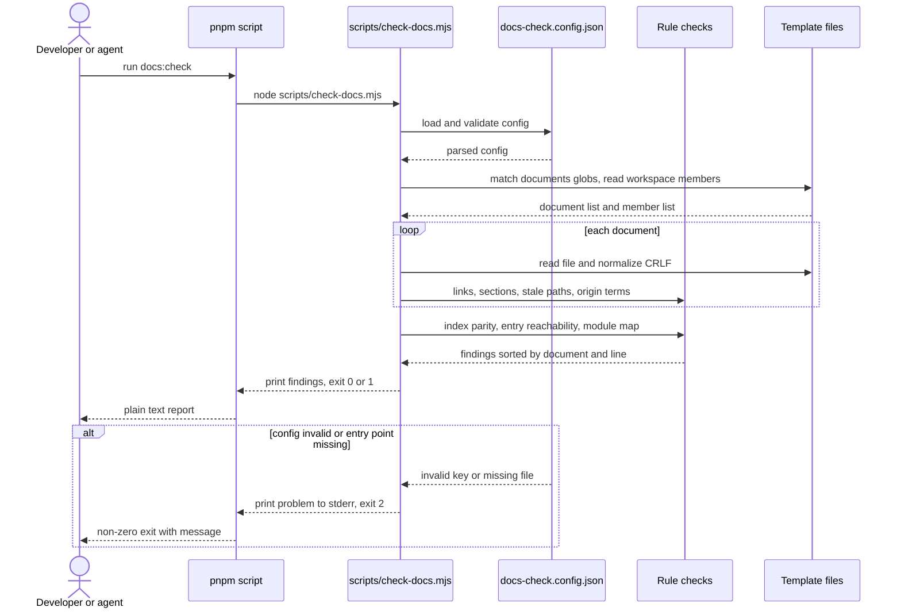
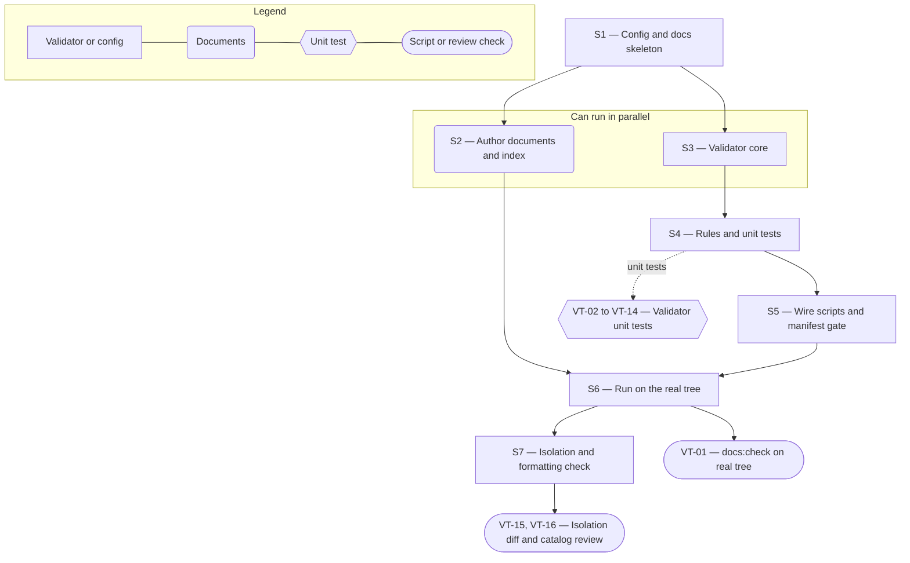

# Technical Specification — Docs-as-Code Knowledge Base

> **PRD slug:** `full-stack-express-starter-template` | **Owning layer:** `templates/full-stack-express/` (`AGENTS.md`, `docs/`, `scripts/`); no Apex layer | **Surface:** Full stack, per the PRD. This Feature ships documents and one Node command-line script, not client or server runtime code.
> **Verification builds:** In the template: `pnpm --dir templates/full-stack-express docs:check` and `pnpm --dir templates/full-stack-express test`. Apex regression guard (results must not change): `npx tsc -p tsconfig.server.json --noEmit` and `npx tsc -p tsconfig.client.json --noEmit`.
> **Open items:** See [design-doc-assumptions.md](design-doc-assumptions.md) (4 unresolved)
> **Design doc:** [design-doc-design.md](design-doc-design.md)

---

## System Boundary and Owning Layer

**Owning layer:** `templates/full-stack-express/` — the files `AGENTS.md`, `docs/**`, `scripts/check-docs.mjs`, `scripts/check-docs.test.mjs`, and one `docs:check` line in the template's root `package.json`. None of the Apex layers (`src/server/services/`, `src/server/routes/`, `src/client/components/`, `src/shared/types/`, `migrations/`) owns any of it.

**Rationale:** The knowledge base describes the template, so it lives in the template and moves with it into the bootstrap source. The template is self-contained (TBI-001, BR-008): it has its own lockfile, scripts, and lint rules, and shares nothing with Apex's root workspace. The validator is a plain Node ESM script with no npm dependency. It runs before `pnpm install`, adds nothing to the pinned dependency set (BR-009), and follows the shape of Apex's `scripts/validate-foundation-skills.mjs` (exit `0` or `1`, one line per problem, CRLF normalized, banned-term lint). It reads files only. It has no HTTP, database, or identity surface.

**Ownership answers:**
- New or existing Express service in `src/server/services/`? **No** — the Feature adds no runtime behavior. The template's own API (`apps/api`) is unchanged; `docs/api.md` only describes the endpoints FEAT-004 and the API Features define.
- New or existing route in `src/server/routes/`? **No** — no endpoint is added in Apex or in the template.
- New React component in `src/client/components/`? **No** — documents and a command-line script only. The component catalog (`docs/component-catalog.md`) describes `packages/ui`; it does not add components.
- New shared type in `src/shared/types/`? **No** — the config is plain JSON checked at load time by the script. No type is shared with Apex or between template packages.
- Database migration needed? **No** — `app_users` and its migrations belong to FEAT-003. The runbook `docs/runbooks/migrations.md` documents the migration command and does not add one.

---

## Security Enforcement

- **Authorization mechanism:** None. The Feature has no endpoint, so no `requirePermission` or `can()` guard applies, and it adds no Apex permission key (the Permission Catalog in `rbac-governance.mdc` is unchanged). The template defines no roles (BR-003). Read access to documents is repository access, which Platform Engineering governs in the generated project's Azure DevOps repository. Running `docs:check` needs no credential.
- **Layer that enforces scope:** The script itself. It resolves the template root once (`--root`, default the directory that contains `package.json` and the config), then rejects every resolved path that falls outside that root (rule `broken-link`, subject `outside template root`). It never reads outside the root, never fetches a URL, never spawns a process, and never evaluates document text. Its only inputs are the config, `pnpm-workspace.yaml`, and the files the `documents` globs match.
- **Sensitive data handling:** Documents use synthetic values only (BR-007): placeholder subjects such as `example-subject`, no real names, email addresses, or internal host names (PBI-030 NFR). The validator output names the rule, the document, the line, and the offending link target, path, heading, or term. It never echoes surrounding document text (PBI-031 NFR). Secret scanning of documents belongs to the supply-chain baseline (FEAT-013), not to this script.

---

## Architecture and Approach

### Layers touched

| Layer | Changed | Notes |
|-------|---------|-------|
| Server services (`src/server/services/`) | No | Apex runtime untouched (BR-008). |
| Server routes (`src/server/routes/`) | No | No endpoint. |
| Server middleware (`src/server/middleware/`) | No | No guard added. |
| Client components (`src/client/components/`) | No | No UI. |
| Client hooks (`src/client/hooks/`) | No | No UI. |
| Shared types (`src/shared/types/`) | No | No shared type. |
| Database (migrations/) | No | No schema change. |
| Drizzle schema (`src/server/db/schema.ts`) | No | No schema change. |
| Template documents (`templates/full-stack-express/AGENTS.md`, `docs/**`) | Yes | Entry point, architecture, ADR area, module map, API doc, runbooks, testing guide, design-system reference, component catalog, compatibility table slot, agent index. |
| Template scripts (`templates/full-stack-express/scripts/`) | Yes | `check-docs.mjs` and `check-docs.test.mjs`. |
| Template root manifest (`templates/full-stack-express/package.json`) | Yes | One `docs:check` script. The root `README.md` script table gains one row. |
| Template quality manifest (FEAT-012) | Yes, conditional | One `docs-validation` gate entry. See ⚠ in assumptions. |

### Template file layout

```
templates/full-stack-express/
  AGENTS.md                         entry point (links every document and the index)
  docs/
    agent-index.txt                 plain-text index, one document per line
    docs-check.config.json          validator config
    architecture.md
    module-map.md                   one heading per workspace member
    api.md                          links the committed OpenAPI document
    testing.md                      links the quality manifest
    design-system.md
    component-catalog.md
    compatibility.md                content from TBI-002
    adr/README.md                   index and how to add a record
    adr/0000-template.md            MADR template
    adr/0001-*.md ...               records of decisions the PRD already makes
    runbooks/local-setup.md
    runbooks/migrations.md
    runbooks/common-failures.md
  scripts/check-docs.mjs
  scripts/check-docs.test.mjs
```

### Per-work-item design decisions

**TBI-033 — Author the knowledge base structure and agent index**
- Pattern followed: Apex's own `AGENTS.md` ("Feature Map" and "Common Questions & Where to Find Answers" tables), `design-docs/` for feature design records, and the MADR-style records Apex's ADR module generates. The entry point is a navigation table, not prose.
- Key decisions:
  - `AGENTS.md` carries four required sections: `Start here`, `Documentation map`, `Skills`, `Scripts`. It links every document directly, so an agent that reads one file reaches all others in one hop (DoD: "links to every other document and the agent index").
  - `docs/agent-index.txt` is plain text. Format: `<repo-relative path>  <one-line summary>`; lines starting `#` are comments; blank lines are ignored. An agent can load it without a Markdown parser.
  - The module map is one file, `docs/module-map.md`, with one `###` heading per workspace member whose text is the member's path (for example `` `packages/contracts` ``). Under each heading: `**Responsibility:**` and `**Public interface:**` lines, each non-empty. Alternative rejected: one file per module. It multiplies index lines and gives the validator many files to match against workspace members.
  - Runbooks use one fixed skeleton: `Purpose`, `Prerequisites`, `Steps`, `Verify`, `Troubleshooting`. `local-setup.md` covers Corepack, `pnpm install --frozen-lockfile`, Docker Compose PostgreSQL, `migrate`, `seed`, `run`. `migrations.md` states that the application never changes schema at startup, that Platform Engineering runs production migrations, and that production rollback uses forward corrective migrations (BR-006). `common-failures.md` lists each startup abort from TBI-004 and the lockfile and Corepack mismatch errors from PBI-001.
  - `docs/api.md` links the committed OpenAPI document and lists the four reference endpoints with their auth rule. It does not restate request or response shapes: Zod and the generated OpenAPI document own them (BR-004), and a second copy would drift.
  - `docs/design-system.md` and `docs/component-catalog.md` name `packages/ui` files by path, so the stale-path check covers them. Parity with the package's public exports is review-only by default (⚠ in assumptions); the catalog ends with a PR checklist line that asks the author to confirm each public export is listed.
  - `docs/compatibility.md` is authored by TBI-002. This Feature gives it a fixed path, links it from `AGENTS.md`, and lists it in the index.
  - The ADR area seeds `0000-template.md` and records for BR-004 (Zod as contract authority), BR-003 (no RBAC), BR-006 (forward-only migrations), and this Feature's docs-as-code decision. The Apex ADR "Build from prompt" is not copied (BR-008).
  - One `## Template origin` section in `README.md` or `docs/architecture.md` states that the template began inside Apex. It is the only place Apex-specific names may appear.

**TBI-034 — Add the documentation validation script**
- Pattern followed: `scripts/validate-foundation-skills.mjs` (zero dependencies, `err`/`warn`/`ok` helpers, CRLF normalization, banned-term list, exit `0`/`1`) and `scripts/check-data-testid.mjs` (an in-source escape hatch, `data-testid-exempt`, and a `--self-test` flag).
- Key decisions:
  - **No dependency.** A Markdown-link-check or remark pipeline was rejected: link-check libraries fetch external URLs by default (PBI-031 forbids that), and each added package grows the pinned set (BR-009). The script hand-parses the three Markdown constructs it needs: ATX headings, inline links and images with reference definitions, and inline code spans. It skips fenced code blocks (``` and ~~~).
  - **Pure core, thin CLI.** `checkDocs({ root, config })` returns `{ findings, documentCount }` and has no side effects. The CLI wrapper prints findings and sets the exit code. Tests call the core for rule coverage and spawn the CLI for exit-code and output coverage.
  - **Own glob matcher.** Supports `*`, `**`, and literal segments; about 20 lines. Node's `fs.glob` and `path.matchesGlob` are experimental in some Node LTS lines, and TBI-002 pins the LTS late.
  - **Workspace members** come from the `packages:` list in `pnpm-workspace.yaml`, supporting entries of the form `dir/*` and literal `dir/name`. A member is a directory that contains `package.json`.
  - **Link resolution** is relative to the document, or to the template root when the target starts with `/`. Each path segment is compared to the directory listing, so a case mismatch fails on every operating system. A target that resolves outside the root is a `broken-link`, because the template becomes a repository root after bootstrap. External schemes (`http:`, `https:`, `mailto:`, `tel:`) and pure `#fragment` targets are skipped. Fragments on internal links are stripped, not validated, because Azure DevOps and GitHub generate different anchors.
  - **Stale paths.** An inline code span is a candidate when it contains `/`, ends in `/` or has an extension on its last segment, has no glob, placeholder, or URL characters (`*`, `{`, `<`, `$`, `://`), and its first segment is an existing top-level entry of the root (or it starts with `./` or `../`). A trailing `:12` or `:12-20` is stripped. Candidates that do not exist, and do not match `ignorePaths`, are `stale-path`. `<!-- docs-check-exempt -->` on the same or previous line skips a span.
  - **Required sections** match level-2 headings, trimmed and case-insensitive, per `requiredSections` rule in the config.
  - **Index parity.** The set of documents is every file the `documents` globs match. Each must appear in the index (`index-missing`). Each path in the index must exist (`index-stale`). Each document other than `AGENTS.md` must be linked from `AGENTS.md` (`entry-unlinked`). Each path in `requiredDocuments` must exist (`required-missing`).
  - **Origin terms.** Case-insensitive match of each `forbiddenTerms` entry as a whole word, outside the `## Template origin` section (the section ends at the next heading of equal or higher level). The finding names the term, not the line text.
  - **Deterministic output.** Findings sort by document path, then line, then rule. Agents and tests parse the same stable text.

**PBI-030 — Find architecture, module boundaries, and runbooks from one index**
- Pattern followed: Apex's `AGENTS.md` navigation tables and `context.md` as the second-level guide. The entry point plays the `AGENTS.md` role; `docs/architecture.md` plays the `context.md` role.
- Key decisions:
  - Reachability is a validator rule (`entry-unlinked`), not a convention. Acceptance criterion (a) becomes a repeatable check (VT-01, VT-13).
  - Broken entry-point links (b), unmapped modules (c), and Apex terms outside the origin note (d) each map to one rule, so the criteria hold on every change, not only at review.
  - Alternative rejected: a docs search service or generated site. The PBI puts both out of scope, and plain files are readable by agents with no runtime.

**PBI-031 — Detect broken links, missing sections, and stale paths in documentation**
- Pattern followed: `scripts/validate-foundation-skills.mjs` for the report shape and exit codes.
- Key decisions:
  - Exit `0` clean, `1` findings, `2` unusable config or invocation. Each non-zero exit prints the problem.
  - The finding line names the document and the subject (link target, stale path, missing heading), which satisfies (b) and (c). External links are never opened (d). The test asserts this by failing on any `node:http`, `node:https`, or `node:net` call.
  - Per BR-013 the script is a gate exposed as a script. The template ships no pipeline step; teams decide when `docs:check` runs. It completes in a local developer loop: synchronous reads of a few dozen files.

---

## Data and Contracts

### API endpoints

| Method | Route | Request shape | Response shape | Auth |
|--------|-------|--------------|----------------|------|
| — | None | The Feature adds no endpoint in Apex or in the template. | — | Not applicable |

### Command-line contract

| Item | Contract |
|------|----------|
| Script | `pnpm docs:check` runs `node scripts/check-docs.mjs` from the template root |
| Flags | `--root <dir>` (default: the directory that holds `docs/docs-check.config.json`), `--config <path>` (default: `docs/docs-check.config.json`), `--self-test` (runs built-in fixtures, as `check-data-testid.mjs` does) |
| Exit `0` | No findings |
| Exit `1` | One or more findings |
| Exit `2` | Missing or invalid config, missing entry point or index file, unreadable root |
| Output | Plain text on stdout (findings) and stderr (exit `2` messages). No color, no interactive prompt |

Finding line format: `<rule> <document>[:<line>] <subject>`. Final line: `docs:check: <n> problems in <m> documents`.

```
broken-link AGENTS.md:14 docs/runbooks/missing.md
stale-path docs/api.md:22 packages/old-name/src/index.ts
missing-section docs/runbooks/migrations.md Troubleshooting
index-missing docs/testing.md
index-stale docs/agent-index.txt:9 docs/old.md
entry-unlinked docs/testing.md
required-missing docs/runbooks/common-failures.md
module-unmapped packages/new-mod
module-incomplete packages/ui Public interface
origin-term docs/architecture.md:7 Apex
docs:check: 10 problems in 6 documents
```

### Rules

| Rule | Reported when | Source |
|------|---------------|--------|
| `broken-link` | An internal link target does not exist, differs by case, or resolves outside the template root | PBI-030 (b), TBI-034 |
| `stale-path` | A path in an inline code span does not exist | PBI-031 (b), TBI-034 |
| `missing-section` | A document lacks a required level-2 heading | PBI-031 (c), TBI-034 |
| `index-missing` | A document is absent from `agent-index.txt` | TBI-034, PBI-030 (a) |
| `index-stale` | An index entry names a file that does not exist | TBI-034 |
| `entry-unlinked` | `AGENTS.md` does not link a document | TBI-033 DoD, PBI-030 (a) |
| `required-missing` | A path in `requiredDocuments` does not exist | TBI-033 DoD |
| `module-unmapped` | A workspace member has no heading in `docs/module-map.md` | PBI-030 (c) |
| `module-incomplete` | A module entry lacks `Responsibility` or `Public interface` text | TBI-033 DoD |
| `origin-term` | A forbidden term appears outside `## Template origin` | PBI-030 (d), BR-008 |

### Config file `docs/docs-check.config.json`

| Key | Type | Purpose |
|-----|------|---------|
| `entryPoint` | string | `AGENTS.md` |
| `index` | string | `docs/agent-index.txt` |
| `documents` | string[] | Globs of documents the index must list: `AGENTS.md`, `README.md`, `docs/**/*.md`, `.cursor/skills/**/SKILL.md` (⚠ skills path) |
| `requiredDocuments` | string[] | Paths that must exist (runbooks, architecture, module map, API doc, testing guide, design-system reference, component catalog, compatibility table) |
| `requiredSections` | `{ match: string, headings: string[] }[]` | Per-glob required level-2 headings. Defaults: `docs/runbooks/*.md` → Purpose, Prerequisites, Steps, Verify, Troubleshooting; `docs/adr/0*.md` → Context and Problem Statement, Considered Options, Decision Outcome; `AGENTS.md` → Start here, Documentation map, Skills, Scripts |
| `moduleMap` | `{ file, workspaceFile, fields }` | `docs/module-map.md`, `pnpm-workspace.yaml`, `["Responsibility","Public interface"]` |
| `ignorePaths` | string[] | Globs the stale-path check skips: `dist/**`, `node_modules/**`, `.env`, `coverage/**` |
| `forbiddenTerms` | string[] | `Apex`, `Amergis`, `ai-pilot` |
| `originHeading` | string | `Template origin` |

Other Features extend this file: FEAT-015 and FEAT-016 add skill globs, FEAT-017 adds `docs/handoff.md` to `documents`, `requiredDocuments`, and `requiredSections`. They do not edit the script.

### Schema / storage changes

| Target | Change | Reason |
|--------|--------|--------|
| None | No table, column, or migration. `app_users` is documented in `docs/architecture.md` and `docs/runbooks/migrations.md`, not changed. | The Feature is documents and a script. |

---

## Testing Strategy

**Unit tests:**
- `scripts/check-docs.test.mjs` (Vitest, the template's unit runner; same layering as Apex's Jest unit tests). Each test builds a fixture tree in `os.tmpdir()`, runs `checkDocs` or spawns the CLI, and asserts observable behavior: finding rule, document, subject, exit status, output lines. No assertion on parser internals.
- One test per rule, one fixture that passes every rule, and one table-driven suite for stale-path candidate selection (fenced block, glob, placeholder, URL, exempt comment, `ignorePaths`, `:line` suffix).
- Cross-platform cases: CRLF documents give the same findings as LF; a case-mismatched link fails.
- Network guard: the external-link test replaces `node:http`, `node:https`, and `node:net` with throwing stubs and asserts no finding and no throw.
- Output hygiene: a document that holds secret-looking text next to a broken link produces output that holds only the link target.

**Integration tests:**
- `pnpm docs:check` on the real template tree exits `0` (VT-01). Run it as a script, not inside the unit suite, so a documentation edit does not fail unrelated unit runs; BR-013 leaves run timing to each team.
- Mutation run: copy the real `AGENTS.md` and `docs/` to a temp root, rename one referenced file, and assert `stale-path` or `broken-link` for exactly that name.
- Isolation diff (VT-15): the change set touches only `templates/full-stack-express/**`. Apex's `tsc` results are identical before and after.

**E2E tests (if applicable):**
- Not applicable. No UI, route, or browser flow. Playwright and axe do not apply; the accessibility requirement (headings, descriptive link text, plain-text output) is covered by the `missing-section` rules and by review.
- Manual review (VT-16): the design-system reference and component catalog list every public export of `packages/ui`, until the ⚠ parity decision changes that.

---

## Observability

- **Custom events/metrics:** None beyond standard request telemetry. The Feature has no runtime process. The validator's plain-text report and exit code are its only output. It writes no log, uses no Pino or OpenTelemetry wiring, and sends nothing over the network.
- **Alerts:** None.

---

## Rollback and Deployment

- **Schema changes backward compatible:** Yes — no schema change.
- **Rollback procedure:** Revert the change set. Every file is new, except one `docs:check` line in the template's `package.json`, one row in the template `README.md` script table, and one conditional quality-manifest gate entry. Apex runtime, database, and builds are unaffected, so nothing else needs undoing.
- **Deployment dependencies:** None for Apex. After bootstrap, Platform Engineering decides whether a pipeline calls `pnpm docs:check` (BR-013). The handoff document (FEAT-017) lists the script and its exit codes as a consumed contract.
- **Feature flag gates deployment:** No. The PRD sets `Flag required: No`.

---

## Verification Test Matrix

| ID | Layer | Arrange | Act | Assert | Linked |
|----|-------|---------|-----|--------|--------|
| VT-01 | Script (integration) | Real template tree after S2 and S5 | Run `pnpm docs:check` | Exit `0`. No `entry-unlinked`, `index-missing`, or `required-missing`. Entry point links testing guidance, module map, API doc, and runbooks; the index lists them | PBI-030 (a), PBI-031 (a), TBI-033 |
| VT-02 | Vitest unit | Fixture where `AGENTS.md` links `docs/runbooks/missing.md`, which does not exist | Run CLI | Exit `1`. Output has `broken-link AGENTS.md:<line> docs/runbooks/missing.md` | PBI-030 (b) |
| VT-03 | Vitest unit | Fixture workspace with `packages/new-mod/package.json` and no heading for it in the module map; a second member with a heading but no `Public interface` text | Run CLI | Exit `1`. Output has `module-unmapped packages/new-mod` and `module-incomplete <member> Public interface` | PBI-030 (c), TBI-033 |
| VT-04 | Vitest unit | Fixture with `Apex` in `docs/architecture.md` body and again under `## Template origin` | Run CLI | One `origin-term` finding, for the body occurrence. None for the origin section | PBI-030 (d) |
| VT-05 | Vitest unit | Fixture where all links, headings, paths, index entries, and module entries are consistent | Run CLI | Exit `0`. Last line `docs:check: 0 problems in <m> documents` | PBI-031 (a) |
| VT-06 | Vitest unit | Fixture with `` `packages/old-name/src/index.ts` `` in `docs/api.md` after the directory was renamed | Run CLI | Exit `1`. Output has `stale-path docs/api.md:<line> packages/old-name/src/index.ts` | PBI-031 (b) |
| VT-07 | Vitest unit | Fixture runbook with no `## Troubleshooting` heading | Run CLI | Exit `1`. Output has `missing-section docs/runbooks/<name>.md Troubleshooting` | PBI-031 (c) |
| VT-08 | Vitest unit | Fixture with `https://example.com/x` and `mailto:team@example.com` links; `node:http`, `node:https`, `node:net` stubbed to throw | Run CLI | Exit `0`. No finding for either link. No stub called | PBI-031 (d) |
| VT-09 | Vitest unit | Fixture with a document missing from the index, an index line naming a deleted file, and a path in `requiredDocuments` that does not exist | Run CLI | `index-missing`, `index-stale`, and `required-missing` each present, each naming its path | TBI-034, TBI-033 |
| VT-10 | Vitest unit | Fixture with a link `../../src/server/x.ts` that resolves inside a parent checkout, and a link `docs/API.md` to the file `docs/api.md` | Run CLI | Two `broken-link` findings; the first has subject `outside template root` | TBI-034, BR-008 |
| VT-11 | Vitest unit | Fixture with CRLF line endings, a path inside a fenced block, a path under `ignorePaths`, a span with `<!-- docs-check-exempt -->`, and `` `docs/api.md:22-30` `` | Run CLI | No `stale-path` finding for any of the five; same findings as the LF version of the fixture | TBI-034 |
| VT-12 | Vitest unit | Fixture with the text `password=hunter2` on the same line as a broken link | Run CLI | Output contains the link target and does not contain `hunter2` | PBI-031 (security NFR), TBI-034 |
| VT-13 | Vitest unit | Fixture with a document that the index lists and `AGENTS.md` does not link | Run CLI | `entry-unlinked <document>` reported; no `index-missing` for it | PBI-030 (a), TBI-033 |
| VT-14 | Vitest unit | Missing config file; config with no `entryPoint`; `entryPoint` file absent | Run CLI three times | Exit `2` each time. stderr names the config key or file | TBI-034 |
| VT-15 | Repository diff check | Change set against `main` | List changed files and re-run Apex `tsc` commands | Every changed path is under `templates/full-stack-express/`. `tsc` results match `main` | TBI-033, BR-008 |
| VT-16 | Manual review checklist | Finished `packages/ui` and FEAT-009 outputs | Compare public exports to `docs/component-catalog.md` and `docs/design-system.md` | Every export listed. Every named file path exists (the stale-path check proves the second half) | TBI-033 |

---

## Implementation Plan

- [ ] S1 — Create the `docs/` skeleton, `docs/docs-check.config.json`, `AGENTS.md` with its four required headings, and an empty `docs/agent-index.txt` _(no blockers inside this Feature; needs the finished FEAT-004, FEAT-009, and FEAT-012 outputs to document)_
  - Covers: structure for `VT-01`, `VT-09`
- [ ] S2 — Author the documents: architecture, ADR area, module map, API doc, runbooks, testing guide, design-system reference, component catalog, compatibility-table slot, and the index entries _(blocked by S1)_
  - Covers: `VT-01`, `VT-16`
- [ ] S3 — Build the validator core in `scripts/check-docs.mjs`: config loader, glob matcher, Markdown scanner, link resolver, reporter, exit codes _(blocked by S1; can parallel with S2)_
  - Covers: `VT-05`, `VT-14`
- [ ] S4 — Implement the rules and their unit tests in `scripts/check-docs.test.mjs`: links, stale paths, sections, index parity, entry reachability, module map, origin terms _(blocked by S3)_
  - Covers: `VT-02`, `VT-03`, `VT-04`, `VT-06`, `VT-07`, `VT-08`, `VT-09`, `VT-10`, `VT-11`, `VT-12`, `VT-13`
- [ ] S5 — Wire `docs:check` into the template root `package.json`, add the `README.md` script-table row, cover `scripts/*.mjs` in the template's ESLint and Prettier runs, add the `docs-validation` gate to the quality manifest (⚠ confirm) _(blocked by S4)_
  - Covers: `VT-01`
- [ ] S6 — Run `pnpm docs:check` on the real tree, fix findings, then run the mutation test _(blocked by S2, S5)_
  - Covers: `VT-01`
- [ ] S7 — Check isolation and formatting: diff scope, Apex `tsc` guard, Apex root formatting check (⚠ confirm approach), catalog review checklist _(blocked by S6)_
  - Covers: `VT-15`, `VT-16`

**Execution lanes:**
- Lane 1 (start immediately): S1
- Lane 2 (after S1): S2 (documents) and S3 → S4 → S5 (validator), in parallel
- Lane 3 (after S2 + S5): S6, then S7

---

## Diagram 1 — Code Execution Flow



---

## Diagram 2 — Implementation Dependency Map


