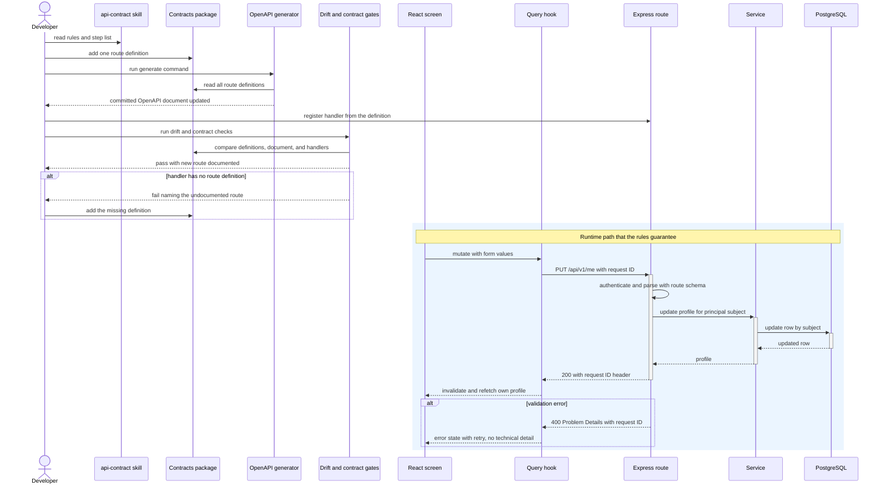
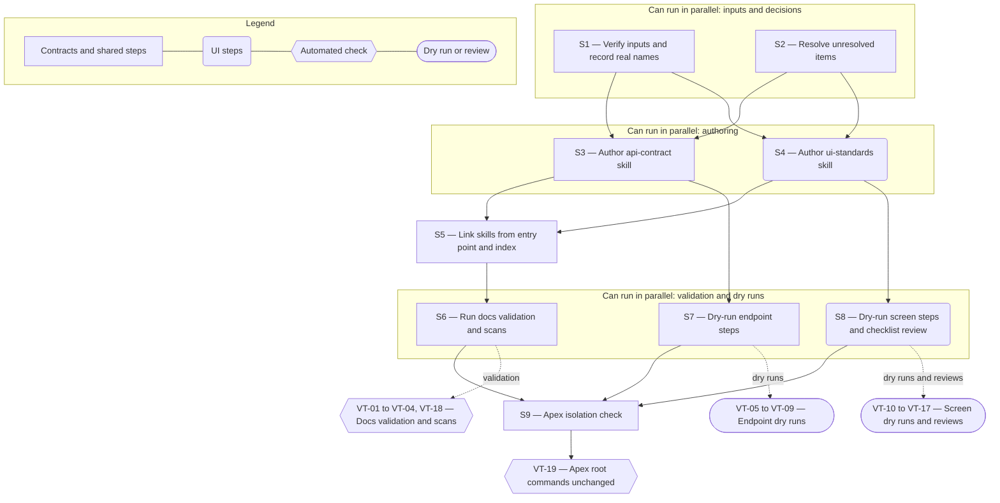

# Technical Specification — API-Contract and UI-Standards Skills

> **PRD slug:** `full-stack-express-starter-template` | **Owning layer:** `templates/full-stack-express/.cursor/skills/` (Markdown only; no Apex `src/` layer) | **Surface:** Full stack (documentation that governs the template's API and web client)
> **Verification builds:** No Apex TypeScript changes, so `npx tsc -p tsconfig.server.json --noEmit` and `npx tsc -p tsconfig.client.json --noEmit` are not required. Verify with the template's documentation validation script (TBI-034), the template's drift, contract, component, and accessibility gates (invoked by the script names in the quality manifest, TBI-027), and Apex's root install, build, and formatting commands (VT-19).
> **Open items:** See [design-doc-assumptions.md](design-doc-assumptions.md) (4 unresolved)
> **Design doc:** [design-doc-design.md](design-doc-design.md)

---

## System Boundary and Owning Layer

**Owning layer:** `templates/full-stack-express/.cursor/skills/` — two new skill directories, `api-contract/` and `ui-standards/`, each holding one `SKILL.md`. The location is an unresolved item (see assumptions); this spec uses it as the recommended default.

**Rationale:** The Feature's output is guidance for generated projects, so it belongs in the isolated template folder and nowhere in Apex's `src/`. The skills are Markdown, which the template's agents and its documentation validation script (TBI-034) already read. Apex's own `.cursor/skills/` layout (for example `fullstack-node-bff/SKILL.md`) supplies the file format. Apex's rules (`react-coding-standards.mdc`, `ui-design-standards.mdc`) supply prior art for the topics but not wording, because they describe Apex's CSS Modules, CSS custom properties, and `ensureAuthenticated`, none of which exist in the template (BR-008). The skills cite template modules that FEAT-004 (contracts package), FEAT-009 (UI package), and FEAT-014 (knowledge base) produce, so they are authored after those Features.

**Ownership answers:**
- New or existing Express service in `src/server/services/`? No — the Feature adds no Apex service. The skills describe the template API's own services but contain no code.
- New or existing route in `src/server/routes/`? No — the Feature adds no Apex route and no template route. Reference endpoints are cited as worked examples only.
- New React component in `src/client/components/`? No — the Feature adds no Apex component and no template component. The profile screen (FEAT-010) is cited as the worked example.
- New shared type in `src/shared/types/`? No — no Apex shared type. The skills point to types derived in the template's contracts package.
- Database migration needed? No — no Apex migration and no template schema change. The skills state that a schema change needs a reviewed migration and refer to the developer skill (TBI-039) for that rule.

---

## Security Enforcement

- **Authorization mechanism:** None added in Apex. Apex's RBAC (`rbac-governance.mdc` patterns such as `can('admin:roles')` and `requirePermission('prds:review')`) and `ensureAuthenticated` do not apply to the template and must not appear in the skills (BR-003, BR-008). The template's rule, encoded as `API-R10` and `API-R12`, is: every non-health route runs behind the template's authentication middleware (TBI-012), and no role or permission model exists. A request for roles or a user list is reported as the open RBAC decision.
- **Layer that enforces scope:** Both, in the generated project and not in this Feature. Route middleware authenticates (`API-R10`). The handler and service take the external subject from the authenticated principal and never from the request (`API-R11`, `UI-R08`). The skills tell the author to do this and name the API tests that prove it (TBI-024 cross-principal test). This Feature enforces nothing at runtime.
- **Sensitive data handling:** The skills contain no secret, no real name, email, or identity subject, and no internal host name. Every example uses a clearly synthetic value (BR-007). The skills forbid identity values and stack traces in error bodies, logs, and telemetry (`API-R08`). VT-18 scans the skill files for violations.

---

## Architecture and Approach

### Layers touched

| Layer | Changed | Notes |
|-------|---------|-------|
| Server services (`src/server/services/`) | No | Apex runtime is unchanged (BR-008). |
| Server routes (`src/server/routes/`) | No | |
| Server middleware (`src/server/middleware/`) | No | |
| Client components (`src/client/components/`) | No | |
| Client hooks (`src/client/hooks/`) | No | |
| Shared types (`src/shared/types/`) | No | |
| Database (migrations/) | No | |
| Drizzle schema (`src/server/db/schema.ts`) | No | |
| Template skills (`templates/full-stack-express/.cursor/skills/api-contract/SKILL.md`, `.../ui-standards/SKILL.md`) | Yes | Two new Markdown files. |
| Template entry point and agent index (owned by FEAT-014) | Yes | One link per skill added to the entry-point document and one line per skill added to the plain-text index. No restructuring. |

### Skill file layout (applies to both skills)

Each `SKILL.md` has YAML front matter with `name` (`api-contract` or `ui-standards`) and `description`, then these headings in this order. TBI-034's required-section check can verify them.

1. `## When to use` — the triggers: adding or changing an endpoint (api-contract) or a screen (ui-standards).
2. `## Required references` — repository-relative paths the author must read first (contracts package interface, drift and generate commands, Problem Details schema, pagination schema; or UI package theme, design-system reference, component catalog, selector convention). Every path exists in the template (VT-04).
3. `## Rules` — one table: `ID | Rule | Enforced by`. The "Enforced by" cell holds a gate ID from the quality manifest, or the literal `Review`. IDs are stable and never reused.
4. `## Adding an endpoint` (api-contract) or `## Adding a screen` (ui-standards) — a numbered step list, one action per step, each naming the command or file.
5. `## Review checklist` — one row per rule or group, `Item | Evidence source | Met? (yes, no, not applicable)`. For `ui-standards` this is the PBI-034 checklist. For `api-contract` it is the reviewer's pre-merge list.
6. `## Stop conditions` — the author stops and reports instead of guessing when a required reference or command is missing, or when a request is out of scope (user list, roles, AWS, pipelines).

### `api-contract` rule table (TBI-035)

| ID | Rule | Enforced by |
|----|------|-------------|
| API-R01 | Declare every route once in the contracts package: method, versioned path, request, response, and error schemas. No handler exists without a definition. | Undocumented-handler check (⚠ unresolved owner); `Review` until it exists |
| API-R02 | Never edit the committed OpenAPI document by hand. Run the generate command and commit its output. | OpenAPI drift gate |
| API-R03 | The contracts package imports no Express, React, or database module. | Build gate (the package declares no such dependency, so the import fails to resolve) |
| API-R04 | Version every path (`/api/v1/...`) and name resources with nouns. Use methods and status codes by meaning: GET reads, PUT replaces, 2xx reports success, 4xx reports a client fault, 5xx reports a server fault. | Contract tests check statuses and shapes; naming is `Review` |
| API-R05 | Return every error as RFC 9457 Problem Details built from the shared schema. The route definition declares each error response it can return. | Contract tests (error responses validated against the Problem Details schema) |
| API-R06 | Every response carries the request ID header, and the route definition declares it. | Contract tests |
| API-R07 | Parse the request with the route's request schema before the handler runs. Handlers receive parsed values only. | API test gate (validation-failure test) |
| API-R08 | An error body, log line, or telemetry attribute never holds a stack trace or an identity value (display name, email, external subject). | API test gate (error-handling test); unit gate (log redaction tests) |
| API-R09 | A list route uses the shared pagination schema: a default page size and a maximum. A larger value returns a Problem Details validation error. | Unit gate (pagination schema tests); contract test for each list route |
| API-R10 | Every route except `/health/live` and `/health/ready` runs behind the authentication middleware. An unauthenticated request returns a 401 Problem Details response. | API test gate (unauthenticated path) |
| API-R11 | On the profile resource, read the external subject from the authenticated principal. The request schema defines no identifier or subject field, and the handler never reads one from the path, query, or body. | API test gate (cross-principal test); schema review for new principal-scoped routes |
| API-R12 | Define no roles, permissions, or authorization policy. Report a request for them as the open RBAC decision. | `Review` |
| API-R13 | Give every route at least one contract test that calls it and validates the response, errors included, against the committed OpenAPI schema. | Contract tests (every documented route covered) |
| API-R14 | Use synthetic values in schema examples, tests, and documents. | `Review` |
| API-R15 | Undocumented or incompatible behavior fails the drift and contract checks. Fix the code or the definition and regenerate. Never loosen a check to pass it. | OpenAPI drift gate; contract tests |

`API-R11` wording follows the unresolved unknown-key policy (reject or ignore). The recommended default states that a request body holding an identifier or subject field returns a 400 Problem Details error.

`Adding an endpoint` steps:
1. Read `Required references`. Stop if any path is missing.
2. Confirm the endpoint is in scope: no user list, create, or lookup; no roles.
3. Add one route definition to the contracts package: versioned path, request, response, and error schemas, and the request ID header. Reuse the shared Problem Details and pagination schemas.
4. Run the generate command. Commit the changed OpenAPI document.
5. Register the handler from the definition. Take the subject from the principal. Call the service and the data-access module, never Drizzle directly.
6. Add API tests: success, validation failure, unauthenticated, database failure, and, for a principal-scoped resource, a cross-principal test.
7. Add or extend the contract test so it covers the new route and its error responses.
8. Run the type-check, lint, OpenAPI drift, API, and contract gates. Fix failures in code or definition.
9. Add the endpoint to the API documentation in the knowledge base, then run the documentation validation.

### `ui-standards` rule table (TBI-036)

| ID | Rule | Enforced by |
|----|------|-------------|
| UI-R01 | Take color, spacing, typography, and breakpoints from UI package theme tokens. Never hard-code a color or size in a component. | `Review`; names the lint rule instead if one exists when the skill is written |
| UI-R02 | Build screens from the UI package and the component catalog. If the catalog lacks a component, propose a catalog addition. Do not create a one-off styled component. | `Review` against the component catalog |
| UI-R03 | Rebrand by overriding tokens only. An override must keep WCAG 2.1 AA contrast. | Unit gate (UI package contrast check, TBI-020) |
| UI-R04 | Lay out for phone, tablet, and desktop with the shell and theme breakpoints. No horizontal scrolling at the narrowest supported width. | Component test gate (shell breakpoints); layout at both widths is `Review` |
| UI-R05 | A screen that loads data renders loading, empty, error, and loaded states from the shared state components. The error state offers retry and shows no technical detail. | Component test gate (one test per state); accessibility gate on each state |
| UI-R06 | Meet WCAG 2.1 AA: semantic landmarks and headings, a visible label on every control, keyboard operation with visible focus, and state changes announced to assistive technology. | Accessibility gate (axe checks on every state) |
| UI-R07 | Build forms with React Hook Form and the shared Zod schema from the contracts package. Show field errors tied to their fields, move focus to the first invalid field, send no request while invalid, and keep entered values after a failed save. | Component test gate; accessibility gate (labels); `Review` |
| UI-R08 | Send only the fields and identifiers the contract defines. Never display or send another person's identifier. | API test gate (cross-principal test); `Review` |
| UI-R09 | Read server data through the shared TanStack Query client and the typed API client. Never fetch inside an effect. After a mutation, invalidate the queries it affects. | Component test gate (updated data without reload); `Review` |
| UI-R10 | Show Problem Details failures through the API client's single error path. The screen shows a message and never the raw body. | Unit gate (API client tests); component test gate |
| UI-R11 | Select elements in tests with the selector convention from the UI package, and add selectors to every interactive and key content element. | Component test gate; `Review` |
| UI-R12 | Use the documented light and dark selection mechanism. Do not branch on the active theme inside components. | `Review` |

`Adding a screen` steps:
1. Read `Required references` (design-system reference, component catalog, theme tokens, selector convention, profile screen). Stop if any is missing.
2. List the catalog components and tokens the screen reuses. If one is missing, propose a catalog addition and stop that element.
3. Define the screen's data needs. Use an existing route definition from the contracts package, or add one with the `api-contract` skill first.
4. Fetch through the typed API client and the shared query client. Invalidate affected queries after each mutation.
5. Build the four states with the shared state components.
6. Build forms from the shared Zod schema with React Hook Form, following the profile screen.
7. Add selectors to interactive and key content elements, using the convention.
8. Add component tests for each state and run the accessibility check on each state.
9. Run the component and accessibility gates, then complete the review checklist with evidence for each item.

`Review checklist` groups for UI/UX (PBI-034): tokens, catalog, states, widths, keyboard and focus, labels, contrast, screen reader, forms, queries, selectors. Each item names its evidence: the design-system reference, the component catalog, a test, or an accessibility result. The widths item asks the reviewer to confirm layout and focus order at the narrowest and widest supported widths.

### Per-work-item design decisions

**TBI-035 — Author the api-contract skill**
- Pattern followed: Apex's `fullstack-node-bff/SKILL.md` ("Adding a new API endpoint (checklist)") for a numbered endpoint checklist, and its front matter format.
- Key decisions: The checklist starts at the contract, not the route handler, because the contracts package is the single authority (BR-004). The rule table puts the enforcing check next to each rule, so an agent sees what will fail. Rejected: prose-only guidance, because the NFR requires an explicit enforcer per rule. Rejected: copying Apex's `ensureAuthenticated` text, because it does not exist in the template.

**TBI-036 — Author the ui-standards skill**
- Pattern followed: Apex's `react-coding-standards.mdc` for forms (React Hook Form with Zod) and server state (TanStack Query, no fetch in effects), and `ui-design-standards.mdc` for the "never hard-code, always use tokens" principle.
- Key decisions: Token rules refer to MUI theme tokens in the UI package, not Apex's CSS custom properties. The skill quotes the selector convention and the profile screen's form and query patterns instead of restating them as new rules. Rejected: a generic accessibility essay. Each accessibility rule maps to a gate or a checklist item.

**PBI-032 — Add an endpoint that follows the API contract rules**
- Pattern followed: the `Adding an endpoint` step list and `API-R01` to `API-R15`.
- Key decisions: The acceptance criteria split across four checks. The happy path needs the drift and contract gates (`API-R02`, `API-R13`). The undocumented-handler case needs a check that no work item builds (unresolved). The pagination case relies on the shared pagination schema. The error-body case relies on API error-handling tests. Where a check does not exist, the rule says `Review`. The skill never claims an enforcement that is absent.

**PBI-033 — Build a screen that follows the UI standards**
- Pattern followed: the `Adding a screen` step list and `UI-R01` to `UI-R12`, with the profile screen as the worked example.
- Key decisions: Accessibility is checked on every state, because PBI-021 requires axe on loading, loaded, edit, and error states. The query rule names invalidation after a mutation, as PBI-020 (a) shows.

**PBI-034 — Review a screen against the UI standards checklist**
- Pattern followed: the `Review checklist` section of `ui-standards`.
- Key decisions: The checklist lives in the skill, not in a separate document, so the reviewer and the author read one source. Each item carries an evidence source, so "met" always has a pointer. A skipped state is a failure, not a warning. An off-catalog component is flagged for catalog addition or replacement.

---

## Data and Contracts

### API endpoints

This Feature adds no endpoint. The skills cite these template endpoints as worked examples and as rule targets. They are defined by FEAT-004 and FEAT-006, and the skills must match the committed contract.

| Method | Route | Request shape | Response shape | Auth |
|--------|-------|--------------|----------------|------|
| GET | `/health/live` | None | Liveness report | None |
| GET | `/health/ready` | None | Readiness report, no sensitive detail | None |
| GET | `/api/v1/me` | None; subject comes from the principal | Own profile | Authenticated principal; no roles |
| PUT | `/api/v1/me` | Display name, optional email (shared Zod schema) | Updated own profile | Authenticated principal; no roles |

Every error response is a Problem Details body with the request ID header.

### Skill file contract

| Target | Contract | Reason |
|--------|----------|--------|
| `templates/full-stack-express/.cursor/skills/api-contract/SKILL.md` | Front matter `name: api-contract` and `description`; headings `When to use`, `Required references`, `Rules`, `Adding an endpoint`, `Review checklist`, `Stop conditions`; rule IDs `API-R01…` | TBI-035; lets TBI-034 verify structure and lets other skills cite rules |
| `templates/full-stack-express/.cursor/skills/ui-standards/SKILL.md` | Front matter `name: ui-standards` and `description`; headings `When to use`, `Required references`, `Rules`, `Adding a screen`, `Review checklist`, `Stop conditions`; rule IDs `UI-R01…` | TBI-036; PBI-034 checklist |
| Rule table row | Three cells: ID, rule text, "Enforced by" (a gate ID from the quality manifest or `Review`) | NFR on both TBIs |
| Agent entry-point document and agent index | One link or line per skill | DoD on both TBIs |

### Schema / storage changes

| Target | Change | Reason |
|--------|--------|--------|
| None | No table, column, or migration in Apex or in the template | The Feature is documentation only |

---

## Testing Strategy

The deliverable is Markdown, so tests prove two things: the files are well formed and linked, and every claim in them holds when someone follows the steps. Template tests use Vitest, React Testing Library, Supertest, and Playwright with axe, which mirrors Apex's Jest, Supertest, and Playwright layering.

**Unit tests:**
- Documentation validation (TBI-034) — passes on both skills; reports a skill missing from the agent index, a broken link, a stale path, and a missing required heading (VT-01, VT-02, VT-04).
- Rule-table check — reports a blank or unknown "Enforced by" cell (VT-03). Depends on the unresolved decision to extend TBI-034.

**Integration tests (executable dry runs in a scratch copy of the template; never committed):**
- API steps — follow `Adding an endpoint` for a scratch route and run the gates. Then break the route four ways: remove the definition, remove the pagination maximum, return a stack trace, accept a subject field. Each break must make the named gate fail with a message naming the problem (VT-05 to VT-09).
- UI steps — follow `Adding a screen` for a scratch screen. Then remove a label, and check the accessibility gate fails and names the field (VT-10, VT-11). Check refetch after a mutation (VT-12).

**Review tests (manual, with a recorded result):**
- Hard-coded color and off-catalog component are reported as violations (VT-13, VT-17).
- The checklist, applied to the profile screen, yields evidence for every item (VT-14). Applied to a scratch screen that skips a state, it yields a failure (VT-15). It prompts for both widths (VT-16).

**E2E tests (if applicable):**
- None added. The Playwright and axe journeys belong to FEAT-011. The dry runs reuse them.

**Isolation tests:**
- Skill text contains no Apex-specific name or path, and no real identity value (VT-18).
- Apex's root install, build, test, lint, and formatting results are the same with and without the skill files (VT-19).

---

## Observability

- **Custom events/metrics:** None beyond standard request telemetry. The skills are static files. They tell authors what must never appear in logs and telemetry (`API-R08`).
- **Alerts:** None.

---

## Rollback and Deployment

- **Schema changes backward compatible:** Yes — there are no schema changes.
- **Rollback procedure:** Revert the commit that adds the two skill files and the two link lines. No data, build artifact, or runtime changes.
- **Deployment dependencies:** None. The files ship with the template folder. Platform Engineering's review and move to the bootstrap source carries them along.
- **Feature flag gates deployment:** No. The PRD sets "Flag required: No", and the backlog carries no `featureFlag` on this Feature.

---

## Verification Test Matrix

| ID | Layer | Arrange | Act | Assert | Linked |
|----|-------|---------|-----|--------|--------|
| VT-01 | Docs validation script | Both skills written and linked; knowledge base finished | Run the documentation validation | Exit 0. Entry point and agent index both link both skills. Every required heading is present in each skill. | TBI-035, TBI-036 |
| VT-02 | Docs validation script | Scratch copy with one skill removed from the agent index | Run the documentation validation | Exit non-zero. Output names the skill document absent from the index. | TBI-035, TBI-036 |
| VT-03 | Docs validation script (rule-table check) | Scratch copy with one "Enforced by" cell blank, and another naming a gate absent from the quality manifest | Run the rule-table check | Exit non-zero. Output names the skill and rule ID for each. On the unmodified skills, exit 0. | TBI-035, TBI-036 |
| VT-04 | Docs validation script | Scratch copy where a path cited under `Required references` is renamed | Run the documentation validation | Exit non-zero. Output names the skill and the stale path. | TBI-035, TBI-036 |
| VT-05 | Scratch template, drift and contract gates | Clean scratch copy. Follow `Adding an endpoint` to add a scratch `GET` route with its tests. | Run the OpenAPI drift gate and the contract tests | Both exit 0. The committed OpenAPI document lists the route with request, response, error schemas, and the request ID header. | PBI-032 (a) |
| VT-06 | Scratch template, drift and contract gates | Add a handler with no route definition | Run the drift gate and the contract tests | Exit non-zero. Output names the undocumented route. **Blocked until the undocumented-handler check exists (⚠).** | PBI-032 (b) |
| VT-07 | Scratch template, API and unit gates | Add a scratch list route using the shared pagination schema | Request a page size equal to the maximum, then above it | The maximum succeeds. The larger value returns 400 with a Problem Details body. The route definition shows the default and the maximum. | PBI-032 (c) |
| VT-08 | Scratch template, API gate | Make a scratch handler return an error body holding a stack trace, and another holding an email | Run the contract and error-handling tests | Exit non-zero for each. Output names the failing route and test. | PBI-032 (d) |
| VT-09 | Scratch template, API gate | Two cases. Case 1: unmodified template. Case 2: scratch copy where the profile request schema gains a `subject` field and the handler reads it. | As principal A, send a `PUT /api/v1/me` request that carries principal B's subject, then run the cross-principal API test | Case 1: the request returns 400 Problem Details under the recommended "reject" policy, and principal B's row is unchanged. Case 2: the cross-principal test fails because B's row changed, which proves the test enforces `API-R11`. The skill text for `API-R11` matches the contract's unknown-key policy. | TBI-035 |
| VT-10 | Scratch template, component and accessibility gates | Follow `Adding a screen` for a scratch data screen with loading, empty, error, and loaded states | Run the component tests and the accessibility check | Both exit 0, and tests exist for each of the four states. | PBI-033 (a) |
| VT-11 | Scratch template, accessibility gate | Remove the label from one form field on the scratch screen | Run the accessibility check | Exit non-zero. Output names the unlabeled field. | PBI-033 (b) |
| VT-12 | Scratch template, component test | Scratch screen reads through the shared query client and saves through a mutation | Save a changed value | The screen shows the saved value without a page reload. No fetch call sits inside an effect. | PBI-033 (c) |
| VT-13 | Manual review with the skill checklist (or lint, if a rule exists) | Scratch screen with a hard-coded color value | Review against the `ui-standards` checklist | The review records a violation naming the token rule `UI-R01`. | PBI-033 (d) |
| VT-14 | Manual review | The profile screen from FEAT-010 | UI/UX reviewer applies the checklist | Every item is marked met, and each cites a design-system reference entry, a component test, or an accessibility result. | PBI-034 (a) |
| VT-15 | Manual review | Scratch screen with no empty state and no error state | Reviewer applies the checklist | The state items are marked failed and named. | PBI-034 (b) |
| VT-16 | Docs validation script (required-text check) and manual review | Final `ui-standards` checklist | Run the check, then review at the narrowest and widest supported widths | The checklist contains items for layout and for focus order at both widths. The reviewer confirms each at both widths. | PBI-034 (c) |
| VT-17 | Manual review | Scratch screen using a component outside the catalog | Reviewer applies the checklist | The component is flagged for catalog addition or replacement. | PBI-034 (d) |
| VT-18 | Repository search of the template folder | Both skills final | Search the skill files for Apex names, Apex paths, `ensureAuthenticated`, RBAC permission keys, email-like values, and subject-like values | No hits, except an explicit note about the template's origin if one exists. | TBI-035, TBI-036 |
| VT-19 | Apex root commands | Skill files present in the Apex checkout | Run Apex's root install, build, test, lint, and formatting check, with and without the template folder | Results are identical. The formatting check passes on the added Markdown, or the approved ignore entry covers it. | TBI-035, TBI-036 |

---

## Implementation Plan

- [ ] S1 — Verify inputs. Confirm FEAT-004, FEAT-009, FEAT-014 outputs exist in the template. Record the real names of: the contracts package interface, the generate and drift commands, the Problem Details and pagination schemas, the contract-test command, the UI package tokens and state components, the selector convention, the design-system reference, the component catalog, the profile routes and screen, and the quality manifest gate IDs. Stop and report any missing item. _(blocked by FEAT-004, FEAT-009, FEAT-014)_
  - Covers: `VT-04`
- [ ] S2 — Resolve the four unresolved items (skill location, undocumented-handler check owner, enforcement names and rule-table validation, unknown-key policy). _(no blockers; can parallel with S1)_
- [ ] S3 — Author `api-contract/SKILL.md` to the layout above, with `API-R01` to `API-R15` and the nine endpoint steps. _(blocked by S1, S2)_
  - Covers: `VT-03`, `VT-18`
- [ ] S4 — Author `ui-standards/SKILL.md` to the layout above, with `UI-R01` to `UI-R12`, the nine screen steps, and the PBI-034 checklist. _(blocked by S1, S2; can parallel with S3)_
  - Covers: `VT-03`, `VT-16`, `VT-18`
- [ ] S5 — Add one link per skill to the agent entry-point document and one line per skill to the agent index. _(blocked by S3, S4)_
  - Covers: `VT-01`, `VT-02`
- [ ] S6 — Run documentation validation and the repository search. Fix failures. _(blocked by S5)_
  - Covers: `VT-01`, `VT-02`, `VT-03`, `VT-04`, `VT-18`
- [ ] S7 — Dry-run the endpoint steps and the four deliberate breaks in a scratch copy. _(blocked by S3; VT-06 also blocked by the undocumented-handler check)_
  - Covers: `VT-05`, `VT-06`, `VT-07`, `VT-08`, `VT-09`
- [ ] S8 — Dry-run the screen steps, then run the checklist reviews with a UI/UX reviewer. _(blocked by S4)_
  - Covers: `VT-10`, `VT-11`, `VT-12`, `VT-13`, `VT-14`, `VT-15`, `VT-16`, `VT-17`
- [ ] S9 — Run Apex's root commands with and without the template folder. Record the dry-run results. _(blocked by S6, S7, S8)_
  - Covers: `VT-19`

**Execution lanes:**
- Lane 1 (start immediately): S1, S2
- Lane 2 (after S1 and S2): S3, S4 in parallel
- Lane 3 (after S3 and S4): S5, then S6
- Lane 4 (after S3; parallel with Lane 3): S7
- Lane 5 (after S4; parallel with Lane 3): S8
- Lane 6 (after S6, S7, S8): S9

---

## Diagram 1 — Code Execution Flow

The Feature ships Markdown, so it has no runtime path of its own. The diagram traces PBI-032: a developer follows the `api-contract` skill, and the rules it requires then govern the runtime path of the new endpoint (React, hook, Express, service, database).

---

## Diagram 2 — Implementation Dependency Map

