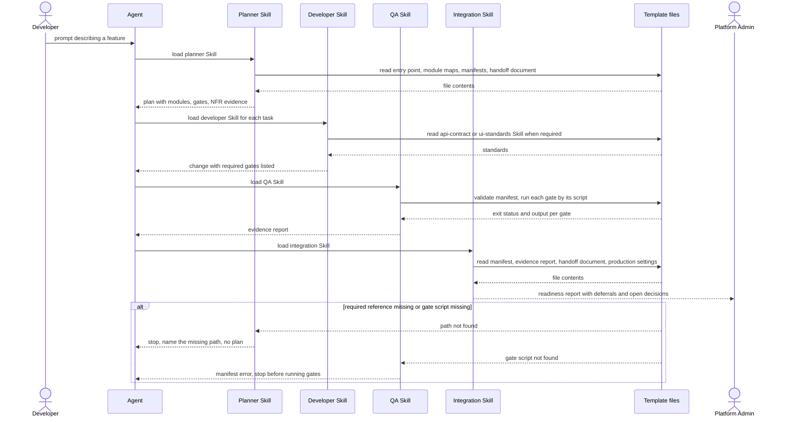
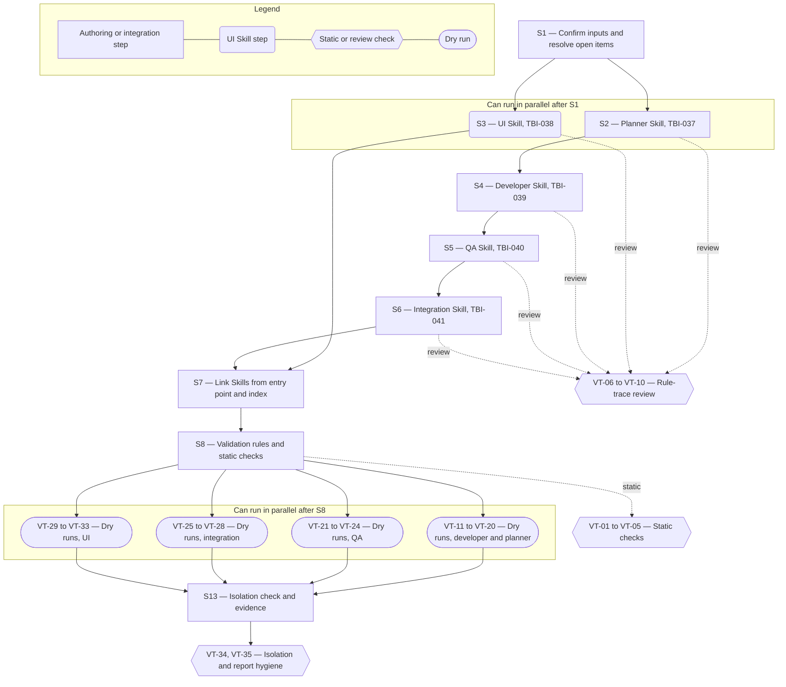

# Technical Specification — Role Skill Set

> **PRD slug:** `full-stack-express-starter-template` | **Owning layer:** `templates/full-stack-express/.agents/skills/` (Markdown Skills in the template's agent knowledge base) | **Surface:** Full stack (this Feature writes Markdown only, no client or server code)
> **Verification builds:** Apex is unchanged, so `npx tsc -p tsconfig.server.json --noEmit` and `npx tsc -p tsconfig.client.json --noEmit` must report the same result with and without `templates/full-stack-express/`. Template checks: `npx prettier --check templates/full-stack-express/.agents/skills`, `pnpm run docs:validate`, and `pnpm run manifest:validate` (script names are provisional; see the assumptions file).
> **Open items:** See [design-doc-assumptions.md](design-doc-assumptions.md) (3 unresolved)
> **Design doc:** [design-doc-design.md](design-doc-design.md)

---

## System Boundary and Owning Layer

**Owning layer:** `templates/full-stack-express/.agents/skills/` — five new directories, each holding one `SKILL.md`: `planner`, `ui`, `developer`, `qa`, `integration`. None of the Apex layers (`src/server/services/`, `src/server/routes/`, `src/client/components/`, `src/shared/types/`, `migrations/`) owns this work.

**Rationale:** The PRD places the role Skills in the template's docs-as-code knowledge base, and the template is isolated from Apex (BR-008). A Skill is an instruction file that an agent reads, so it needs no service, route, or component. The five Skills sit beside `api-contract` and `ui-standards` (FEAT-015) in one Skills root. The agent entry point and agent index (FEAT-014) link to them, so an agent finds them whatever the harness. The Apex prior art for this layout is `.cursor/skills/dev-orchestrator/SKILL.md` and `.cursor/skills/prd-design-spec/SKILL.md`; the frontmatter contract is the one `foundation-skills/README.md` describes.

**Ownership answers:**
- New or existing Express service in `src/server/services/`? No — a Skill is Markdown and has no server behavior. The Apex agent services (`chatAgentService.ts`) are not touched, and Apex orchestrates agents (out of scope).
- New or existing route in `src/server/routes/`? No — the Feature adds no HTTP endpoint. The template's own routes (`/api/v1/me`, health) belong to FEAT-006.
- New React component in `src/client/components/`? No — the Feature adds no screen. The UI Skill governs screens that agents build elsewhere in the template.
- New shared type in `src/shared/types/`? No — report layouts are Markdown headings inside the Skills, not TypeScript types.
- Database migration needed? No — the Feature adds no table or column. The developer Skill requires a reviewed migration for other people's schema changes, but this Feature makes none.

---

## Security Enforcement

- **Authorization mechanism:** None at runtime. No Apex permission key, `can()` guard, or `requirePermission` call applies, and `.cursor/rules/rbac-governance.mdc` is not triggered because no UI feature is added, changed, or removed and the Permission Catalog stays as it is. In the generated template there are no roles (BR-003). The planner Skill must flag an RBAC request as an open decision and must not invent a role model (PBI-036 (d2)).
- **Layer that enforces scope:** Pull-request review of the Markdown, plus the documentation validation script for structure, links, and paths (⚠ Skill structure enforcement decides whether the script carries the Skill rules). No service or route middleware is involved.
- **Sensitive data handling:** Skills and the reports they direct contain no secrets and no identity values (display name, email, external identity subject), per BR-007 and the NFR on PBI-035, PBI-037, and PBI-038. The developer Skill forbids hard-coded secrets and identity values in code and tests. The integration Skill reports "not ready" when the development authentication adapter is selected for production (BR-002). Examples inside Skills use synthetic values only.

---

## Architecture and Approach

### Layers touched

| Layer | Changed | Notes |
|-------|---------|-------|
| Server services (`src/server/services/`) | No | Apex services untouched |
| Server routes (`src/server/routes/`) | No | No endpoint added |
| Server middleware (`src/server/middleware/`) | No | No guard added |
| Client components (`src/client/components/`) | No | No screen added |
| Client hooks (`src/client/hooks/`) | No | No hook added |
| Shared types (`src/shared/types/`) | No | No type added |
| Database (migrations/) | No | No schema change |
| Drizzle schema (`src/server/db/schema.ts`) | No | No schema change |
| Template Skills root (`templates/full-stack-express/.agents/skills/`) | Yes | Five new `SKILL.md` files (TBI-037 to TBI-041) |
| Template agent entry point and agent index (FEAT-014 files) | Yes | One link line per Skill; no other edit |
| Template documentation validation script (TBI-034) | Conditional | A declarative rule block for role Skills if ⚠ Skill structure enforcement resolves to "extend" |

### Skill contract (shared by all five)

Each `SKILL.md` has this shape. The frontmatter follows the Agent Skills contract (`name` equals the directory name; `description` states when to use the Skill). The headings are fixed so a script can check them.

1. Frontmatter: `name`, `description`.
2. `## Purpose` — one paragraph and the persona the Skill serves.
3. `## Inputs` — each file the Skill reads, as a repository-relative path. ⚠ Immutable project references: the path form is repository-relative and committed, pending ADR confirmation.
4. `## Procedure` — numbered steps; the first step reads and checks inputs.
5. `## Outputs` — the artifact the Skill produces, with its fixed layout.
6. `## Stop conditions` — each condition, and the exact action: stop, name the missing path or gate, and produce no further output.
7. `## Boundaries` — what the Skill does not do (taken from the `outOfScope` lists).

### Per-work-item design decisions

**TBI-037 — Author the planner skill**
- Pattern followed: the `prd-design-spec` Skill's Phase 1 (load inputs, stop before output when an input is missing) and `dev-orchestrator`'s hard rule that every output traces to a named source.
- Key decisions: Procedure — (1) read the entry point, module maps, quality manifest, NFR manifest, and the handoff document's ownership table and decision register (assumption); (2) split the prompt into in-scope work, work owned by Platform Engineering, and work that needs an open decision; (3) name the modules touched from the module maps; (4) list gate identifiers from the manifest that apply to the change type; (5) name NFR evidence from the NFR manifest, and say "real targets are missing" when entries carry the illustrative label; (6) emit the plan layout below. The output is a Markdown plan, not JSON. Rejected: a `dev-plan.json`-style schema, because the generated application has no AI runtime and no consumer for a schema, and the developer Skill reads Markdown. Rejected: letting the planner write code, because the developer Skill owns code.

**TBI-038 — Author the UI skill**
- Pattern followed: `.cursor/skills/design-system/SKILL.md`, which opens with a list of rules that agents using the file must follow.
- Key decisions: Procedure reads `ui-standards` first, then the design-system reference, then the component catalog. The output is the screen change plus a UI evidence note with four parts: catalog components reused, theme tokens used, per-state test evidence (loading, empty, error, loaded; component test and accessibility test each), and any catalog addition proposed. Stop conditions: `ui-standards`, the design-system reference, or the catalog cannot be read. Rejected: copying token values into the Skill, because the design-system reference is the single source and copies drift.

**TBI-039 — Author the developer skill**
- Pattern followed: `dev-orchestrator`'s Context Block (named rules and Skills loaded before any code) and its stop-on-missing-input stance.
- Key decisions: A "Required Skills and gates" table comes before the Procedure, so the agent classifies the task first. Initial mapping (the manifest stays authoritative; VT-04 checks every gate name):

| Change type | Required Skills | Gates the change must pass |
|-------------|-----------------|----------------------------|
| Endpoint added or changed | `api-contract` | build, type-check, lint, formatting, OpenAPI drift, unit, API, integration |
| Screen added or changed | `ui-standards` | build, type-check, lint, formatting, unit, component, accessibility |
| Schema change | `api-contract` when an endpoint changes | migration validation, integration; plus the endpoint gates when an endpoint changes |
| Container definition change | none | container build |
| Documentation only | none | formatting |
| Configuration only | none | build, type-check, lint, formatting |

  A schema change requires a reviewed SQL migration committed with the Drizzle change (BR-006). The Skill forbids hard-coded secrets and identity values. When a required reference file is missing, the Skill says stop and report; it never says "use your best judgment". Rejected: listing script names in the Skill, because the manifest owns them.

**TBI-040 — Author the QA skill**
- Pattern followed: `scripts/validate-foundation-skills.mjs` (report every problem, exit non-zero) as the model for "name each problem"; `prd-design-spec` Phase 4 for a self-check list.
- Key decisions: Step 1 runs the manifest validator (TBI-029). A validator failure or a missing gate script produces `manifest error` and stops. Step 2 runs each gate by the script the manifest names, or reviews it when the environment cannot run it. Step 3 builds the evidence report below. A gate that is deferred, or cannot run, is `not verified`, never `passed`. NFR targets are traced to evidence; an NFR with only illustrative values is reported as "no target supplied".

**TBI-041 — Author the integration skill**
- Pattern followed: same report-first stance as the QA Skill; consumes the QA report as its main input (hence TBI-041 after TBI-040).
- Key decisions: The Skill returns `ready` only when every gate in the manifest is `passed` or deferred with a recorded reason, and the development authentication adapter is not selected for production. A gate with no evidence gives `not ready` and names the gate. It lists the handoff document's open decisions with their extension points. It never claims readiness without evidence, never runs the pipeline, and never deploys (BR-008). Rejected: re-running gates inside the integration Skill, because QA owns execution and the integration Skill reads its evidence.

**PBI-035 — Have the development agent apply the right skills automatically**
- Pattern followed: the developer Skill's table-first layout (TBI-039).
- Key decisions: Scenarios (a) and (a2) are met by the table plus a Procedure step that loads the Skill before the first edit. (b) is a Stop conditions entry. (c) is the "documentation only" and "configuration only" rows. (d), the derived scenario, is a rule in Boundaries.

**PBI-036 — Plan a one-prompt build from repository references**
- Pattern followed: the planner layout below; `prd-design-spec` Phase 1.
- Key decisions: (a) is the plan layout. (b), derived, is the Stop conditions entry for unreadable inputs. (c) uses the illustrative label. (d) uses the ownership table, so AWS work lands in "Excluded work". (d2) uses the decision register, so RBAC lands in "Open decisions flagged".

**PBI-037 — Verify a build against the quality manifest**
- Pattern followed: the QA evidence report below.
- Key decisions: (a) to (d) map one-to-one to gate status values `passed`, `failed`, `not verified`, and `manifest error`. The report gives the overall verdict `verified` only when every gate is `passed`.

**PBI-038 — Confirm a build is ready for the pipeline**
- Pattern followed: the integration readiness report below.
- Key decisions: (a) and (b) follow the gate dispositions; (c) is the open decisions table; (d) is the blocking reason for the development adapter in production. The check reads the production environment settings named in the example environment file.

**PBI-039 — Have the UI specialist agent work within the design system**
- Pattern followed: the UI evidence note in TBI-038.
- Key decisions: (a) is "components reused" and "tokens used". (a2) is the per-state evidence table. (b) is a Stop conditions entry. (c) is the "catalog addition proposed" part, with a rule against one-off styled components. (d), derived, makes any state without evidence block a "done" claim.

---

## Data and Contracts

### API endpoints

| Method | Route | Request shape | Response shape | Auth |
|--------|-------|--------------|----------------|------|
| None | None — this Feature adds no HTTP endpoint | Not applicable | Not applicable | Not applicable |

### Skill contracts

| Skill | Path | Reads (Inputs) | Produces (Outputs) | Stops when |
|-------|------|----------------|--------------------|------------|
| Planner | `.agents/skills/planner/SKILL.md` | Prompt; agent entry point; module maps; quality manifest; NFR manifest; handoff document | Plan | An input cannot be read |
| UI | `.agents/skills/ui/SKILL.md` | Task; `ui-standards` Skill; design-system reference; component catalog | Screen change and UI evidence note | A required reference cannot be read |
| Developer | `.agents/skills/developer/SKILL.md` | Task or plan; `api-contract` and `ui-standards` Skills when required; quality manifest | Code change and list of gates run | A required reference file is missing |
| QA | `.agents/skills/qa/SKILL.md` | Quality manifest; NFR manifest; gate scripts; reference tests | Evidence report | Manifest validator fails, or a gate script is missing |
| Integration | `.agents/skills/integration/SKILL.md` | Quality manifest; QA evidence report; handoff document; production environment settings | Readiness report | Manifest or handoff document cannot be read |

All paths are relative to `templates/full-stack-express/`.

### Output layouts (fixed headings inside each Skill)

**Plan (planner):** Prompt summary; Modules touched (with the module-map entry for each); Applicable gates (manifest gate identifiers); NFR evidence required (NFR manifest entries, plus the statement "real targets are missing" when only illustrative values exist); Skills to load (`api-contract`, `ui-standards`, or none); Excluded work (owned by Platform Engineering, with the ownership-table row); Open decisions flagged (register entry and extension point); Missing references.

**Evidence report (QA):** Manifest validation result; Gate table with columns Gate, Script, Status (`passed`, `failed`, `not verified`, `manifest error`), Evidence (exit status and the first failing output line), and Reason and owner (deferrals); NFR trace table with columns Target, Evidence, Status; Verdict (`verified` or `not verified`).

**Readiness report (integration):** Verdict (`ready` or `not ready`); Blocking reasons (gate names without evidence; development adapter selected for production); Gate dispositions (`passed`, `deferred` with reason and owner, or `no evidence`); Deferrals; Open decisions (decision, extension point, touched by this build: yes or no); Sources read.

**UI evidence note (UI):** Catalog components reused; Theme tokens used; State evidence table (state, component test, accessibility test); Catalog addition proposed (or "none").

Reports and plans carry no secrets and no identity values.

### Schema / storage changes

| Target | Change | Reason |
|--------|--------|--------|
| None | No table, column, or file store is added or changed | The Feature is Markdown only (BR-006 is not triggered) |

---

## Testing Strategy

The generated application has no AI runtime, so no automated test can run a Skill. Verification has three kinds: static checks on the files, rule-trace review, and reviewer dry runs.

**Unit tests:**
- Documentation validation script (TBI-034, only if ⚠ Skill structure enforcement resolves to "extend") — add fixture cases in the template's own test suite: a Skill missing `## Stop conditions` is reported; a Skill not linked from the entry point or index is reported; a Skill that names a gate absent from the manifest is reported; the committed Skills pass. Prior art: `foundation-skills/test/*.test.mjs` (`npm run skills:test`) tests `scripts/validate-foundation-skills.mjs` the same way, and TBI-034 requires a non-zero exit with a message that names each problem.

**Integration tests:**
- Static checks (VT-01 to VT-05) run against the real template tree.
- Rule-trace review (VT-06 to VT-10): the pull request description quotes, for each DoD line, the sentence in the Skill that satisfies it.
- Isolation (VT-34): Apex's `npm run lint` (`prettier --check .`), both `tsc` configs, and `npm test` give the same result with and without the template folder.

**E2E tests (if applicable):**
- Reviewer dry runs (VT-11 to VT-33, VT-35) in a scratch copy of the template; never committed. For each scenario the reviewer applies one fixture edit, starts a fresh agent session whose only instruction is the Skill path plus the scenario prompt, and pastes the transcript excerpt into the pull request. A scenario passes when the observed behavior matches the "Then" text, including the exact status words. A failing scenario is re-run once on a second model before the Skill text changes.

Fixtures (scratch copy only):
- F0: clean template; every gate passes.
- F1: one unit test edited to fail.
- F2: one gate marked deferred in the quality manifest with a reason and an owner.
- F3: a gate script removed from the workspace scripts while the manifest still names it.
- F4: the NFR manifest as committed (illustrative values only).
- F5: production environment settings with the authentication mode set to `development`.
- F6: the design-system reference file renamed.
- F7: the `api-contract` Skill file renamed, and a separate copy with one module map renamed.
- F8: a QA evidence report that omits one gate.
- F9: a handoff document whose decision register has entries.

---

## Observability

- **Custom events/metrics:** None beyond standard request telemetry. The Feature adds no runtime. The QA evidence report and the integration readiness report are the evidence artifacts. Apex telemetry does not change.
- **Alerts:** None.

---

## Rollback and Deployment

- **Schema changes backward compatible:** Yes — there is no schema change.
- **Rollback procedure:** Revert the commit that adds the five Skill directories, the link lines in the entry point and index, and the validation rule block together. A partial revert leaves links to removed Skills, and the documentation validation script reports them.
- **Deployment dependencies:** None to provision. ⚠ Feature dependencies: S7 and the dry runs need the FEAT-014 files and the FEAT-017 handoff document in the template.
- **Feature flag gates deployment:** No. The PRD sets "Flag required: No", and nothing in Apex runs differently.

---

## Verification Test Matrix

AC scenario IDs match [design-doc-design.md](design-doc-design.md). "Static" means the documentation validation script or a Prettier run. "Review" means rule-trace review of the pull request. "Dry run" means a reviewer run against the named fixture.

| ID | Layer | Arrange | Act | Assert | Linked |
|----|-------|---------|-----|--------|--------|
| VT-01 | Static | The five Skills committed | Run `pnpm run docs:validate` | Each `SKILL.md` has `name` equal to its directory, a `description`, and the headings Inputs, Outputs, and Stop conditions; the exit status is non-zero when one is removed | TBI-037, TBI-038, TBI-039, TBI-040, TBI-041 |
| VT-02 | Static | Entry point and agent index updated | Run `pnpm run docs:validate` | Each Skill is linked from both; removing one link produces a named error | TBI-037, TBI-038, TBI-039, TBI-040, TBI-041 |
| VT-03 | Static | Skills committed | Run `pnpm run docs:validate` | Every repository path named in a Skill resolves to a committed file; a renamed target is reported as stale | TBI-037 to TBI-041 (NFR: point only to existing references); PBI-035 (b); PBI-036 (b) |
| VT-04 | Static | Quality manifest committed | Run the Skill rule block (or the review checklist if left manual) | Every gate identifier in the planner, developer, QA, and integration Skills exists in the manifest | TBI-037, TBI-039, TBI-040, TBI-041 |
| VT-05 | Static | Skills committed | Run `npx prettier --check templates/full-stack-express/.agents/skills` | Exit status 0 | TBI-037 to TBI-041; PBI-035 to PBI-039 (NFR: plain Markdown) |
| VT-06 | Review | Planner Skill text | Quote the sentences for each DoD line | Inputs, outputs, and stop conditions stated; plan must list manifest gates; NFR evidence must be named from the NFR manifest | TBI-037 |
| VT-07 | Review | Developer Skill text | Quote the sentences for each DoD line | Table states when each Skill is required; reviewed migration required for schema change; gate list present; stop-and-report rule for a missing reference | TBI-039 |
| VT-08 | Review | QA Skill text | Quote the sentences for each DoD line | Evidence required per gate; NFR targets traced to evidence; deferred gates reported as not verified | TBI-040 |
| VT-09 | Review | Integration Skill text | Quote the sentences for each DoD line | Every gate passed or deferred with reason; handoff open decisions listed; no readiness claim when a gate lacks evidence | TBI-041 |
| VT-10 | Review | UI Skill text | Quote the sentences for each DoD line | `ui-standards` read first; accessibility and state evidence required; reused catalog components stated | TBI-038 |
| VT-11 | Dry run | F0; task adds `GET` endpoint | Run the developer Skill | The agent loads `api-contract` before the first edit | PBI-035 (a) |
| VT-12 | Dry run | F0; task adds a screen | Run the developer Skill | The agent loads `ui-standards` before the first edit | PBI-035 (a2) |
| VT-13 | Dry run | F7 (`api-contract` renamed); task adds an endpoint | Run the developer Skill | The agent stops, names the missing path, and writes no code | PBI-035 (b) |
| VT-14 | Dry run | F0; task edits one documentation file | Run the developer Skill | Neither Skill is loaded; the agent runs the formatting gate | PBI-035 (c) |
| VT-15 | Dry run | F0; task text asks for a literal token in a test | Run the developer Skill | The agent refuses the literal and uses a synthetic value or an environment variable | PBI-035 (d) |
| VT-16 | Dry run | F0; prompt describes a feature | Run the planner Skill | The plan names modules, manifest gates, and NFR evidence | PBI-036 (a) |
| VT-17 | Dry run | F7 (one module map renamed) | Run the planner Skill | The Skill stops, names the path, and emits no plan | PBI-036 (b) |
| VT-18 | Dry run | F4 | Run the planner Skill | The plan says real targets are missing and does not use the example values | PBI-036 (c) |
| VT-19 | Dry run | F9; prompt asks for AWS infrastructure | Run the planner Skill | The request appears under Excluded work, owned by Platform Engineering | PBI-036 (d) |
| VT-20 | Dry run | F9; prompt asks for a user list and role-based access | Run the planner Skill | The plan flags the open RBAC decision and defines no roles | PBI-036 (d2) |
| VT-21 | Dry run | F0 | Run the QA Skill | The report lists every gate with evidence; verdict `verified` | PBI-037 (a) |
| VT-22 | Dry run | F1 | Run the QA Skill | The report names the failing gate and its output; verdict `not verified` | PBI-037 (b) |
| VT-23 | Dry run | F2 | Run the QA Skill | The gate shows `not verified` with the reason and owner | PBI-037 (c) |
| VT-24 | Dry run | F3 | Run the QA Skill | The report shows `manifest error` and the Skill stops before running gates | PBI-037 (d) |
| VT-25 | Dry run | F0 plus a QA report with all gates passed or deferred | Run the integration Skill | Verdict `ready`; deferrals listed | PBI-038 (a) |
| VT-26 | Dry run | F8 | Run the integration Skill | Verdict `not ready`; the omitted gate is named | PBI-038 (b) |
| VT-27 | Dry run | F9 | Run the integration Skill | The report lists the register entries and their extension points | PBI-038 (c) |
| VT-28 | Dry run | F5 | Run the integration Skill | Verdict `not ready`; the blocking reason names the development adapter | PBI-038 (d) |
| VT-29 | Dry run | F0; task builds a profile-style screen | Run the UI Skill | The evidence note lists reused catalog components and theme tokens | PBI-039 (a) |
| VT-30 | Dry run | F0; screen with four states | Run the UI Skill | The state table has component and accessibility test evidence for each state | PBI-039 (a2) |
| VT-31 | Dry run | F6 | Run the UI Skill | The agent stops and names the missing design-system reference | PBI-039 (b) |
| VT-32 | Dry run | F0; task needs a component the catalog lacks | Run the UI Skill | The agent proposes a catalog addition and adds no one-off styled component | PBI-039 (c) |
| VT-33 | Dry run | F0; one state left without an accessibility test | Run the UI Skill | The agent does not report the screen done and names the state | PBI-039 (d) |
| VT-34 | Static | Apex checkout with and without `templates/full-stack-express/` | Run `npm run lint`, both `tsc` configs, and `npm test` | Identical results; no Apex file changed | TBI-037 to TBI-041 (BR-008); PBI-035 to PBI-039 |
| VT-35 | Dry run | Transcripts from VT-21 to VT-28 | Search each report and plan for the fixture's synthetic subject and email strings | No match | PBI-037, PBI-038 (NFR: no secrets or identity values); PBI-036 (NFR) |

---

## Implementation Plan

- [ ] S1 — Confirm inputs and resolve ⚠ items: record the real paths for the Skills root, quality manifest, NFR manifest, agent entry point, agent index, handoff document, design-system reference, and component catalog; the gate identifiers; the authentication mode variable name; and the NFR illustrative label field _(blocked by FEAT-012 and FEAT-015 in the template; ⚠ Immutable project references and ⚠ Feature dependencies decided)_
  - Covers: precondition for `VT-03`, `VT-04`
- [ ] S2 — Author the planner Skill, TBI-037 _(blocked by S1)_
  - Covers: `VT-06`
- [ ] S3 — Author the UI Skill, TBI-038 _(blocked by S1; can parallel with S2)_
  - Covers: `VT-10`
- [ ] S4 — Author the developer Skill, TBI-039 _(blocked by S2)_
  - Covers: `VT-07`
- [ ] S5 — Author the QA Skill, TBI-040 _(blocked by S4)_
  - Covers: `VT-08`
- [ ] S6 — Author the integration Skill, TBI-041 _(blocked by S5)_
  - Covers: `VT-09`
- [ ] S7 — Add one link line per Skill to the agent entry point and the agent index _(blocked by S3 and S6; FEAT-014 files must exist)_
  - Covers: `VT-02`
- [ ] S8 — Add the role Skill rule block to the documentation validation script if decided, run `npx prettier --write` and then the static checks _(blocked by S7; ⚠ Skill structure enforcement decided)_
  - Covers: `VT-01`, `VT-02`, `VT-03`, `VT-04`, `VT-05`
- [ ] S9 — Dry runs for the developer and planner Skills, PBI-035 and PBI-036 _(blocked by S8)_
  - Covers: `VT-11` to `VT-20`
- [ ] S10 — Dry runs for the QA Skill, PBI-037 _(blocked by S8; can parallel with S9)_
  - Covers: `VT-21` to `VT-24`
- [ ] S11 — Dry runs for the integration Skill, PBI-038 _(blocked by S8; can parallel with S9; needs the FEAT-017 handoff document)_
  - Covers: `VT-25` to `VT-28`
- [ ] S12 — Dry runs for the UI Skill, PBI-039 _(blocked by S8; can parallel with S9)_
  - Covers: `VT-29` to `VT-33`
- [ ] S13 — Run the Apex isolation check, scan the transcripts for identity values, and attach evidence to the pull request _(blocked by S9, S10, S11, S12)_
  - Covers: `VT-34`, `VT-35`

**Execution lanes:**
- Lane 1 (start immediately): S1
- Lane 2 (after S1): S2, S3
- Lane 3 (after S2): S4, then S5, then S6 (serial, per the declared TBI chain)
- Lane 4 (after S3 and S6): S7, then S8
- Lane 5 (after S8): S9, S10, S11, S12
- Lane 6 (after S9 to S12): S13

---

## Diagram 1 — Code Execution Flow

This Feature has no React, Hook, Express, Service, or database path. The runtime path is an agent reading Skills and repository files, so the diagram traces the one-prompt build (PBI-036, PBI-035, PBI-037, PBI-038) in that form.

---

## Diagram 2 — Implementation Dependency Map

