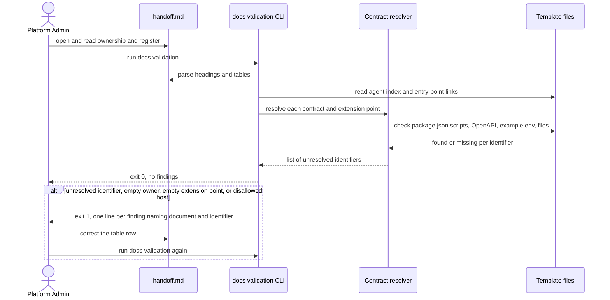
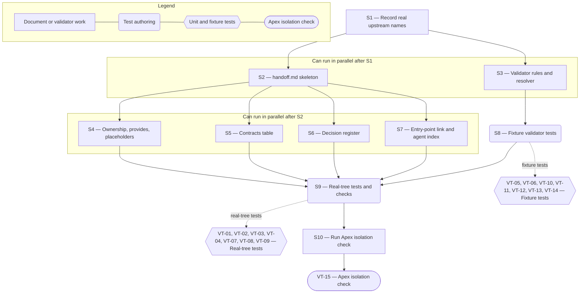

# Technical Specification — Platform Engineering Handoff Package

> **PRD slug:** `full-stack-express-starter-template` | **Owning layer:** `templates/full-stack-express/` (documentation and validator script; no Apex `src/` layer) | **Surface:** Documentation and tooling (the PRD's template-wide surface is Full stack)
> **Verification builds:** Apex root, unchanged by this Feature: `npx tsc -p tsconfig.server.json --noEmit` and `npx tsc -p tsconfig.client.json --noEmit` (both include only `src/`), `npm run lint` (Prettier over the whole repo, including the template), `npm test`. Template side: `pnpm -C templates/full-stack-express docs:validate` and `pnpm -C templates/full-stack-express test` (script names are proposals; S1 confirms them).
> **Open items:** See [design-doc-assumptions.md](design-doc-assumptions.md) (6 unresolved)
> **Design doc:** [design-doc-design.md](design-doc-design.md)

---

## System Boundary and Owning Layer

**Owning layer:** `templates/full-stack-express/docs/` for the document, and the TBI-034 documentation validator under `templates/full-stack-express/scripts/` for the new rules. No Apex layer (`src/server/services/`, `src/server/routes/`, `src/client/components/`, `src/shared/types/`, `migrations/`) owns any of this work.

**Rationale:** The handoff document describes the template, so it lives in the template's own docs-as-code tree and ships with it when Platform Engineering moves the folder. The validation rules belong in the validator that FEAT-014 builds, because that script already walks the template's documents, reads the agent index, and exits non-zero with plain-text findings. A second validator would duplicate the file walk and the output format. Apex itself changes nothing: the PRD states the template "does not change Apex's runtime".

**Ownership answers:**
- New or existing Express service in `src/server/services/`? No — the document is static Markdown. The template's own Express API (FEAT-006) is only described, not changed.
- New or existing route in `src/server/routes/`? No — Apex gets no route. The backlog's `/template-preview` route has no matching Apex code and conflicts with the PRD; see the first ⚠ item in the assumptions file.
- New React component in `src/client/components/`? No — the design doc's UI/UX section is "Not applicable".
- New shared type in `src/shared/types/`? No — the validator's row types stay private to the validator module in the template.
- Database migration needed? No — the Feature touches no table. The document names the migration command but does not run it.

---

## Security Enforcement

- **Authorization mechanism:** None added. No Apex permission key, `requirePermission(...)`, or `can(...)` guard applies, because the Feature adds no Apex page or endpoint. Per the `rbac-governance.mdc` checklist, the answer to "does the feature expose a capability that should be access-controlled?" is no: the document is read through repository access. The template itself defines no roles (BR-003), and the document records RBAC as an unresolved decision.
- **Layer that enforces scope:** Not applicable at runtime. At review time, the validator enforces content rules on the document: no absolute URL to a host outside `localhost`, `127.0.0.1`, and `example.*` domains, and the FEAT-013 secret scan script runs over the file.
- **Sensitive data handling:** The document contains no secrets, no real identity values, and no internal host names (TBI-042 and the security NFRs of PBI-040 and PBI-041). It lists environment variable names only, never values. The data-classification register entry states that classification of display name, email, and external identity subject is unresolved and that synthetic fixtures and identity redaction are engineering practice, not a classification. Validator output names the document and the offending identifier or path only; it does not echo document content beyond that (the PBI-031 output rule).

---

## Architecture and Approach

### Layers touched

| Layer | Changed | Notes |
|-------|---------|-------|
| Server services (`src/server/services/`) | No | Apex unchanged |
| Server routes (`src/server/routes/`) | No | Apex unchanged |
| Server middleware (`src/server/middleware/`) | No | Apex unchanged |
| Client components (`src/client/components/`) | No | Apex unchanged |
| Client hooks (`src/client/hooks/`) | No | Apex unchanged |
| Shared types (`src/shared/types/`) | No | Apex unchanged |
| Database (migrations/) | No | No schema change |
| Drizzle schema (`src/server/db/schema.ts`) | No | No schema change |
| Template documentation (`templates/full-stack-express/docs/`) | Yes | New `handoff.md`; one link in the entry-point document; one line in the agent index |
| Template validator (`templates/full-stack-express/scripts/`) | Yes | Required-headings entry for `handoff.md`; contract resolver; ownership, register, and URL rules |
| Template tests | Yes | Vitest tests with fixture trees for each validator rule |

### Per-work-item design decisions

**TBI-042 — Write the handoff document**
- Pattern followed: The Apex `AGENTS.md` feature map and "Common Questions" table, which point a reader to one authoritative file per question. The handoff document does the same for Platform Engineering. For machine-readable tables, it follows the plain-Markdown-table convention that the FEAT-014 validator and the FEAT-016 integration skill already read.
- Key decisions:
  - One file, `templates/full-stack-express/docs/handoff.md`, five `##` sections in this order: `What the Template Provides`, `Ownership`, `Contracts Platform Engineering Consumes`, `Replacement Placeholders`, `Unresolved Decision Register`. Fixed headings are what the validator and the integration skill key on. Rejected: splitting into one file per section, because a reviewer reads once and the validator would need a multi-file index for a single concept.
  - The document is written by hand. Rejected: generating it from the manifests, because the ownership table and register are judgment, and generation would hide stale prose behind regenerated tables. The validator catches drift instead.
  - Every table is Prettier-formatted under the template's resolved config, so Apex's root `prettier --check .` passes. Run the template format script before commit.
  - Contract rows are the only place identifiers are claimed. Prose sections avoid naming scripts and files, so there is one place to validate and one place to fix.
  - The `Contracts` table has columns `Kind`, `Identifier`, `Purpose`, `Source in the template`. Kinds and how each resolves: `script` against the `scripts` keys of the template root `package.json`; `manifest` and `container` against file existence; `endpoint` (written `GET /api/v1/me`) against the committed OpenAPI 3.1 document; `env` against the keys in the example environment file. The migration command is a `script` row.
  - Expected rows (S1 replaces proposed names with the real ones): scripts for install, build, check, test, run, migrate, seed, the documentation validation, the secret, vulnerability, and license scans, SBOM generation, and the container build; manifests for the quality manifest, the NFR manifest, and the compatibility table, plus the committed OpenAPI document; endpoints `GET /health/live`, `GET /health/ready`, `GET /api/v1/me`, `PUT /api/v1/me`; every key in the example environment file; the container definition.

**PBI-040 — Review what the template provides and what Platform Engineering owns**
- Pattern followed: The PRD's Access Control table, which already pairs each action with one owning group. The `Ownership` table uses the same one-owner-per-row shape.
- Key decisions:
  - Rows: AWS infrastructure (includes ECS configuration); CI/CD pipelines; migration execution; deployment packaging — container definition; deployment packaging — image publishing and deployment stages; repository governance. Deployment packaging is two rows because the template owns the container definition (BR-014) and Platform Engineering owns publishing and deployment stages, so one cell cannot name one owner.
  - `Owner` is exactly `Template` or `Platform Engineering`. The validator rejects an empty or other value (PBI-040 (d)).
  - `Replacement Placeholders` holds four rows: project name, package scope, service name, database name. Each row lists the files where the token appears. The set must equal the placeholder list in the template README (TBI-001), which VT-03 checks, so the README and the handoff document cannot disagree.

**PBI-041 — See the unresolved decisions and the extension points they affect**
- Pattern followed: The PRD's "Assumptions Made" list of unresolved decisions, and the FEAT-016 integration skill's need to list open decisions (PBI-038). The register is the single source both read.
- Key decisions:
  - Columns: `Decision`, `Extension point`, `Template behavior until decided`, `Decision needed from Platform Engineering`. No status column, because PBI-041 puts decision tracking out of scope.
  - Five rows with extension points: production identity provider — the identity-provider adapter interface and authentication middleware (FEAT-005); RBAC — the authentication middleware and the route definitions in the contracts package (BR-003); data classification — the `app_users` fields and the log redaction configuration (FEAT-003, FEAT-007); NFR targets and test execution policy — the NFR manifest and the quality manifest (FEAT-012, BR-013); feature-flag provider — the flag-evaluation interface and its local adapter (FEAT-008, BR-011).
  - Each `Extension point` cell holds backticked repository-relative paths. The validator resolves each path. A cell with no path is rejected (PBI-041 (d)); a path with no file is reported as stale (PBI-041 (b)).
  - The data classification row says classification is unresolved and that synthetic fixtures and identity redaction are engineering practice, not a classification. It names no level.

**Validator extension (TBI-042 support; closes the gap in TBI-034, see ⚠ in assumptions)**
- Pattern followed: The Apex `scripts/ci/check-codemap-paths.mjs` check, which extracts backticked paths from one Markdown file, filters out placeholders, tests `existsSync`, lists every missing path, and exits 1. The contract resolver uses the same extract, test, list, exit shape, with typed resolvers per `Kind` instead of one path test.
- Key decisions:
  - Add a contract resolver module beside the TBI-034 validator, plus a required-headings entry for `handoff.md`. Do not fork the validator.
  - Run the new rules only on `handoff.md`. Other documents keep the TBI-034 rules, so FEAT-014 behavior does not change.
  - Output is plain text, one line per finding: document path, section, identifier. No document content beyond the identifier.
  - Rejected: validating prose for the words "script" or "endpoint", because that creates false positives; only the typed tables are claims.

---

## Data and Contracts

### API endpoints

This Feature adds no endpoint. It documents four endpoints that other features own; the validator resolves each against the committed OpenAPI 3.1 document.

| Method | Route | Request shape | Response shape | Auth |
|--------|-------|--------------|----------------|------|
| GET | `/health/live` | None | Liveness status (FEAT-006) | None |
| GET | `/health/ready` | None | Readiness status; no sensitive detail (FEAT-006) | None |
| GET | `/api/v1/me` | None | Authenticated principal's own profile (FEAT-006) | Authenticated principal from the identity-provider adapter |
| PUT | `/api/v1/me` | Profile update body (FEAT-004) | Updated own profile (FEAT-006) | Authenticated principal from the identity-provider adapter |

### Document and validator contract

| Item | Shape | Consumer |
|------|-------|----------|
| `handoff.md` headings | Five fixed `##` headings listed above | Documentation validator; FEAT-016 integration skill |
| `Ownership` table | Columns `Area`, `Owner`, `What the template ships`, `What Platform Engineering does`; `Owner` ∈ {`Template`, `Platform Engineering`} | Documentation validator; Platform Engineering reviewers |
| `Contracts` table | Columns `Kind`, `Identifier`, `Purpose`, `Source in the template`; `Kind` ∈ {`script`, `manifest`, `endpoint`, `env`, `container`} | Contract resolver; Platform Engineering's pipeline authors |
| `Replacement Placeholders` table | Columns `Placeholder`, `Meaning`, `Where it appears`; four rows | Template README check; developers starting a project |
| `Unresolved Decision Register` table | Columns `Decision`, `Extension point`, `Template behavior until decided`, `Decision needed from Platform Engineering` | Contract resolver; FEAT-016 integration skill |
| Validator exit status | `0` when every rule passes; `1` with one plain-text line per finding | Developers; Platform Engineering's pipeline |

### Schema / storage changes

| Target | Change | Reason |
|--------|--------|--------|
| None | None | The Feature stores no data. The `app_users` table (FEAT-003) is described in the register only. |

---

## Testing Strategy

The template uses Vitest (PRD Testing Decisions). Tests assert observable behavior: validator exit status and reported findings, and the parsed content of the real document. They do not assert the validator's internal wiring. Apex's own layers (Jest, Supertest, Playwright) are not used, because Apex Jest matches only `src/server/**/__tests__` and `src/client/**/__tests__`, so template tests never run under Apex.

**Unit tests:**
- Contract resolver — each `Kind` resolves a present identifier and rejects a missing one; the migration command row is a `script` row; an `endpoint` row matches method and path in a fixture OpenAPI document.
- Ownership and register row rules — empty or unrecognized `Owner` rejected; empty `Extension point` rejected; a register missing one of the five decisions rejected.
- URL rule — `localhost`, `127.0.0.1`, and `example.*` hosts pass; any other absolute host is reported.

**Integration tests:**
- Validator CLI against fixture trees (a temp copy of a minimal template docs tree), asserting exit status and the finding lines. One fixture per negative case: missing script, missing extension-point file, empty owner, empty extension point, missing heading, document absent from the agent index, disallowed host.
- Validator CLI against the real template tree: exit `0`, all five decisions present, every contract resolves, placeholders equal the README list.
- Existing FEAT-013 secret scan script run over `handoff.md`: exit `0`.

**E2E tests (if applicable):**
- Not applicable. No browser surface exists. The Playwright and axe layer belongs to the profile screen (FEAT-010).

**Apex isolation check (manual or Apex CI):**
- Run `npm run lint` and `npm test` at the Apex root with and without the `templates/` folder. Results must match (BR-008). Only `npm run lint` can differ, because Prettier is the one Apex check that reads outside `src/`; `tsc`, ESLint, and Jest are scoped to `src/`.

---

## Observability

- **Custom events/metrics:** None beyond standard request telemetry. The Feature adds no runtime code. The validator prints findings to stdout and sets its exit status; it emits no telemetry.
- **Alerts:** None.

---

## Rollback and Deployment

- **Schema changes backward compatible:** Yes — there are no schema changes.
- **Rollback procedure:** Revert the commit. It removes `handoff.md`, the index line, the entry-point link, the validator additions, and the tests. No data or deployment state needs repair.
- **Deployment dependencies:** None. The template is not deployed from Apex. The one external dependency is the sequencing in the PRD: FEAT-013 and FEAT-014 must be complete, and the files they create must exist before the document names them (S1).
- **Feature flag gates deployment:** No — the PRD sets "Flag required: No". The template's own flag interface (FEAT-008) is a deliverable for generated applications, not an Apex Feature Flag.

---

## Verification Test Matrix

| ID | Layer | Arrange | Act | Assert | Linked |
|----|-------|---------|-----|--------|--------|
| VT-01 | Vitest — validator CLI on the real template tree | Template tree complete through FEAT-014 and this Feature | Run the documentation validation | Exit `0`; no finding names `handoff.md` | TBI-042 (DoD 4) |
| VT-02 | Vitest — parse real `handoff.md` | Real document | Read the `Ownership` table | Rows exist for AWS infrastructure, CI/CD pipelines, migration execution, deployment packaging (two rows), and repository governance; every `Owner` is `Template` or `Platform Engineering` | PBI-040 (a) |
| VT-03 | Vitest — parse real `handoff.md` and README | Real document and template README | Read both placeholder lists | Four placeholders (project name, package scope, service name, database name) appear in both, and the two sets are equal | PBI-040 (a2) |
| VT-04 | Vitest — contract resolver on the real tree | Real document and template | Resolve every `Contracts` row | Every row resolves; at least one row exists for each kind, including the migration command, the four endpoints, and the container definition | PBI-040 (c), TBI-042 (DoD 2) |
| VT-05 | Vitest — validator CLI on a fixture tree | Fixture `handoff.md` with a `script` row naming `no-such-script` | Run the validation | Exit `1`; one finding line names `handoff.md` and `no-such-script` | PBI-040 (b) |
| VT-06 | Vitest — validator CLI on a fixture tree | Fixture `Ownership` table with one empty `Owner` and one `Owner` of `Someone` | Run the validation | Exit `1`; findings name both rows; no other finding appears | PBI-040 (d) |
| VT-07 | Vitest — parse real `handoff.md` | Real document | Read the register | Exactly five rows: production identity provider, RBAC, data classification, NFR targets and test execution policy, feature-flag provider | PBI-041 (a), TBI-042 (DoD 3) |
| VT-08 | Vitest — contract resolver on the real tree | Real document | Resolve every register `Extension point` path | Every path exists in the template, and each row has at least one path | PBI-041 (a2) |
| VT-09 | Vitest — parse real `handoff.md` | Real document | Read the data classification row | Text states that synthetic fixtures and identity redaction are engineering practice, not a classification, and contains no "classified as" phrase | PBI-041 (c) |
| VT-10 | Vitest — validator CLI on a fixture tree | Fixture register row whose extension-point file was deleted | Run the validation | Exit `1`; finding names `handoff.md`, the decision, and the missing path | PBI-041 (b) |
| VT-11 | Vitest — validator CLI on a fixture tree | Fixture register row with an empty `Extension point` cell | Run the validation | Exit `1`; finding names the decision | PBI-041 (d) |
| VT-12 | Vitest — validator CLI on a fixture tree, and the secret scan script | Fixture `handoff.md` containing `https://git.internal.corp/x`; separately, the real document | Run the validation on the fixture; run the secret scan on the real file | Fixture: exit `1`, finding names the host. Real file: scan exits `0` and prints no secret value | TBI-042 (security NFR), PBI-040 and PBI-041 security NFRs |
| VT-13 | Vitest — validator CLI on fixture trees | One fixture whose agent index omits `handoff.md`; one fixture whose entry-point document lacks a link to it | Run the validation on each | Exit `1`; finding names `handoff.md` for the index case and the entry-point document for the link case. The real tree passes (VT-01) | TBI-042 |
| VT-14 | Vitest — validator CLI on a fixture tree | Fixture `handoff.md` with the `## Ownership` heading removed | Run the validation | Exit `1`; finding names `handoff.md` and the missing section | PBI-040 (b), TBI-042 (DoD 4) |
| VT-15 | Apex root commands | Apex checkout with and without `templates/` | Run `npm run lint` and `npm test` in both | Both runs succeed and produce the same results; Apex lockfile and outputs are unchanged | TBI-042 (BR-008), PBI-040 |

---

## Implementation Plan

- [ ] S1 — Read the finished FEAT-001 through FEAT-014 artifacts in the template and record the real names: knowledge-base layout, entry-point document, agent index, validator and its required-headings config, script names, manifest files, committed OpenAPI path, example environment file, container definition, placeholder list in the README _(blocked by FEAT-013 and FEAT-014 completion; resolves ⚠ "Knowledge-base file names")_
- [ ] S2 — Create `docs/handoff.md` with the five `##` headings and empty, Prettier-formatted table headers _(blocked by S1)_
  - Covers: `VT-14`
- [ ] S3 — Extend the validator: required-headings entry for `handoff.md`; contract resolver with the five kinds; `Owner` and register-row rules; absolute-URL host rule _(blocked by S1; needs the resolution of ⚠ "Where contract resolution lives")_
  - Covers: `VT-04`, `VT-05`, `VT-06`, `VT-08`, `VT-10`, `VT-11`, `VT-12`
- [ ] S4 — Write `What the Template Provides`, the `Ownership` table, and the `Replacement Placeholders` table; match the README placeholder list _(blocked by S2; can parallel with S5, S6, S7)_
  - Covers: `VT-02`, `VT-03`
- [ ] S5 — Write the `Contracts` table from the S1 names _(blocked by S2; can parallel with S4, S6, S7)_
  - Covers: `VT-04`
- [ ] S6 — Write the `Unresolved Decision Register`, including the data classification wording _(blocked by S2; can parallel with S4, S5, S7)_
  - Covers: `VT-07`, `VT-08`, `VT-09`
- [ ] S7 — Link `handoff.md` from the agent entry-point document and list it in the agent index _(blocked by S2; can parallel with S4, S5, S6)_
  - Covers: `VT-13`
- [ ] S8 — Write the fixture-based validator tests for every negative rule _(blocked by S3; can parallel with S4 through S7)_
  - Covers: `VT-05`, `VT-06`, `VT-10`, `VT-11`, `VT-12`, `VT-13`, `VT-14`
- [ ] S9 — Write the real-tree tests; run the template format, documentation validation, secret scan, and test scripts until all pass _(blocked by S4, S5, S6, S7, S8)_
  - Covers: `VT-01`, `VT-02`, `VT-03`, `VT-04`, `VT-07`, `VT-08`, `VT-09`, `VT-12`
- [ ] S10 — Run the Apex isolation check: root `npm run lint` and `npm test` with and without `templates/` _(blocked by S9)_
  - Covers: `VT-15`

**Execution lanes:**
- Lane 1 (start immediately): S1
- Lane 2 (after S1): S2, S3
- Lane 3 (after S2): S4, S5, S6, S7
- Lane 4 (after S3, parallel with Lane 3): S8
- Lane 5 (after S4 through S8): S9
- Lane 6 (after S9): S10

---

## Diagram 1 — Code Execution Flow

The runtime path of this Feature is a review and a validation run. No React, hook, Express, or database layer takes part, so the participants are the reviewer, the document, the validator CLI, the contract resolver, and the template files that the resolver reads.

---

## Diagram 2 — Implementation Dependency Map

