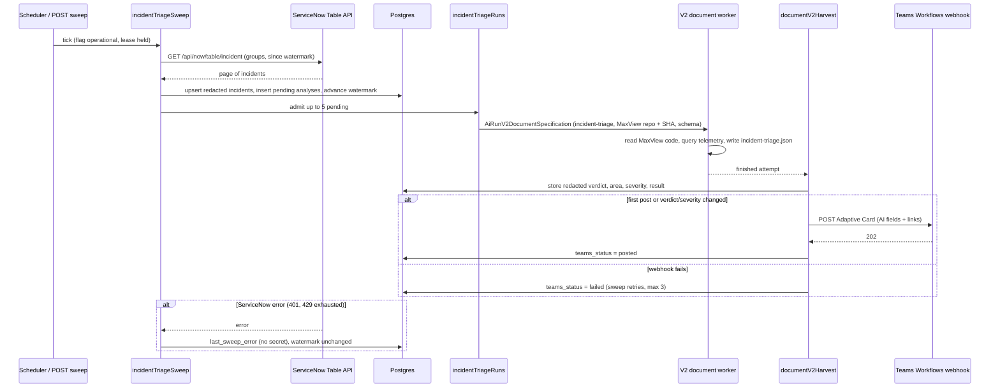
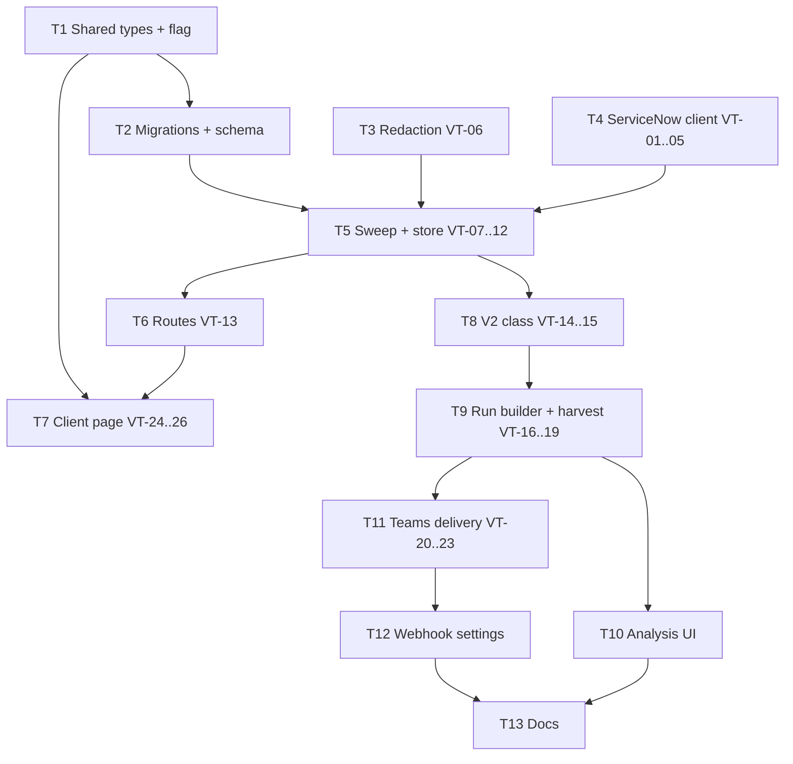

# ServiceNow Incident Triage for MaxView

## Work item
- **ID:** 61556 (Product Backlog Item)
- **Title:** Triage MaxView ServiceNow incidents in Apex and post results to Teams
- **ADO:** https://dev.azure.com/amergis/MaxView/_workitems/edit/61556
- **Related:** none. Blocked by: none. Blocks: none.
- **Branch:** `feature/61556-servicenow-incident-triage`, from `main` at `2ccde574`
- **Due date:** 2026-12-04

## Summary
Incidents for MaxView land in ServiceNow, in four assignment groups that hold 2,655 incidents. Support staff answer each one by hand, so nobody sees the patterns, and incidents caused by a real MaxView defect seldom reach the dev team.

Apex gains an Incident Triage module that:
- reads those incidents from ServiceNow on a 15-minute schedule and on demand, and never writes back;
- removes personal data;
- stores each incident;
- runs one AI analysis per meaningful change. The analysis gives a summary, a verdict, the affected MaxView area, a severity, and evidence from MaxView code and telemetry, plus a suggested fix when the verdict is `bug`;
- posts a card to a Teams channel. The card carries no personal data and links back to ServiceNow and to Apex.

## Implementation surfaces (change scope)
**Surfaces:** Full stack

**Rationale:** Most of the work is new server code: the ServiceNow client, the scheduler, storage, a V2 document workflow class, and Teams delivery. A new client page shows the results and holds the settings.

**Verification builds:**
- `npx tsc -p tsconfig.server.json --noEmit`
- `npx tsc -p tsconfig.client.json --noEmit`
- `npx jest --selectProjects server --no-coverage -- <files>`
- `npx jest --selectProjects client --no-coverage -- <files>`
- `npm run lint:eslint`
- `npm run build:client`
- `npm run migrate:local:up`

**ADO Description block:**
```
**Surfaces:** Full stack
**Hosts / solutions to verify:** Apex App Service (Express + React), Apex V2 document worker, Postgres migrations
```

## Operator Checklist (manual steps)
- [ ] [ServiceNow] Create a dedicated read-only integration user. It needs read on `incident` and `sys_user_group` only, with no write roles, and its timezone set to GMT. Register an OAuth application for the password grant. Why: Apex cannot use a person's session. When: before live testing.
- [ ] [ServiceNow] Confirm the instance host (`maximstaffing.service-now.com`) and whether it is the same as MaxView's `SNOW_HOST`. When: before live testing.
- [ ] [Config] Set `SERVICENOW_INSTANCE_URL`, `SERVICENOW_CLIENT_ID`, `SERVICENOW_CLIENT_SECRET`, `SERVICENOW_USERNAME` and `SERVICENOW_PASSWORD` on app-scrum-dev, using Key Vault references. Set them in the portal, because Terraform ignores `app_settings`. Set them locally in `.env.local`. Why: the ServiceNow client reads them. When: before live testing.
- [ ] [Network] Confirm App Service can reach ServiceNow over 443. When: before live testing.
- [ ] [Grounding] Confirm two things: the Apex `MaxView` project's skill repository and branch point at the MaxView code repo, and the `AZURE_INSIGHTS_CLIENT_ID` identity has Reader on MaxView App Insights and Log Analytics. Why: the AI checks code and telemetry. When: before AI live testing.
- [ ] [Policy] Confirm that sending redacted incident text to the model provider is acceptable under Amergis data policy. When: before enabling the flag for MaxView.
- [ ] [Teams] A channel owner creates a Workflows flow, "Post to a channel when a webhook request is received", owned by a shared account. Paste its URL into Incident Triage settings. Why: Apex posts to it. When: before Teams live testing.
- [ ] [Deploy] Confirm the V2 document worker image is rebuilt and deployed, because a new workflow class changes worker code. When: during deploy.
- [ ] [Flag] In Platform Admin, add a `project = MaxView` rule to `servicenow-incident-triage`, then enable it. Enable the `incident-triage` menu for MaxView. Enable the project in settings and confirm the group sys_ids. When: after deploy.
- [ ] [Security] Confirm that the `AZURE_INSIGHTS_CLIENT_ID` identity has Reader-only roles on MaxView resources. Review the document worker's outbound access, because the AI reads incident text that external reporters wrote. When: before enabling the flag for MaxView (added during implementation).
- [ ] [Follow-up] Hand off from a `bug` verdict: file an ADO Bug or start the self-healing cloud agent. File after merge.

## Scope & out-of-scope
In:
- A read-only ServiceNow client.
- A delta sweep with a watermark and a lease shared across instances.
- Redaction.
- Three new tables.
- A V2 `incident-triage` document workflow.
- The triage prompt and output schema, built on the `maxview-incident-investigation` foundation skill.
- A `PROJECT_SKILL_WORKFLOWS` entry.
- A Teams Workflows webhook card.
- The `/incident-triage` page with list, detail and settings.
- RBAC, the feature flag, the menu key, and docs.

Out:
- Any ServiceNow write.
- Filing an ADO Bug or starting a cloud agent.
- Backfill beyond the configured window.
- Digest posts.
- A Teams bot channel install.
- Graph.
- More than one ServiceNow instance.
- Tables other than `incident`.

## System boundary & owning project
Apex owns this work. Apex already holds the MaxView investigation skill, repo grounding, the V2 document worker and Teams delivery, and it is where the dev team reviews AI analysis.

MaxView is the wrong home. Its hosts (TimeClock, MaxHub, the integration services) serve the product, not internal triage. MaxView changes only as the code that the AI reads.

## Integration host decisions
- ServiceNow is polled by a timer inside the App Service, not pushed. A Postgres lease (`withRepoCacheLease('incident-triage:sweep')`) lets only one instance sweep per interval.
- The AI runs on the existing V2 document worker lane (`workloadLane: 'document'`, `capacityClass: 'batch'`).
- No Service Bus topic is added.

## Architecture / approach
1. `IncidentTriageSchedulerService` ticks every 15 minutes. `POST /api/incident-triage/sweep` runs `sweepProject` for a single project.
   - On a scheduled tick, it returns early unless `isFeatureOperational('servicenow-incident-triage')`, then takes the lease. For each enabled project whose flag is on for the whole project, it calls `serviceNowClient.listIncidentsUpdatedSince`.
   - When that loop finishes, whether or not each project succeeded, admission and Teams retries run once, limited to those projects. The stale-run reaper runs across all projects. It fails `running` rows older than 45 minutes only when their agent run is neither active nor waiting for harvest (the same rule as `isDocumentHarvestPending`, mirrored in SQL). A run with no agent run or no attempt is failed. A late completion resets `teams_status` to pending, so the card still posts. The reaper has no other side effects.
   - The on-demand sweep skips the lease and the operational check. It relies on the router's per-request flag check, and admits and retries only that project's rows.
   - The query uses group sys_ids and the watermark minus 5 minutes, with an allowlist of fields that excludes user reference fields.
2. Each incident is redacted (`incidentRedaction.ts`), hashed over its signal fields, and upserted. A `pending` analysis row is inserted, and the partial unique index `(incident_id, content_hash)` stops scheduled duplicates. The watermark advances only after the page is stored.
3. The sweep admits at most 5 pending rows. `incidentTriageRuns.ts` builds a frozen `AiRunV2DocumentSpecification` and admits it. The spec carries:
   - `workflowClass: 'incident-triage'`;
   - the skill and its companions;
   - the redacted `incident.md` and `output-schema.json` scratch inputs;
   - the MaxView repository, provider and SHA;
   - model and effort from the `incident_triage` project workflow setting.
4. The worker opens the pinned MaxView repository and signs in to Azure, because the skill path matches `maxview-incident-investigation`. It writes `incident-triage.json`, and the worker validates it against the schema.
5. The harvest applies the result: it redacts every string again and stores the verdict, area, severity and result. It then posts the card (`incidentTriageTeams.ts`) when no card has been posted yet or when the verdict or severity changed. A failed post is recorded and retried by the sweep, up to 3 times.
6. `/incident-triage` lists incidents and analyses, shows the detail, runs a sweep or re-analysis (`incident-triage:run`), and edits settings and the webhook (`incident-triage:manage`).

## Seam decisions
- `serviceNowClient` (HTTP mocked): catches a wrong query shape, wrong paging, auth refresh, 429 back-off, non-GET calls, and secrets leaking into errors or logs. Misses the live instance's timezone handling and rate limits.
- `incidentRedaction` (pure): catches missed email, phone and id patterns. Misses names in free text; the prompt and card design cover those.
- `incidentTriageSweep` (Drizzle mocked): catches the flag and lease gating, watermark movement, dedupe and the cap. Misses real Postgres unique-index behavior; the migration up/down run covers that.
- Spec guard plus `documentExecute` and harvest: catch spec shapes the worker would refuse, routing of the result file, and repository plus Azure sign-in. Miss the model's output quality; the live checks VT-06 and VT-07 cover that.
- `incidentTriageTeams` (fetch mocked): catches card content, redaction, the repost rule and failure recording. Misses what the Workflows endpoint accepts; the live check VT-10 covers that.
- Routes (supertest-style): catch flag-off 404, RBAC 403 and project access. Miss the UI.
- `IncidentTriagePage` (RTL): catches the flag split, rendering and permission-gated controls.

## Data & contracts
New tables (node-pg-migrate, `schema.ts` updated):
- `incident_triage_settings`:
  - `project` PK, `enabled`, `assignment_group_ids jsonb`, `backfill_days`
  - `watermark`, `last_sweep_at`, `last_sweep_error`
  - `teams_webhook jsonb` (encrypted envelope plus a `masked` value that shows only the host), `updated_by`, `updated_at`
- `incident_triage_incidents`:
  - `id`, `project`, `sys_id`, `number`
  - redacted `short_description`, `description` and `close_notes`
  - `state`, `priority`, `impact`, `urgency`, `category`, `subcategory`, `assignment_group_name`
  - `opened_at`, `resolved_at`, `sys_updated_on`, `close_code`
  - `content_hash`, `first_seen_at`, `last_seen_at`
  - `UNIQUE (project, sys_id)`
- `incident_triage_analyses`:
  - `run_id` PK, `incident_id` FK, `content_hash`, `sys_updated_on`
  - `status` (`pending|running|completed|failed`), `requested_by`
  - `model`, `effort`, `repository`, `grounded_sha`
  - `verdict`, `area`, `severity`, `result jsonb`, `failure_detail`
  - `teams_status` (`pending|posted|failed|skipped`), `teams_attempts`, `teams_posted_at`
  - `admission_attempts` (added by migration `20261120192353_1e54`; after 3 failed admissions the row is `failed`)
  - `requested_at`, `completed_at`
  - Partial unique index `(incident_id, content_hash) WHERE requested_by IS NULL`

Output schema `incident-triage.json`:
- `summary`, `teamsSummary`
- `verdict` (`bug|config|data|infra|not_a_bug|insufficient_evidence`)
- `area`, `severity` (`low|medium|high|critical`), `confidence` (`low|medium|high`)
- `verification.codeEvidence[]`, `verification.telemetryEvidence[]`
- `suggestedFix` (required when `verdict = bug`), `nextAction`

API (`/api/incident-triage`, every route requires `requireProjectAccess`):
- `GET /incidents` (`incident-triage:view`)
- `GET /incidents/:id` (view)
- `POST /sweep` (`incident-triage:run`)
- `POST /incidents/:id/analyze` (run)
- `GET|PUT /settings` (`incident-triage:manage`)
- `POST /settings/test-post` (manage)

Configuration: `SERVICENOW_INSTANCE_URL`, `SERVICENOW_CLIENT_ID`, `SERVICENOW_CLIENT_SECRET`, `SERVICENOW_USERNAME`, `SERVICENOW_PASSWORD`.

Flag: `servicenow-incident-triage`. Permissions: `incident-triage:view` (admin, member), `incident-triage:run` (admin), `incident-triage:manage` (admin).

## UI/UX
`/incident-triage` is an opt-in menu item. It has three parts:
- **List:** number, opened, state, priority, verdict, area, severity, analyzed time and Teams status, with a verdict filter.
- **Detail drawer:** the redacted incident text, a ServiceNow link, the summary, badges, evidence, the suggested fix, the next action, and running/failed states. It has a "Re-analyze" button.
- **Settings panel:** enable, group sys_ids, backfill days, a write-only webhook field whose placeholder shows only the host, and "Send test card".

A "Check ServiceNow now" button appears only with the run permission. The page follows `.cursor/rules/ui-design-standards.mdc` and uses CSS modules.

## Acceptance Criteria
1. Apex reads incidents assigned to the MaxView groups from ServiceNow, on a schedule and on demand. It never writes to ServiceNow.
2. For each incident, an AI run produces:
   - a summary;
   - a classification: a verdict (bug, config, data, infra, not a bug, or insufficient evidence), the affected MaxView area and a severity;
   - a check against MaxView code and telemetry, with evidence;
   - a suggested fix when the verdict is bug.
3. Each incident is analyzed once per meaningful ServiceNow change, judged by a content hash over its signal fields. Results are stored in Apex and can be viewed there.
4. Results are posted to a configured Teams channel with links back to ServiceNow and Apex. A card is posted on the first analysis, and again when the verdict or severity changes. Cards carry no personal data.
5. The feature is behind the flag `servicenow-incident-triage`. Credentials and the webhook URL are never logged.

## User stories
Not applicable. Each AC already names the actor (Apex, or the support/dev team viewing results), the behavior and the benefit.

## Out of scope
See Scope & out-of-scope.

## E2E Coverage Candidates
- Persona: an Apex admin on the `MaxView` project with the flag on. Route: `/incident-triage`. Data: stubbed ServiceNow responses (synthetic). Decision: there is no Playwright spec in this PR, because the flow depends on external ServiceNow, the worker and Teams. Live checks VT-01 to VT-20 cover it. A Playwright spec with a ServiceNow stub is a candidate later.

## Testing strategy
- Server unit tests (Jest, Drizzle mocked as in `rbacService.test.ts`):
  - `incidentRedaction.test.ts`
  - `serviceNowClient.test.ts`
  - `incidentTriageSweep.test.ts`
  - `incidentTriageRoutes.test.ts`
  - `incidentTriageRuns.test.ts`
  - `incidentTriageTeams.test.ts`
  - extended `documentV2Harvest.test.ts`, `aiRunsV2Worker/documentExecute.test.ts`, and the spec guard test
  - `menuSettings.test.ts` and `schemaTableWidth.test.ts` stay green
- Client unit tests (RTL): `IncidentTriagePage.test.tsx`.
- Live: local Apex with a ServiceNow stub or the real integration user, and app-scrum-dev for the worker and Teams.

## Verification test matrix (design-time TDD cases)
| ID | Layer | Arrange | Act | Assert | Linked AC |
|---|---|---|---|---|---|
| VT-01 | server | client with group ids and watermark | list incidents | query has `assignment_groupIN`, `sys_updated_on>=`, `ORDERBYsys_updated_on`, field allowlist | 1 |
| VT-02 | server | two full pages, then a short page | list | stops after the short page | 1 |
| VT-03 | server | 429 with `Retry-After` | list | waits, then retries; gives up after 3 | 1 |
| VT-04 | server | any call | list | only GET to `/api/now`, POST only to `/oauth_token.do` | 1 |
| VT-05 | server | sentinel secrets, failing call | list | sentinels absent from console and errors | 5 |
| VT-06 | server | text with emails, phones, ids | redact | masked; the Clerk error text kept; idempotent | 4 |
| VT-07 | server | flag not operational | tick | no ServiceNow call | 5 |
| VT-08 | server | lease held elsewhere | tick | skip, no calls | 1 |
| VT-09 | server | page stored | sweep | watermark advances to the max `sys_updated_on`; not advanced on error | 1 |
| VT-10 | server | same content twice | sweep | one pending analysis | 3 |
| VT-11 | server | changed content | sweep | new pending analysis | 3 |
| VT-12 | server | 8 pending | sweep | 5 admitted | 2 |
| VT-13 | server | flag off, no permission, other project | call routes | 404 / 403 / 403 | 5 |
| VT-14 | shared | full spec; spec without repo; spec without schema | guard | accept / refuse / refuse | 2 |
| VT-15 | server | incident-triage spec | worker execute | pinned repo opened; Azure sign-in called | 2 |
| VT-16 | server | spec built | build run | repository, SHA, provider, schema, threadId, model from settings | 2 |
| VT-17 | server | bug verdict without fix | validate | rejected by schema | 2 |
| VT-18 | server | result with PII in strings | harvest apply | stored redacted | 3 |
| VT-19 | server | admission conflict | admit | scheduled row reverted to pending; manual row deleted | 2 |
| VT-20 | server | completed analysis | post | card has number, AI summary, verdict, links; no raw text; redacted | 4 |
| VT-21 | server | same verdict and severity re-analyzed | post | no repost | 4 |
| VT-22 | server | webhook 500 | post | `teams_status=failed`, retried up to 3; URL not logged | 4 |
| VT-23 | server | no webhook | post | `skipped` | 4 |
| VT-24 | client | flag off | render page | nothing rendered | 5 |
| VT-25 | client | rows, member role | render | rows shown; sweep and settings hidden | 3 |
| VT-26 | client | admin | click "Check ServiceNow now" | sweep endpoint called | 1 |
| VT-27 | server | project id and envelope | encrypt, then decrypt; decrypt with another project | round-trips; other project fails; the mask shows only the host (no path, no signature, no tail characters); a value that is not a URL gets a fixed placeholder | 5 |
| VT-28 | server | non-Workflows host, or URL with credentials or a port | PUT settings | 400; URL not echoed | 4, 5 |
| VT-29 | server | incident with a running analysis | admit | skipped, not admitted twice | 3 |
| VT-30 | server | 3 admission failures | admit | row `failed` with a fixed reason | 2 |
| VT-31 | server | groups changed | upsert settings | watermark reset to null | 1 |
| VT-32 | client | admin; analysis pending | open detail | polls every 10s and stops when completed | 3 |
| VT-33 | client | admin | save, remove, test-post webhook | URL sent once and never shown again (the placeholder shows only the host); 200, 409 and 502 messages | 4 |
| VT-34 | client | admin | save Project Settings | payload carries `incidentTriage*` fields | 2 |
| VT-35 | server, client | card link | build card; open `?project=&incident=<uuid>` | link carries project and incident; page opens the detail; non-UUID ignored | 4 |
| VT-36 | server | AI text containing markdown links and URLs | build card | no link markup on the card | 4 |
| VT-37 | server | on-demand sweep of project A, or a project whose flag is off | sweep | no admission or posts for other or disabled projects; admission and retries run once per tick even after a ServiceNow error | 5 |
| VT-38 | server | running row older than the limit, with no active run | tick | row failed; incident unblocked | 3 |
| VT-39 | server | failed analysis | fail | `teams_status = skipped` | 4 |
| VT-40 | server | stale running row whose agent run finished but is not harvested | tick | row not failed | 3 |
| VT-41 | server | analysis failed by the reaper, then harvested late | complete | `teams_status` back to pending; card posts; second completion is a no-op | 4 |

Live cases L-01 to L-20 are in the live test plan (`test-report.md`, filled during live testing).

## Risks & open questions
- Prompt injection. Anyone who files a ServiceNow ticket controls the incident text, and the AI run that reads it has the MaxView source and Azure CLI. Mitigations:
  - the prompt marks the incident block as untrusted data and limits the run to read-only commands;
  - the card strips links and URLs from AI text;
  - the insights identity is Reader-only (see Operator Checklist).
  - Remaining risk: the V2 document worker cannot narrow shell to Azure CLI. Shell is either fully on or fully off, and this run gets full shell with no sandbox, as the `maxview-incident-investigation` skill already does. Narrowing shell would need a new worker policy field on the App Service side, which is out of scope for this PR. The Operator Checklist gates the flag on that review.
- The ServiceNow integration user and OAuth app depend on the ServiceNow admin team. This blocks live checks against real data.
- How the instance compares `sys_updated_on` (the user's timezone) and its rate limits are unverified.
- Data policy for sending redacted text to the model provider is unconfirmed.
- Names in free text can survive the regex. The prompt forbids repeating them, and the card carries only AI fields.
- AI cost and duration per incident. The prompt caps telemetry queries, and each sweep admits at most 5.
- Grounding on the MaxView `development` tip can show code newer than prod, which runs `Release/<CalVer>`.
- Harvest reads only the latest run for each thread (`incident-triage:<project>:<sysId>`). If a second run were admitted before the first was harvested, the first row could stay `running`. Admission therefore skips incidents that already have a running analysis, and manual analyze returns 409 in that case.
- When the assignment groups change, the watermark resets to null, so newly added groups get the backfill window again. This was decided during implementation.
- A pending row that cannot be pinned or admitted is retried for at most 3 sweeps, then marked `failed`, so it stops taking one of the 5 slots (added during implementation).
- Grounding uses `fetchRepositoryTip` and `runGroundingService.activateGroundings` with `runType: 'service'`, the same as `askApexService`, rather than a full checkout on App Service.

## Implementation plan
1. Shared types and flag key (VT-24 needs it).
2. Migrations and schema.
3. Redaction (VT-06) and the ServiceNow client (VT-01 to VT-05).
4. Sweep and store (VT-07 to VT-12), and routes (VT-13).
5. Client page and nav (VT-24 to VT-26).
6. V2 class (VT-14, VT-15), then the run builder and harvest (VT-16 to VT-19).
7. Teams delivery and settings (VT-20 to VT-23), and the analysis UI.
8. Docs: `context.md`, `AGENTS.md`, `CHANGELOG.json`, `rbac-governance.mdc` catalog.

## Diagram 1 - Code execution flow


## Diagram 2 - Implementation dependency map


## Implementation tasks
**Surfaces:** Full stack
**Hosts / solutions to verify:** Apex App Service (server + client), V2 document worker, Postgres migrations

- [x] T1 - Shared incident triage contracts and flag key
  - **Delivers:** `src/shared/types/incidentTriage.ts`, `INCIDENT_TRIAGE_FLAG` in `src/shared/types/featureFlags.ts`
  - **Test seam:** type-check - covered by consumers
  - **Blocked by:** None - can start immediately
  - **Can parallel with:** T3, T4
- [x] T2 - Tables, flag seed and permissions
  - **Delivers:** two migrations; `schema.ts` tables and relations
  - **Test seam:** migrate up/down; `schemaTableWidth.test.ts`
  - **Blocked by:** T1
  - **Can parallel with:** T3, T4
- [x] T3 - Redaction of incident text
  - **Delivers:** `incidentRedaction.ts`
  - **Test seam:** `redactIncidentText`, `redactForTeams` - VT-06
  - **Blocked by:** None - can start immediately
  - **Can parallel with:** T1, T2, T4
- [x] T4 - Read-only ServiceNow client
  - **Delivers:** `serviceNowClient.ts`
  - **Test seam:** `listIncidentsUpdatedSince` - VT-01 to VT-05
  - **Blocked by:** None - can start immediately
  - **Can parallel with:** T1, T2, T3
- [x] T5 - Sweep scheduler and store
  - **Delivers:** `incidentTriageStore.ts`, `incidentTriageSweep.ts`, scheduler start in `index.ts`
  - **Test seam:** `IncidentTriageSchedulerService.tick`, `sweepNow` - VT-07 to VT-12
  - **Blocked by:** T2, T3, T4
  - **Can parallel with:** None
- [x] T6 - Incident triage routes
  - **Delivers:** `routes/incidentTriage.ts`, mounted in `index.ts`
  - **Test seam:** HTTP routes - VT-13
  - **Blocked by:** T5
  - **Can parallel with:** T7 (once T6's contract is in T1)
- [x] T7 - Incident Triage page and navigation
  - **Delivers:** page, detail, settings, API client, hook, menu key, App route, nav items
  - **Test seam:** `IncidentTriagePage` - VT-24 to VT-26
  - **Blocked by:** T1
  - **Can parallel with:** T5, T6
- [x] T8 - V2 document workflow class `incident-triage`
  - **Delivers:** spec guard, result file, scratch paths, harvest and reader routing
  - **Test seam:** spec guard, `documentExecute` - VT-14, VT-15
  - **Blocked by:** T5
  - **Can parallel with:** T7
- [x] T9 - Triage run builder, admission and harvest apply
  - **Delivers:** `incidentTriageRuns.ts`, `incident_triage` project workflow, sweep admission
  - **Test seam:** `buildIncidentTriageSpec`, `admitIncidentTriage`, `applyIncidentTriageCompleted` - VT-16 to VT-19
  - **Blocked by:** T8
  - **Can parallel with:** None
- [x] T10 - Analysis in the UI
  - **Delivers:** detail view analysis, re-analyze, verdict filter
  - **Test seam:** `IncidentTriagePage` - VT-25
  - **Blocked by:** T9
  - **Can parallel with:** T11
- [x] T11 - Teams Workflows webhook delivery
  - **Delivers:** `incidentTriageTeams.ts`, post after harvest, retry in sweep
  - **Test seam:** `postIncidentTriageCard` - VT-20 to VT-23
  - **Blocked by:** T9
  - **Can parallel with:** T10
- [x] T12 - Webhook settings (encrypted, masked, test post)
  - **Delivers:** settings route changes and settings UI field
  - **Test seam:** routes, settings UI - VT-13, VT-22
  - **Blocked by:** T11
  - **Can parallel with:** None
- [x] T13 - Product knowledge and changelog
  - **Delivers:** `context.md`, `AGENTS.md`, `public/CHANGELOG.json`, `.cursor/rules/rbac-governance.mdc` catalog rows, changelog version sync migration `20261120193917_e77e_sync-changelog-version-1-44-0.sql` (1.44.0)
  - **Test seam:** `npm run lint` on touched files
  - **Blocked by:** T10, T12
  - **Can parallel with:** None

- [ ] T14 - Fix review findings (round 1): Apex deep link, untrusted incident text, project-scoped admission, stale-run reaper
  - **Delivers:**
    - the card link carries `project` and `incident`, and the page opens the detail from the URL;
    - the prompt marks the incident block as untrusted;
    - card text has no link markup;
    - admission and retries run once per tick, limited to enabled and flagged projects;
    - stale `running` rows are failed;
    - failed rows set the Teams status to `skipped`;
    - webhook fetches refuse redirects;
    - error logs omit messages;
    - analyze 404 and 409 are separated.
  - **Test seam:** card builder, page, `redactForTeams`, sweep tick, store, routes - VT-35 to VT-39
  - **Blocked by:** T1-T13
  - **Can parallel with:** None

**Won't do / Out of scope:**
- ServiceNow writes.
- Bug filing or self-healing hand-off (follow-up after merge).
- Digest.
- Teams bot channel install.
- Graph.

**Execution lanes:**
- Lane A: T1 then T2.
- Lane B: T3 and T4, alongside lane A.
- Then T5 and T6, alongside T7.
- Then T8 and T9.
- Then T10, alongside T11 and T12.
- T13 last.
